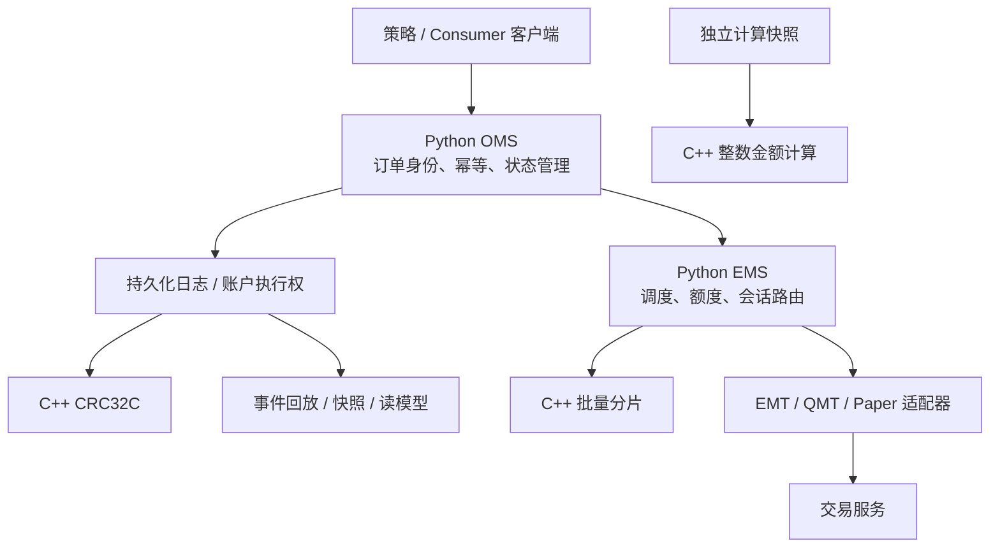

# XunTradeOMSEMS

**面向策略接入、订单管理与交易执行的 C++20 / Python 混合架构交易中台。**

XunTradeOMSEMS 围绕 OMS 订单生命周期和 EMS 执行调度，提供订单身份管理、幂等处理、
持久化日志、账户执行权隔离、会话分片与券商适配能力，让策略请求、执行结果和恢复过程可关联、可核对。

Python 负责领域模型、业务编排、恢复与接口集成；C++20 负责日志校验、批量分片和整数金额计算。
两者通过进程内原生扩展协作，兼顾业务开发效率与计算性能。

## 核心能力

| 能力 | 说明 |
| --- | --- |
| OMS 订单管理 | 管理订单身份、状态、幂等请求与撤单关联，维护订单生命周期 |
| EMS 执行调度 | 按账户管理有界队列、执行额度和会话路由，隔离订单与撤单通道 |
| 持久化与恢复 | journal-first 写入顺序、提交标记、校验与连续前缀恢复，保留不确定提交的核对依据 |
| 账户与会话隔离 | 通过账户 fence、不可变路由计划和路由 epoch 约束执行权；撤单与回报按精确订单身份归属 |
| 券商适配 | 提供 EMT、QMT 与 Paper 适配模块，通过适配边界连接交易服务 |
| C++ 计算内核 | CRC32C、BLAKE2s-128 批量分片、int64 金额与限额检查，支持有界 CPU 并行 |
| 接口与读模型 | Consumer 协议、订单查询、事件回放、快照和读模型投影 |
| 工程验证 | 原生构建、离线自检、跨后端一致性测试、性能基准与 Windows/Linux CI 配置 |

## 架构



### C++ 与 Python 的职责

- **C++20**：日志 CRC32C 校验、与会话路由协议一致的 BLAKE2s-128 批量分片，以及整数金额和限额计算。
  x64 自动检测 SSE4.2；其他 CPU 使用可移植 CRC32C 实现。
- **Python**：订单领域、OMS/EMS 编排、账户执行权、持久化屏障、恢复、查询与券商适配。
- **原生扩展边界**：批量输入在持有 GIL 时完成复制，纯计算阶段释放 GIL，结果按输入顺序返回。
  每批最多 1,000,000 行，最多 32 个 worker，小批次自动串行。

系统遵循 journal-first 与 fail-closed 原则：无法确认持久化或执行权时停止进入交易调用；
提交结果不确定时保留核对流程，不自动重复发送订单。

当前计算并行度覆盖单机 CPU，账户和会话通过显式计划分片。跨机器计算 RPC、集群共识和自动迁移尚未实现。

## 快速开始

### 环境要求

| 环境 | 要求 |
| --- | --- |
| Python | CPython 3.10 |
| Windows 原生构建 | x64，Visual Studio 2022 C++ Build Tools，MSVC 与 Windows SDK |
| Linux 原生构建 | x64，支持 C++20 的 GCC/Clang，Python 开发头文件 |
| 独立 C++ 构建 | CMake 3.25 或更高版本 |

所有 C++ 目标统一使用 **ISO C++20**，包括计算内核、Python 绑定和原生测试。
CMake 禁止标准降级与 GNU 语言扩展；MSVC 使用 `/std:c++20 /Zc:__cplusplus`，
GCC/Clang 使用 `-std=c++20`。C 回调队列模块使用独立的 C 构建配置。

获取代码：

```bash
git clone git@github.com:XunAn523/Xun-Trade-platform.git XunTradeOMSEMS
cd XunTradeOMSEMS
```

Windows PowerShell：

```powershell
py -3.10 -m venv .venv
.\.venv\Scripts\python.exe -m pip install -e . pytest hypothesis
.\.venv\Scripts\python.exe -m xuntrade_omsems self-check --require-native
```

Linux：

```bash
python3.10 -m venv .venv
.venv/bin/python -m pip install -e . pytest hypothesis
.venv/bin/python -m xuntrade_omsems self-check --require-native
```

安装过程会编译 C++ 扩展，原生编译失败时终止安装。自检使用临时目录和离线示例，
验证计算内核、分片协议与持久化日志，不连接交易服务。

使用锁定依赖安装：

```bash
uv sync --locked --python 3.10
uv run xuntrade-omsems self-check --require-native
```

### 独立构建 C++ 核心

```bash
cmake -S . -B build/cmake -DCMAKE_BUILD_TYPE=Release
cmake --build build/cmake --config Release
ctest --test-dir build/cmake -C Release --output-on-failure
```

C++ 核心可独立构建和测试，不依赖券商 SDK、数据库或交易连接。

## 运行模式

通过环境变量 `XUNTRADE_BACKEND` 选择计算后端，进程启动时生效：

| 模式 | 行为 |
| --- | --- |
| `native`（默认） | 使用 C++ 扩展；扩展缺失时启动失败 |
| `python` | 使用 Python 参考实现，适合诊断与结果对照 |
| `auto` | 优先使用 C++；扩展缺失时允许 Python 兼容运行 |

查看当前计算后端：

```bash
python -m xuntrade_omsems info
```

原生后端信息中的 `cxx_standard: 202002` 表示扩展实际以 C++20 模式编译。

原生计算运行失败会向调用方返回异常，不静默切换后端。
大批次使用按需扩展的进程内 C++20 常驻线程池，最多 31 个后台 worker，
小批次仍在调用线程串行执行；`worker_pool_threads` 显示已创建线程数。
计算进程使用 `spawn` 启动。通过 `fork` 继承已装载的原生计算模块时，批量入口会显式拒绝，
避免继承线程、锁和预算状态导致死锁；重新 `spawn` 的进程各自初始化线程池。

## Python 接口

```python
from xuntrade_omsems.compute import assess_orders, backend_info, session_shards

print(backend_info())

# 将执行身份映射到固定数量的会话分片。
indices = session_shards(("execution-1", "execution-2"), 3, workers=4)

# 每行：数量、单位价格、可用金额、订单金额上限。
# 所有金额采用同一最小货币单位，使用整数表示。
results = assess_orders(((100, 1250, 200000, 200000),), workers=1)
assert results == ((125000, 0),)
```

金额计算返回 `(notional_minor, code)`：

| code | 含义 |
| --- | --- |
| `0` | 通过算术和限额检查 |
| `1` | 非法数值 |
| `2` | int64 乘法溢出 |
| `3` | 超过订单金额上限 |
| `4` | 超过可用金额 |

数量和价格必须为正整数；无效或溢出行的 `notional_minor` 为 `0`。
每行输入代表独立快照，计算结果不承担共享资金预留或实际下单授权。
批量调用还受 64 MiB 单批保守内存预算、256 MiB 进程记账预算、4 个在途调用和
合计 32 个请求 worker 的约束；超内存预算返回 `ValueError`，并发容量不足返回 `RuntimeError`。
内存记账包含转换和输出的保守估算，不包含调用方已持有的输入，也不等同于进程 RSS 上限。
后端信息提供当前在途调用、worker 和记账字节数，失败或完成时释放预算。
交易请求应通过 OMS/EMS、持久化日志、账户执行权与券商适配流程。

账户内批量路由入口为 `AccountSessionShardRouter.route_execution_ids()`，
在完成账户与身份校验后，将批量计算结果映射到不可变会话计划。

## 测试与性能

本地和 CI 使用同一份版本化验收清单；安装锁定的验收依赖后执行：

```bash
python -m pip install uv==0.13.9
uv sync --locked --extra ci --python 3.10
uv run --locked --extra ci python -m tools.quality.run_acceptance --suite native_core
uv run --locked --extra ci python -m tools.quality.run_acceptance --suite python_reference --output-dir build/acceptance/python_reference
uv run --locked --extra ci python -m tools.quality.wheel_smoke
```

`tools/quality/test_suites.json` 定义原生核心、Python 对照和环境排查范围。
验收输出 JSON、JUnit 和日志，记录提交、工作区状态、依赖锁和清单哈希。
每个跳过节点都列出原因及补验前提；未知跳过原因使验收失败。进程超时保留诊断并停止本次子进程树。
wheel 检查从全新源码快照构建，在隔离环境中安装锁定运行依赖，并以 `-I` 验证已安装 C++20 扩展。

环境排查可逐文件运行，历史证据缺失和失败不会计入发布通过结果：

```bash
uv run --locked --extra ci python -m tools.quality.run_acceptance --suite environment_review --per-file --timeout-seconds 90 --output-dir build/acceptance/environment_review
uv run --locked --extra ci python -m tools.quality.run_acceptance --catalog build/acceptance/test-catalog.json
```

目录清单同时列出尚未纳入核心验收的测试文件；核心清单通过不等于全量历史测试通过。

运行离线计算基准：

```bash
python -m tools.benchmarks.hybrid_compute --batch-size 50000 --repeats 7 --workers 4 --output benchmark-results.local.json
```

测量离线组件链路（批量路由 → 有界调度 → fsync 日志 → 模拟券商 → 回调 ACK）：

```bash
python -m tools.benchmarks.offline_pipeline --orders 200 --capacity 256 --output pipeline-results.local.json
```

该工具报告完成/拒绝数量、吞吐、P50/P95/P99、排队时间和日志同步时间；
`--capacity 4 --broker-delay-us 1000` 可观察背压。模拟链路不装载 SDK，不代表实盘风控与执行权部署验收。

基准比较 Python、C++ 单线程与 C++ 多线程，包含 Python 调用和数据转换成本。
测量范围不含磁盘 fsync、网络、OMS 领域校验或券商延迟，不能外推为完整交易链路的性能保证。

可选测试工具：

```bash
python -m pip install -e '.[test,tooling]' -e tools/performance
```

SDK、PostgreSQL 和部署集成测试需要对应环境。已执行的验证范围、结果和已知问题见
[验证报告](docs/VALIDATION.md)，基准原始数据见 [性能记录](docs/benchmarks)。

## 项目结构

```text
XunTradeOMSEMS/
├── native/                 # C++20 内核、Python 绑定与 C 回调队列
├── xuntrade_omsems/         # 计算接口、后端选择与离线 CLI
├── xuanling_tradecore/      # 订单领域、OMS/EMS、运行时与券商适配
├── emt_gateway/             # EMT 网关接口、journal 与会话支持
├── contracts/               # 协议、schema 与校验资产
├── deploy/                  # 部署配置与运行脚本
├── tests/                   # 功能与回归测试
├── tools/                   # 性能、验收与质量工具
└── docs/                    # 架构、运维与验证文档
```

EMT 专用 Consumer 组合位于 `xuanling_tradecore.compatibility.emt_consumer`，
通用 Consumer 层保持与券商实现隔离。内部调用方应使用该命名空间导入 `emt_*_v1` 组合模块。
CI 对全仓库执行 Ruff、模块边界和敏感内容扫描，并验证原生构建、协议与核心回归。

## 日志归档

`AsyncFileJournalArchive` 使用冷线程写入身份归档，默认按 4,096 条记录或 16 MiB 分段，
不在内存保留逐条历史记录。活动文件沿用指定路径，封存段及可重建索引保存在同名 `.segments` 目录。
索引记录段编号、帧数、字节数和 SHA-256；重启验证 CRC，已索引封存段的校验变化会报错，
不会截断或修复封存数据。活动文件仍按完整前缀恢复。
索引在启动、轮转和关闭时写入，运行中可能落后于活动段，重启会按已验证帧重建。
已有超阈值活动文件会整体封存，后续新段遵守分段阈值。

默认保留全部历史磁盘段。显式配置 `maximum_segments`（至少 2，包含活动段）后，
才删除超过保留数量的最旧封存段；单段大小由 `maximum_segment_records` 和 `maximum_segment_bytes` 配置。
归档记录的 LSN 仅在段内有效，索引与归档不作为交易授权、资金预留或 broker 恢复依据。
关闭时会先停止接收并排空已接受队列；超时保留文件所有权供后续关闭重试。

## 文档与运行范围

- [混合架构与语言边界](docs/HYBRID_ARCHITECTURE.md)
- [验证报告与已知问题](docs/VALIDATION.md)
- [Consumer 协议](contracts/consumer/v2/framing.md)
- [性能原始记录](docs/benchmarks)

C++ 计算层和离线 journal 支持 Windows x64 与 Linux x64。
EMT 交易接入采用 Linux x86_64 与官方 CPython 3.10 SDK；供应商 SDK、账户配置与凭据由部署环境提供。
实盘可用性需要结合目标环境、交易账户和现场验收确认。
