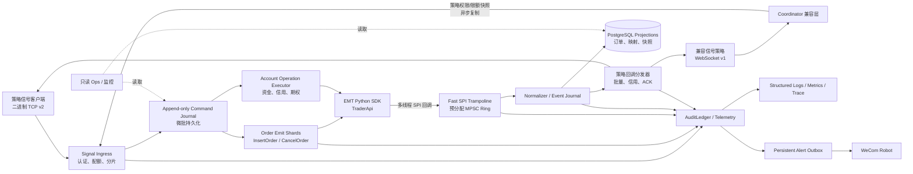

# EMT Python SDK 高性能交易网关设计

> 状态：设计基线（未实施）  
> 目标版本：`emt-gateway v0.5`  
> 范围：单台 Linux x86_64 主机、一个 EMT `TraderApi` 进程实例、一个账户/`client_id` 会话，以及多个仅发送交易信号、接收交易回调的本机策略。Windows 不属于支持、验收或发布范围。

## 1. 接口基线与设计结论

本设计以 **东方财富证券 EMT 极速柜台 `TraderApi`** 为准：`Login` 是唯一需等待返回的同步阻塞调用；`InsertOrder`、`CancelOrder` 和所有 `Query*` 都是立即提交的非阻塞请求，实际结果通过 SPI 回调异步返回。`InsertOrder` 返回当日唯一的 `order_emt_id`；`EMTOrderInsertInfo.order_client_id` 是用户自定义且会在 `OnOrderEvent` 回传的关联字段；`request_id` 用于关联查询回调。

因此网关不应再采用“终端策略定时器/文件队列/同步查询等待”的 QMT 模型，也不应在每笔订单后等待原生回调。它是一个**信号下单与回调专用**的异步 EMT 数据平面：策略侧独立负责行情、信号、定价和择时；网关绝不订阅、缓存、计算或转发行情。

- 登录只在会话生命周期线程串行执行；成功后不让任何下单、撤单或内部对账查询阻塞 API I/O 线程；
- 订单在经过本地持久化提交后，立即并发调用 `InsertOrder`；不等待 `OnOrderEvent`；
- SDK 回调仅做极短的二进制入队，不做 JSON、数据库、网络或策略代码；
- 策略数据面包含下单、撤单、经授权的账户操作/查询、回执、全部原生交易/账户回调、ACK 与本地状态读取；所有 `Query*` 都是强类型、独立预算的账户/交易接口，绝不作为行情来源；
- PostgreSQL 从订单热路径降为可重建投影库；副作用前的权威证据改为顺序追加、分段的命令日志；
- 公共订单/成交流在登录前订阅，交易日切换时强制重建会话；按柜台流控自适应限速，而非以本地并发数盲冲；
- 保留当前工程的本机认证、单账户隔离、幂等、可靠事件、对账、只读运维和 fail-closed 边界。

> 术语纠正：最初引用的 `emquant.18.cn` 页面展示的是另一套 GM 策略 SDK。本设计改用你补充的“除登录外异步”的 EMT 极速柜台语义，调用面为 `Login / InsertOrder / CancelOrder / Query* / TraderSpi`；两套 SDK 的对象、线程模型和 ID 不能混用。

官方依据：

- [TraderApi：登录、报单、撤单、查询](https://emt.eastmoneysec.com/api/help/classEMT_1_1API_1_1TraderApi.html)
- [TraderSpi：订单、成交、撤单错误与查询回调](https://emt.eastmoneysec.com/api/help/classEMT_1_1API_1_1TraderSpi.html)
- [官方 FAQ：`InsertOrder` 线程安全、交易/查询回调并发与分页限制](https://emt.eastmoneysec.com/docs/EMT_API/md_input_EMTAPI_FAQ.html)
- [EMT 平台能力说明](https://emt.eastmoneysec.com/)

## 2. 性能目标与不可牺牲的正确性

“最高性能”定义为：不在订单提交、原生回调或策略事件发送路径人为串行等待；减少跨进程、JSON、锁、随机 I/O 和频繁 `fsync`；但不以重复报单、静默丢回报、跨策略错路由或未审计副作用换吞吐。

| 目标 | 实现约束 |
| --- | --- |
| 最短报单路径 | 热路径为：认证/内存校验 → 有界微批命令日志提交 → `InsertOrder`。不经过同步 SQL 事务、Coordinator RPC、查询或等待回调。 |
| 高并发报单 | `InsertOrder` 官方声明线程安全；按 `order_client_id` 分片并发发射，保持同一订单的报单/撤单因果顺序。 |
| 高并发回调 | 使用 MPSC 预分配环形队列；回调线程只复制最小字段并入队，归一化、落盘、投递均在后置 worker 完成。 |
| 回调优先 | 策略实时事实只来自可靠订单/成交/撤单错误及账户操作回调；账户 `Query*` 使用独立低优先级预算，绝不占用报撤单或高优先级回调资源。 |
| 可恢复副作用 | 任何 `InsertOrder`/`CancelOrder` 调用前都有可恢复命令记录；调用开始后永不自动重发，只能按原生 ID、回调和查询对账。 |
| 可量化优化 | 每个阶段记录单调时钟：接收、日志提交、SDK 调用起止、`order_emt_id` 返回、回调入队、事件落盘、策略 ACK；以 p50/p99/p99.9 和队列水位驱动调优。 |

不在设计阶段伪造固定“微秒级”承诺。最终阈值由 P0 基准在目标网卡、磁盘、Python 版本、EMT SDK 版本与券商环境上测得，并写入发布配置；所有人工 sleep、固定 5 ms 轮询、逐笔全量账户查询、行情订阅/缓存和 SPI 回调线程中的数据库 `COMMIT` 均为禁止项。

## 3. 总体架构：控制面与交易数据面分离



### 3.1 关键改动

1. **Gateway 热路径直连 EMT。** 现有 `Coordinator → Gateway` 同步 TCP 调用不能处于低延迟订单临界路径。Coordinator 保留为兼容接入、策略认证/配置管理和可靠投递控制面；它将版本化、不可变的策略权限与限额快照异步发布给 `Order Ingress`。
2. **新建信号/回调二进制数据面。** 现有 WebSocket v1/JSON 仅兼容低频信号与回调。高频策略使用常驻的 loopback TCP v2：固定长度二进制头 + **FlatBuffers** payload，连接认证一次后以递增序号防重放，不对每帧重复 HMAC。协议覆盖所有 EMT 交易/账户操作与查询，但不定义行情、K 线、逐笔、盘口或指标消息，也不透传原始 C++ 结构体。
3. **EMT 适配器是普通 CPython 服务而非终端策略脚本。** 它加载 EMT Python SDK，创建 API、注册 SPI、执行登录并拥有唯一 `session_id`。网关不导入/创建 `QuoteApi`，也不把行情回调作为命令时钟；策略信号一到即按订单路径处理。
4. **日志先行，投影后置。** 命令日志是热路径的恢复事实；PostgreSQL 订单表、账户/持仓快照和策略回调 outbox 均为异步投影，不能反压 `InsertOrder`。这些快照只用于准入、对账与只读诊断，不向策略提供行情或生成信号。

### 3.2 策略权限与额度快照栅栏

控制面向 `Order Ingress` 发布不可变 `PolicySnapshot`，其中至少包含 `policy_version`、`effective_lsn`、`expires_at_monotonic`、策略启停、标的/方向白名单和额度。Ingress 只接受已确认生效且未过期的版本：策略禁用、Token 吊销、额度收紧或控制面失联超过 TTL 时，原子切换为 `POLICY_STALE` 并拒绝新订单；已进入 `CALL_STARTED` 的命令不改写。

策略权限变更通过“控制面写入 → Ingress 收到版本 → 返回应用 ACK → 控制面发布生效”完成，不能只靠异步复制的最终一致性。每个 `COMMAND_PREPARED` 都写入 `policy_version`，使事后审计和恢复能证明它由哪个规则集准入。

### 3.3 全链路审计、监控与告警不变量

所有数据链路必须同时具备**可观测**和**可追溯**能力，覆盖 `策略接收 → 风控/幂等 → CommandJournal → SDK 调用 → SPI 回调 → EventJournal → 投影/策略投递 → 客户端 ACK`，以及所有查询、会话、配置和人工状态变更。每个边界均生成轻量 `FlowRecord`，至少包含：`trace_id`、`correlation_id`、父节点 ID、链路阶段、输入/输出载荷哈希、`trading_day`、`session_epoch`、`policy_version`、LSN、原生/业务订单 ID、单调时间、wall time、结果码和错误指纹。审计记录不写密码、Token、完整账号或完整敏感载荷。

`AuditLedger` 使用预分配有界队列和顺序追加分段文件；工作线程批量持久化 `FlowRecord`、派生 OpenTelemetry 兼容 trace/metrics 和结构化日志。它不位于 SPI callback 的同步 I/O 路径，但任何关键审计记录无法入队、持久化失败或检测到 LSN/哈希链断裂时，都必须记录缺口、关闭新订单并进入 `RECONCILE_REQUIRED`；不得采样、覆盖或静默继续。Command Journal 和 Event Journal 中的原始 LSN 是审计事实源，AuditLedger/PostgreSQL/trace 后端均为可重建索引。

所有 `WARN`、`ERROR` 与 `CRITICAL` 同时生成结构化 JSON 日志和不可变 `AlertOutbox` 记录；事件含稳定 `alert_id`、指纹、严重度、`trace_id`/`correlation_id`、账户别名、会话/状态、脱敏上下文、首次/末次时间与计数。`WeComNotifier` 仅从已持久化 outbox 异步读取并以至少一次语义发送，网络不可用、限流、超时或返回失败会保留记录、指数退避并暴露积压指标；它绝不阻塞订单发射或 callback。告警风暴可按相同指纹批量通知，但每条原始告警必须保留独立日志与 outbox 记录，批量消息必须携带覆盖的 `alert_id` 范围/计数，不能以聚合为由丢失事件。通知中仅发送脱敏摘要和本机 Ops 关联 ID，不发送密钥、密码或完整订单载荷。

## 4. EMT 会话与线程模型

### 4.1 登录前初始化、生命周期与交易日轮换

一个账户实例只允许一个 `client_id`、一个活跃 `session_id`。`CreateTraderApi`、`RegisterSpi`、`SubscribePublicTopic(EMT_TERT_RESTART)`、`SetHeartBeatInterval`、`SetSoftwareVersion`、`Login`、`Logout`、`Release` 均由专用 `SessionLifecycleThread` 串行执行；SPI 注册、公共流订阅、心跳和软件版本必须在 `Login` 前完成。`SubscribePublicTopic` 是订单/成交公共流的前提，`EMT_TERT_RESTART` 用于登录后重传本交易日公共流。

心跳由配置固定在 EMT 官方建议的 5~15 秒区间；高配部署可在登录前调用 `SetCpuAffinity` 绑定 EMT 内部线程，但必须先做独占核、Journal/Normalizer 核隔离的基准验证，低配机器禁用该选项。`GetTradingDay()` 是唯一交易日来源，禁止用本机零点切日。

服务每日开盘前按 EMT “不支持过夜”的约束完成受控轮换：关闭新单 → 排空/对账旧日未决命令 → `Logout`/`Release` → 归档旧日日志与 ID 区间 → 新建 API、预登录配置、登录、新 `session_epoch`、公共流重传和基线对账 → `READY`。断线恢复也必须先 `Logout` 再 `Login`，否则公共流订阅方式不会重新生效。

SDK 断连、`IsServerRestart(session_id)` 为真、登录返回 0、`OnDisconnected`、callback ring 溢出、策略快照过期或身份不一致时：立即关闭新订单闸门；已提交副作用进入对账，不主动重报。

### 4.2 并发发射分片

`InsertOrder` 与 `CancelOrder` 是短、非阻塞的“发送请求”调用。网关创建 `N` 个有界 `EmitShard`，其中：

```text
shard_key = hash(account_id, order_client_id) % N
```

- 同一 `order_client_id` 的所有操作进入同一 shard；因此 `CancelOrder` 永远排在其 `InsertOrder` 已取得 `order_emt_id` 后。
- 不同订单可并行调用 `InsertOrder`。`N` 由基准结果调节，默认不按 CPU 数盲目扩大；过多调用线程可能只增加 Python GIL/SDK 锁竞争。
- 发射 worker 不做数据库访问、网络协议序列化或回调等待；只消费已提交的紧凑命令记录并调用 SDK。
- `InsertOrder` 返回非零 `order_emt_id` 时，立即发布轻量 `NATIVE_ACCEPTED`；订单状态、成交、撤单结果仍只以 SPI 回调为准。

官方说明同账户、同 `client_id` 同时只能保留一个 session；多进程横向扩容必须按账户或不同 `client_id` 分片，绝不能对同一账户/client_id 复制热备并同时登录。

资金划拨、信用还款/展期/额度调拨、期权行权与组合报单也必须通过同一“命令先行、`CALL_STARTED` 后不重发、原生 ID/serial ID 映射”的操作框架，但不默认与普通报撤单共用并发假设。`AccountOperationExecutor` 按 `operation_kind` 和关联的负债/资金/组合 ID 保序；除非 P0 已证明目标 Python binding 与券商环境对某方法线程安全，否则该方法的调用 lane 保持串行。它拥有独立有界队列和权限/额度，不得耗尽 `InsertOrder`/`CancelOrder` 的高优先级预算。完整清单见 [接口全覆盖矩阵](../02-接口与数据/02-EMT交易与账户接口全覆盖矩阵.md)。

### 4.3 柜台流控与优先级发射

EMT 的报单流速由柜台控制，超过阈值会返回 `211008`；本地增加线程或队列不会提高该阈值。已在单账户、单原生 EMT 会话、2,000 路原始同时信号的模拟盘试验中观测到：柜台实际接受前 1,000 笔报单，第 1,001 笔起同步返回 `211008 / VENUE_THROTTLED`。因此本 scope 的 EMT 柜台委托下单接口最大原始突发并发数标记为 **1,000**；它是已观测的拒绝边界，不是可持续速率、跨账户限额或发布 SLA。可复核的脱敏证据见 [`2026-09-05-concurrency-ceiling.json`](../../data/performance/probes/emt/tradecore-redis-emt-burst/2026-09-05-concurrency-ceiling.json)。

`EmitAdmissionController` 因此按账户维护有界等待队列和自适应令牌窗口，且必须在原生调用前拦截：正常成功以温和加性增长探测可用速率，收到 `211008`、发送失败或回调延迟突增时乘性收缩并记录冷却窗口。不能把 `1,000` 直接配置为常态发射配额；部署值须由独立的定速校准获得，并始终保留流控余量。订单和撤单使用独立配额，撤单在安全前提下优先于新报单；查询永远不能占用报撤单预算。

控制器的窗口、退避、冷却、恢复斜率均配置化且只由压测和仿真/实盘灰度校准。达到柜台流控时返回可重试的 `VENUE_THROTTLED`，但不把已经进入 `CALL_STARTED` 的命令重新入队；策略若重试必须使用原 `client_order_id`。

### 4.4 高速 SPI 回调

全部 69 个 `TraderSpi` 回调都可能来自 SDK 内部线程；订单/成交、资金/信用/期权操作、账户变动和查询 callback 必须统一进 `fastspi`。查询回调按官方的有符号 `int request_id`、可选 `is_last` 与分页语义归并；单次响应 callback 不得等待或伪造 `is_last`。官方还明确要求回调快速返回，否则可能堵塞后续消息乃至断线。

回调实现规则：

1. 回调入口仅校验 `session_id`、记录准确 `callback_name`、读取必要 POD 字段、打时间戳、复制到预分配 `CallbackRecord`，然后压入 MPSC ring；不做字符串格式化、日志、哈希、磁盘、锁等待、JSON 或 socket 发送。
2. 生产版使用 Linux CPython 3.10 ABI 编译的 `emt_fastspi` 原生 `.so` 扩展（Cython/pybind11 均可）提供回调 trampoline 与预分配 MPSC ring；纯 Python `queue` 只允许用于 P0/P1 功能验证，不作为高吞吐配置。
3. `CallbackNormalizer` 以批处理方式取记录；先用 `GetClientIDByEMTID(order_emt_id)`、`GetAccountByEMTID(order_emt_id)`、操作 serial/EMT ID 与 `operation_id` 映射过滤并关联，再保留 `NATIVE_CALLBACK` 和生成派生事件/查询 item。所有登录同一用户的客户端都可能收到订单及部分账户操作响应，故不能只因收到回调就认定其归属本实例。
4. ring 到达告警水位时先停止新订单和低优先级查询；若达到硬上限，声明 `CALLBACK_STREAM_BROKEN`、保存溢出证据并执行全量对账。不得静默丢弃后继续可交易。

## 5. 订单、撤单与原生关联

### 5.1 三层 ID

| 层级 | 标识 | 生成与用途 |
| --- | --- | --- |
| 策略业务层 | `client_order_id`（字符串/128 bit） | 策略稳定幂等键。超时或断线重发必须复用它。 |
| EMT 用户关联层 | `order_client_id`（以 SDK Python 结构体实际类型为准） | Gateway 在 `GetTradingDay()` 返回的交易日、`client_id`、`session_epoch` 范围内单调分配，调用前写入命令日志，填入 EMT 下单字段，并在 `OnOrderEvent` 回传。 |
| EMT 系统层 | `order_emt_id`（`uint64`） | `InsertOrder` 非零返回即代表请求发送成功；当日唯一，是撤单与对账主键。 |

映射键为 `(trading_day, client_id, order_client_id)` 和 `(trading_day, order_emt_id)`，而不是依赖 symbol、价格、时间近似匹配。`order_client_id` 的位宽、取值范围及 Python binding 字段名必须由 P0 探针从实际 SDK 生成；超出范围时停止接单而非截断或复用。

### 5.2 极短下单路径

```text
1. StrategyDataPlane 收到 ORDER_INTENT(client_order_id, payload)
2. 内存幂等表与策略权限/限额快照校验；分配 order_client_id
3. CommandJournal 追加 COMMAND_PREPARED 并完成所属微批的持久化提交
4. 立即把 LSN 交给对应 EmitShard
5. EmitShard 标记 CALL_STARTED，调用 InsertOrder(order, session_id)
6. 非零返回 order_emt_id：在同一临界区原子发布内存映射，并向 CommandJournal 追加 NATIVE_ACCEPTED 映射记录
7. NATIVE_ACCEPTED 映射记录持久化后才向策略推送回执；OnOrderEvent / OnTradeEvent 异步到达，成为订单/成交事实
```

`ORDER_ACCEPTED` 的含义是“命令已持久化并已取得发射资格”；`NATIVE_ACCEPTED` 的含义是“SDK 返回非零 `order_emt_id`”；两者均不代表交易所受理或成交。对所有超时、解释器异常、进程崩溃或连接中断，只要已进入 `CALL_STARTED`，状态即为 `SUBMIT_UNKNOWN`，禁止调用 `InsertOrder` 重试。

官方保证 `InsertOrder` 的非零 `order_emt_id` 先于 `OnOrderEvent` 回调到达，因此步骤 6 可在回调正常化前建立无锁只读映射；回调不会因“订单 ID 尚未返回”被错误地暂存。`InsertOrder` 返回 0 时必须由同一 EmitShard 立即读取 `GetApiLastError()`，连同返回码写入 `LOCAL_SEND_REJECTED`。若 Python binding 抛异常或进程在调用边界崩溃，不能据 0 推断未发送，应仍进入 `SUBMIT_UNKNOWN` 并查询/对账。

### 5.3 事件唯一性与状态归并

订单状态事件以 `(trading_day, order_emt_id, order_submit_status, order_cancel_emt_id, normalized_update_fields_hash)` 去重，并交给每订单状态归并器处理，不能仅依到达顺序判定终态。成交事件使用 `(trading_day, order_emt_id, exec_id, side_or_order_direction)` 作为业务去重键；禁止单独以 `exec_id` 去重，因为自成交可能产生相同 `exec_id` 的两笔成交回报。`OnTradeEvent` 才是部分成交事实来源，`OnOrderEvent` 不得伪造部分成交状态。

### 5.4 撤单路径

策略提交 `CANCEL_INTENT(client_cancel_id, target_client_order_id)`。Gateway 从内存映射或日志恢复映射取得 `order_emt_id` 后，以目标订单的 shard 发起 `CancelOrder(order_emt_id, session_id)`；非零返回的 `order_cancel_emt_id` 是撤单请求 ID。撤成以原订单的 `OnOrderEvent` 中撤单状态或 `order_cancel_emt_id` 回传为准；失败以 `OnCancelOrderError` 为准。

禁止暴露“全撤/全平”快捷 API。没有准确 `order_emt_id`、订单不属该策略、映射处于未知、或已终态时拒绝撤单；不得为性能跳过归属校验。

## 6. 命令与事件持久化

### 6.1 Command Journal

命令日志采用每账户独立的预分配分段 append-only 二进制文件，而不是热路径的每笔 PostgreSQL 行事务。记录格式固定为 `[header | payload | CRC32C | commit_marker]`：header 含 magic、version、LSN、类型、长度、单调时间与 `policy_version`；`commit_marker` 含 LSN 与记录 hash。读者只承认 CRC 和 commit marker 均有效的连续前缀。

- `strict` 配置：每笔命令 write-through 后才调用 SDK，适用于对单笔断电证据要求最高的账户。
- `micro_batch` 配置：连续命令按数量上限或可配置的**最大提交等待预算**合并一次持久化；未持久化的命令绝不调用 SDK。它只合并落盘，不延后已提交命令的异步发射。
- PostgreSQL 的订单、映射、快照和运维查询通过 journal tailer 异步构建；崩溃时可从最后 checkpoint 重放。
- Linux 上持久化确认由 `fdatasync`/`fsync` 成功定义。失败、超时或写入延迟越界都会立刻关闭交易闸门。恢复时在写锁下截断无效尾部，绝不覆盖已提交记录或重用 LSN。
- 每个段都有结束 hash、checkpoint、只读归档和保留策略；日志空间、flush 延迟或 writer 故障达到阈值立即关闭交易闸门。

此设计使“副作用前证据”保持可恢复，同时将随机事务 I/O 从报单临界路径移走。`micro_batch` 不是放弃持久化：未得到所属 LSN 的持久化确认前，任何线程都不得调用 EMT API。

### 6.2 Event Journal 与策略投递

归一化后的订单、成交、撤单错误、会话和对账事件先写入 `EventJournal`，再分配策略 `delivery_id`。按策略维持带信用窗口的批量投递：一帧可承载多个同优先级事件，策略处理并持久化后发送 `ACK_EVENT`。重连后从最后未确认的 `delivery_id` 重放，保持至少一次；策略以 `event_id` 去重。

订单/成交/撤单错误和会话事件优先于本地状态读取、快照和指标。慢策略只耗尽自己的信用窗口，不得阻塞 API 回调、其他策略或订单发射。事件批量编码使用二进制数据面；兼容 WebSocket v1 由独立转换 worker 生成 JSON，永不占用 SPI callback 或 EmitShard。

## 7. 仅供恢复/对账的异步查询与内存快照

所有 `Query*` 在发送成功时只表示请求已提交。多条响应以原生 `is_last=true` 结束；原生签名不含 `is_last` 的查询以其单次响应结束。`QueryRegistry` 将完成模式写入 `NativeMethodSpec`，并使用如下键：

```text
(session_epoch, request_id, query_kind)
```

`request_id` 映射为 EMT 原生有符号 `int`，仅分配 `1..2_147_483_647`。它只在当前活跃窗口内唯一，完成或超时后也不得立刻复用，必须经过“所有可能迟到回调已隔离”的冷却期；数值耗尽时等待活跃/冷却窗口排空后在**同一 session 内**换代分配，不得为整数回绕而无故重登。`session_epoch` 只随真实会话重建改变。查询每条记录只追加到本请求 accumulator，直到 `is_last` 或 `NativeMethodSpec` 指定的单次响应才完成 Future/流式响应。

所有 EMT `Query*` 都属于账户/交易能力，由 `QueryScheduler` 以强类型 `ACCOUNT_QUERY_INTENT` 支持；它们不能触发策略信号或作为行情服务。策略断线恢复仍优先依赖命令状态读取与可靠回调重放；`ReconciliationService`、经审计的只读 Ops 和具备细粒度权限的策略都可创建 query Future。

内部查询策略：

- 订单提交路径只读 lock-free/RCU 风格的账户、持仓、可用资金和订单索引快照；不调用 `QueryAsset`、`QueryOrders` 或 `QueryPosition`。
- 策略账户查询、对账、首次登录、断线/日切恢复和显式运营查询都进入低优先级 `QueryScheduler`。每类 API 配置并发、频率、结果字节和页数上限、策略权限与独立信用窗口。
- 分页查询严格遵守官方单页不超过 200 的建议；记录 `reference` 和 `is_last`，连续页由调度器发起，不由 callback 递归调用。
- 查询 callback 永远只入队，禁止在 callback 内再发送查询。项目不创建 `QuoteApi`、不订阅行情、也没有行情查询/缓存任务；QueryScheduler 只处理账户恢复和对账。

## 8. 高性能协议与反压

### 8.1 Strategy Data Plane v2

高性能客户端使用常驻 loopback TCP 连接，而非每单建立连接。帧头固定包含 `magic`、协议版本、消息类型、flags、payload 长度、`strategy_slot`、单连接 `seq` 和 `request_id`；body **固定使用 FlatBuffers**，字段编号一经发布不可复用，只能新增 optional 字段。握手阶段以现有高熵 Token 认证，随后派生连接 session key；重连更换 session/序号空间。

实现要求：批量 `recv` 解帧、批量写出、`TCP_NODELAY`、固定最大帧、预分配 buffer、每连接单 writer、按订单键分区；不在热路径 base64、压缩小包、重复 JSON 编解码或每帧 HMAC。WebSocket v1 仅承载兼容策略和控制消息，不作为高频吞吐指标基线。

### 8.2 有界队列与降级顺序

每个边界都有容量与高/低水位：Ingress、Journal、EmitShard、SPI ring、Normalizer、EventJournal、策略投递和 QueryScheduler。高水位的处理顺序固定为：

1. 拒绝新的低优先级账户查询、本地状态读取与快照；
2. 只对造成积压的策略施加信用/入站配额；
3. 拒绝新的订单，返回明确 `BACKPRESSURE`，已持久化命令继续排空；
4. SPI ring 接近满时进入全局 `DISARMED` 并启动对账；
5. 永不丢弃、改写或重发已达 `CALL_STARTED` 的订单。

以队列长度、字节数、最老等待时间和每秒 drain rate 共同判定，不能只用一个队列长度阈值。所有容量来自启动时配置与压测报告，禁止运行时无界增长。

## 9. 对账、故障恢复与策略归属

EMT 订单、成交和查询回调可能跨多个内部线程到达；服务重启可能使 SDK 调用是否真正发送未知。恢复遵循：

1. 读取 Command/Event Journal，恢复 `order_client_id`、`order_emt_id`、未完成查询和策略 delivery 游标；
2. 创建新 API 并在登录前订阅 `EMT_TERT_RESTART` 公共流；登录到新的 `session_epoch` 后优先接收本交易日订单/成交重传，再发送异步 `QueryUnfinishedOrders`、分页 `QueryOrders`、分页 `QueryTrades`、资金与持仓查询；
3. 使用 `GetTradingDay()`、`order_emt_id` 和 `order_client_id` 合并原生事件、查询结果与命令日志，生成补偿事件；
4. 发现 `CALL_STARTED` 无明确原生结果、订单映射冲突、回调溢出或服务器重启时，维持 `RECONCILE_REQUIRED`；
5. 仅在快照完整、命令未知项已解释或人工确认、SPI ring 健康且策略路由一致时恢复交易。

EMT 文档说明所有登录该用户的客户端都会收到订单响应。因此 Gateway 不得把“收到了回调”视为“本实例发出的订单”；先用 `client_id`、`order_client_id`、`order_emt_id` 和账户会话映射归属，再投递策略。无法证明归属的回调作为账户级 `UNATTRIBUTED_NATIVE_EVENT` 记录并进入对账，绝不按标的/时间猜测路由。

## 10. 安全、部署与运维

- 一账户一部署实例：独立 `client_id`、端口、命令/事件日志、PostgreSQL schema、策略密钥、SDK 日志目录和操作状态文件；同一账户/client_id 不运行双活。
- EMT API 登录密码、策略 Token 与 Gateway session key 分离保存。文件 ACL 不允许 `Users`、`Everyone`、`Authenticated Users` 宽泛写入；密钥和原生账户信息不写日志。
- Linux 部署按 EMT FAQ 为运行账户授予执行 `lshw` 的最小权限（仅该二进制、不可使用宽泛 `NOPASSWD:ALL`）；否则登录时可能无法采集终端信息。服务以专用、非交互账户运行。
- Gateway、二进制数据面、WebSocket 和 Ops HTTP 默认均监听 `127.0.0.1`。Ops HTTP 永远只读；人工断路、重新对账与停机走本机受认证控制管道并审计。
- `CreateTraderApi` 的 SDK `save_file_path` 必须是该账户专用、已 ACL 校验的真实目录；SDK 日志等级与保留期配置化，避免高频 debug I/O 侵入数据盘。
- 监控输出：交易日、会话状态/epoch、登录时间、SDK/API 版本、每类 API 返回码、`211008` 流控次数与自适应窗口、API 调用/回调速率、各路径 p99、journal flush、队列水位、回调溢出、未对账命令、策略 ACK 延迟和原生状态差异。

## 11. 推荐目录与实现边界

```text
emt-gateway/
  emt_gateway/
    session.py               # Create/Register/Login/Logout 生命周期
    native_api.py            # 唯一导入 EMT Python SDK 的 facade
    platform_loader.py       # `.venv`、Linux SDK 动态库与 ABI 预检
    emit_shard.py            # InsertOrder / CancelOrder 并发发射
    fastspi.*                # Linux 编译的 callback trampoline + MPSC ring
    command_journal.py       # 分段追加、LSN、批量持久化与恢复
    event_pipeline.py        # normalize、event journal、策略分发
    query_registry.py        # request_id、is_last、分页与限流
    order_mapping.py         # 三层 ID、归属、订单状态机
    snapshots.py             # RCU 内存快照与异步 PostgreSQL projection
    strategy_dataplane.py    # 二进制 TCP v2
  strategy_api_compat/       # 现有 WebSocket v1 / Coordinator 兼容层
  vendor/emt/                # 发布时注入的 Linux EMT 二进制；不混入 .venv
    linux-x86_64/
  deploy/
    linux/                   # `.venv` + systemd / LD_LIBRARY_PATH
  tests/
    fake_emt_api.py
    test_emit_concurrency.py
    test_callback_overflow_reconcile.py
    test_request_id_pagination.py
    test_submit_unknown_never_replay.py
  docs/
```

`native_api.py` 是唯一接触 EMT SDK 的 Python 模块；外部策略、Coordinator 和业务代码不得直接构造 EMT 原生结构体或调用 API。所有 SDK/binding 版本差异集中到这里，并在启动时生成不可变 capability report。

## 12. 实施与验收门禁

| 阶段 | 交付 | 必过项 |
| --- | --- | --- |
| P0：绑定与基准探针 | 固定 EMT Python SDK 版本、API capability report、单线程/多线程 `InsertOrder` 基准 | 验证 `order_client_id` 类型、返回/回调先后关系、SDK GIL 行为、每账户/client_id 限制、真实回调并发度，以及登录前 SPI/公共流/心跳/绑核接口的 Python binding 对应关系。 |
| P1：原生异步骨架 | 生命周期、全量 SPI ring、`request_id` registry、公共流重传、全量账户/交易查询和内存快照 | 所有查询由回调 `is_last` 或单次回调规则完成；策略协议覆盖强类型账户 `Query*` 但无行情消息；callback 内零数据库/网络；断线后 `Logout → Login` 可恢复公共流且 fail-closed。 |
| P2：订单热路径 | CommandJournal、EmitShard、三层 ID、单笔下单/撤单 | `InsertOrder` 不等待回调；同订单撤单不乱序；`CALL_STARTED` 后零自动重发。 |
| P3：可靠事件与恢复 | EventJournal、策略 ACK、重启/断线/交易日切换对账 | 订单、成交、撤单错误均至少一次投递；未归属事件不误路由；重传流与查询合并无重复。 |
| P4：压力与故障矩阵 | 仿真压测、柜台流控、杀进程、磁盘慢、callback storm、慢策略 | 所有高水位正确降级；`211008` 自适应退避；ring 溢出后自动 DISARM + 对账；无 silent loss。 |
| P5：实盘灰度 | 小额白名单、单策略、双人审计 | 基线延迟/吞吐/错单率达到发布阈值，连续稳定运行后才放开策略数和品种。 |

EMT 的完整交易/账户接口范围（不含 `QuoteApi`）以[EMT全交易接口 OMS / EMS 实施与验收定档](./13-EMT全交易接口OMS-EMS实施与验收定档.md)为准：订单类维持 Fast execution lane，资金/信用/期权管理操作进入 control lane，全部查询进入 query lane。任何新增接口都不得改变现有 C0--C7 的同步边界。

验收时必须报告 `receive→journal durable`、`journal→InsertOrder return`、`callback→ring enqueue`、`ring→event durable`、`event→strategy ACK` 的直方图及 p99.9，而不是只报告 SDK 的单次 `InsertOrder` 耗时。任何优化若使副作用证据、可重放事件或策略归属不再可证明，则不予合并。

## 13. 实施前待确认项

1. 实际 EMT Python binding 的包名、版本、Python/位数、`order_client_id` 字段类型与全部结构体命名，以及 `SubscribePublicTopic`、`SetHeartBeatInterval`、`SetCpuAffinity` 是否完整暴露；
2. 单账户对 `client_id`、并发 `InsertOrder`、查询并发与请求频率的券商侧限制；
3. 目标账户/品种对市场、价格类型、数量精度、融资融券、ETF/期权接口的开通矩阵；
4. 目标机器磁盘对严格与微批 journal 的 flush 延迟分布，以及可接受的最大提交等待预算；
5. Python SDK callback 是否可由 Python 层无额外拷贝地转入 Linux 编译的 `fastspi` 原生扩展；若不行，采用供应商支持的 C++ SPI bridge 并保持 Python 数据面 API 不变；
6. 生产策略是否可迁移到二进制 TCP v2。不能迁移的策略继续使用 WebSocket v1，但不计入极致性能吞吐承诺；
7. EMT 柜台给目标账户实际施加的报单流控、允许的心跳、TCP/UDP 登录模式与白名单限制。
