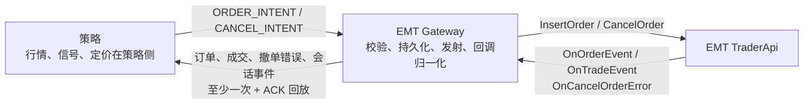

# 信号下单与回调专用架构

> 状态：实施基线  
> 定位：`emt-gateway` 是策略的 EMT 交易与账户执行、查询及回报网关，不是行情、研究或策略运行平台。

## 1. 服务边界

策略负责产生交易信号并提供已决定的标的、方向、价格、数量和业务幂等键；Gateway 负责把信号及经授权的账户操作/查询安全、可审计地提交给 EMT，并将全部原生交易与账户回调可靠送回原策略。

| Gateway 必须做 | Gateway 明确不做 |
| --- | --- |
| 信号认证、幂等、权限、静态标的/方向/数量规则、额度与账户快照校验。 | 行情订阅、行情查询、分时/K 线/逐笔/盘口缓存、指标计算、选股、信号生成。 |
| 命令先行持久化、异步 EMT 报单/撤单、流控、断线恢复、日切对账。 | 根据实时行情推导价格、改写策略价格、替策略择时或以 tick 作为下单时钟。 |
| 原生订单/成交/撤单错误归属、状态归并、可靠回调、策略 ACK 与重放。 | 作为通用数据 API、行情中转、策略计算服务或跨账户聚合平台。 |
| 全部 EMT 交易/账户 `Query*` 由强类型、权限受控的账户查询接口支持，也用于启动恢复、断线/日切对账和只读运维。 | 向策略透传原始 C++ 结构体/任意方法反射，或把查询回调与交易回调混在同一优先级队列。 |

## 2. 策略侧契约

### 输入：策略 → Gateway

仅允许以下业务意图：

| 命令 | 必填核心字段 | Gateway 行为 |
| --- | --- | --- |
| `ORDER_INTENT` | `client_order_id`、标的、市场、方向、订单类型、价格、数量、TraceContext。 | 静态/账户校验 → durable `COMMAND_PREPARED` → 异步 `InsertOrder`。 |
| `CANCEL_INTENT` | `client_cancel_id`、目标 `client_order_id`、TraceContext。 | 仅按已证明的原生映射发起 `CancelOrder`。 |
| `ACCOUNT_OPERATION_INTENT` | `operation_id`、`operation_kind`、强类型账户操作载荷、TraceContext。 | 调用资金划拨、信用操作、期权行权/组合等已开通 EMT 操作。 |
| `ACCOUNT_QUERY_INTENT` | `query_id`、`query_kind`、强类型请求/分页载荷、TraceContext。 | 调用对应 EMT 交易/账户查询；采用独立低优先级预算。 |
| `ACK_EVENT` | `delivery_id`。 | 确认策略已持久化处理回调，可推进可靠投递游标。 |
| `COMMAND_STATUS_REQUEST` | `client_order_id` 或 `command_id`。 | 只读返回本地 Journal/Event 投影中的已知状态；不得触发 EMT `Query*`。 |

`ORDER_INTENT` 是信号，不是成交承诺。`ORDER_ACCEPTED` 表示网关已持久化并获得发射资格；`NATIVE_ACCEPTED` 表示 SDK 返回了非零 `order_emt_id`；两者均不代表交易所受理或成交。

### 输出：Gateway → 策略

| 回调/回执 | 业务语义 | 优先级 |
| --- | --- | --- |
| `COMMAND_RECEIPT` | 本地受理或明确拒绝。 | 最高。 |
| `NATIVE_RECEIPT` | 已得到 `order_emt_id`，尚非原生订单事实。 | 最高。 |
| `ORDER_EVENT` | EMT `OnOrderEvent` 的归一化订单状态。 | 最高。 |
| `TRADE_EVENT` | EMT `OnTradeEvent` 的归一化成交事实。 | 最高。 |
| `CANCEL_ERROR_EVENT` | EMT 原生撤单错误。 | 最高。 |
| `ACCOUNT_OPERATION_EVENT` | 资金划拨、信用还款/展期/额度调拨、期权行权/组合等异步结果。 | 高。 |
| `ACCOUNT_QUERY_ITEM` / `ACCOUNT_QUERY_COMPLETE` | 全部查询的原生 item/分页/完成语义。 | 低；独立信用窗口。 |
| `NATIVE_CALLBACK` | 全量、版本化、脱敏的 `TraderSpi` 回调副本。 | 按权限；不因无法派生业务事件而丢弃。 |
| `SESSION_EVENT` | 登录、断线、重传、对账、`DISARMED`/`READY` 状态变化。 | 高。 |
| `COMMAND_STATUS_RESPONSE` | 已持久化的本地状态快照。 | 低；不可替代回调。 |

同一 `order_emt_id` 的回调由单一订单状态归并器线性化，并携带单调递增 `order_event_seq`；不同订单可以并发投递。策略必须按 `event_id` 去重，以 `order_event_seq` 检查同订单缺口，并在本地持久化后 `ACK_EVENT`。网络断开后，Gateway 从最后 ACK 的 `delivery_id` 重放；策略不能通过重新生成 `client_order_id` 来“补单”。

## 3. 专用化带来的性能优化

1. **移除行情数据面。** 没有 `QuoteApi`、行情 socket、订阅表、tick ring、行情缓存、行情序列化、指标 worker 或由行情触发的任务调度；CPU、内存、GC、网络和告警预算全部留给交易信号与原生回调。
2. **协议收敛而非缩水。** 高频 TCP v2 只解析 EMT 交易意图、强类型账户操作/查询、原生回调、ACK、心跳和本地状态读取；没有行情消息类型、原始 C++ 结构体透传或任意方法反射，减少分支、载荷和慢策略反压来源。
3. **优先级固定。** `TRADE_EVENT`、`ORDER_EVENT`、撤单错误和会话故障永远先于本地状态读取、Ops 查询、投影刷新和指标导出；内部对账查询只能使用独立低优先级预算。
4. **回调优先于快照。** 策略的实时订单事实来自可靠回调；账户/持仓投影只用于网关准入、对账和只读诊断，不作为策略信号输入或行情替代品。
5. **风险校验无行情依赖。** 使用策略授权白名单、价格/数量精度和上下限等静态合约规则、账户资金/持仓快照及限额。若策略需要实时行情风控，应在策略侧完成后再提交信号；Gateway 只记录所用 `policy_version` 与决定载荷 hash。

## 4. 账户查询的严格限制

EMT `Query*` 全部由 `QueryScheduler` 支持：经授权的策略账户查询、首次登录基线、断线恢复、交易日切换、`SUBMIT_UNKNOWN`、callback 溢出、订单/成交差异和资金/持仓对账。完整映射见 [接口全覆盖矩阵](../02-接口与数据/02-EMT交易与账户接口全覆盖矩阵.md)。

- 通过 `ACCOUNT_QUERY_INTENT` 暴露强类型查询；策略重连仍优先通过事件重放和本地命令状态读取恢复，不能以查询代替事件 ACK。
- 使用独立 `QueryScheduler`、独立配额和低优先级队列；它永不占用报单/撤单/回调预算。
- 内部查询结果只能更新账本、投影、对账结论和必要的补偿回调；不能产生行情事件、触发策略信号或变更已 `CALL_STARTED` 命令。

## 5. 验收重点

1. 在应用依赖、运行进程、网络连接和协议 schema 中不存在行情 SDK、订阅、行情消息或行情缓存。
2. 压测时同时注入订单信号与 callback storm，报单/回调 p99.9 不受任何行情任务影响；因为不存在行情任务，该项以架构/进程清单证明。
3. 策略断线重连后仅凭 `delivery_id` 重放与 `COMMAND_STATUS_REQUEST` 即能恢复已知订单状态；账户查询可在恢复后按独立预算发起，不能阻塞回调。
4. 内部恢复查询与策略回调并发时，回调 ring、订单发射队列和撤单优先级不退化。
5. 对每个信号和回调可用 `correlation_id` 回放到 Journal、原生 ID、策略 ACK、日志和企微告警；未归属回调必须对账而非投递给任意策略。
