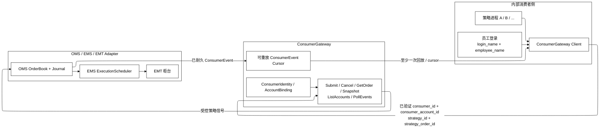
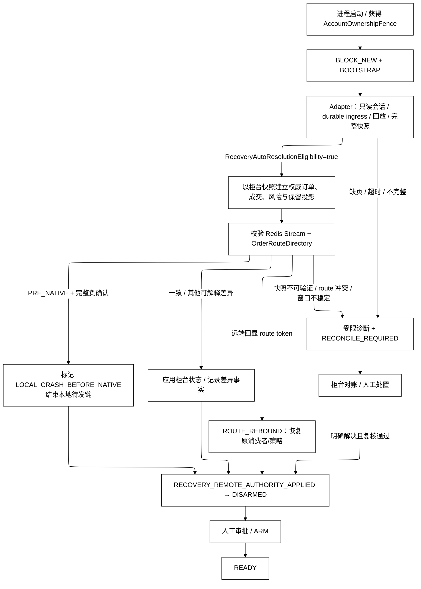
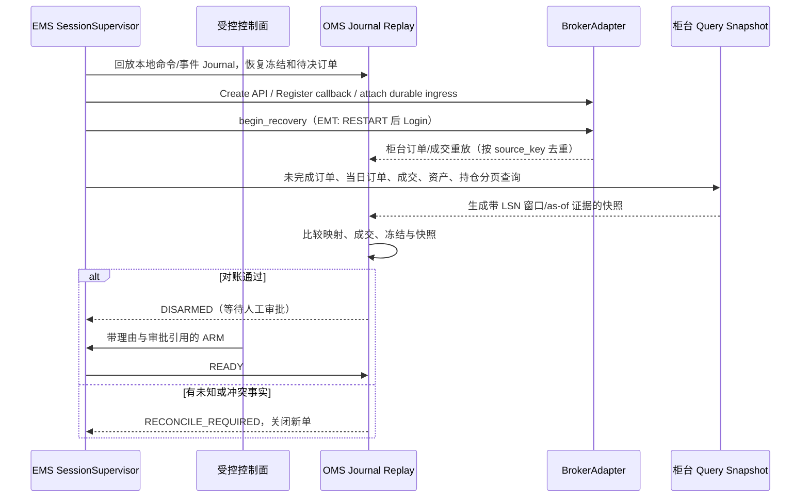

# 玄灵交易核心（Xuanling TradeCore）OMS / EMS / BrokerAdapter / 外部执行端模块化实施方案

> 状态：定档（唯一实施与验收基线；产品落地步骤与验收于 2026-08-31 重构，PaperBroker 外部执行端边界及逐链路非阻塞异常监控基线于 2026-09-01 定档，券商自定义字段 `BrokerCustomRefV1=系统ID_策略ID_交易员ID` 于 2026-09-03 定档，`MmapJournalProfileV1` Redis-free 热路径修订于 2026-09-07 定档；第一版只处理 **TradeCore 交易进程崩溃/重启、操作系统持续运行**，不讨论主机断电、操作系统重启或硬件故障；恢复时以完整 Broker/执行端快照为唯一业务状态权威，选定 Journal profile 只保留本地归属与因果审计，异步 SSD 为归档、PostgreSQL 为异步 read model；`fastspi v2` 目标架构不变）<br>
> 产品身份：**玄灵交易核心（Xuanling TradeCore，以下简称 TradeCore）**是面向内部策略与人工操作的单机 OMS + EMS 交易核心；EMT、QMT 与外部 PaperBroker 交易拟合项目都是 `BrokerAdapter` 下游的执行端。TradeCore 以“运行适配器类 + 版本化 AdapterProfile manifest”描述每个已实现接入：当前优先实现 `EmtBrokerAdapter + EmtAdapterProfile`；PaperBroker 接入已调整为待实现，不构成本轮开发或验收范围；QMT 首版只保留契约/fake，生产 `QmtBrokerAdapter + QmtAdapterProfile` 后续独立实施。TradeCore 不在本仓库实现 PaperBroker 的撮合、行情时钟、交易规则、费用模型、订单簿或持久化。<br>
> 基线：当前 `dev` 源码审查（`emt_gateway.gateway.OrderGateway`、`AsyncPostgresOrderLedger`、`EmtSession`、`EmtOrderAdapter`、`TraderSpi Bridge`）。其中 `emt_gateway`、`emt-gateway-*` 与 `OrderGateway` 是 P0 EMT 兼容实现/工具名，不是 TradeCore 产品名。<br>
> 目标：将 P0 EMT 基础设施演进为执行端中立的 TradeCore；策略、OMS、EMS 与 EMT、QMT、外部 PaperBroker 交易拟合项目只经稳定 `BrokerAdapter` 契约连接，禁止把任一执行端 SDK、协议或业务实现耦合进 OMS/EMS。

> 使用规则：本文件是 OMS / EMS / BrokerAdapter 及 EMT、QMT、外部 PaperBroker 接入边界的唯一实施基线；现状以第 2 节和第 11.2 节为准，实施与放行以第 12 节为准。PaperBroker 外部项目自身的撮合与数据模型以其独立仓库和版本化契约为准，不属于本项目交付物。

> **现行 profile 覆盖说明（F0，2026-09-09）：** 当前源码只保留 `MmapJournalProfileV1`。本文件中所有描述 `RedisCompatibilityProfile`、Redis Function/Stream、Redis UDS/ACL、AOF/RDB、Redis 部署、恢复或压测步骤的段落，除非明确写为“后置只读投影候选”，均是**不可执行的历史设计/审计记录**：不能作为部署前置、运行时依赖、C0--C7 等待项或验收依据。当前运行规则以第 13.4 节、[当前版本完善与统一验收路线](./06-当前版本完善与统一验收路线.md) 和 F0 质量基线为准；未来重新采用 Redis 必须新建 profile 和完整功能包，不能复用本文件历史段落。

## 1. 结论

当前仓库**已实现 P0 单账户 EMT 兼容基础设施**：命令/事件 Journal、下单和撤单的本地幂等、EMT 原生 ID 关联、最小化回调入队、回调耐久化、异步 PostgreSQL 订单投影、查询请求 ID 生命周期和受控恢复原则。

但它**尚未实现最终所需的 OMS、EMS、统一 BrokerAdapter 注册与外部 PaperBroker 接入形态**。现有 `OrderGateway` 是低延时、单账户的命令发射核心；`AsyncPostgresOrderLedger` 是可重建的轻量订单投影，明确不是 OMS，更不能作为 EMT 下单/撤单的授权来源。PaperBroker 的交易拟合实现来自独立外部项目，本仓库不复制或重写其撮合能力，只交付面向该项目的 Adapter profile、协议映射、回调归一化、查询/恢复能力协商和契约测试。

### 1.1 项目身份、命名与 P0 迁移边界

`Xuanling TradeCore` 是本项目唯一的产品、部署和对外文档名称；它不以任何柜台、SDK 或交易拟合项目命名。目标 distribution 名为 `xuanling-tradecore`，目标 Python 主包为 `xuanling_tradecore`，正式控制目录为 `/var/lib/xuanling-tradecore/control/`。`BrokerAdapter` 及其 `venue_id`/`adapter_instance_id` 是 EMT、QMT、外部 PaperBroker 和未来执行端的唯一归属边界；“PaperBroker 接入完成”只表示 TradeCore 侧 profile 通过，不表示外部项目代码归入本仓库或由本仓库维护。

现有 `emt_gateway` Python 包、`emt-gateway-perf`/`emt-gateway-attribution` CLI、`OrderGateway` 类以及已有 EMT 压测/恢复证据均是**冻结的 P0 兼容资产**：在 M0–M2 迁移完成、compatibility contract test 通过且已有调用方已按计划切换前必须保留；它们只能被表述为“P0 EMT 兼容实现”，不得作为产品名称、目标目录或新领域模块前缀。最终目录以 `xuanling_tradecore/` 为主，`emt_gateway/` 仅保留为导入兼容层并明确弃用期限。

控制目录改名不是普通文件移动：首次启用 TradeCore 路径时，账户必须处于 `DISARMED`、持有原 `AccountOwnershipFence`，并以受控迁移记录旧/新路径、owner/mode、设备、`ReleaseState` hash、cursor key/registry hash 与迁移审批。迁移只接受完整且可验证的旧控制记录；中断、缺失、权限/设备漂移或校验失败均保持 `DISARMED + RECONCILIATION`，不得静默创建“首次安装”的 `RuntimeControlRoot`，也不得同时使用两份控制根。迁移提交后只允许新 `RuntimeControlRoot` 写入，旧根在其 cursor/审计保留期内只读保留。

### 核心归属决策（已确认 EMT / QMT 结构）

`EMTOrderInsertInfo.order_client_id` 是 EMT 要求填写、并会在订单回报、成交回报和订单查询中返回的 `uint32_t` 字段。第一版采用以下不可变规则：

- 每笔由本项目发出的委托都必须由 EMS 根据已登记的 `system_id + strategy_id + trader_id` 生成 `BrokerCustomRefV1`，其唯一规范格式为 `<system_id>_<strategy_id>_<trader_id>`；三个 ID 均为柜台关联命名空间中的稳定、不可变、非展示 ID，片段内禁止出现 `_`，不得使用姓名、登录名或自由文本。支持字符型自定义字段的 profile 必须将该规范值原样写入并在订单回报、成交回报、撤单错误、查询和回放中回显；策略、CLI 和调用方不能自行拼接或覆盖该字段。
- 每个 Adapter profile 必须在签名 manifest 中固定自定义字段的 `max_chars + max_bytes + charset + encoding + normalization`。EMS 在任何 `CALL_STARTED` 或冻结前按柜台实际编码同时校验字符数和字节数；超限、包含非法字符、片段为空、分隔符数量不为 2 或无法无损回显时必须明确拒绝且零柜台调用，禁止截断、散列替换、删字符或静默降级。QMT profile 将完整 `BrokerCustomRefV1` 写入 `order_remark`。EMT `order_client_id:uint32` 不是字符字段，无法直接承载该字符串；EMT profile 必须另行按订单分配唯一非零整数，并在同一耐久 binding 中保存该整数与完整 `BrokerCustomRefV1` 的关联。`strategy_order_id`、姓名、登录名和业务备注仍只保存在本地，不进入柜台自定义字段。
- 每个 `(venue_id, account_id, TradingDayEpoch, adapter_client_scope)` 必须有已签名、可撤销且具有效期的 `AdapterClientScopeOwnership`：它由 `BundleTrustPolicy` 允许的 scope-ownership signer 签发，固定 owner instance、scope 配置来源、唯一性/回显能力、启用/失效时间、启动 probe 摘要和碰撞处置策略。EMT 的 `emt_client_id` 必须是仅供该 TradeCore 账户实例使用的专属柜台 client scope；其他终端、脚本或人工登录不得复用。启动、日切、profile 切换和恢复都必须重新核验该证据；证据过期、撤销、scope probe 失败、未知同 scope token 或碰撞时立即 `SCOPE_COLLISION_DETECTED → DISARMED + RECONCILE_REQUIRED`。若 profile 不能证明 scope 独占或柜台不能回显足以检测碰撞的字段，则禁止自动 `RECOVERY_REMOTE_ROUTE_REBOUND` 和负确认终态裁决，只能保持 `RECONCILE_REQUIRED`。
- 归属映射必须与 `CALL_STARTED` 一起写入本机 mmap Journal 的同一原子事实；其中最小 `OrderRouteDirectory` 以 `(account_id, trading_day, adapter_client_scope, client_order_ref)` 为键，保存完整 ConsumerTrace、`AdapterRouteToken` 摘要和原生调用阶段。`MmapJournalProfileV1` 以 CRC 正确且 commit word 最后写入的本地 mmap frame 为副作用前提，详见第 13.4 节。异步 SSD、PostgreSQL 和未来 projector 都只能消费已确认 Journal position，均不得成为 C0–C7 等待项；进程崩溃恢复先取得完整 Broker 快照：它决定柜台业务状态，而已验证的本地 `PRE_NATIVE` 记录决定“本地尚未发出”的崩溃归因，SSD/PG 不参与本版本恢复裁决。
- 未经本项目发出的外部终端手工单，默认 `UNATTRIBUTED`；禁止按价格、数量、时间或策略名猜测归属，只能经可审计的人工挂接流程建立关联。

目标依赖关系应固定为：

```mermaid
---
config:
  theme: base
  themeVariables:
    background: '#ffffff'
    primaryColor: '#ffffff'
    primaryTextColor: '#000000'
    primaryBorderColor: '#000000'
    lineColor: '#000000'
    secondaryColor: '#ffffff'
    tertiaryColor: '#ffffff'
  layout: elk
  look: classic
---
flowchart LR
    subgraph STRATEGY[策略与研究系统]
        S[量化策略]
        R[回测 / 回放]
    end

    subgraph OMS[OMS：订单簿与风险保留]
        OID[全局 oms_order_id]
        SM[订单状态机 / 幂等 / 成交去重]
        RES[资金、持仓、券源保留]
        REC[启动恢复 / 对账编排]
    end

    subgraph EMS[EMS：执行与账户会话]
        ROUTE[账户 / 柜台路由]
        EXEC[报单、撤单、查询调度]
        GUARD[限频、价格保护、Kill Switch]
        SESSION[会话、重连、公共流恢复]
    end

    subgraph ADAPTER[可插拔 BrokerAdapter]
        EMT[EmtAdapter]
        QMT[QmtAdapter]
        PAPER[PaperBroker 接入 profile]
    end

    subgraph JOURNAL[本机恢复与查询层]
        RJ[预分配 mmap Journal<br>副作用前本地因果事实]
        SSD[异步 SSD archive<br>审计归档 / 非热路径]
        PG[异步 PostgreSQL<br>read model / 查询 / 对账]
    end

    subgraph VENUE[Adapter 下游执行端]
        EMTGW[EMT 仿真 / 生产柜台]
        QMTGW[QMT / 券商柜台]
        PAPEREXT[外部 PaperBroker<br>交易拟合项目]
    end

    S -->|策略订单 / strategy_order_id| OID
    R -->|回放订单| OID
    OID --> SM
    SM --> RES
    SM --> REC
    SM -->|C1/C2 命令事实、C5/C6 回调事实| RJ
    RJ -. 异步归档 .-> SSD
    RJ -. 异步投影 .-> PG
    SM -->|ExecutionInstruction| ROUTE
    ROUTE --> EXEC
    EXEC --> GUARD
    GUARD --> SESSION
    SESSION --> EMT
    SESSION --> QMT
    SESSION --> PAPER
    EMT --> EMTGW
    QMT --> QMTGW
    PAPER --> PAPEREXT
    EMT -->|订单、成交、错误、账户事件| SM
    QMT -->|同一领域事件模型| SM
    PAPER -->|同一领域事件模型| SM

    style S fill:#ffffff,stroke:#000000,color:#000000
    style R fill:#ffffff,stroke:#000000,color:#000000
    style OID fill:#ffffff,stroke:#000000,color:#000000
    style SM fill:#ffffff,stroke:#000000,color:#000000
    style RES fill:#ffffff,stroke:#000000,color:#000000
    style REC fill:#ffffff,stroke:#000000,color:#000000
    style ROUTE fill:#ffffff,stroke:#000000,color:#000000
    style EXEC fill:#ffffff,stroke:#000000,color:#000000
    style GUARD fill:#ffffff,stroke:#000000,color:#000000
    style SESSION fill:#ffffff,stroke:#000000,color:#000000
    style EMT fill:#ffffff,stroke:#000000,color:#000000
    style QMT fill:#ffffff,stroke:#000000,color:#000000
    style PAPER fill:#ffffff,stroke:#000000,color:#000000
    style RJ fill:#ffffff,stroke:#000000,color:#000000
    style SSD fill:#ffffff,stroke:#000000,color:#000000
    style PG fill:#ffffff,stroke:#000000,color:#000000
    style EMTGW fill:#ffffff,stroke:#000000,color:#000000
    style QMTGW fill:#ffffff,stroke:#000000,color:#000000
    style PAPEREXT fill:#ffffff,stroke:#000000,color:#000000
    style STRATEGY fill:#ffffff,stroke:#000000,color:#000000
    style OMS fill:#ffffff,stroke:#000000,color:#000000
    style EMS fill:#ffffff,stroke:#000000,color:#000000
    style ADAPTER fill:#ffffff,stroke:#000000,color:#000000
    style JOURNAL fill:#ffffff,stroke:#000000,color:#000000
    style VENUE fill:#ffffff,stroke:#000000,color:#000000
```



## 2. 当前实现盘点

下表只基于当前源码能力，不把设计文档中的未来设想视为已交付功能。

| 目标能力 | 当前实现与证据 | 结论 |
| --- | --- | --- |
| 本地订单命令 ID、同进程幂等 | `OrderGateway` 为命令生成 UUID `command_id`，按 `(order/cancel, client_id)` 和 payload hash 防重。 | 部分实现；不是跨进程/跨重启的全局 OMS ID。 |
| 报单/撤单 Journal | 原生调用前写 `CALL_STARTED`，随后写 `NATIVE_ACCEPTED`、`LOCAL_SEND_REJECTED` 或 `SUBMIT_UNKNOWN`。 | 已实现的是 SSD `FileJournal` P0 基线；M1 将新增独立 Redis Streams 本地 Journal、异步 SSD 归档与以 Broker 快照为权威的进程崩溃恢复协议。 |
| EMT 原生订单关联 | 内存保存 `native_id → _Command`；PG 投影含 `order_emt_id`、`cancel_emt_id`。 | 部分实现；启动后尚无正式 hydrate/对账服务恢复全部映射。 |
| 策略归属 / `order_client_id` | 旧 `OrderIntent.client_order_id` 会进入 EMT request factory；PG 已有策略字段，SPI 会复制 `order_client_id`，但没有独立数值分配器、同步归属 Journal 或 `client_id` 全量复制。 | 部分实现；必须在 M0/M1 补齐，不能把调用方字符串直接当 EMT 归属方案。 |
| 订单状态与成交累计 | `PostgresOrderLedger` 有 `orders`、`trades`、`filled_qty`、`leaves_qty`；回调映射 `LIVE / PART_FILLED / FILLED / CANCELED / REJECTED`。 | 部分实现；是异步投影，不是完整 OMS 状态机。 |
| 成交去重 | `OnTradeEvent` 优先用 `market + report_index`，缺失时用 `market + exec_id`；两者都缺失则进入对账而不猜测。 | 已实现轻量订单簿所需的安全去重。 |
| PG 持久化 | `AsyncPostgresOrderLedger` 仅 `Queue.put_nowait`，后台连接、事务、退避；PG 故障不阻塞 C0–C7。 | 已实现，符合低延时原则；不是同步 OMS 主库。 |
| SQLite 持久化 | 没有 SQLite OMS 表；当前 P0 使用追加式 SSD `FileJournal`。 | 未实现，M1 目标为 Redis Streams 本地 Journal、异步 SSD 归档和异步 PG read model；不应重新引入 SQLite 热路径。 |
| Linux 依赖基线 | `pyproject.toml`、`uv.lock` 与 GitLab CI 已固定 Linux x86_64/CPython 3.10；CI 使用项目 `.venv`、冻结同步、`pip-audit`、可重复 CycloneDX SBOM，并可在专用 runner 生成不导入 SDK 的 EMT 二进制版本/SHA-256 清单。 | 已在 Ubuntu WSL2 Linux x86_64 的独立项目 CPython 3.10.18 `.venv` 中完成真实 EMT `.so` 的 SHA-256、动态链接和静态 binding 定档；该结论不读取系统默认 `python3`，也不包含登录、查询或账户操作。完整证据见 `artifacts/implementation/m2-e/M2-E-02I/`。 |
| EMT 会话 | `EmtSession` 负责 Create、软件版本、心跳、公共流订阅、同步 Login、Logout、Release。 | 已实现基础单会话生命周期。 |
| EMT 报单/撤单适配 | `EmtOrderAdapter` 只封装 `insertOrder`、`cancelOrder`、`getApiLastError`。 | 已实现窄适配，未形成完整 EMS Adapter。 |
| EMT 查询 | `EmtTraderFacade` 覆盖官方 TraderApi，`QueryRegistry` 管理 request_id、分页/终态回调。 | 已实现调用基础；无账户快照服务和统一对账作业。 |
| SPI 回调低锁入队 | `TraderSpi Bridge` 仅复制标量；`FastSpiMpscRing` V1 使用 native ring，但其中仍保存 Python 对象，且入队前会创建 UUID/dataclass 并受 CPython GIL 串行化。 | V1 仅作 P0 兼容基线；M2 必须替换内部实现为 `fastspi v2` 原生 POD ring + `eventfd` 唤醒，OMS/EMS/Adapter 契约不变。 |
| `OnCancelOrderError` | 已注册并进入通用回调管线。 | 未实现 OMS 撤单失败状态转换、错误分类及对账触发。 |
| 公共流重放 | 可在登录前调用 `subscribePublicTopic`。当前默认是 QUICK(2)，`DeferredCallbackIngress` 在未 attach 前会丢弃回放。 | 未实现安全的 RESTART 重放、去重、启动恢复闭环。 |
| 多客户端订单识别 | Facade 可暴露 SDK `GetClientIDByEMTID`，但无服务把它接入订单归属判定。 | 未实现。 |
| 资金/持仓冻结 | 无领域冻结账本；仅具备受控 `Query*` 驱动和少量性能测试。 | 未实现。 |
| 频率、价格保护、Kill Switch | 受控 fixture 有低频限制，`admit` 为可注入回调。 | 未形成常驻 EMS 风控组件。 |
| 多账户/多柜台路由 | 当前模型是一个 `EmtSession`/账户，没有 `VenueAdapterRegistry`、QMT profile 或 `(venue_id, adapter_instance_id)` 路由。 | 未实现。 |
| 执行算法接口 | 无 TWAP/VWAP/POV/智能拆单领域接口。 | 未实现。 |
| 可替换 BrokerAdapter | 只有 `NativeOrderPort`（窄协议），没有通用 `BrokerAdapter` 注册、`VenueOrderIdentity` 或恢复能力协商。 | 未实现。 |
| 外部 PaperBroker 接入 | 工程中没有面向已引入交易拟合项目的正式 Adapter profile、版本化 wire/API 契约、回调归一化、RouteTokenBinding、查询/恢复 capability 和故障隔离证据；外部项目自身的撮合、T+1、涨跌停、停牌、费用、滑点与回放不属于本仓库实现范围。 | TradeCore 侧接入未实现；外部项目能力不得按本仓库源码盘点。 |

### 2.1 当前模块应保留的价值

以下组件不应因 OMS/EMS 重构而删除：

- `FileJournal`：当前 P0 的 SSD 同步历史格式与压测基线；M1 保留其 V1 Reader，并新增异步 SSD archive reader，二者均不在 C1→C4 或 C5→C7 等待。
- `RedisStreamJournal`：`RedisCompatibilityProfile` 的原生副作用前、TradeCore 本地回调事件确认前 Journal；它运行于独立、专属 systemd Redis 服务中，`XADD` 原子成功才构成该 profile 的 commit。`MmapJournalProfileV1` 不在 C1→C2 或 C5→C6 等待 Redis，而以本地 mmap frame commit 构成同机进程崩溃恢复证据。任一 profile 的 Journal 完整性或容量不可证明时均 fail-closed；进程崩溃后的订单、成交、风险与保留均以完整 Broker 快照恢复，异步 SSD 仅归档、PG 仅为 read model。
- `emt_gateway.gateway.OrderGateway`：P0 的 EMT 兼容入口，可下沉为 `EmtBrokerAdapter` 报撤单执行 lane 的实现，保留 C0–C7 指标和先 Journal 后调用的语义；它不定义 TradeCore 的对外产品边界。
- `AsyncPostgresOrderLedger`：可演进为 OMS PG read model 的一个投影器；绝不让它参与原生调用的同步准入。
- `QueryRegistry` 与 `EmtTraderFacade`：分别保留为查询关联和 SDK 能力门禁层。
- `fastspi` 与 `TraderSpi Bridge`：作为 EMT Adapter 的 callback ingress。保留公开 ingress 语义，M2 将内部 V1 Python-object ring 替换为 `fastspi v2` 原生 POD ring + `eventfd`；继续禁止在 SDK 回调线程做 SQL、网络、策略代码、UUID/dataclass 构造、同步指标或生命周期 observer。

## 3. 目标模块边界

### 3.1 OMS：唯一的本地订单事实与风险保留层

OMS 管理策略订单语义，不直接导入 EMT SDK，也不知道 `vnemttrader` 的字段名。它负责：

- 全局 `oms_order_id`（建议 UUIDv7）和稳定的 `strategy_id + strategy_order_id` 唯一约束；
- 订单/撤单/成交事件归并、部分成交累计、幂等、重复回报去除；
- 可用资金、可卖持仓、融资额度、可融券源的**保守预留**；
- `oms_order_id → execution_id → adapter_order_id` 关联；
- 订单、成交、资产、持仓的快照与对账差异；
- 重启后从 Journal 回放内存状态，并在柜台对账完成前保持 `lifecycle=RECOVERING + reconciliation=RUNNING`（兼容展示名 `RECONCILING`）。

OMS 不负责：执行端连接、协议字段转换、SDK/API 调用、网络重连或撮合。它向 EMS 发送不可变 `ExecutionInstruction`，接收统一的 `BrokerEvent`；PaperBroker 的交易拟合语义完全留在外部项目内部。

#### 指令幂等与冲突语义

OMS 在任何风控、冻结或 `CALL_STARTED` 前，先以 `(strategy_id, strategy_order_id)` 查找已耐久的 `intent_hash`。`intent_hash` 是版本化 canonical serialization 的 SHA-256，必须覆盖 `consumer_id`、`consumer_account_id`、账户、交易日 Epoch、业务线、标的/市场、方向、价格规则及保护价、数量、策略和执行参数；不得包含传输 `consumer_request_id`、重试次数、观测时间、可选展示备注或调用方可变的 correlation 字段。同一键且 hash 相同，必须返回原 `oms_order_id`、当前状态和原有 `execution_id`，绝不新建保留或调用 Adapter；同一键而 hash 不同，必须返回 `IDEMPOTENCY_CONFLICT`，写入受限审计事实，但不得创建/调整保留、改变原订单或调用 Adapter。该检查和首次 `intent_hash` 的写入属于同一账户串行准入临界区，重启后只从 Journal 恢复，不能以 PG read model 判断。

### 3.2 EMS：执行、会话和柜台路由层

EMS 接收 OMS 已准入的执行指令，选择账户和 BrokerAdapter，并负责：

- `account_id + venue + business_line → adapter_instance` 路由；
- 每账户会话生命周期、公共流订阅、断线、日切和恢复闸门；
- 报单/撤单并发 lane、柜台限频、撤单优先级和价格保护；
- 常驻 Kill Switch（账户、策略、标的、方向四个粒度）；
- 原生错误到统一错误分类；
- 向 OMS 输出带幂等源键的执行事件。

#### Kill Switch 动作语义

第一版的四级 Kill Switch 默认动作仅为 `BLOCK_NEW`：立即拒绝尚未创建冻结和 `CALL_STARTED` 的新指令，不追溯改变已耐久命令。`CANCEL_OWNED_WORKING` 是独立、显式批准的控制面动作；它只对可证明属于本 OMS 的 `WORKING / PARTIALLY_FILLED` binding 生成幂等撤单指令。撤单结果仍须由后续 `BrokerEvent` 确认，不能把“已请求撤单”当作“已撤成”。`UNATTRIBUTED` 和所有外部订单均不纳入批量/自动 Kill Switch 撤单范围；已授权的 `ATTACHED` 外部订单只能由第 4.1.1 节指定的人工或策略，经各自显式的 OMS 撤单请求处理。激活、升级、复位均必须携带 `control_command_id`、账户状态/控制版本的 optimistic precondition、操作员、理由和审批引用，先写审计 Journal 再生效；重复控制命令只返回同一结果，过期版本或状态不匹配 fail-closed。

控制面统一加载已签名、版本化的 `ControlApprovalPolicy`，由 OPA 对 `principal_role + action + account/profile scope + reason_code + approval_set + nonce + optimistic_precondition + policy_epoch` 做离线可复核决策。紧急 `BLOCK_NEW` 可由一个具备 `RISK_OPERATOR` 或 `SYSTEM_OPERATOR` 角色的操作者执行，保证止损动作不等待第二人；`ARM`、Kill Switch reset、`CANCEL_OWNED_WORKING`、`ATTACH_EXTERNAL_ORDER`、profile/bundle 切换、`ROLLBACK_BUNDLE/ROLLBACK_RELEASE` 和 Journal generation reset 必须 maker-checker，发起人与审批人不同，且二者都在动作范围内授权。审批带一次性 nonce、签发/到期时间、目标账户/profile、预期状态/控制版本和理由；过期、重放、同人双角色、前置状态变化、OPA/policy 不可用或控制事实提交失败一律零生效。`ControlApprovalPolicy` 的 epoch/hash、决策摘要和实际审批集合写入控制 Journal、`DecisionContext` 与 release-manifest，但不记录凭据或个人敏感明文。

#### 账户生命周期、对账与准入门禁的状态代数

为避免把生命周期、对账进度和动作混为一个状态，所有实现、Consumer API、Journal 事实和验收统一采用以下三个正交维度：

- `AccountLifecycle = BOOTSTRAP | RECOVERING | DISARMED | READY`；只有 `READY` 表示进程已完成必要恢复并可被准入。
- `ReconciliationStatus = NOT_REQUIRED | REQUIRED | RUNNING | VALIDATED`；它只描述当前证据是否要求或正在进行对账，不直接授予报单权限。
- `AdmissionGate` 是带版本的关闭原因集合：`KILL_SWITCH`、`OPERATOR_STOP`、`JOURNAL_CAPACITY`、`JOURNAL_INTEGRITY`、`CALLBACK_GAP`、`RISK_STALE`、`SESSION_OR_ADAPTER`、`RECONCILIATION`。新订单当且仅当 `lifecycle=READY`、`reconciliation=VALIDATED` 且 gate 集合为空时才能跨越 C1。

`BLOCK_NEW` 仅是“加入一个或多个 `AdmissionGate` 并拒绝后续新单”的动作，不是生命周期状态；`RECONCILING` 是旧文档/界面兼容别名，等价于 `lifecycle=RECOVERING + reconciliation=RUNNING`；`RECONCILE_REQUIRED` 等价于 `reconciliation=REQUIRED` 且至少含 `RECONCILIATION` gate。每次 gate 增加、更新或清除必须以耐久 `ACCOUNT_GATE_CHANGED` / `ACCOUNT_STATUS` 事实记录 `gate_id`、原因码、来源 LSN 或 `recovery_run_id`、首次/末次时间、操作者及审批引用（如适用）。清除 gate 必须引用导致该 gate 的完整恢复/风控/控制面证据，任何 CLI、启动脚本或 PG 操作均不得直接绕过它。

gate 的故障分流固定如下，禁止实现自行猜测：`KILL_SWITCH`、`OPERATOR_STOP`、`RISK_STALE` 和尚未造成事实缺口的 `JOURNAL_CAPACITY` 是**保护性 gate**，只阻断 C1，可保持当前 `READY/VALIDATED` 以等待受控解除；`JOURNAL_INTEGRITY`、`CALLBACK_GAP`、`SESSION_OR_ADAPTER`、`RECONCILIATION` 以及任何未知副作用/柜台差异是**恢复性 gate**，必须先立即使本地 C1 判定 fail-closed，再以可提交的状态事实转为 `DISARMED + REQUIRED + RECONCILIATION gate`。只有实际开始验证性恢复时才进入 `RECOVERING + RUNNING`（兼容展示名 `RECONCILING`）。若业务 Journal 本身已不可写，不能伪造状态事实；只允许写受限运行诊断并维持进程内 fail-closed，下一次可验证启动必须以 `DISARMED + REQUIRED` 开始。这样 `READY` 不会被误当作“所有问题已解除”，而单纯的风控/操作暂停也不会被误启动为柜台对账。

容量水位只使用这一套状态语义：`warn` 只告警；`stop_new` 在 Redis 原子准入中拒绝新的 `CALL_STARTED` 并加入保护性 `JOURNAL_CAPACITY` gate，但不改变当前 `READY/VALIDATED`、不阻塞撤单、callback、恢复或既有终态；只有 Redis 已不能安全提交、发生非预期 trim、索引/批次/generation 不一致、配置或服务 identity 漂移等**完整性故障**时，才升级为恢复性 `JOURNAL_INTEGRITY → DISARMED + REQUIRED`。SSD archive/PG lag 触发的 stop-new 也只能产生 `JOURNAL_CAPACITY`，不得把可追赶的异步落后误判成业务事实损坏。

#### 账户所有权栅栏与调度背压

部署边界固定为一台指定 Linux 主机，且每个 `(account_id, venue_id, adapter_client_scope)` 只绑定一个 TradeCore 运行实例和一个**活动**本地 Journal generation；`adapter_client_scope` 对 EMT 是 `emt_client_id`，对其他柜台由对应 Adapter 的能力清单定义。历史 Journal generation 可以因介质恢复而并存，但同一账户绝不允许两个 writer/session。第一版不部署跨主机实例、HA、active-active 或自动故障接管，因此不引入分布式 lease/部署清单。`AccountOwnershipFence` 仅防止本机重复启动：它必须在创建 SDK、登录、回放或任何 Adapter 副作用前，取得服务账户独占、独立于任一 Journal 根目录的 `RuntimeControlRoot` 下对应 `AccountControlRoot`（例如 `/var/lib/xuanling-tradecore/control/accounts/<scope-hash>/`）中的 Linux `flock(LOCK_EX | LOCK_NB)`；文件名由 `(account_id, venue_id, adapter_client_scope)` 的不可逆规范化标识导出，不能随 `journal_id` 或 stream generation 改变。锁文件记录 `instance_id`、启动单调时间、主机标识、当前 `journal_id`/根路径，仅作诊断，不作为第二事实源。Journal 与控制目录都必须位于本机文件系统，禁止 NFS/共享文件系统锁作为生产所有权机制。栅栏获取失败、活动 Journal 配置与受审批 generation 不匹配或所有权异常时，进程不得登录任何柜台、不得写 Journal、不得接受新单；异常失去所有权或 Writer 状态不可证明时立即 `DISARMED`、停止后续副作用并执行恢复/对账。创建新的 stream generation 前后都必须持续持有同一 fence；旧进程确认退出、锁已释放、新进程完成 Journal 回放和 M3 对账后，才允许经控制面重新放行；绝不凭进程存活探测直接接管。

第一版 Redis 拓扑同时固定为 `STANDALONE_SINGLE_PRIMARY`：同一主机只有一个专属 Redis 数据实例，`replica_count=0`、不启用 Sentinel、`cluster-enabled=no`、`port 0`，TradeCore 只经权限受限的 Unix socket 连接。不得在同机启动“主从+哨兵”并宣称 HA；它们仍共享主机、电源、内核和磁盘，且异步复制/自动提升会破坏本版本固定的 service identity、UDS、generation 和提交证明。未来只有引入独立故障域、远程 TCP、复制确认、主节点 fencing 和切换后连续性协议时，才可另行定档 Redis HA；现有 Adapter profile 迁移规则不能替代 Redis 故障切换。

稳定控制目录分为运行时级 `RuntimeControlRoot` 与账户级 `AccountControlRoot`：二者由本机持久 SSD 承载、服务账户独占，并且独立于活动/历史 Journal、PG 与部署 bundle。`RuntimeControlRoot` 保存全局单调的 `ReleaseState`；每个由规范化账户范围导出的 `AccountControlRoot` 子目录保存该账户的所有权锁、cursor 完整性 key 与已批准的 stream-reset registry。它们只容纳**控制元数据**；不得写入订单、成交、资金、持仓或可回放的业务事实，亦不得在 Journal 故障时充当回退 Journal。除仅供诊断的锁内容外，所有控制记录都使用固定 schema、临时同目录文件完整写入并 `fsync`、原子 `rename`、随后 `fsync` 父目录的提交协议；拒绝 symlink、跨目录 rename 和未 `fsync` 的“成功”返回。任何依赖控制记录的动作只能发生在该提交成功后：接受高 epoch release 前先持久化 `ReleaseState`，签发 cursor 前先持久化新 key，发布新 stream generation 或 `ACCOUNT_STREAM_RESET` 前先持久化 registry。任一控制根缺失、权限异常、完整性不能证明、提交失败或与 release-manifest 配置不符时，受影响账户保持 `DISARMED`，必须走受控恢复，不能自动重建或静默替换。

`ExecutionScheduler` 对每账户使用版本化、容量受限的 ingress 与执行队列，禁止无界 `Queue`。新单与撤单使用隔离的配额，撤单保留最低容量并在合格后优先调度；队列水位、容量、单指令大小和等待预算进入性能 evidence。新单抵达已满队列时立即返回无 `oms_order_id` 的 `INGRESS_OVERLOADED`，不创建保留、不写 `CALL_STARTED`、不调用 Adapter；调用方可用原 `strategy_order_id` 在预算内重试。持续超水位加入 `JOURNAL_CAPACITY` 或对应调度 `AdmissionGate` 并告警，而不是积压无界延时；已经 durable 的命令和回调事实仍按既有恢复语义处理。

每个新单必须在 C1 由版本化 `ExecutionDeadlinePolicy` 写入不可变的 `native_start_budget_ns`、`admitted_monotonic_ns`、`deadline_policy_hash` 与仅供诊断的 UTC 时间；它限制“从准入到首次跨越 C3b/SDK 前”的本地排队时间，不能用客户端墙钟、网络延时或当前策略配置临时改写。若 execution lane 在获取 `native_call_gate` 时发现预算已耗尽且 RouteDirectory 仍为 `PRE_NATIVE`，必须以同一 Redis 原子批次写入 `DISPATCH_EXPIRED_BEFORE_NATIVE + RESERVATION_RELEASED + ORDER_REJECTED`，并向原消费者投递明确过期结果；此路径零 Adapter 调用、不得重报。已取得 `NATIVE_CALL_ENTERED` 的命令即使随后超时也只能按结果未知/柜台恢复处理，不能以本地 deadline 宣称未发出或自动撤单。撤单使用独立、较高优先级的 `CancelDeadlinePolicy`，但同样不得跨越未证明的 native 边界。进程重启后单调时钟不连续，旧命令只按已耐久 phase 和 Broker 恢复证据处理，绝不由失效的内存 deadline 自动结束。

EMS 不持有策略订单簿，不把原始 EMT 回包直接交给策略，也不以 PG 可用性决定是否调用柜台。

### 3.3 BrokerAdapter：稳定的替换边界

定义项目内协议，不暴露 EMT、QMT 或其他柜台的结构体：

```python
class BrokerAdapter(Protocol):
    adapter_id: str
    adapter_instance_id: str
    capabilities: BrokerCapabilities

    def start(self, observer: BrokerEventObserver) -> None: ...
    def submit(self, instruction: ExecutionInstruction) -> SubmitAccepted: ...
    def cancel(self, request: CancelExecutionInstruction) -> CancelAccepted: ...
    def query(self, request: BrokerQuery) -> QueryHandle: ...
    def begin_recovery(
        self, plan: RecoveryPlan, observer: BrokerEventObserver
    ) -> RecoveryHandle: ...
    def collect_recovery_evidence(self, handle: RecoveryHandle) -> BrokerRecoveryEvidence: ...
    def stop(self) -> None: ...
```

约束如下：

- `ExecutionInstruction` 必须携带 EMS 已从预登记 binding 生成并完成长度校验的不可变 `BrokerCustomRefV1`（三个片段、完整值、字符/字节数、`BrokerCustomFieldSpec` hash），以及独立的逐笔 `AdapterRouteToken`、规范化 `client_order_ref`（profile 具备时）、`adapter_client_scope` 与 `RouteTokenBinding` manifest hash；`submit` 只可复核/编码/写入它们，不能自行重分配、接受调用方字段或以自由备注替代。`submit` 只表示 Adapter/柜台接受发送；订单有效、撤成、成交只由后续 `BrokerEvent` 确认。
- `BrokerEvent` 必须有 `event_id` 或可推导的稳定 `source_key`；事件中不得含账号密码、完整原始回包或未脱敏敏感信息。
- `capabilities` 明确普通、融资融券、期权、分页查询、公共流重放、执行端类型、`AdapterRouteToken` 的分配/写入/回显/规范化能力、稳定原生订单/成交 ID、恢复期间的事件覆盖与查询完备性等能力，OMS 不能猜测 Adapter 支持范围。PaperBroker 是否支持确定性拟合、何种撮合模型与数据回放由外部项目的版本化 capability 声明，TradeCore 只消费声明且不实现这些能力。每个可自动报单 profile 必须声明唯一 `RouteTokenBinding(field_name, native_type, max_chars, max_bytes, charset_or_range, encoding, write_path, callback_echo_paths, query_echo_paths, normalization_version)`；缺少任一项的 profile 只可只读/人工对账。
- Adapter 对同一 `execution_id` 必须保序；不同订单是否并行由 EMS 的 adapter capability 和压测结果决定。
- `begin_recovery` 只允许在账户持有 `AccountOwnershipFence`、处于 `BOOTSTRAP / RECOVERING` 且存在 `RECONCILIATION` gate 时调用；它必须先挂接 callback ingress **及其到当前可写 Redis Journal 的耐久 Event fact 路径**，再按该柜台能力启动回放/登录和只读查询。`collect_recovery_evidence` 必须返回回放覆盖范围、已关闭或仍未关闭的 `CallbackGapEvidence`、已完成的订单/成交/未完成订单及资金持仓查询、交易日、服务器 as-of/序列（如有）、来源版本和完整性状态；不能证明任一必需部分完整时返回 `INCOMPLETE`，而不是以空列表表示“没有订单”。
- 核心只依赖版本化 `VenueOrderIdentity(venue_id, adapter_instance_id, adapter_client_scope, client_order_ref, venue_order_id, venue_cancel_id)` 与规范化 `BrokerEvent`。Adapter 必须在 callback/query/replay ingress 中依 `RouteTokenBinding.extract_* + normalize()` 把原生字段还原到此 identity，失败即写未归属事实并进入对账。EMT 的 `client_id/order_client_id/order_emt_id/order_cancel_emt_id`、QMT 或其他柜台的对应字段仅属于各自 Adapter mapping；领域层不得以 `isinstance(Emt...)`、字段名或 SDK 返回码分叉。

`BrokerRecoveryEvidence` 必须内嵌版本化、可独立 hash 的 `RecoveryCompletenessCertificate`，并且只能由 Adapter 生成、不得由 OMS 推测补齐。每个 mapping/capability manifest 同时固定一个 `RecoveryEvidenceProfile`：所需回放/查询类别、`QueryCompletionSpec`、最大单查询 deadline、最大快照年龄、as-of 偏差、稳定双扫描最大次数/静默窗口、CallbackGap 覆盖、RouteTokenBinding 回显路径和 certificate 有效期。证书至少固定 `venue_id/account_id/TradingDayEpoch/adapter_client_scope`、Adapter/SDK/mapping/capability/RecoveryEvidenceProfile 版本、回放起止 watermark 与 digest、每类必需查询的 request/cursor、页数/末页、行集 digest、as-of 或稳定双扫描证明、`CallbackGapEvidence` 关闭状态、柜台时间窗、专属 scope ownership 检查结果及明确的 `negative_confirmation_eligible`。核心将其纯函数化为单一 `RecoveryAutoResolutionEligibility`，并把 eligibility 输入、结果和 certificate hash 写入恢复事实；三向矩阵、M1/M3/R0 不得各自重新判断。仅 eligibility 为 true 时，才可把“柜台未找到”用于 `PRE_NATIVE` 的本地崩溃判定或 `NATIVE_CALL_ENTERED` 的负确认终态；否则一律 `INCOMPLETE → RECONCILE_REQUIRED`。

`BrokerEvent` 采用版本化标准 envelope，至少包含 `schema_version`、`adapter_id`、`adapter_instance_id`、`venue_id`、`account_id`、`TradingDayEpoch`、事件类型、接收单调时间、`source_kind`、`source_key`、可选 `execution_id`/`cancel_request_id`、`VenueOrderIdentity` 和规范化字段摘要。EMT 订单事件的 key 使用账户/Epoch、`order_emt_id`、`client_id`、`order_client_id`、状态、累计/剩余数量、`order_cancel_emt_id` 及柜台序号/时间（如有）的规范化组合；其他 Adapter 以经其 mapping manifest 证明的等价稳定字段构造 key；成交固定使用 `trade_key`；撤单错误固定使用本地 `cancel_request_id` 加目标订单与错误类别；分页查询使用 request-id 或 `QueryCompletionSpec` 的单飞关联和行键；外部 PaperBroker profile 优先使用该项目提供的稳定 `event_id`，缺失时只能按已批准 mapping manifest 的等价字段构造。source-key 算法另有 `source_key_schema_version`，以固定字段顺序、枚举数值、定点整数和显式缺失标记编码；禁止依赖 locale、浮点文本、原始 payload 或外部项目对象 repr。仓库必须保存跨 Adapter 的 canonical test vector，变更算法只能提升 schema 版本且保留旧版本 Reader。若某类回调无法构造规定 key，不得退化为随机 UUID 或裸原始 payload，必须写未归属事实并进入对账。相同 key 的重复投递幂等，不同内容复用同 key 视为冲突并 fail-closed。

#### 原生返回与 callback 并发的收敛规则

同一 `execution_id` 的原生 `submit/cancel` 返回与柜台 callback 可以并发，且 callback **允许先于 C4 返回**。每账户 execution lane 必须用单写入 actor 或等价的线性化 `NativeOutcomeRace` 合并两类观察，不能按线程到达顺序假定 `C4 < C5`：

1. 若 C4 先到达，先以 `NATIVE_ACCEPTED` / `CANCEL_NATIVE_ACCEPTED` 耐久化返回观察，再按普通 `BROKER_EVENT` 处理 C5；
2. 若 C5 先到达，callback worker 在同一逻辑批次写入 `NATIVE_OBSERVED_FROM_CALLBACK`（或撤单等价事实）和 `BROKER_EVENT`，订单可直接进入其可观察状态；随后迟到的 C4 只追加 `NATIVE_RETURN_OBSERVED`，不得回退 OMS 状态、重复创建保留、重复生成 ConsumerEvent 或再次调用柜台；
3. 若返回为负值/不明而同一 binding 的 callback 已耐久化，callback 对订单外部状态优先，返回仍作为受限观测审计；若没有可证明关联的 callback，才按既有 `SUBMIT_UNKNOWN / CANCEL_SUBMIT_UNKNOWN` 进入恢复对账。

同一 `source_key`、`execution_id` 和 `cancel_request_id` 的竞争结果必须幂等；`NATIVE_ACCEPTED`、`NATIVE_OBSERVED_FROM_CALLBACK` 与 `NATIVE_RETURN_OBSERVED` 是不可变事实而非互斥覆盖。崩溃发生在任一观察 commit 前时只按已提交前缀和柜台恢复证据处理，绝不由内存 race 状态推定副作用。该合并只在 Journal worker/OMS actor 发生，不向 SDK callback 线程增加锁等待、I/O 或 Python 对象构造。

#### Callback ingress 缺口与满环语义

`fastspi v2` 或任一 Adapter 的有界 callback ingress 满时，producer 不得阻塞、重试、同步写 Journal 或静默丢弃 callback。每个成功入队的 slot 必须携带 `producer_id + callback_seq`；`callback_seq` 在该 producer/`boot_id/process_epoch` 域内严格递增。任何入队失败必须以原生原子操作更新账户级 `CallbackGapLatch`：至少记录该域、`first_rejected_callback_seq`、`last_rejected_callback_seq`、饱和计数、callback kind 摘要和首次/末次单调时间，并立即使本地 C1 判定 fail-closed、加入 `CALLBACK_GAP` 与 `RECONCILIATION` gate、把 `ReconciliationStatus` 置为 `REQUIRED` 后唤醒。worker 首次可安全提交时必须将账户持久化为 `DISARMED + REQUIRED + RECONCILIATION gate` 并写入对应状态事实；若此前崩溃，则启动恢复按该缺口处理，不能因内存状态丢失而保留 `READY`。连续或交错溢出可以合并为保守的闭区间，但不得把后续成功 slot 解释为该区间内没有丢失。

`CallbackGapLatch` 是保护性诊断状态，不是替代业务事实的内存队列：worker 在恢复可用容量后，必须先把 `CALLBACK_GAP_DETECTED`（含 latch 全量、已确认 ingress frontier、`boot_id/process_epoch`）以 Journal 事实提交，再继续允许该账户处理正常回调；若在此之前进程崩溃，启动恢复须把上一已确认 ingress frontier 至新的 durable ingress/回放覆盖范围视为未证明，不能因内存 latch 消失而推定没有缺口。`RECOVERY_REMOTE_AUTHORITY_APPLIED` 的前提是全部 gap 事实已由 Adapter manifest 所声明且已验证的公共流回放与完整订单/成交/未完成订单查询覆盖，并以完整柜台快照重建；缺少可证明覆盖、窗口不稳定、callback 序号冲突或仍有未关闭 gap 时必须保持 `RECONCILE_REQUIRED`。不得生成虚构 `BROKER_EVENT`、自动释放保留或仅凭 PG 投影关闭缺口。

### 3.4 Adapter 实现：EMT 为首个真实柜台实现，QMT 首版仅保留契约/fake

将现有 `EmtSession`、`EmtTraderFacade`、`EmtOrderAdapter`、`TraderSpi Bridge`、`QueryRegistry` 和 `fastspi` 迁入 `adapters.emt`，并由 `EmtBrokerAdapter` 统一持有，版本化映射/能力由 `EmtAdapterProfile` 提供。首版 `adapters.qmt` 只交付 `FakeQmtBrokerAdapter`、`QmtAdapterProfile` schema/fixture 和通用 contract vector；生产 `QmtBrokerAdapter` 未来另行实施，只能通过同一 `BrokerAdapter`、`VenueOrderIdentity`、`BrokerRecoveryEvidence`、mapping/capability manifest 与 S1-A contract 接入，不得复用 EMT Session、SPI、枚举数值或以条件分支侵入 OMS/EMS。策略和 OMS 只能见到领域对象。

Adapter profile 不是故障自动切换单元：EMT→QMT 或 QMT→EMT 只能作为受控迁移，绝不用于绕过一个处于 `RECONCILE_REQUIRED` 的旧 profile。迁移前必须在旧 profile 完成 Journal 回放和柜台对账、没有 `CALL_STARTED`/`CANCEL_STARTED` 结果不明、没有工作中订单或未归属外部订单、没有未释放的本地保留，并由人工审批关闭旧 session；新 profile 以新的 `venue_id/adapter_instance_id/adapter_client_scope` 和独立 capability/mapping evidence 在 `DISARMED` 启动。历史 Journal 可保留多个 profile 的事实，但所有 ID、回调、查询和 `RecoveryPlan` 始终按 `venue_id` 隔离，禁止拿新 profile 的空查询为旧 profile 的未知订单作负确认。

建议目录演进为：

```text
xuanling_tradecore/          # TradeCore 新主包；仅包含柜台中立领域与运行时能力
  domain/                 # 订单、成交、资产、持仓、错误、时间、不可变事件
  oms/                    # OrderBook、ReservationBook、Reconciler、PG projections
  ems/                    # Router、ExecutionScheduler、Guard、KillSwitch、SessionSupervisor
  consumer/               # ConsumerGateway、binding、receipt、event cursor/replay、audit trail
  adapters/
    base.py               # BrokerAdapter、BrokerEvent、Capability
    emt/                  # EmtBrokerAdapter、EmtAdapterProfile、SDK loader、映射、session、SPI、查询
    qmt/                  # 首版仅 FakeQmtBrokerAdapter、QmtAdapterProfile schema/fixture；真实 SDK 接入另行实施
    paper/                # PaperBrokerAdapter + PaperBrokerAdapterProfile：client、codec、mapping、event/query/recovery bridge；无撮合实现
  persistence/            # Journal、PG projector、snapshot store
  runtime/fault_monitor/  # 有界 fault queue、gap page、后置 worker/exporter；不参与业务裁决
  runtime/fault_supervisor/ # 独立进程持久化脱敏 monitoring-gap/crash 证据
  compatibility/          # 对旧 OrderGateway / API 的渐进包装
emt_gateway/              # 冻结的 P0 EMT 兼容包；仅经 compatibility/ 被适配，按迁移期限弃用
```

迁移期间保留 `emt_gateway.gateway.OrderGateway` 兼容入口；它内部委托 `xuanling_tradecore` 的 EMS EMT 执行 lane，避免上层策略一次性改造。兼容入口也必须解析到显式配置的 `ConsumerAccountBinding` 与 `ConsumerStrategyBinding`，不得绕过消费者、账户或策略隔离；无法映射的旧调用 fail-closed，而不是伪造消费者身份或员工姓名。新领域代码、QMT/PaperBroker 接入 profile、控制面和消费者接口不得再导入 `emt_gateway`；只有 `compatibility/` 允许依赖该 P0 包。PaperBroker 外部项目也不得反向导入 TradeCore 内部 OMS/EMS 实现，只能消费发布的 Adapter/wire 契约。M0 的 package contract test 必须证明“由旧入口发起”和“由 TradeCore 入口发起”的合法 EMT 指令得到相同 canonical `ExecutionInstruction`、Journal 因果关系和 fail-closed 行为。

#### 受控停止、进程死亡与副作用边界

`SIGTERM`、发布回滚、operator stop 和 systemd restart 均先进入同一受控停止流程：立即写入账户 `BLOCK_NEW`/停止原因事实、停止接受新的 UDS 信号和调度新的 native 调用，但继续以有界 deadline 处理已提交的回调事实、PG 异步投影排空和必要的本地事件可见性。每个已 `CALL_STARTED` 的命令由唯一 execution lane 保存不可回退的 `native_call_gate`，并在 `OrderRouteDirectory` 中先耐久写入 `dispatch_phase=PRE_NATIVE`；execution lane **必须**在实际进入 SDK 的前一条指令前，以固定 `phase_transition_id`、`expected_phase=PRE_NATIVE` 和 canonical payload hash 调用 Redis 原子 `append_phase`，同时写入 `NATIVE_CALL_ENTERED` 事实并推进同一键。只有取得首次成功或同一 transition ID 幂等重试返回的可验证原结果后才可调用 SDK；响应丢失、超时或 deadline 内无法证明时不得调用 SDK。因而 `PRE_NATIVE` 是唯一可在进程重启后证明“尚未发出”的阶段，`native_call_gate` 只是运行期并发保护，不能单独作为崩溃后的证据。只有 lane 持有 gate、RouteDirectory 仍为 `PRE_NATIVE`、且能证明尚未跨越 SDK 调用边界时，才允许把该命令以新的 `DISPATCH_ABORTED_BEFORE_NATIVE` Journal 事实结束；该事实必须引用原 `CALL_STARTED`，且写入成功后才允许丢弃本地待调度项。任何已进入 `NATIVE_CALL_ENTERED`、gate 状态不可证明、deadline 到期、`SIGKILL`、OOM、watchdog 或进程崩溃均一律按 `SUBMIT_UNKNOWN / CANCEL_SUBMIT_UNKNOWN → RECONCILE_REQUIRED` 恢复，绝不自动重报。

停止顺序固定为：`BLOCK_NEW` → 关闭 ConsumerGateway listener/拒绝新请求 → 停止 execution lane 取得新的 `native_call_gate` → 在 deadline 内处理可证明安全的 pre-native 中止和 callback Journal → 调用 Adapter 的受控 logout/release/stop → 释放 `AccountOwnershipFence`。任何 Journal、SDK 或 callback worker 未能在 deadline 内证明状态时，不得伪造“优雅退出成功”；由后续进程回放、柜台对账和人工放行处理。测试必须分别在 C1、C2、C3、C4、C5、C6、C7 及 shutdown 竞争点注入 `SIGTERM` 和等效强杀，验证没有额外 Adapter 调用、没有自动重报、没有错误释放冻结。

`DISPATCH_ABORTED_BEFORE_NATIVE` 只能与对应的 `RESERVATION_RELEASED`、最终 OMS `REJECTED` 状态（`ErrorCategory=LOCAL_STOP_BEFORE_NATIVE`）和停止原因以同一 `append_batch` 提交；它证明本次未跨越 SDK，故可安全释放该订单尚未使用的本地冻结。若该批次失败、reservation revision 不匹配、callback 已到达或任何线程曾取得/无法证明未取得 `native_call_gate`，禁止写该事实和释放冻结，必须保留未知状态交由对账。相同规则适用于撤单：只有能证明尚未调用 `CancelOrder` 的请求才能以 `CANCEL_ABORTED_BEFORE_NATIVE + CANCEL_REJECTED(ErrorCategory=LOCAL_STOP_BEFORE_NATIVE)` 结束，否则保持 `CANCEL_SUBMIT_UNKNOWN`。

### 3.5 ConsumerGateway：消费者、策略与可靠回执边界

`ConsumerGateway` 是项目对内部消费者暴露的唯一策略数据面；消费者、人工操作界面和策略都不得直接取得任一 BrokerAdapter session、柜台凭据、`EmtBrokerAdapter`/`QmtBrokerAdapter` 或 Journal Writer。消费者登录与策略信号是两个不同边界：员工登录用于身份、账户展示和人工操作授权；策略会话只能使用已登记的消费者/策略绑定发信号。身份解析只发生在会话建立或控制面操作，C0–C7 内只传递已验证的稳定 ID，不进行远程鉴权、数据库查询或姓名解析。



#### 消费者身份、账户与策略绑定

`ConsumerPrincipal` 至少包含不可变 `consumer_id`、唯一 `login_name`、员工真实姓名 `employee_legal_name`、状态和 `identity_snapshot_id`。真实姓名仅保存在受限的内部身份登记册并加密落盘；消费者只能读取自己的资料，内部管理员按授权读取。Journal、性能报告、指标、策略事件和普通日志只记录 `consumer_id` 与 `identity_snapshot_id/hash`，不复制姓名或登录名；登录名只允许出现在受限身份审计记录中，且不得随订单、事件、性能报告或 JetStream 扇出。

`ConsumerAccountBinding` 至少包含 `consumer_account_id`、`consumer_id`、内部 `account_id`、`venue_id`、`adapter_instance_id`、受限的 `venue_account_id`、`adapter_client_scope`、消费者可见的 `account_display_name`、账户状态、允许的业务 capability 和版本。已登录消费者调用 `ListAccounts` 必须只返回其授权 binding 的 `consumer_account_id + account_display_name + 可用状态/capability`；不得返回未授权账户、柜台登录凭据或其他消费者资料。EMT profile 将 `venue_account_id` 映射为 EMT `account_id`、将展示名称映射为 EMT 配置的账户名称；QMT 或后续柜台按各自适配器独立映射，不得将 EMT 字段加入通用 Consumer API。第一版一个柜台账户实例只归属一个 `consumer_id`，一个消费者可绑定多个柜台账户实例，且可在每个账户下登记多个策略。`ListAccounts` 返回当前已生效名称；每笔订单和每个对外事件则固化 `account_display_name_snapshot + binding_version`，因此柜台账户改名不会改写历史回执、事件或审计证据。

#### 本地签名 bundle 的信任根

所有会影响运行语义的 bundle（mapping、capability、retention、`AvailabilityObjective`、schema 生命周期策略）均须携带 `bundle_type`、`bundle_epoch`、内容 hash、`signer_key_id`、签名算法、签名和生效窗口。运行时只以预置公钥信任根与 `BundleTrustPolicy` 验证它们；策略至少约束允许的 `signer_key_id`、可签发的 bundle 类型、有效窗口、最小 `bundle_epoch` 与已废弃 key。信任策略及其 hash、版本、根 key id 写入 release manifest，且不能由待校验 bundle 自己提供或更新。

release manifest 本身必须由部署包预置的 release signer 验签，验签成功后才可读取其中的 `BundleTrustPolicy` 引用；运行中的 bundle 或 manifest 不得把自身携带的公钥提升为根。轮换 key 时，新 key 必须由仍受信任的旧 key 交叉签名，或在 `DISARMED` 下以更高 `BundleTrustPolicy` epoch 的受审批 release manifest 更新；撤销或过期 key 立即拒绝新增 bundle。全程离线校验，不依赖远端 key 服务；该策略仅保存公钥和约束，绝不包含私钥、登录凭据或柜台 token。

release manifest 另有独立、全局单调的 `release_epoch`。运行时将已接受的最大 epoch、manifest hash、signer key id 与验签时间写入 `RuntimeControlRoot` 中、独立于活动 bundle 与业务 Journal 的持久 `ReleaseState`；每次安装、启动与恢复均先验证 manifest 签名：`release_epoch < ReleaseState.max_accepted_release_epoch` 必须拒绝，`release_epoch = max` 只允许 manifest hash 完全相同的正常重启，`release_epoch > max` 才可作为新 release 接受并推进 `ReleaseState`。推进顺序固定为“验签 → 以第 3.2 节协议原子且 `fsync` 地提交新 `ReleaseState` → 才允许加载 bundle、创建 SDK 或登录”；任一步中断/失败均不得运行新 bundle，也不得把旧 state 当作可忽略的缓存。同 epoch 的不同 hash 一律拒绝并保持账户 `DISARMED`。需要回退 artifact 时只能发布 `ROLLBACK_RELEASE`：它引用旧 artifact 集合、记录理由/审批和审计 hash，但自身必须使用新的更大 `release_epoch`，绝不回退 `ReleaseState`。`ReleaseState` 缺失、损坏或在控制根故障后无法证明连续性时，不得以“首次安装”静默重置；部署流程须先完成受控重新批准并留下运维证据，账户仍保持 `DISARMED`。

`ConsumerStrategyBinding` 将全局唯一、不可变的 `strategy_id` 绑定到 `consumer_id`、允许的 `consumer_account_id` 集合、策略显示名、状态和版本。策略不能靠请求体伪造 `consumer_id`、切换消费者账户或使用其他策略的 `strategy_id`；策略会话、人工操作和账户切换均经 binding 校验。策略下单后的 `strategy_order_id` 是消费者策略侧的业务幂等键，必须能反向定位消费者、账户、策略和实际 `VenueOrderIdentity`。

消费者身份、账户和策略 binding 以完整、版本化的本地 `ConsumerBindingSnapshot` 原子加载；其 schema、版本、单调 `bundle_epoch`、hash、加载时间和审批审计可复核，启动或更新时缺失、过期、重复 ID、跨消费者账户共享或 hash 不匹配均拒绝相应消费者会话。PG 仅保存可查询的异步投影，绝不作为信号热路径或账户恢复时的授权来源；已加载 snapshot 在会话期间不可变，常规名称、说明和未来能力更新只影响重新建立的会话，并在后续 Journal 的 ConsumerTrace/DecisionContext 中留下版本引用。禁用消费者、撤销策略或账户 binding 属于安全更新：ConsumerGateway 必须提升授权 epoch 并立即使相应会话失效，在每次读写前校验该 epoch；已写入的 ConsumerTrace 永不改写。第一版不支持把既有 `consumer_account_id` 转移给另一消费者；需要变更归属时必须先 `DISARMED`、撤销旧 binding、创建新 binding，并由受限审计流程处理旧消费者的历史访问，禁止把旧订单事件直接暴露给新消费者。

所有会影响准入、路由、风控、控制审批或可见性的本地签名 bundle（Consumer binding、mapping、capability、规则、retention、`ControlApprovalPolicy`、OpenFeature）均必须携带各自单调 `bundle_epoch` 和内容 hash。正常激活只接受大于当前已耐久 epoch 的完整 bundle；签名正确但 epoch 回退、重复内容却改变版本、或缺少依赖 bundle 的激活均 fail-closed。每次接受的激活先写入控制面 Journal 事实，记录旧/新 epoch、hash、操作者、理由、审批引用和生效 LSN；确有回退需要时，只能由显式、受审计的 `ROLLBACK_BUNDLE` 控制命令选择历史内容，但新控制事实仍须分配更大的 epoch，禁止把持久水位倒退。

#### 消费者数据面契约与回执

##### Linux UDS 传输与背压

第一版 ConsumerGateway 数据面固定为 pathname `AF_UNIX + SOCK_STREAM`，不得改用 abstract socket、`SOCK_SEQPACKET` 或 datagram；这是为了使已连接 peer 的 `SO_PEERCRED` 身份语义与部署权限模型保持一致。协议使用版本化固定头加显式长度的 framing：服务器仅在收齐一个完整 frame 后记录 `I0`，随后执行解码、长度/schema/binding 校验并记录 C0；transport worker 还须以该 frame 的首字节接收单调时间至 I0 计算独立 `frame_assembly_ns` 直方图，用于识别分片/粘连或本地 socket 背压，但它不改变 C0–C7 的业务边界。半帧、超出 `ConsumerTransportLimits.max_request_bytes/max_response_bytes`、未知关键 frame kind、编码错误、超时或 protocol version 不兼容均关闭连接或返回无业务状态的结构化拒绝，不创建 OMS 事实。UDS 路径、socket inode、父目录及运行时清理由服务账户独占管理；启动时遇到陈旧 socket 只能在确认它是同账户拥有的 socket、没有监听者且不会越过目录权限时清理，否则 fail-closed。

每连接的读取缓冲、待处理请求数和 `SubscribeOrderEvents` 出站字节/事件队列都必须有独立上限。同步 `IntentReceipt`、`PollEvents` 页面与在线推送使用不同的有界队列；慢消费者、写超时或断线只关闭其连接并要求按持久 cursor 重放，绝不占用 OMS/EMS lane、callback worker 或 Redis Journal 原子提交 worker。协议不接受文件描述符传递、凭据传递或未声明的 ancillary 数据；检测到该类控制消息即关闭连接并留下受限安全审计，不把其内容写入业务 Journal。

`ConsumerGatewayPort` 提供 `ListAccounts`、`SubmitSignal`、`CancelOrder`、`GetOrder`、`GetOrderAuditTrail`、`GetAccountOrderSnapshot`、`PollEvents` 和可选的长连接 `SubscribeOrderEvents`。第一版优先提供同机 Python client / Unix Domain Socket transport；所有 transport 共享同一版本化契约，不允许策略直接调用 Adapter。会话建立时，客户端必须声明支持的 Consumer API / event schema 版本范围，网关只建立有共同兼容版本的会话；新增可选字段可以在同版本演进，改变既有字段语义、删除字段或新增会改变策略状态机的 `event_kind` 必须升级版本。对无法无损降级的历史或实时事件，网关返回 `EVENT_SCHEMA_INCOMPATIBLE / UPGRADE_REQUIRED`，客户端不得静默跳过、推进 cursor 或继续驱动策略；该兼容失败只拒绝该消费者会话，绝不影响 OMS、任一柜台或其他消费者。`SubmitSignal` 的必填业务字段是 `consumer_account_id`、`strategy_id`、`strategy_order_id` 与订单意图；`consumer_request_id` 只用于一次传输关联，不参与业务幂等或 `intent_hash`。

ConsumerGateway 的低延时 UDS 不是 OpenAPI/HTTP 数据面，必须交付独立、可生成/可回归的 `ConsumerWireContractV2`：仓库固定 `contracts/consumer/v2/` 下的固定头字节序/字段范围与 `.bin` golden vectors、请求/响应/事件/错误的 JSON Schema Draft 2020-12、所有 error code 的稳定语义表、正反例 JSON fixtures、schema hash 与兼容矩阵。应用载荷只在已完整收帧后按该 schema 解码；固定头仍保持二进制 framing，不强制引入 Protobuf、HTTP 或远程 RPC。Python client、未来其他语言 client 与 server 必须从同一契约消费字段/错误码，并以 golden frame、schema validation、向后兼容和拒绝路径测试证明一致；任何 schema/wire 破坏性变更必须升级 Consumer API version、保留旧 reader 至其 direct-replay/审计窗口结束，并在 `DISARMED` 下切换。

Unix Domain Socket 必须位于服务账户拥有、非共享、不可被普通消费者写入的运行目录；禁止 abstract socket，socket 文件采用最小权限并由部署显式声明允许的 consumer service UID/GID。服务端在每个连接建立时取得并校验 `SO_PEERCRED`，将 `(pid, uid, gid)` 映射为已加载的 `ConsumerPrincipal`/策略会话；请求体中的 `consumer_id` 只能与该连接已认证身份比对，绝不能作为身份来源。一个 Unix UID 同时运行多个消费者时，不得虚假依赖 `SO_PEERCRED` 区分策略：必须拆分 service UID，或在建立连接时完成额外的本地认证并将结果固定到该连接。身份映射只发生于建连、会话失效或控制面更新，C0–C7 内只使用已验证的稳定 principal ID，不进行逐信号系统调用、远程鉴权或数据库查询。

成功准入后 `SubmitSignal` 返回不可变 `IntentReceipt`：`consumer_id`、`consumer_account_id`、`account_display_name_snapshot`、`binding_version`、`strategy_id`、`strategy_order_id`、`oms_order_id`、已创建的 `execution_id`、通用 `VenueOrderIdentity`（`venue_id`、`adapter_instance_id`、`client_order_ref`、可选 `venue_order_id`）、当前 OMS 状态、`accepted_event_id` 和其 `accepted_event_position=ConsumerEventPositionV2(redis_ms, redis_seq, fact_ordinal)`。`accepted_event_id` 必须唯一指向本次 `CALL_STARTED` 的耐久事实，并与后续 `PollEvents` 中的同一事件完全相同，策略可据此将同步回执与异步事件去重关联。它只表示 OMS 已耐久接受并按状态机推进，绝不把 receipt 伪称为柜台已接受、订单有效、成交或撤成。EMT 的 `order_client_id`、QMT 的 `order_remark` 仅可作为受版本保护的 profile 扩展字段，不能成为通用 receipt 的必填字段。`INGRESS_OVERLOADED`、风控拒绝、账户不可用或身份/绑定不匹配必须返回结构化拒绝原因；没有成功准入就不得返回伪造的 `oms_order_id`。

`ConsumerEvent` 是消费者侧唯一的不可变对外事件 envelope；`ConsumerOrderEvent` 是其中带订单归属的 `ORDER_*` 变体，`ACCOUNT_STATUS`、受限 `ACCOUNT_RISK_CHANGED` 等使用各自变体，不能再把账户级事件伪装成订单事件。每个 envelope 都必须携带接收者 `consumer_id`、`consumer_account_id`、`account_display_name_snapshot`、`binding_version` 与 `TradingDayEpoch`，以便在 Journal 回放后仍可验证投递范围且不会混淆日切前后的原生 ID。一个已验证的 Redis batch envelope 可包含多条消费者可见事实，故对外最小顺序单位固定为 `ConsumerEventPositionV2=(redis_ms:uint64, redis_seq:uint64, fact_ordinal:uint32)`：Redis stream ID 必须由唯一 `RedisStreamIdV1` parser 从 canonical `<ms>-<seq>` 解析，`fact_ordinal` 是该 batch 内经 `record_count` 与 `batch_digest` 校验后的零基事实序号；比较、分页与断点均按该数值三元组的字典序，禁止按原始 stream ID 字符串或 JSON 文本排序。每个对外事件必须一对一引用一个已提交事实，重放绝不生成新 ID：`consumer_event_id = ce2_ + Base64url(canonical_binary(journal_id, ConsumerEventPositionV2))`；事件结构字段而非该字符串是权威解析来源。并同时携带 `event_schema_version`、`event_kind`、`journal_id`、canonical `journal_lsn`、`fact_ordinal`、`source_fact_type`、`source_fact_hash`、`correlation_id`、可选 `causation_event_position`、`persisted_at_utc`、`boot_id`、`process_epoch`、单调接收时间以及时间源质量快照。`boot_id/process_epoch` 仅用于解释重启前后的单调时间，不替代 `ConsumerEventPositionV2` 因果顺序；UTC 仅用于柜台/审计关联。订单变体还必须携带不可变 `ConsumerTrace`（`consumer_id`、`consumer_account_id`、`account_display_name_snapshot`、`binding_version`、`strategy_id`、`strategy_order_id`、身份快照引用）、`oms_order_id`、可选 `execution_id / VenueOrderIdentity / cancel_request_id`、`order_revision`、前后 OMS 状态、原生结果类别和受限错误摘要。EMT 的 `order_client_id`、QMT 的 `order_remark` 及其他原生字段仅存在于受版本保护的 Adapter extension payload；`order_revision` 仅随同一 `oms_order_id` 的消费者可见状态转换单调递增；`ConsumerEventPositionV2` 是跨 batch 的唯一顺序依据。调用方不得指定、覆盖或拼接任何事件 ID、关联 ID、因果 ID 或消费者追溯字段。

每个消费者可见 `ACCOUNT_STATUS` 必须同时带 `AccountLifecycle`、`ReconciliationStatus`、当前非敏感 `AdmissionGate` 原因码、状态版本与可选的 opaque `gate_id`；它不得泄露 callback 序号、柜台原始载荷或内部诊断细节。`CALLBACK_GAP_DETECTED`、gap 覆盖关闭、Journal/风控/会话 gate 变化均须一对一产生该账户的耐久 `ACCOUNT_STATUS` ConsumerEvent，授权消费者可据此停止其后续策略动作；`GetAccountOrderSnapshot` 也必须返回同一切点的账户状态/gate 集合。这些消费者可见状态事件由已提交 Journal 事实投影，绝不要求 callback producer 同步等待 C7，也不改变 C5→C7 的有界路径。

事件流按单账户 `ConsumerEventPositionV2` 严格顺序提供；消费者订阅多个账户时使用每账户 cursor map，不承诺跨账户全序。`ConsumerEventCursorV2` 是带版本与完整性保护的 opaque token，绑定 `consumer_id`、`consumer_account_id`、`journal_id`、`stream_generation`、已读断点 `after_position` 与签发授权 epoch；它不是授权凭据，每次 `PollEvents` 仍必须按当前会话与 binding 校验。`after_position` 只能为流起点 `BEGIN` 或一个已经存在、已授权可见的 `ConsumerEventPositionV2`，绝不指向未来 LSN/member；因此无需虚构“下一条”或尾部 sentinel。每次成功 `PollEvents` 在线性化读点先捕获固定 `high_watermark_position`（空流为 `BEGIN`），只返回 `(after_position, high_watermark_position]` 的可见事件；页面可在 member 之间截断，但绝不跳过/重复事实或把其错误推进到下一 LSN。`next_cursor` 的 `after_position` 等于本页最后一条事件；空页则与请求 cursor 完全相同。`has_more` 只针对本次固定 watermark 判断，watermark 后新到事件留给下一页；这样在尾部、空流、重试和 batch 内截断均有确定语义。篡改、跨账户使用、倒退、非法 RedisStreamIdV1、未知 position 或未登记的 Journal 不匹配均 `CURSOR_INVALID` 且不泄露事件；唯一例外是第 4.3 节已审批、已锚定且由独立 `CursorStreamRegistry` 可验证的 `stream_generation` 重置，此时旧流 cursor 返回受限的 `JOURNAL_GAP` 断点信息和当前可读流定位，不返回旧/新订单事件，也不得当作普通 `CURSOR_EXPIRED`。`JOURNAL_GAP` 与 `CURSOR_RECOVERY_UNAVAILABLE` 是 `PollEvents` 的非成功结果 envelope：前者只含 `previous_journal_id`、`last_verified_position`（并可附诊断 `last_verified_lsn`）、当前解析到的 `new_journal_id`/`new_stream_generation`、`snapshot_required=true`、恢复决定链引用和由旧流 source、consumer binding/授权 epoch 共同签名的 opaque `reset_context`，后者不含业务/流定位字段；两者都没有 `events`、`next_cursor` 或 `high_watermark_position`，客户端不得推进旧 cursor。客户端必须持久化 `JOURNAL_GAP` 后，以该 `reset_context` 调用 `GetAccountOrderSnapshot`；服务端仅在 context 与当前 binding、registry 及该旧流到当前尾流的无环解析一致时返回快照、`snapshot_position` 及尾流 generation 的新 cursor，失配/过期均 `STREAM_RESET_MISMATCH` 且不返回订单。客户端只可在快照和该新 cursor 一并落库后显式接受返回的 generation。客户端仅在其业务状态已落库后保存 `next_cursor`，因此重复投递可由 `consumer_event_id` 消除，且不会把确认操作放入 OMS/柜台热路径。

`SubscribeOrderEvents` 只提供在线低延时推送；可靠语义由 `PollEvents(cursor)` 提供。消费者断线、重启或推送丢失后必须从最后确认的 per-account cursor 重放；服务端至少一次投递，消费者 ACK、网络断线、PG 失败或可选 JetStream 故障绝不影响 OMS/EMT 副作用或 Journal。`ConsumerEventRetentionPolicy` 定义消费者契约，并必须与 `JournalRetentionPolicy` 作为同一签名 retention bundle 生效：至少声明最短 direct-replay 窗口、单页事件/字节上限、封存后最早可读 `ConsumerEventPositionV2`、磁盘低水位动作和审计保留期；绝不因单个消费者未 ACK 而反压或阻塞报单，也不得因磁盘压力静默缩短窗口或删除未封存事实。低水位先告警，达到 stop-new 水位只加入保护性 `JOURNAL_CAPACITY` 并拒绝新 `CALL_STARTED`，由受控 trim/扩容恢复；只有发现归档段、锚点、保留窗口或审计完整性已损坏/不可证明时才升级为 `JOURNAL_INTEGRITY → DISARMED`。超过窗口的 cursor 返回 `CURSOR_EXPIRED(earliest_position, latest_position)`，客户端必须调用 `GetAccountOrderSnapshot`。该快照由账户串行 OMS 投影在一个 `snapshot_position` 原子切点生成，只包含当前消费者仍获授权账户和策略的订单状态、关联 ID 与账户状态，并返回从该切点继续的 cursor；快照后的事件再由 `PollEvents` 补齐，不能用 PG 读模型冒充恢复事实。`GetOrder(oms_order_id)` 用于单订单精确重建；`GetOrderAuditTrail(oms_order_id)` 是非热路径的历史审计查询，只向仍有权访问该订单的消费者或受限内部审计角色返回该订单因果有序的不可变 `ConsumerEvent`、`ConsumerEventPositionV2`、source hash 和已 seal 时的本地 archive 段证据引用。首版从 Redis Journal 或异步 SSD archive 读取；可选 Object Lock 副本只作为外部审计锚点。归档暂不可用时明确返回 `AUDIT_EVIDENCE_UNAVAILABLE`，绝不以 PG 投影或重新构造事件伪造证据。可选 JetStream 仅是 `ConsumerEvent` 的后置扇出，不能替代此直接 cursor/replay 契约。

对柜台检测到但尚未挂接的 `EXTERNAL_MANUAL / UNATTRIBUTED` 订单，不向任何策略泄露订单级字段或伪造策略归属；若它已影响同一消费者账户的风险输入，只发不含原生订单细节的 `ACCOUNT_RISK_CHANGED`。完成带理由的 `ATTACH_EXTERNAL_ORDER` 后，先发带 `attribution_binding_id`、`attribution_version`、原 `VenueOrderIdentity` 和挂接 Journal 证据的 `ORDER_ATTACHED_EXTERNAL`；EMT 的 `order_emt_id` 只存在于该事件的受版本保护 extension。此后的订单事件才按显式 `MANUAL_CONTROL` 或 `STRATEGY_CONTROL` 归属投递；挂接绝不改写先前未归属事件，也不虚构 `strategy_order_id`、`execution_id` 或本项目的报单事实。

#### 事件 schema 生命周期

`ConsumerOrderEvent`、查询快照和 API receipt 都使用显式 `schema_name + schema_version`。`SchemaLifecyclePolicy` 是已签名 bundle，至少声明每个 schema 的引入版本、最低兼容 reader、允许的 upcaster、废弃 epoch、事件保留期限和对应 reader/upcaster artifact 的不可变 hash。原始 Journal 事件绝不原地改写；读取旧事件时只能由已登记的 upcaster 生成新的读取视图，并保留原始版本、转换链和 hash。

启用会改变消费者可见字段或语义的新 writer，必须在 `DISARMED` 下完成 policy、reader/upcaster 与兼容性回归校验。不能解析某版本的客户端在订阅建立时必须收到明确的 `UPGRADE_REQUIRED`，不得静默降字段。只有当该版本最后一条可恢复事件、其归档与法定/业务保留窗口均已过期，并且冷恢复演练证明不再依赖相应 reader 后，才可在新的 `SchemaLifecyclePolicy` 中移除 reader 或 upcaster。

#### Cursor 完整性密钥与在线投递边界

`ConsumerEventCursorV2` 使用本地 `CursorKeyRing` 的带 `cursor_key_id` HMAC 完整性保护；token 至少覆盖 schema version、`consumer_id`、`consumer_account_id`、`journal_id`、`stream_generation`、`after_position`（`BEGIN` 或 canonical `ConsumerEventPositionV2(redis_ms, redis_seq, fact_ordinal)`）、签发授权 epoch、签发/到期时间和 token version。旧 LSN-only、冒号拼接或字符串比较 cursor 不得与 V2 混读，必须按版本拒绝并经快照重同步；验签使用常量时间比较。未知/已退役 key、签名/字段不一致、未知 after position 或未登记流返回无业务载荷的 `CURSOR_INVALID`，过期 token 或超出 direct-replay 窗口返回 `CURSOR_EXPIRED`。唯一例外是仍在 `CursorStreamRegistry` 保留期内的已批准旧流：它先验签并校验当前授权，再以 `JOURNAL_GAP` 通知流已断开，即使原 cursor 已超过普通 direct-replay/token 生存期也不读取或返回任何旧业务事件。

`CursorKeyRing` 与 `CursorStreamRegistry` 必须放在服务账户专属、由本地持久 SSD 支撑的 `RuntimeControlRoot` 下对应 `AccountControlRoot`（例如 `/var/lib/xuanling-tradecore/control/accounts/<scope-hash>/`），不得位于活动/历史 Journal 根或 PG 中。前者只保存 HMAC key；后者只保存经批准的旧 `(journal_id, stream_generation)` 到后继流的**不可变、有向 reset 边**、重置决定 hash、批准时间和保留截止时间，绝不保存订单、成交、资金或持仓事实，也不能充当 OMS 或 Journal 的回退写入点。解析器必须从旧流沿边解析至当前可读尾流，并拒绝环、分叉、悬空目标、未经批准边或任一不可读目标；不能证明唯一尾流即视为控制根不可用。控制根的文件权限仅允许 TradeCore 服务账户访问。每个控制记录保留至 `max(cursor 最大生存期, 流重置通知保留期)` 结束，key 轮换时 current/retired key 同样并行验签到该窗口结束，随后才允许删除 retired key 或对应 registry 记录。新 generation 的可见顺序固定为：新的独立 Journal 根已创建并可读 → registry 以第 3.2 节协议提交新的 reset 边 → 新流 `ACCOUNT_STREAM_RESET` Journal 事实提交 → 才允许把任一旧 cursor 解析为 `JOURNAL_GAP` 或返回该尾流的 snapshot/cursor；其中任一步失败都保持 `DISARMED`，不得暴露半完成的新流定位。

旧 cursor 走 `JOURNAL_GAP` 时，先以保留 key 常量时间验签，再校验当前会话、consumer binding、授权 epoch 与 `CursorStreamRegistry` 的批准映射；该无业务载荷的 reset 通知在 registry 保留期内优先于 token 到期和 direct-replay 窗口判断，随后必须以其 `reset_context` 从 `GetAccountOrderSnapshot` 取得当前尾流 cursor，绝不可由旧 token 读取事件。仅全部成功才返回断点与新流定位。`reset_context` 是有界生存期、签名校验且**可幂等重放**的能力串，绑定消费者、账户和旧流 source，不授予订单读取权限；响应丢失、客户端在自身落库前崩溃或其间发生后继 reset 时均可重试。每次成功响应都必须从该旧 source 唯一解析出的当前尾流生成，且响应内 `snapshot_position + next_cursor` 自洽；因此同一 context 在后继 reset 已完成后可返回更新的尾流 generation，客户端必须以最新响应整体覆盖其尚未确认的 reset 恢复尝试。正常 snapshot 或普通 `CURSOR_EXPIRED` 路径不得接受它，也不得在服务端为其维护消费者 ACK 状态。若控制根、相应 key 或 registry 在其保留窗口内不可用/损坏，账户必须保持 `DISARMED + RECONCILIATION`，接口仅返回 `CURSOR_RECOVERY_UNAVAILABLE`，不得把该情形伪装为普通过期或发放事件。cursor 生成、验签与订阅队列操作属于 ConsumerGateway I/O worker，不进入 OMS/EMT C1→C6 热路径。

`C7` 的定义仅为相关 `ConsumerEvent` 已可由本账户 cursor 读取或已进入有界本地投递队列，不表示任一消费者进程已调度、读取或落库。服务端须单独记录 `D0`（投递 worker 取到事件）、`D1`（成功写入本地 socket）及客户端 SDK 可选的 `D2`（客户端已解码）指标；D0–D2 只用于消费者体验和慢消费归因，永不阻塞 C5→C7，也不得与 EMT/柜台回调等待混合为本地热路径 SLA。

`SubscribeOrderEvents(cursor)` 的可靠切换必须在单账户 event-dispatcher 临界区线性化：先校验 V2 cursor/授权，在同一临界区捕获 `subscribe_high_watermark_position`（空流为 `BEGIN`）并把该连接的在线队列起点登记为其严格后继 `ConsumerEventPositionV2`，再返回该 watermark 与 `after_position=subscribe_high_watermark_position` 的切换 cursor；客户端先以原 cursor 可靠 `PollEvents` 至该 watermark，之后才消费该连接的在线事件。连接在响应前断开、队列满或切换失败时，客户端仍只从原 cursor 重放。这样在线推送只是 watermark 之后的低延时补充，不能出现 Poll/Subscribe 切换缺口，也不需要把消费者 ACK 放入 OMS、EMS、Journal 或 callback 线程。

#### 单机进程治理、资源与 ABI 证据

交易进程必须由版本化的 systemd service unit 管理，而不是依赖 shell、screen 或临时脚本常驻。unit 至少固定专属 `User`/`Group`、`RuntimeDirectory`/mode、Journal/SDK/配置的最小 `ReadWritePaths`、`Restart=on-failure`、明确 `KillSignal=SIGTERM`、`TimeoutStopSec`、`LimitNOFILE`、CPU affinity/`AllowedCPUs`、cgroup 内存/任务上限及 `LimitCORE=0`（如确需 core dump，必须是独立批准、受限加密的诊断流程）。可选 systemd watchdog 仅由非热路径 supervisor 上报；它触发的进程死亡按强杀恢复语义处理，绝不能绕过 `DISARMED`、Journal 回放或对账。unit 的每次退出、重启、OOM/timeout 与 ownership lock 获取结果均生成受限运维证据。

release-manifest 除 SDK/native extension 文件 hash 外，还必须固化 Linux ELF ABI 证据：解释器、EMT SDK 与 `fastspi` 扩展的 `SONAME`/`NEEDED`、解析后的共享库绝对路径及 hash、glibc/libstdc++ 版本需求、`readelf -d/-V` 输出 hash 和动态加载探针结果。目标主机中任一 ABI 依赖、SSD 设备或挂载、CPU/NUMA 绑定、systemd 资源策略或 SDK 库解析漂移时，账户保持 `DISARMED`，必须重跑 S0-R/R0 受影响验收；禁止依靠环境变量偶然命中其他 `.so`。

独立的 host-health worker 按已选 profile 定期采集 Journal 健康。`RedisCompatibilityProfile` 采集 Redis systemd 状态、Unix socket/ACL、Function library/source SHA-256、`maxmemory=<signed capacity bytes>`、`maxmemory-policy=noeviction` 和每账户 stream/index 容量；`MmapJournalProfileV1` 采集 Journal 目录/挂载与权限、frame/profile hash、每个 shard 的可信 position/剩余容量、single-writer 健康、merge-manifest 连续性和异步 projector lag。两种 profile 还必须采集停止新单水位、异步 SSD 归档的可用空间/文件系统/挂载、PG 投影水位、`RuntimeControlRoot/AccountControlRoot` 的权限/无 symlink/可读完整性、systemd 重启/OOM/timeout 计数及时钟质量。它不得参与 C0–C7，也不得把 key material 写入诊断。所选 Journal 不可用、完整性/配置/identity 漂移、控制根或恢复覆盖不再可证明、批次/索引/generation 不一致时，先使对应账户 `DISARMED` 并保存受限诊断，再由 S0-R/R0 规定的恢复流程处理；单纯容量或异步 SSD/PG lag 到达 stop-new 水位时只加入保护性 `JOURNAL_CAPACITY` 并停止新单，不回滚已确认 Journal 事实，也不阻塞撤单、callback 和恢复。健康检查成功本身绝不清除 gate 或使账户进入 `READY`。

#### 单机可用性边界

在用户确认的单台主机部署范围内，第一版提供的是高可靠的 Journal 恢复、受监督进程重启、账户状态向量（消费者兼容展示为 `READY / DISARMED / RECONCILING`）可观测性和消费者事件重放；它不宣称主机、电源、磁盘或网络完全失效时的跨主机 HA。`ListAccounts`、`GetOrder`、`GetAccountOrderSnapshot` 和 `ConsumerEvent` 必须暴露 lifecycle、reconciliation、gate 原因和最后已知 Journal LSN；策略只有在目标账户 `READY + VALIDATED + 无 gate` 时才应期待新信号进入准入，`DISARMED` 或 `RECOVERING + RUNNING`（兼容展示名 `RECONCILING`）必须得到明确拒绝或状态事件而不是静默等待。

### 3.6 逐链路、可验收的非阻塞异常监控体系

本节是 C0–C7、D0–D2、异步持久化、恢复和宿主机健康检查共同遵守的异常基线。“每一个链路出现错误都抛出异常”在本方案中的准确含义是：错误不得被静默吞掉，必须在责任边界形成稳定、类型化、可关联的失败结果，并留下足以证明副作用边界的状态或事实；它不等于允许 Python/C++ 异常穿过 native callback ABI，也不等于为了报警而在交易线程同步写日志、写磁盘或访问网络。

#### 3.6.1 四类必达结果与统一故障信封

任一错误至少产生以下结果中的一项；涉及已接受命令、可能发生的 Adapter 副作用、Journal 完整性或账户安全时，必须同时产生多项：

1. **调用结果**：同步调用方收到稳定的公开错误码；进程内部使用类型化异常，禁止根据 SDK 原始文本决定业务分支。
2. **正确性记录**：能够访问 Redis Journal 时提交对应拒绝、未知结果、恢复要求或 gate 事实；若 Journal 自身不可用，则先 fail closed，并写入与业务 Journal 隔离的受限运行时诊断。
3. **保护动作**：按故障范围拒绝当前请求、停止该执行、锁存 `AdmissionGate`、使账户 `DISARMED`，或进入 `RECOVERING + RUNNING`。保护动作必须先于监控导出，且不依赖监控成功。
4. **监控信封**：调用 `FaultEmitterPort.emit_nowait()` 投递统一 `OperationalFault`；投递失败只触发监控 gap 语义，不得改变已经作出的正确性决定。

`OperationalFault` 使用版本化 schema，最低字段固定如下：

```text
OperationalFaultV1
  fault_id                    # 可重放生成或进程内唯一，不作为业务幂等键
  fault_schema_version
  stage                       # PRE_I0 / I0 / C0...C7 / D0...D2 / SESSION / QUERY / CONTROL / ASYNC / RECOVERY / HOST / MONITORING
  substage?                   # 例如 C3A_C3B / C4_RETURN_COMMIT / C4_C5_WAIT
  component
  category
  severity                    # INFO / WARN / ERROR / CRITICAL
  retryability                # NEVER / SAFE_SAME_ID / RECOVERY_ONLY / OPERATOR
  side_effect_state           # NONE / PRE_NATIVE / POSSIBLE / CONFIRMED
  gate_action                 # NONE / REJECT_CURRENT / STOP_NEW / DISARM_ACCOUNT / DISARM_SCOPE
  account_id? / venue_id? / adapter_instance_id?
  execution_id? / cancel_request_id?
  correlation_id / causation_position?
  public_error_code?
  source_exception_type
  sanitized_summary_code      # 有界枚举或模板编号，不放原始回包
  boot_id / process_epoch
  first_seen_monotonic_ns / last_seen_monotonic_ns / occurrence_count
  journal_position?           # 只有事实已提交时填写
```

员工姓名、登录凭据、完整账号、token、原始委托/回包、任意长度的 exception message 和 stack trace 不得进入指标 attribute。`source_exception_type` 只允许登记过的异常类枚举，不能直接接受外部项目或 SDK 提供的任意字符串。受限诊断中的 stack trace 也必须先脱敏、有大小和保留期上限，并用 `fault_id` 与故障信封关联。`consumer_id`、`strategy_id`、订单 ID 和 execution ID 只进入受限结构化事件，不得作为 OpenTelemetry 指标 label，以免形成高基数和隐私泄漏。

#### 3.6.2 异常边界与传播规则

| 边界 | 程序内传播方式 | 禁止行为 | 边界失败后的最低动作 |
| --- | --- | --- | --- |
| Consumer API / IPC handler | 捕获类型化领域异常并映射为稳定公开错误码；协议破坏可关闭当前连接。 | 向消费者返回 SDK 原始错误文本、内部 stack 或凭据。 | 返回明确拒绝；若请求已经形成耐久命令，带回既有 `journal_position`。 |
| OMS/EMS actor | 预期业务拒绝使用类型化结果；基础设施和不变量错误抛到 actor 顶层边界统一处理。 | `except Exception: pass`、失败后继续调用 Adapter、用告警成功代替状态提交。 | 写事实或 fail closed；不变量错误锁存相应 gate，并由 supervisor 处理 actor。 |
| BrokerAdapter port | 将 EMT、QMT、外部 PaperBroker connector 的错误统一归一化，不让 OMS/EMS 依赖厂商异常类。 | 从错误字符串猜测“是否已发送”；在未知结果上自动换新 ID 重报。 | 明确区分 `PRE_NATIVE`、确定拒绝和 `POSSIBLE`；后者进入恢复/核对。 |
| native callback producer | **不得把任何异常抛穿 C/C++ ABI**；顶层 `noexcept`/等价边界只做固定大小复制、原子计数、锁存和非阻塞唤醒。 | 文件/网络 I/O、同步日志、JSON/OTel 序列化、等待有界队列空位、跨 ABI throw。 | 原子更新 `CallbackGapLatch` 或 callback decode fault，唤醒 C5 worker；账户停止新单直至覆盖证明。 |
| C5/C6 callback worker | 在 Python/C++ worker 顶层捕获、归一化并决定事实、冲突或恢复动作。 | 丢弃无法归属/无法解码回报后继续 `READY`。 | 记录 `UNATTRIBUTED`、冲突或 gap 事实；必要时 `DISARMED` 并请求快照。 |
| 异步 archive / PG / exporter worker | 每个 worker 有顶层异常边界、失败计数、最后成功位置和受监督重启。 | 反向阻塞 C0–C7；用 PG/SSD 成功覆盖 Redis 失败；无限内存重试。 | 保持 Redis 事实不变，按 lag 水位停止新单；监控 exporter 只进入监控 gap。 |
| recovery / host-health | 错误归一化为恢复证据不完整或控制面完整性故障。 | 因一次健康检查成功自动置 `READY`。 | 保持或进入 `DISARMED`，只由显式恢复状态机解除。 |

只有当前栈帧的调用者能够立刻处理且重试不会扩大副作用时，才允许就地重试；重试必须使用原业务幂等键。C3b 进入 native 调用以后，若不能由 Adapter capability 证明“未送达”，一律按 `side_effect_state=POSSIBLE` 处理，不得包装成普通可重试异常。

#### 3.6.3 故障分类与逐链路处置矩阵

稳定故障类别至少包括：`ConsumerProtocolError`、`IdentityBindingError`、`IngressOverloaded`、`IdempotencyConflict`、`RiskAdmissionRejected`、`JournalCommitError`、`PhaseTransitionConflict`、`DispatchExpiredBeforeNative`、`AdapterDefiniteReject`、`AdapterOutcomeUnknown`、`CancelOutcomeUnknown`、`NativeReturnObservationCommitError`、`BrokerEventDeadlineExceeded`、`AdapterSessionError`、`BrokerQueryTimeout`、`QueryCompletionError`、`CallbackIngressOverflow`、`BrokerEventNormalizationError`、`BrokerEventConflict`、`ConsumerProjectionError`、`ConsumerDispatchError`、`ConsumerSocketWriteError`、`ConsumerDecodeError`、`AsyncProjectionError`、`RecoveryEvidenceIncomplete`、`ControlAuthorizationError`、`ControlApprovalError`、`ControlRootIntegrityError` 和 `MonitoringPipelineFault`。权威映射由机器可读 `fault-catalog.yaml` 管理；新增类别必须同时更新 schema、公开错误映射、severity/gate/side-effect 策略和故障注入测试，禁止只增加一条日志。

| 链路 | 代表性错误 | 对调用方/线程的异常结果 | 状态、事实与副作用边界 | 非阻塞监控及恢复要求 |
| --- | --- | --- | --- | --- |
| PRE-I0 传输接收 | 帧超长、非法编码、连接半关闭、认证握手超时。 | `ConsumerProtocolError`；当前请求拒绝，协议不可恢复时关闭当前连接。 | 尚未形成命令，不生成 OMS ID、不调用 Adapter；认证攻击按限速策略处理。 | 原子计数并采样投递；不得把原始帧写入日志。重新建连不恢复未接受请求。 |
| I0→C0 身份、schema 与 binding | schema 版本不兼容、签名/epoch 失效、消费者与账户不匹配。 | `IdentityBindingError` 或稳定 schema 错误。 | 不进入 C1，不生成业务事实；需要安全审计的失败写受限审计事件。 | 低基数错误计数；连续认证故障可隔离 session，但不得影响其他账户。 |
| SESSION 建立/登录/重连/日切 | SDK loader/login 失败、公共流订阅或 replay 起点失败、session generation 漂移、断线重连超限、日切 session 切换失败。 | `AdapterSessionError` 在 session supervisor 顶层抛出并闭合；不得抛给 callback ABI 或已结束的策略调用。 | 登录前失败零柜台委托；运行中失败锁存 `SESSION_OR_ADAPTER + RECONCILIATION`，保持既有未知冻结，不自动重报。 | 记录 session generation、步骤枚举和 capability hash；有界退避重连，恢复后仍须完成 S1-A/M3 证据链才可解除 gate。 |
| C0→C1 准入队列 | 有界队列已满、deadline 在排队中耗尽、账户已有 gate。 | `IngressOverloaded`、`ACCOUNT_NOT_READY` 或既有 gate 原因。 | 未接受请求不生成 `oms_order_id`；已分配命令 ID 时只返回原关联结果，不调用 Adapter。 | 记录 depth/high-watermark/拒绝数；监控队列满不能反向阻塞准入队列。 |
| C1 领域校验与幂等 | intent hash 冲突、风险拒绝、交易日/标的/数量非法。 | `IdempotencyConflict` 或 `RiskAdmissionRejected`；业务拒绝不是进程故障。 | 按契约提交拒绝/审计事实；同幂等键同 payload 返回原结果，不调用 Adapter。 | 只投递有界枚举原因；同类高频拒绝在窗口内聚合。 |
| C1→C2 Redis 原子提交 | UDS/ACL/Function 漂移、超时、OOM、stream/index 冲突。 | `JournalCommitError`；请求 fail closed。 | C2 不成立、后续 Adapter 调用数必须为零；锁存 `JOURNAL_INTEGRITY` 或 Redis 可用性 gate。Journal 不可写时保存隔离诊断。 | `ERROR/CRITICAL` 信封后置投递；恢复必须验证 Redis、Function、索引和 gate，不能靠 exporter 状态解除。 |
| C2→C3 调度与 deadline | actor 死亡、调度队列满、deadline 到期、取消与新单竞争。 | `DispatchExpiredBeforeNative` 或 `PhaseTransitionConflict`。 | 能证明 `PRE_NATIVE` 时原子提交终止/释放；证明不了时保持冻结并进入恢复，不得假定未发。 | 记录 phase、队列水位和 supervisor restart；恢复按原 execution/cancel ID 核对。 |
| C3a→C3b phase/Guard | phase CAS 失败、route/capability/kill-switch 漂移。 | 类型化 phase/guard 异常。 | 未取得调用权不得进入 native；不变量冲突使账户 `DISARMED`。 | 每次 gate transition 必须有一次信封或聚合计数；解除需要显式控制事实。 |
| C3b→C4 Adapter 调用 | EMT/QMT/外部 PaperBroker connector 本地参数拒绝、进程/网络断开、超时、返回无法判定。 | 确定未发送为 `AdapterDefiniteReject`；可能送达为 `AdapterOutcomeUnknown`。 | 分别提交确定拒绝或 `OUTCOME_UNKNOWN`；未知结果保持冻结并触发 Broker 快照/查询，不自动重报。外部 PaperBroker 故障只由本项目 connector/profile 归一化。 | 记录 Adapter profile/version、`side_effect_state` 和耗时段；不得记录外部项目内部敏感回包。 |
| C3b→C6 撤单调用/回报 | 撤单 native 返回不明、错误 callback 乱序、目标订单终态竞争、撤单观察事实提交失败。 | 可能送达统一为 `CancelOutcomeUnknown`；确定未发送才返回明确撤单拒绝。 | 保持原订单和保留的保守状态；同一 `cancel_request_id` 最多一次原生撤单，查询/回放确认前不把超时当撤成，也不自动换 ID 重试。 | 记录 cancel phase、目标 identity、`side_effect_state` 和 race 结果；callback/查询按独立有界路径收敛。 |
| C4 返回观察提交 / C4↔C5 race | native 已返回但 `NATIVE_ACCEPTED/NATIVE_RETURN_OBSERVED` 的 Redis commit 失败或进程崩溃；callback 同时先到。 | `NativeReturnObservationCommitError` 在 execution lane 顶层闭合；已经到达的 callback 仍按独立 C5→C6 路径处理。 | `NATIVE_CALL_ENTERED` 已证明跨越副作用边界，故一律 `POSSIBLE`；不能因本地看见成功返回但未提交就补写“确定成功”。重启只按 Redis 已提交前缀与完整 Broker 证据收敛；C5 已提交时迟到 C4 只补观察。 | fault 信封只描述观察提交失败和 race 结果；每个 crash-before/during/after commit 点都必须断言不重报、不重复释放冻结。 |
| C4→C5 外部回报等待 | 返回已记录但预期 callback 在 profile deadline 内未到、公共流中断或 session generation 改变。 | deadline worker 产生 `BrokerEventDeadlineExceeded`；不在等待线程同步抛给已结束的 SubmitSignal 调用。 | 不把“超时”当作拒单/撤成；订单保持待决或结果未知，按 capability 发起只读查询/恢复，必要时 `SESSION_OR_ADAPTER + RECONCILIATION`。 | 记录 deadline/profile/session generation；定时器和查询都在独立有界 worker，不能占住 execution lane 或 callback producer。 |
| QUERY 请求/分页/完成 | request-id/cursor 关联失败、重复/乱序/缺失页、完成标志非法、查询超时、单飞冲突或返回业务不支持。 | `BrokerQueryTimeout` 或 `QueryCompletionError` 在 query worker 顶层抛出并归一化。 | 不提交不完整 snapshot/certificate，不把空页猜成负确认；恢复/对账保持 `REQUIRED`，查询业务不支持降级 capability。 | 记录 query kind、关联模式、页数、末页状态与有界 digest；重试沿原 request/recovery run，不能占用 execution lane。 |
| C5 callback ingress | ring 满、eventfd/wakeup 失败、producer decode/copy 失败。 | 不向 native 线程抛异常；原子锁存 `CallbackIngressOverflow`。 | 立即停止受影响账户新单，保留最后可靠 ingress position；不得继续宣称 callback 完整。 | 保留关键告警槽或 latch；worker 恢复后提交 gap 事实并以完整 Broker 快照覆盖，禁止仅清空队列恢复。 |
| C5→C6 归一化与事实提交 | source-key 缺失、字段非法、无法归属、重复 payload 冲突、Redis 失败。 | worker 抛并在顶层转为 `BrokerEventNormalizationError`/`BrokerEventConflict`。 | 可证明重复则返回原事实；冲突/无法归属写受限事实并 `DISARMED`；Redis 失败保持 gap/冻结。 | 信封带 source-key hash 或有界类别，不带原回包；恢复以快照、查询和 RouteDirectory 证明覆盖。 |
| C6→C7 ConsumerEvent 生成 | schema 投影失败、fact ordinal/cursor 不连续、消费者 payload 编码失败。 | `ConsumerProjectionError`；隔离失败的投影/session，不修改已提交 Broker 事实。 | 对同一 Journal 位置幂等重试；若源事实/顺序不自洽则锁存 `JOURNAL_INTEGRITY`，禁止跳过后推进 cursor。 | 记录最后成功/失败 position；修复后从失败位置重放，不能从内存消息补造事实。 |
| C7→D0 dispatcher 取件 | per-account dispatcher 队列满、worker 死亡、position 跳跃或订阅切换 watermark 冲突。 | `ConsumerDispatchError`；隔离对应 session/dispatcher。 | 不修改 C7 的耐久可重放事实，不跳过失败 position；队列满时断开慢消费者并保留原 cursor。 | 记录最后取件 position、队列高水位和 restart；从同一 Journal position 幂等重建。 |
| D0→D1 socket 写入 | socket 背压/超时、客户端断开、framing 写入失败。 | `ConsumerSocketWriteError`；关闭当前连接，不向 OMS/EMS 传播。 | 不能因部分写入推进客户端业务 cursor；消费者按最后已落库 cursor 至少一次重放。 | session 级投递指标后置导出；慢消费者隔离，不得拖慢其他消费者或账户。 |
| D1→D2 客户端 SDK 解码 | schema 不兼容、frame 截断、校验失败、客户端进程在落库前崩溃。 | 客户端 SDK 抛 `ConsumerDecodeError` 或稳定 `UPGRADE_REQUIRED`；不得 ACK/保存 next cursor。 | 服务端事实不变；客户端以原 cursor 重试，重复事件按 `consumer_event_id` 去重。 | 客户端可选上报脱敏 fault；上报失败不阻塞本地事件落库，也不反馈阻塞服务端 C5→C7。 |
| CONTROL ARM/Kill Switch/挂接/reset | OPA 拒绝或不可达、角色不符、maker-checker 缺失、审批过期/重放、前置状态变化、控制事实提交失败。 | `ControlAuthorizationError` 或 `ControlApprovalError` 返回控制调用方；不传播到自动策略 lane。 | mutation 零生效或以已提交控制事实为准；不得部分 ARM、解除 gate、切换 bundle/generation 或多撤一次。 | 记录 policy/approval/nonce/precondition hash；控制面 worker 与交易 lane 隔离，重试必须使用原 control command ID。 |
| ASYNC SSD/PG | 磁盘满、挂载漂移、segment 校验失败、PG 不可达/迁移不兼容。 | `AsyncProjectionError` 留在 worker 边界。 | 不回滚 Redis；保存最后成功 Journal 位置。纯 lag/容量达到策略水位只 `STOP_NEW`；segment hash/连续性或挂载身份不一致才 `DISARMED + JOURNAL_INTEGRITY`。 | 有界重试、熔断和 supervisor；恢复必须从最后成功位置幂等追赶并通过 hash/连续性校验。 |
| RECOVERY | 快照缺页、查询超时、route 冲突、callback gap 无法覆盖、负确认不完整。 | `RecoveryEvidenceIncomplete`。 | 保持 `DISARMED + RECONCILIATION`，禁止自动重报、撤单或释放未知冻结。 | 每轮恢复关联 recovery plan/version 和证据摘要；只由恢复状态机提交状态跃迁。 |
| HOST / 控制面 | control root 权限/symlink/hash 漂移、ABI/共享库漂移、Redis unit 配置异常、worker 反复死亡。 | `ControlRootIntegrityError` 或宿主级 critical fault。 | 受影响账户或共享故障域 fail closed；systemd 可以重启进程，但不能自动置 `READY`。 | host-health 后置采集；保存脱敏 evidence manifest，按 S0-R/R0 重新验收。 |
| 监控链路自身 | fault queue 满、OTel Collector/日志后端不可达、序列化或 exporter worker 崩溃。 | `MonitoringPipelineFault` 在监控 worker 内闭合，不返回交易调用方。 | 不改变业务事实、不释放 gate、不阻塞 callback/交易线程；锁存 `MonitoringGapLatch`。 | 容量恢复后先发 `MONITORING_GAP_DETECTED/RECOVERED` 汇总；按策略熔断、退避和受监督重启。 |

#### 3.6.4 `FaultEmitterPort`、有界队列与满载降级

每个进程提供统一的 `FaultEmitterPort.emit_nowait(fault) -> EmitDisposition`。该调用对业务调用者必须具备 `noexcept` 等价语义：即使 queue/coalescer 自身损坏，也只能返回/锁存 `GAP_LATCHED`，不能再向 OMS、EMS、Adapter、callback 或 ConsumerGateway 抛出第二个监控异常。热路径实现只允许构造固定上限的 canonical record、做原子计数/有界无等待入队并返回 `ENQUEUED / COALESCED / DROPPED_LOW_PRIORITY / GAP_LATCHED`；不得等待队列空位，不得执行网络/文件 I/O，不得同步格式化 stack/JSON，不得获取可能由 exporter 持有的锁。callback producer 使用更严格的预分配记录和原子 latch，不直接调用 Python logging 或 OTel SDK。

故障队列按 severity 保留关键容量，满载策略固定如下：

| severity | 满载动作 | 正确性要求 |
| --- | --- | --- |
| `INFO` | 按签名策略采样或丢弃，递增 `fault_dropped_total`。 | 不得承载唯一的正确性事实。 |
| `WARN` | 按 `stage + category + component + scope` 在有界窗口合并，累计 occurrence。 | 水位或降级保护动作在合并前独立完成。 |
| `ERROR` | 使用保留槽；仍失败时原子锁存 `MonitoringGapLatch` 并累计首末时间/数量。 | Journal 事实、冻结和 gate 已先完成；不得因告警丢失回滚或重做副作用。 |
| `CRITICAL` | 使用最高优先级保留槽并唤醒 worker；仍失败时锁存 gap，并让 systemd/host-health 从独立心跳检测。 | fail-closed 动作不等待监控；监控不可用不能使账户继续 `READY`。 |

`MonitoringGapLatch` 只证明“某段监控明细可能缺失”，不能替代 `CallbackGapLatch`、Redis Journal、Broker 快照或恢复证据，也不因队列再次可写而自动清除。其跨崩溃证据固定使用 `RuntimeFaultGapPageV1`：由 TradeCore 与独立 `fault-supervisor` systemd 进程共同映射一页预分配、固定布局的共享内存，TradeCore 热路径只执行原子 `active/first_seq/last_seq/count/category_bitmap` 更新并以 `eventfd` 尽力唤醒，禁止 file I/O、fsync、动态分配或等待；`fault-supervisor` 以独立 cgroup/进程读取后，将脱敏 gap 摘要异步原子持久化到 `RuntimeControlRoot` 的专用 evidence 文件并维护自身心跳。worker 必须先导出包含 gap 起止、按类别计数和队列高水位的汇总，再提交 `MONITORING_GAP_RECOVERED`；TradeCore 崩溃或被 `SIGKILL` 时，supervisor 结合共享页、boot/process epoch、systemd exit/OOM 计数和最后心跳保守生成 crash-gap 证据。主机断电仍属于本版本未承诺故障域；除此以外不得仅靠同进程内存或“下一次启动猜测”假装明细完整。

exporter 使用有界超时、熔断、指数退避和有界本地诊断 spool；spool 不是业务 Journal，不得保存原始业务 payload，也不得成为 `READY` 前置的唯一依据。exporter、聚合器或 spool 失败均不能反向占满 C0–C7、callback ring、消费者投递队列或 Redis client pool。监控 worker 处理 `MonitoringPipelineFault` 时禁止再次入同一 fault queue 形成递归；它只更新独立原子计数/latch、受限心跳和 systemd 退出状态，由 host-health 或下一次成功导出汇总。

#### 3.6.5 指标、策略、延时预算与自动化验收契约

最低低基数指标为：`operational_fault_total{stage,category,severity,component}`、`fault_queue_depth/capacity/high_watermark`、`fault_enqueued/coalesced/dropped_total`、`monitoring_gap_active`、`fault_exporter_failure_total`、`fault_exporter_last_success_monotonic`、`fault_worker_alive/restart_total`、`callback_gap_active`、`admission_gate_transition_total{reason}` 和每个异步投影的最后成功 Journal position/lag。订单、execution、消费者、策略和完整账户 ID 不得成为 metric label。

队列容量、critical 保留槽、`emit_nowait` 最大预算、coalesce 窗口、exporter timeout/backoff/spool 上限、severity 映射和各水位均来自签名、版本化 `FaultMonitoringPolicy`，其 hash 写入 release-manifest；若某项策略会改变准入或 gate，还必须进入 `DecisionContext`。禁止在代码中散落无法验收的常量。

在合格 Linux 目标主机上，第一版先采用下列**工程优化目标**；它们不是尚未实测即可对外承诺的 SLA，R0 必须以同版本 policy、队列实现、CPU 绑定和 exporter 配置复测后才能转为放行门槛：

| 路径 | 预计/优化目标 | 计入口径 |
| --- | --- | --- |
| 无故障正常路径 | 不构造 `OperationalFault`，不调用 exporter；沿用既有 C0–C7 时间点与低成本内存计数。新增监控对相应分段 p99 的增量目标 `≤ 1%`。 | 同一 O1/O2 workload 做监控代码启用但无故障与编译/配置关闭的 A/B；报告绝对 ns 与百分比，不能只报百分比。 |
| native callback 故障锁存 | 原子更新 `CallbackGapLatch`/计数并唤醒的 p99 目标 `≤ 10 µs`、p99.9 目标 `≤ 50 µs`；最大值（p100）只报告并关联调度/抢占证据，不作为硬门槛；无文件/网络 syscall。 | C/C++ 单调时钟包围 latch+wakeup；单列 producer 抢占和 ring 饱和场景。 |
| Python/worker `emit_nowait` | 构造有界信封并入队/合并/锁存 gap 的 p99 目标 `≤ 50 µs`、p99.9 目标 `≤ 200 µs`；任何样本不得等待 exporter。 | 对四级 severity、队列正常/满载分别至少 100,000 次；报告 p50/p99/p99.9/p100 和内存高水位。 |
| fault worker 到本机 Collector 接收 | 正常容量下 p99 目标 `≤ 1 s`；断网/熔断时不设交易链路等待，恢复后 gap 汇总目标 `≤ 5 s` 开始导出。 | 从 `first_seen_monotonic_ns` 到本机 Collector receipt；外部告警平台、短信/电话延时另报，不混入 C0–C7。 |
| CRITICAL 本机保护动作 | fail-closed/gate 动作在 fault 投递前完成，因此其额外监控等待固定为 `0`；supervisor/host-health 对监控 worker 失活的发现目标 `≤ 2 s`。 | 分别记录业务保护完成、fault disposition 和 supervisor detection，禁止用告警到达时间反推保护时间。 |

若 R0 实测未达到上述监控开销目标，但正确性、无阻塞和有界内存成立，该性能项标为未达优化目标并阻止对应性能声明；不得为通过延时而关闭 `CallbackGapLatch`、关键故障保留槽或 fail-closed 动作。反之，即使延时达标，只要存在一次 producer 等待 exporter、无界增长、静默异常或监控恢复改变业务状态，也必须判定本节验收失败。

本节的完成定义不是“能看到告警”，而是以下自动化证据全部成立：

1. 对 PRE-I0、I0、C0–C7、D0–D2、SESSION、QUERY、CONTROL、ASYNC、RECOVERY、HOST 和监控链路逐项注入至少一个代表性故障，并断言稳定异常/错误码、事实或 gate、Adapter 调用次数、`side_effect_state` 与一个信封或可证明的合并计数。
2. 对 C1→C2、C2→C3、C3b→C4、C4 返回观察 commit、C4↔C5 race 和 C5→C6 的每个失败点执行“异常发生前/原子边界中/边界后进程崩溃”三点测试，恢复后不得出现重复副作用、丢失未知冻结或越过失败 position。
3. 冻结、断网或杀死 OTel Collector/exporter，并在 O2-core 至少 18,000 个计划信号期间验证交易/callback producer 无等待监控、进程内存受 policy 上限约束、各 severity 按表降级、正确性事实与基线一致。
4. 使用 ftrace/perf 与测试 hook 证明 callback producer 没有文件/网络 syscall、JSON/日志格式化、可能阻塞的锁和队列等待；ring 溢出时必须先锁存 `CallbackGapLatch`，而不是只增加丢包指标。
5. 分别让 fault queue、关键保留槽和本地 spool 达到上限，验证 `MonitoringGapLatch`、首末时间、分类计数和恢复汇总；gap 期间进程崩溃后仍能从独立证据识别监控不完整。
6. 杀死每个异步 worker，验证顶层异常边界、supervisor 重启、最后成功位置和幂等追赶；重复失败达到 policy 阈值时执行声明的 `STOP_NEW/DISARMED`，不得无限快速重启。
7. 扫描指标、日志、spool、测试报告和 evidence manifest，确保凭据、实名、完整账号、原始委托/回包与未截断 stack 不出现；故障信息仍可凭 `fault_id + journal_position/correlation_id` 完成关联。
8. 验证监控全不可用不会使失败请求成功、不会增加 Adapter 调用、不会解除任何 gate，也不会让账户进入 `READY`；监控恢复同样无权改变业务状态。

#### 3.6.6 技术栈职责与禁止越界

| 技术栈/组件 | 在异常监控中的唯一职责 | 不承担的职责 |
| --- | --- | --- |
| C/C++ native atomics + POD ring + Linux `eventfd` | 在 EMT 或其他 native callback 线程内复制有界字段、递增 callback sequence、锁存 gap 并无阻塞唤醒 worker。 | 不构造 Python 对象、不写 Redis/日志/OTel、不决定订单终态。 |
| Python 类型化领域异常/结果 | 在 ConsumerGateway、OMS、EMS、Adapter connector 和 worker 边界表达稳定 category、retryability 与 side-effect 语义。 | 不直接暴露 SDK 异常类/文本，不让异常穿过 native ABI。 |
| `msgspec`/canonical binary codec | 编解码有大小上限的内部 `OperationalFaultV1` 和边界领域对象，保证枚举、字段顺序与版本确定。 | 不在 callback producer 做动态对象构造；不替代 JSON Schema 的发布契约校验。 |
| JSON Schema Draft 2020-12 + registry | 校验发布时/启动时的 `OperationalFaultV1`、`FaultMonitoringPolicy`、实施账本和 exporter 配置兼容性。 | 不在 C0–C7 对同一对象重复做 schema 校验。 |
| RedisStreamJournal | 保存订单正确性事实、未知结果、状态/gate 和可恢复因果；它是 TradeCore 进程崩溃恢复的第一层前提。 | 不保存大体积 stack/OTel telemetry；Redis 不可用时不能由监控 spool 替代。 |
| 有界 fault queue + coalescer + `MonitoringGapLatch` | 隔离 producer 与 exporter，执行 severity 保留、采样/合并和进程内监控缺口锁存。 | 不单独承担跨崩溃证据、业务重放、callback gap 覆盖或订单幂等。 |
| `RuntimeFaultGapPageV1` + 独立 `fault-supervisor` | 以共享页原子序号/位图、`eventfd`、进程心跳与 systemd exit/OOM 证据保守识别 TradeCore 崩溃前后的监控缺口，并异步持久化脱敏摘要。 | 不参与交易状态、Redis commit、gate 解除；TradeCore 热路径不等待 supervisor 或控制根写盘。 |
| 后置 fault worker + OpenTelemetry Collector | 脱敏、聚合、序列化并导出 metrics/events；Collector 作为本机接收与后续观测系统的隔离层。 | 不参与准入、Adapter 调用、gate 解除或 `READY` 判定。 |
| journald + systemd supervisor/watchdog | 保存受限进程退出/重启证据，检测 worker/进程死亡并按声明策略重启。 | 不从日志重建订单，不因进程重新存活自动放行账户。 |
| SSD 诊断 spool | 在 exporter 暂时不可用时有界保存已脱敏的监控记录和 gap 汇总。 | 不是 Redis Journal/SSD 业务 archive，不保存原始业务 payload，不提供订单恢复权威。 |
| PostgreSQL/SSD archive projector | 异步暴露投影 lag、失败位置和水位，恢复后从 Redis 位置幂等追赶。 | 不回滚/补造 Redis 事实，不反向阻塞 C0–C7，不裁决当前订单状态。 |
| `perf`/ftrace + failpoint + Hypothesis/property tests | 证明无阻塞 syscall、锁等待、内存上界、race/crash 收敛和逐链路覆盖。 | 不作为生产常驻监控 agent，不在真实柜台委托期间采集未批准的原始敏感追踪。 |
| EMT/QMT/PaperBroker Adapter profile | 只把本项目观察到的调用、连接、callback/query 和恢复错误归一化为统一故障类别与 capability 证据。 | 不监控或实现外部 PaperBroker 项目内部撮合；外部项目内部日志/指标仍由其自身版本和运维边界负责。 |

## 4. 订单 ID、映射和持久化设计

### 4.1 必须分开的 ID

| ID | 生成者 | 作用 | 持久化/唯一性 |
| --- | --- | --- | --- |
| `consumer_id` | ConsumerIdentity | 内部消费者主键，关联登录账号和实名身份。 | UUIDv7；全局唯一；Journal 只保存 ID 与身份快照 hash。 |
| `consumer_account_id` | ConsumerGateway | 消费者可调用的柜台账户 binding 主键。 | UUIDv7；绑定唯一 `consumer_id + venue_id + adapter_instance_id + venue_account_id`，向消费者展示对应 `account_display_name`。 |
| `strategy_id` | ConsumerStrategyBinding | 全局策略主键，绑定一个消费者及其允许账户。 | UUIDv7；全局唯一，不允许跨消费者复用。 |
| `oms_order_id` | OMS | 全局本地订单主键，跨 Adapter 不变。 | UUIDv7；全局唯一。 |
| `strategy_order_id` | 策略 | 策略重试和业务幂等键。 | `(strategy_id, strategy_order_id)` 唯一，并与首次接受的版本化 `intent_hash` 绑定。 |
| `consumer_request_id` | Consumer client | 一次 API/IPC 传输关联 ID。 | 可选 UUID；只用于请求/日志关联，不参与业务幂等，重试可变化。 |
| `ConsumerEventPositionV2` | ConsumerGateway | 消费者可见的、batch 内可寻址的顺序位置。 | 固定为 `RedisStreamIdV1(redis_ms:uint64, redis_seq:uint64) + fact_ordinal:uint32` 的数值三元组；显示形式 `redis_ms-redis_seq/fact_ordinal` 仅供展示，比较绝不按字符串字典序。 |
| `consumer_event_id` | ConsumerGateway | 对消费者可见的耐久事件主键。 | 固定为 `ce2_` 加 `journal_id + ConsumerEventPositionV2` 的 canonical-binary Base64url 编码；一对一引用已提交事实，重放、PG 投影和 JetStream 扇出均不得重新生成或解析旧的冒号拼接形式。 |
| `ConsumerEventCursorV2` | ConsumerGateway | 单消费者、单账户事件流的已读断点。 | token 持有 `after_position=BEGIN` 或一个已存在的 `ConsumerEventPositionV2`，从不指向未来 LSN/member；版本化、完整性保护且绑定当前身份、账户、Journal 与授权 epoch。不是授权凭据，失效/过期后只能按契约重同步。 |
| `execution_id` | EMS | 一次具体执行尝试；算法拆单时一对多。 | `oms_order_id + child_no` 唯一。 |
| `cancel_request_id` | OMS/EMS | 一次撤单意图的本地幂等与恢复主键。 | 全局唯一；关联唯一 `CancelTarget`：`OWN_EXECUTION(execution_id)` 或已核验的 `ATTACHED_EXTERNAL(attribution_binding_id, venue_order_id)`，不能由任一柜台的撤单 ID 替代。 |
| `venue_id` / `adapter_instance_id` | EMS 路由 | 柜台类型与单账户 Adapter 实例范围。 | 与账户、交易日和 release/mapping/capability 版本共同固定；OMS 不依赖 SDK 类名。 |
| `adapter_client_scope` | BrokerAdapter | 柜台用于隔离本客户端订单的 scope。 | 对 EMT 是 `client_id`；其他 Adapter 必须由 capability/mapping manifest 明确。 |
| `AdapterClientScopeOwnership` | EMS / capability manifest | 对一个账户/Epoch/柜台 scope 的独占声明与碰撞裁决前提。 | 固定受信 signer、owner instance、scope 来源、启动 probe、回显/检测能力、有效期与撤销 epoch；不独占、过期、撤销或不完整时不得自动 route rebound 或负确认。 |
| `BrokerCustomRefV1` | EMS | 券商字符型自定义字段的统一业务关联值。 | 唯一规范格式为 `<system_id>_<strategy_id>_<trader_id>`；三个片段是预登记的柜台侧稳定 ID，片段内禁止 `_`，不得使用姓名、登录名或自由文本。必须同时满足 profile 的 `max_chars/max_bytes/charset/encoding`，超限或不能无损回显时在 `CALL_STARTED` 前拒绝。 |
| `AdapterRouteToken` | EMS + BrokerAdapter | 所有自动报单 Adapter 的逐笔路由令牌抽象。 | 与 `BrokerCustomRefV1` 分离：前者用于逐笔关联，后者用于系统/策略/交易员归属。EMT 使用逐笔非零整数并关联完整归属值；字符型柜台如只有可重复的业务备注，不能把归属值伪称为逐笔唯一 token。核心保存 schema/version、规范化值、digest 与 `client_order_ref`，禁止调用方覆盖。 |
| `client_order_ref` | BrokerAdapter | `AdapterRouteToken` 规范化后的逐笔客户侧关联键。 | 只接受 EMS 为该 Adapter 分配/验证的 opaque typed value；EMT 为非零 `order_client_id:uint32`。QMT `order_remark:utf8` 固定承载可重复的 `BrokerCustomRefV1`，只有 profile 另有稳定逐笔字段时才能建立独立 `client_order_ref`；否则提交后用 `venue_order_id`，恢复歧义进入对账。其他 Adapter 必须声明等价逐笔字段。 |
| `OrderRouteDirectoryKey` | EMS / Redis Function | 崩溃后将柜台回显关联键恢复到消费者、账户、策略和本地订单的最小路由键。 | `(venue_id, account_id, trading_day, adapter_client_scope, client_order_ref)` 唯一；与 `PRE_NATIVE/NATIVE_CALL_ENTERED` phase 一同耐久保存，不是柜台字段，也不是第二订单簿。 |
| `RecoveryCompletenessCertificate` | BrokerAdapter | 对一次恢复回放、分页快照、scope ownership 与负确认覆盖的机器可验凭证。 | 绑定 `RecoveryEvidenceProfile`、版本化并单独 hash；只有 `RecoveryAutoResolutionEligibility=true`（其中可包含 `negative_confirmation_eligible=true`）才允许按“未找到”结束未知本地链。 |
| `venue_order_id` | BrokerAdapter / 柜台 | 原生订单 ID。 | `(venue_id, account_id, trading_day, venue_order_id)` 唯一；发送前可为空。 |
| `venue_cancel_id` | BrokerAdapter / 柜台 | 原生撤单 ID。 | 关联对应 `CancelTarget`，允许空。 |
| `order_client_id` / `order_emt_id` / `order_cancel_emt_id` | EMT Adapter / EMT | EMT profile 对 `client_order_ref` / `venue_order_id` / `venue_cancel_id` 的字段名。 | 保留为 EMT 映射和兼容 API 字段；不进入跨 Adapter OMS 契约。 |
| `trade_key` | Adapter | 成交去重键。 | EMT 优先 `market + report_index`，回退 `market + exec_id`。 |

每笔首次接受的订单和撤单必须生成不可变 `DecisionContext`，并随对应副作用前 Journal 事实写入：`decision_context_version`、`consumer_id`、`consumer_account_id`、`strategy_id`、`identity_snapshot_id/hash`、账户展示名称 snapshot/hash、`venue_id`、`adapter_instance_id`、mapping manifest version/hash、account capability snapshot version/hash、`risk_snapshot_id`、风险/费用/保证金/价格保护规则版本、交易日历/规则包版本、`AvailabilityObjective` version/hash、`ControlApprovalPolicy` version/hash（自动策略无人工审批时只记录适用 policy snapshot），以及控制面/feature-flag snapshot version/hash。它是“当时为何准入”的唯一审计依据，不能在恢复或对账时由当前配置回填；姓名明文、凭据和可变 session token 不得写入。配置、规则或 capability 更新以完整、按 `BundleTrustPolicy` 验签通过的 bundle 原子激活：已 durable 的订单继续绑定原 context，新指令只能全量使用一个新 context；任何部分加载、版本缺失或不匹配均保持 `DISARMED`。会改变准入语义的 bundle 只允许在账户 `DISARMED` 时切换，并留下批准、操作者、旧/新版本与生效 LSN 的控制面审计事实。

当前 `OrderIntent.client_order_id` 直接进入 EMT request factory，缺少上述独立的分配器和映射表。迁移期保留它作为旧 API 的**本地幂等键**，但 `EmtBrokerAdapter` 必须另行获得 EMS 分配的整数 `order_client_id`，QMT Adapter 必须由 EMS codec 从预登记 binding 生成并原样写入 `BrokerCustomRefV1 order_remark`；禁止把旧字符串、UUID 或调用方任意数值/备注直接传给任一柜台。逐笔分配器和归属 builder 必须在 Journal 写入前完成，并将 mapping/binding 作为事件的一部分；禁止以 PG 自增 ID、查询 PG 或临时截断方式逐笔生成字段。

### 4.1.1 策略归属：统一 `AdapterRouteToken`，EMT 使用 `order_client_id`

结论：OMS/EMS 不为任一券商字段编写业务分支；每个能自动委托的 Adapter 必须实现同一 `BrokerCustomRefV1`、`AdapterRouteToken` 与 `RouteTokenBinding` 契约。EMS 从当前已验证的 binding 取得 `system_id`、`strategy_id`、`trader_id`，生成唯一规范形式 `<system_id>_<strategy_id>_<trader_id>`。该值标识系统/策略/交易员归属，同一 binding 下多笔订单会重复，故不得将其本身视为逐笔唯一 `client_order_ref`。支持字符型自定义字段的 Adapter 必须原样写入并无损回显；EMT 等字段类型无法承载该字符串的 Adapter 必须保存完整规范值与逐笔受限原生 token 的耐久关联。柜台没有稳定写入+回显字段或无法证明长度边界时，profile 仅能作为只读/人工对账 Adapter，不能接受自动委托。

#### 券商自定义字段 `BrokerCustomRefV1` 格式（定档）

```text
BrokerCustomRefV1
  schema_version       = 1
  system_id            # 柜台侧系统 ID；稳定、预登记、非展示值
  strategy_id          # 柜台侧策略 ID；与内部全局 strategy_id 一一映射
  trader_id            # 柜台侧交易员 ID；与 ConsumerPrincipal/operator 一一映射
  canonical_value      = system_id + "_" + strategy_id + "_" + trader_id
  encoded_length_chars # 字符数
  encoded_length_bytes # 按 profile encoding 编码后的字节数
  format_manifest_hash # 本次使用的 BrokerCustomFieldSpec/RouteTokenBinding hash
```

格式规则不可由实现自行放宽：

1. `canonical_value` 必须且只能由三个非空片段和两个 ASCII 下划线组成，顺序固定为 `system_id_strategy_id_trader_id`。
2. 三个片段使用 profile 批准的 ASCII 字符集（默认 `[A-Za-z0-9-]+`），片段内禁止 `_`，因此该值始终可无歧义拆分为三段。
3. 这里的 `strategy_id` 与 `trader_id` 是柜台侧稳定 ID，不是策略展示名、员工姓名或登录名；如内部主键为 UUIDv7，应通过受审计的一一映射预先分配足够短的柜台侧 ID，禁止报单时临时截断或散列碰撞回退。
4. 每个 profile 的 `BrokerCustomFieldSpec` 必须固定原生字段名、`max_chars`、`max_bytes`、编码、字符集、大小写/空白规范化和所有 callback/query/replay 回显路径。ASCII 基线下字符数与 UTF-8 字节数相等，但实现仍必须分别校验两个上限。
5. 长度计算和格式校验发生在 OMS/EMS 准入临界区内、冻结和 `CALL_STARTED` 之前。`encoded_length_chars > max_chars`、`encoded_length_bytes > max_bytes`、任一片段不合法、原生字段会被截断/清洗或 profile 未声明上限时，返回 `BROKER_CUSTOM_REF_INVALID` 或 `BROKER_CUSTOM_REF_TOO_LONG`，不创建订单冻结、不写 `CALL_STARTED`、不调用 Adapter。
6. PostgreSQL read model 与受保护 Journal payload 必须同时保存三个片段、完整 `canonical_value`、字符数、字节数和 manifest hash；仅保存 digest、仅保存拼接串而不能拆分，或仅保存原生返回值均不合格。
7. QMT `order_remark` 等字符型字段必须直接写完整 `canonical_value`。EMT `order_client_id:uint32` 只保存 EMS 按订单分配的非零整数；完整 `canonical_value` 及其与整数 token 的关联保存在 `AttributionBinding`、`OrderRouteDirectory`、Journal 和 PG `broker_order_mappings` 中。EMT 的整数例外不改变数据库规范字段格式。
8. `canonical_value` 是归属值而非订单号：数据库和恢复逻辑允许同一归属 binding 对应多笔订单，禁止对其建立逐笔唯一约束；只有逐笔 `client_order_ref` 或 `venue_order_id` 才能承担订单唯一关联。若 QMT 仅回显重复的 `order_remark`，必须结合原生订单 ID 和 manifest 中其他已验证不变量进行匹配，仍有歧义时进入 `RECONCILE_REQUIRED`，不得任取一笔。

```text
AdapterRouteToken
  token_schema_version       # 令牌格式与规范化算法版本
  native_field_kind          # UINT32 | UTF8_REMARK | Adapter-defined approved kind
  normalized_value_bytes     # 有界 canonical bytes；RouteDirectory 的唯一比较值
  native_value_digest        # 审计/日志使用；不记录敏感业务文本
  binding_manifest_hash      # RouteTokenBinding 所属 mapping/capability 版本
  broker_custom_ref          # 完整 system_id_strategy_id_trader_id；受保护保存
  broker_custom_ref_digest   # 规范值摘要

RouteTokenBinding (每个 Adapter/profile/account scope 必填)
  field_name / native_type / max_chars / max_bytes / charset_or_range / encoding
  allocate_and_encode()      # 仅 EMS/Adapter 可调用，重试返回同一 token
  write_order_request()      # 每笔 Insert/Submit 前写入原生订单字段
  extract_callback()         # OnOrder/OnTrade/OnCancel 等适用回调
  extract_query_and_replay() # 分页订单、未完成订单、公共流/恢复回放
  normalize()                # native value → normalized_value_bytes；拒绝非 canonical 值
```

`RouteTokenBinding` 不是自由备注透传：QMT 的 `order_remark` 必须且只能承载 EMS 生成的完整 `BrokerCustomRefV1`，格式固定为 `system_id_strategy_id_trader_id`；禁止拼入姓名、登录名、策略展示名、标的、价格或业务备注。发送前必须根据 profile 声明的字符/字节上限完成校验，超限明确拒绝，禁止截断、清洗或换一个不符合格式的短 token。由于同一策略/交易员的多笔订单会使用相同 remark，QMT profile 不得把 remark 单独声明为逐笔唯一键。EMT 的 `uint32` 字段空间不足以承载文本，故其 codec 按订单输出唯一非零整数，并在本地耐久保存该整数与完整 `BrokerCustomRefV1` 的关联。报单重试、原生返回、回调、查询、回放和重启恢复均使用同一 binding；撤单沿目标订单的既有 binding/原生订单 ID 关联，不生成第二个“撤单备注”。

| EMT 字段 | 官方结构定义 | 可否用于策略归属 | 使用规则 |
| --- | --- | --- | --- |
| `order_client_id` | `EMTOrderInsertInfo` 的必填 `uint32_t`，“报单引用，由客户自定义”。`EMTOrderInfo`、成交回报和订单查询均回传。 | 可以，作为唯一的 EMT 侧原生关联键。 | 只放 EMS 按订单分配的非零 32 位整数；同时在本地耐久保存该整数与完整 `system_id_strategy_id_trader_id` 的关联。同一归属值可关联多笔不同整数订单；策略展示名、人工备注和姓名不进入该整数。 |
| `order_emt_id` | EMT 生成的 `uint64_t`。 | 不可以作为发送前标记；可作为发送后权威映射。 | `InsertOrder` 返回或回调后与 `order_client_id` 绑定。 |
| `client_id` | SDK/EMT 填写的客户端 ID。 | 不能填写策略备注。 | 用于区分同账户下不同客户端；与 `order_client_id` 组成回调归属键。 |
| `order_cancel_client_id` | 回报中为用户自定义，但官方 Python 示例标注“暂未使用”。 | 不作为撤单策略标识的依赖。 | 当前 `CancelOrder(order_emt_id, session_id)` 路径没有可靠的独立赋值入口，撤单仍由目标订单映射关联。 |
| `reserved`、`order_source`、`algorithm_type` | 保留或“无需用户填写”的字段。 | 不可以。 | 不写入任何私有数据，避免 SDK/柜台版本兼容风险。 |
| QMT `order_remark` | QMT profile 的订单备注/客户关联字段。 | 可以承载完整 `BrokerCustomRefV1`，但不能单独作为逐笔唯一键。 | 必须原样写入 `system_id_strategy_id_trader_id`，并在 QMT 订单回报、成交回报、撤单错误、分页订单查询和恢复回放中实测无损回显；`max_chars/max_bytes`、编码、字符集、大小写与空白规范化均写入 manifest。任何截断或清洗都使 profile 不具备自动报单能力；多笔同 remark 的订单须用原生订单 ID/其他已验证不变量消歧。 |

依据为随 SDK 提供的《东方财富证券极速交易系统交易 API 开发手册》中的 `EMTOrderInsertInfo`/`EMTOrderInfo` 定义，以及《EMTTraderApi 常见问题》Q27/Q28：官方建议规划 `order_client_id` 以过滤和区分多客户端订单。当前 `spi_bridge.py` 已从 `OnOrderEvent` 与 `OnTradeEvent` 复制 `order_client_id`，但尚未建立完整的策略归属服务，也尚未把回调中的 EMT `client_id` 作为归属键的一部分复制到领域事实。

#### 归属模型

```text
AttributionBinding
  attribution_binding_id   # UUIDv7；挂接/归属事实的稳定本地主键
  consumer_id              # 消费者主键；外部未归属单可为空
  consumer_account_id      # 消费者账户 binding；外部未归属单可为空
  account_display_name_snapshot # 绑定时的消费者展示名称 snapshot
  binding_version          # 绑定版本；与名称快照共同冻结
  identity_snapshot_id     # 消费者实名身份快照；不含姓名明文
  oms_order_id             # 全局订单 ID；外部未归属单可为空
  execution_id             # 执行子单 ID；外部未归属单可为空
  origin                   # PROGRAM | MANUAL_OMS | EXTERNAL_MANUAL
  attribution_state        # BOUND | UNATTRIBUTED | ATTACHED
  strategy_id              # 实际执行策略的全局 ID；手工单使用专属 ConsumerStrategyBinding
  strategy_order_id        # 策略幂等键或人工工单号
  operator_id              # 仅 MANUAL_OMS / ATTACHED 需要，审计字段
  broker_system_id         # BrokerCustomRefV1 的系统 ID 片段
  broker_strategy_id       # 与内部 strategy_id 一一映射的柜台侧策略 ID
  broker_trader_id         # 与 ConsumerPrincipal/operator 一一映射的柜台侧交易员 ID
  broker_custom_ref        # 完整 system_id_strategy_id_trader_id
  broker_custom_ref_chars / broker_custom_ref_bytes / broker_custom_field_manifest_hash
  account_id
  trading_day
  venue_id                 # EMT / QMT / PAPER；不可由策略指定
  adapter_instance_id      # 单账户柜台实例，防止跨 session/柜台混淆
  adapter_client_scope     # EMT 为 callback client_id；其他 Adapter 由 manifest 定义
  client_order_ref         # EMS 分配且柜台可回显的 opaque 关联键；外部未知单可为空
  venue_order_id           # 柜台接受/回报后填入；EMT 为 order_emt_id
  venue_cancel_id          # 柜台撤单接受/回报后填入；EMT 为 order_cancel_emt_id
  adapter_identity_fields  # 受版本化 mapping 保护的 EMT/QMT 专有字段摘要，不承载业务语义
  handling_authority       # OWN | MANUAL_CONTROL | STRATEGY_CONTROL | NONE
  attribution_version      # 仅人工挂接时递增，保留不可变审计链
  journal_lsn              # 归属事实所在 Journal 位置
```

`OrderRouteDirectory` 是为“柜台已收到、但后续本地事实尚未来得及提交”这一崩溃窗口设置的最小、耐久路由索引；它不是第二个订单簿，也不是把字典序列化进 EMT 字段。每笔本项目委托在 C4 前必须在与 `ORDER_ATTRIBUTED/CALL_STARTED` 同一 Redis 原子提交中建立一条不可覆盖的条目：

```text
OrderRouteDirectoryEntry
  key = (venue_id, account_id, trading_day, adapter_client_scope, client_order_ref)
      # EMT: (EMT, account_id, TradingDayEpoch, emt_client_id, order_client_id)
  consumer_id / consumer_account_id / binding_version
  strategy_id / strategy_order_id
  broker_system_id / broker_strategy_id / broker_trader_id
  broker_custom_ref / broker_custom_ref_digest
  broker_custom_ref_chars / broker_custom_ref_bytes / broker_custom_field_manifest_hash
  identity_snapshot_id      # 身份引用；绝不写 employee_legal_name
  oms_order_id / execution_id / attribution_binding_id
  intent_hash / decision_context_hash / route_schema_version
  dispatch_phase            # PRE_NATIVE | NATIVE_CALL_ENTERED | NATIVE_RETURN_OBSERVED | LOCAL_ABORTED_BEFORE_NATIVE
  created_position / phase_position
  last_phase_transition_id / last_phase_payload_hash
  route_recovery_horizon / route_expire_after
```

`BrokerCustomRefV1` 是必须落库的业务归属值，固定为 `system_id_strategy_id_trader_id`。QMT 将其原样写入 `order_remark`；EMT 为每笔订单另行分配非零 `order_client_id`，并在上述 Redis 条目和 PG mapping 中保存整数 token 与完整规范值的关联。`adapter_client_scope` 对 EMT 是 `client_id`，对 QMT/其他柜台由 manifest 定义；调用方不得自行指定或覆盖三个片段。三个片段只使用稳定柜台侧 ID，绝不能使用员工姓名、登录名、策略展示名或任意字典。`BrokerCustomRefV1` 在同一策略/交易员下允许复用，不能单独索引回某一订单；逐笔原生 token 不得复用。重启恢复时必须先以逐笔 token 或 `venue_order_id` 锁定订单，再用规范值复核归属；仅有重复 remark 且无法消歧时进入 `RECONCILE_REQUIRED`。

`PRE_NATIVE → NATIVE_CALL_ENTERED` 是不可跳过的副作用栅栏。每次 `append_phase` 必须带唯一 `phase_transition_id`、`expected_phase`、`target_phase`、`execution_id` 与 canonical `transition_payload_hash`；Redis Function 在一次原子操作中验证 RouteDirectory key、当前 phase、载荷 hash 和 route 未过期，追加唯一 phase 事实，更新条目并记录该 transition 的结果。**同一** `phase_transition_id + payload_hash` 的重试必须返回第一次成功的完全相同 `ConsumerEventPositionV2`、目标 phase 和 route revision，绝不追加第二条 phase 事实；不同 ID 对同一 expected phase 的竞争、phase/hash/route 冲突或非法跳转一律返回 conflict，使账户 `DISARMED` 且零 SDK 调用。execution lane 仅可在取得原始成功或其幂等重试的已验证结果后调用 `Adapter.submit`；客户端在 Redis 已执行但响应丢失、超时或连接断开时，必须以**同一** transition ID 查询/重试直到获得该证明，不能因为“不知道是否成功”直接调用 SDK。deadline 内仍不能证明时 fail-closed，不调用 SDK。

`NATIVE_RETURN_OBSERVED` 只记录本地已观察到返回，不能替代柜台订单/成交事实。唯一允许的另一分支是 `PRE_NATIVE → LOCAL_ABORTED_BEFORE_NATIVE`，且只能由受控停止或 recovery eligibility 为 true 的完整负确认附带 `DISPATCH_ABORTED_BEFORE_NATIVE` 事实提交，也遵守相同的 `append_phase` 幂等与 expected-phase 规则。这样，完整 `NATIVE_ACCEPTED` 或 callback Journal batch 即使在 C4/C5 后因进程崩溃尚未提交，恢复程序仍可用 manifest 声明的逐笔 `(adapter_client_scope, client_order_ref)`——EMT 为 `(emt_client_id, order_client_id)`——找到原始路由。QMT `order_remark` 仅复核归属；若没有独立逐笔字段，则必须结合 `venue_order_id` 和其他已验证不变量，歧义时不得自动 route rebound。若 RouteDirectory 不能写入、同键载荷/hash 冲突、phase 非法跳转、transition 结果不可证明或已过保留期，必须 `DISARMED` 且零 SDK 调用，禁止退化为向任一原生字段写自由文本。

#### RouteDirectory 生命周期与回收

RouteDirectory 的完整条目只服务于进程崩溃恢复窗口，不能因消费者 cursor、在线订阅或 JetStream ACK 滞留而无限保留。`RouteDirectoryRetentionPolicy` 必须版本化并固定 `route_recovery_horizon`、`route_tombstone_horizon`、容量上限和 stop-new 水位；一条目只有同时满足“订单/撤单已终态、所属 `TradingDayEpoch` 已收尾、至少一份 `RecoveryAutoResolutionEligibility=true` 的 `BrokerRecoveryEvidence`（订单、成交、未完成订单与负确认覆盖）已覆盖该 Epoch，且 recovery horizon 已届满”才可回收。回收由 Redis Function 以当前 entry revision/terminal proof 原子校验，并追加 `ROUTE_TOMBSTONED` 事实后把完整 ConsumerTrace/策略字典压缩为不可改写 tombstone：`key`、`attribution_binding_id`、`initial_attribution_position`、`trace_digest`、`terminal_reason`、`tombstoned_position`、`reclaim_after`；不得直接删除或修改活跃条目。

tombstone 至少保留至 `route_tombstone_horizon` 覆盖已声明的柜台更正/查询窗口，且不得跨 `TradingDayEpoch` 复用令牌。任何晚到柜台回调、查询或恢复快照命中 tombstone 必须产生 `ROUTE_TOMBSTONE_HIT → RECONCILE_REQUIRED`，不得静默当作新外部单或重新建立归属；只有仍可由 Journal/SSD audit 证据证明同一原始归属且 policy 显式允许的只读审计查询可读取其摘要。`PRE_NATIVE`、`NATIVE_CALL_ENTERED`、非终态、未知 phase、无完整 recovery coverage 或当前 Epoch 条目绝不允许 tombstone。仅 tombstone horizon 到期后才可由同一函数物理删除，删除前仍须确认没有 active execution/reference。必须监控 `route_directory_active_bytes`、`route_tombstone_bytes`、`route_gc_lag`、`route_tombstone_hit_count` 与令牌水位；容量不可证明或超过 stop-new 水位时停止新单而非缩短恢复窗口。消费者事件、Journal 与 archive 自行按其 retention policy 保留审计和重放，RouteDirectory 的 GC 不依赖任何消费者 ACK/cursor。

每账户/交易日必须在 release-manifest 中固定已签名的 `RouteDirectoryCapacityPlan`，不能以运行时经验阈值替代：`max_active_entries` 至少覆盖“最大 working 订单 + 结果未知订单 + 在途撤单”；`max_tombstone_entries` 至少覆盖“交易日终态峰值速率 × (`route_tombstone_horizon + max_gc_lag`)”；`required_bytes` 按 active/tombstone 记录的 P95 序列化字节、Redis index 开销与不低于 30% 安全余量计算。计划还必须声明 `warn_bytes`、`stop_new_bytes`、最大 active/tombstone entries、GC 扫描批量、最大 GC lag、令牌高水位、收尾前最小剩余空间和验证时的容量样本。`warn` 只告警，`stop_new` 必须在 Redis Function 内线性化地拒绝新的 `CALL_STARTED`，但不得阻塞回调、撤单、恢复或既有订单终态；超过任何计划上限只能扩容或受控清理，绝不缩短 recovery/tombstone horizon。S0-R/M1 验收必须以该 plan 的小阈值 fixture 验证所有边界。

本项目发出的订单关联方向严格为 `AttributionBinding --生成/验证 BrokerCustomRefV1--> 归属字段`，并由独立的 `逐笔 client_order_ref/原生 token --柜台回传--> venue_order_id` 完成订单级关联。外部挂接订单以 `attribution_binding_id + 已核验 venue_order_id` 组成 `CancelTarget`，不伪造 `client_order_ref` 或 `execution_id`。字符型归属字段必须完整承载 `system_id_strategy_id_trader_id`；内部 UUIDv7 可通过受审计的一一映射取得预登记、长度合规的柜台侧 ID，但不得在报单时截断、散列碰撞回退或复用映射。策略展示名和业务备注仍只能从本地映射读取。EMT profile 的链为 `BrokerCustomRefV1 ← order_client_id → order_emt_id`；QMT profile 的链为 `BrokerCustomRefV1/order_remark + qmt_order_id/其他已验证逐笔字段`（实际字段名由 manifest 固定）。remark 重复时不能单独 route rebound，其字段规则均由第 4.1.1 节约束。

`ClientOrderRefAllocator` 以每个 `RouteTokenBinding` 的 schema 管理不可复用逐笔 token；EMT `ClientOrderIdAllocator` 按 `(account_id, trading_day, emt_client_id)` 维护单调、非零的 `uint32` 序号。QMT `OrderRemarkCodec` 不分配另一个任意字符串，而是严格编码并校验既有 `BrokerCustomRefV1`；若 QMT profile 另有逐笔字段，则由独立 allocator 管理，若没有则依赖原生订单 ID 并将提交后/恢复时的歧义保守地转入对账。启动时从已验证的 Command Journal、同 scope 的 `OrderRouteDirectory` 已分配逐笔令牌，及 eligibility 为 true 的 `BrokerRecoveryEvidence` 中同一专属 scope 的已观测柜台令牌恢复不可复用水位，不能查询 PG，也不能在报单热路径上等待数据库。若柜台回报出现同 scope 的未知逐笔令牌、重复逐笔令牌、binding 不匹配或 scope ownership 不成立，立即 `SCOPE_COLLISION_DETECTED → DISARMED + RECONCILE_REQUIRED`，不得继续按本地水位分配或 route rebound。达到 EMT `2^32 - 1` 或任一 profile 的逐笔 token 空间高水位前提前关闭该账户新单并受控轮换，禁止回绕复用。

`trading_day` 是 EMS 在账户激活时建立的不可变 `TradingDayEpoch`，必须由柜台可验证的交易日信息与版本化交易日历共同确认，不能仅取主机自然日。日切前账户先进入 `DISARMED`，完成前一 Epoch 的未完成订单/成交/资金持仓对账后，才可创建新 Epoch 并从 1 开始分配新的 `order_client_id`。回调、查询和外部单若不能确定其所属交易日，或在日切窗口到达且无法与旧 binding 证明关联，一律记录 `UNKNOWN` 并进入对账；不得把它归属给新 Epoch 的同一数值。

映射必须在跨越任一 BrokerAdapter `submit` 边界前写入 `RedisStreamJournal`。一次 `append_batch` 通过固定的 Redis Function 原子追加一个包含 `ORDER_ATTRIBUTED`、`RESERVATION_CREATED` 与 `CALL_STARTED(dispatch_phase=PRE_NATIVE)` 的 batch envelope，并同时建立受限的订单/幂等/关联索引和 `OrderRouteDirectoryEntry`；Function 返回的 `stream_id` 经 `RedisStreamIdV1` parser 与成员 `fact_ordinal` 形成 `ConsumerEventPositionV2`。三项使用第 4.1 节固定的“最小明文索引头 + 敏感载荷密文”布局保存保留、归属与不可变 ConsumerTrace；Redis 可见字段只包含原子校验/检索所需 ID、枚举、长度、digest、binding manifest hash、`venue_id`、`adapter_instance_id`、`client_order_ref` 和 `adapter_client_scope`，姓名、凭据、账户资料和完整业务载荷不以明文进入 Redis。在 C4 前，execution lane 还必须以固定 `phase_transition_id` 成功调用 `append_phase`，使同一 RouteDirectory 条目与 `NATIVE_CALL_ENTERED` 事实同时提交；只有取得该原子操作已证明的原始/幂等结果，才可调用 Adapter。异步 SSD archive、PostgreSQL 的 `broker_order_mappings` 和可选对象归档只消费已确认 `stream_id`，不能成为报单依赖。EMT 在受保护的 Adapter 字段中保存 `order_client_id/emt_client_id`；QMT 保存规范化 `order_remark` 与其原生订单标识。

#### Journal 事实包格式、兼容与密钥故障

现有 SSD `FileJournal` V1 的记录仅承载 `kind`、命令/关联标识、`payload_hash` 与单调时钟；既有 V1 文件不可改写，必须始终可被新 Reader 回放。M1 将运行 Journal 演进为“每账户一个 Redis Stream、一个单调 stream ID 与一个异步 SSD archive”：`RedisStreamJournal` 是 TradeCore 崩溃后的本地归属、幂等和因果审计来源；订单、成交、风险和保留恢复以完整 Broker 快照为准。SSD archive 是 Redis Stream 的异步、只追加归档副本；PG 仅保存可重建 read model。V1 anchor 记录 V1 已验证提交前缀 SHA-256、末 LSN 与路径标识；首次 Redis generation 必须引用该 anchor。SSD archive 段使用 `segment-{first_lsn}-{uuid}.v2` 名称，文件头至少包含格式版本、`journal_id`、首/末 Redis stream ID、创建的 `TradingDayEpoch`、最大帧/批次限制和 archive 格式；段尾保存 batch hash/seal。目录 manifest 只是可由段扫描重建的索引，不能成为唯一事实源。

`RedisStreamJournal` 必须运行于独立、专属的 Redis systemd service，通过权限受限的 Unix socket 访问；它不得与 TradeCore 进程同生命周期重启。拓扑固定为第 3.2 节的 `STANDALONE_SINGLE_PRIMARY`。每账户使用独立 stream、索引前缀和 consumer group；Redis 配置分别固定 `maxmemory=<signed capacity bytes>` 与 `maxmemory-policy=noeviction`，禁止其他 eviction policy 和不受控 `XTRIM`，并为 Stream/索引设置 `warn` 与 `stop_new` 内存水位。`append_batch` 只能由经 `FCALL` 调用、加载了固定 `library_name + function_name + source_sha256` 的 Redis Function 执行：验证 generation/容量/幂等键，写一条完整 batch envelope，再原子更新关联索引与高水位；第一版禁止运行时退化为 `EVAL/EVALSHA`。任一步失败均不跨越 Adapter 边界。`XADD` 成功只承诺**Redis 存活期间的 TradeCore 进程重启恢复**，不承诺 Redis 自身、操作系统或断电恢复。异步 SSD archive 与 PG 不处于该 commit 中；Redis 不可达、Function identity/ACL/角色异常或 stream/index/generation 完整性不可证明时立即 `DISARMED`，纯内存/stream 容量到达 stop-new 水位只加入保护性 `JOURNAL_CAPACITY`。

`append_batch` 的“原子”由单线程 Redis Function 执行边界保证，而不是由客户端多次 `XADD`、pipeline 或事务返回顺序推断。每条 batch envelope 含 `batch_id`、`stream_id`、`record_count`、有序事实摘要和 `batch_digest`；Function 仅在成员完整、幂等键未冲突、账户 generation 匹配并且索引写入成功时返回该 `stream_id`。恢复、投影和上游状态机只把校验通过、顺序连续的完整 envelope 视为批次可见；缺失成员、数量/摘要不符、重复 batch、跨 generation 回卷，以及未来另行定档的 Redis AOF/复制恢复后 stream ID 回退或索引不一致均进入 `RECONCILE_REQUIRED`。`NATIVE_ACCEPTED`、撤单和 callback 批次沿用同一协议，禁止通过“单条字段已写入”推断三事实已提交。

`OrderFactEnvelope` 是 Redis Stream、异步 SSD archive、PG projector 与归档共享的逻辑载荷：所有事实有共同的 `schema_version`、事实类型、账户/Epoch、`journal_lsn`（Redis stream ID）、单调接收时间、幂等 source key、`oms_order_id` 和可选 `execution_id`；`ORDER_ATTRIBUTED` 保存 `VenueOrderIdentity` 的已知部分、ConsumerTrace 与归属 token/hash，`RESERVATION_*` 保存资源、定点整数/Decimal 数量、币种/市场和状态，`CALL_STARTED` 保存不可变指令摘要，`NATIVE_ACCEPTED` 保存 Adapter 确认及当时可得的 `venue_order_id`，`SUBMIT_UNKNOWN` 保存受限结果类别，`BROKER_EVENT` 保存可重放的订单状态、原生 ID、累计/剩余数量、成交去重键和受限错误摘要。EMT profile 在受保护 Adapter 字段中额外保存 `(emt_client_id, order_client_id, order_emt_id, order_cancel_emt_id)`。ConsumerTrace 包含 `consumer_id`、`consumer_account_id`、账户名称 snapshot/hash、`binding_version`、`strategy_id`、`strategy_order_id` 和身份快照引用，不含姓名/凭据明文。不得只保存原始回包、浮点金额或无法重建 OMS 状态的 hash。

Redis 中的物理 envelope 固定拆成两部分：`JournalIndexHeaderV1` 是 Redis Function 可见、大小固定上限的最小明文元数据，只保存 schema/generation、账户不可逆 scope、业务/幂等键的受限 ID 或 digest、phase、枚举、密文长度、payload digest 和索引字段；`JournalSensitivePayloadV1` 在调用 `FCALL` 前由 TradeCore 以 AEAD 加密，保存完整 ConsumerTrace、风险/保留明细、展示名 snapshot 和受保护 Adapter 字段。AAD 必须绑定 `journal_id + generation + account_scope + TradingDayEpoch + batch_id + fact_ordinal + header_digest`，Function 只验证 header、ciphertext 长度/digest、幂等和索引，不取得任何密钥，也不能根据密文内容分支。Reader 在验证完整 batch/index/header 后才解密；认证失败、未知 key、AAD/digest 不匹配一律 `JOURNAL_INTEGRITY → DISARMED`。

运行密钥分成两个不可混用的 key ring：`JournalPayloadKeyRing` 负责 Redis sensitive payload，`ArchiveKeyRing` 负责 SSD archive 外层帧。二者都由服务账户专属 secrets root 或 systemd credentials 提供，密钥材料不得进入 Redis、PG、业务/监控 Journal、release-manifest、`RuntimeControlRoot/AccountControlRoot` 或 Git；manifest 只保存 key id、算法、epoch 和公允的配置 hash。`KeyLifecyclePolicy` 必须分别规定两类 key 的 active/retired 双读窗口、轮换、撤销、丢失和删除前置条件。新单/回调在对应 Journal payload key 不可用时不得跨越 C2/C6；历史 key 不可读时不得伪造空载荷，只能按受影响范围进入 `RECONCILE_REQUIRED`。

异步 SSD archive 将完整 canonical Redis envelope（含已加密 sensitive payload）封装到独立的 archive AEAD 帧；帧头保存 archive `key_id`、nonce、AAD 版本与密文长度，AAD 绑定逻辑格式版本、Redis stream ID、事实类型和账户范围。对同一 Archive AEAD key，nonce 绝不可复用：每个 archive 段/key epoch 在段头分配唯一随机 `nonce_prefix`，每帧使用单调 `frame_sequence` 派生 nonce；轮换和段 seal 都不得重置该序号。archive 写入失败只推进 `archive_lag`、告警和保护性 `JOURNAL_CAPACITY` 水位，不影响已经确认的 Redis commit。轮换时新 archive 段使用新的 active `key_id`，Reader 在恢复期必须双读 active/retired key；任何 key 只有在关联 archive 段、PG 投影、归档副本和法定保留期均已过期、且恢复演练完成后才可退役删除。Journal payload key、Redis ACL、V1 migration anchor 或 archive 校验任一失败时按各自事实影响范围处理，不得用一个 key ring 代替另一个。`JournalLimits` 必须版本化并在创建冻结或 `CALL_STARTED` 前检查单事实、三事实 batch、Redis密文和archive外层帧的大小；超限时产生 `EXECUTION_REJECTED`，不得分块跨越任一柜台副作用。

`RedisStreamJournal` 的 atomic Function 在每个可见 batch 后推进 `redis_committed_stream_id`；异步 SSD archive、PG projector 与对象归档只消费该已确认 ID，可分别落后。Redis 不可达、ACL/Function identity 异常、stream 被意外 trim、索引不一致或 Redis 服务身份/事实完整性不健康时，当前批次不成功、不得调用 Adapter/确认本地 callback，并立即使账户 `DISARMED`；纯容量达到 stop-new 水位则只拒绝新的 `CALL_STARTED`，继续处理 callback、撤单、恢复和既有终态。绝不以无界进程内队列或 PG 替代 Redis commit。SSD archive、PG 或归档故障不会回滚已确认 Redis batch，也不得阻塞下一次仍能安全完成的 Redis commit；但其 `archive_lag`、`projection_lag`、失败计数和未归档保留期必须有告警与停止新单水位。若 callback 到达时 Redis Journal 无法安全提交，账户必须 fail-closed、保留诊断并进入恢复/对账，而不是确认后丢弃事实。

该架构的恢复边界必须如实声明：独立 Redis 服务中的 `RedisStreamJournal` 保证**Redis 持续存活时 TradeCore 进程崩溃/重启**后，本地归属、幂等和因果审计可读取；它不承诺 Redis 进程、操作系统、主机或断电后的自动 RPO。本版本中只有被核心计算为 `RecoveryAutoResolutionEligibility=true` 的 `BrokerRecoveryEvidence` 才可作为崩溃后的订单、成交、风险和保留自动恢复权威；eligibility 为 false 的柜台快照只供人工诊断。异步 SSD archive 与 PG 永远只是归档/read model，不能作为自动恢复裁决者或同步事实源。系统持续发布 `redis_committed_stream_id`、Redis 内存/Stream 长度、Redis service health、`archive_lag`、SSD 空间/健康与 `projection_lag`；容量达到 stop-new 水位加入保护性 `JOURNAL_CAPACITY`，配置/身份/完整性边界不可证明才立即 `DISARMED`。如未来要求 Redis 自身或主机故障后的自动恢复，必须另行引入独立故障域的同步复制，并重做正确性、恢复与 O1/O2 验收；当前异步 SSD/PG 不构成该承诺。

一个报单 batch 的三项事实必须先按上述布局生成 header/密文，再由一次 Redis Function 写入同一 `stream_id`；撤单的 `CANCEL_REQUESTED/CANCEL_STARTED` 和 callback 的 `BROKER_EVENT/RESERVATION_*` 同理。C4 先到达时，`NATIVE_ACCEPTED` 必须在向上游暴露原生接受结果前完成 Redis batch commit；C5 先到达时，按第 3.3 节先提交 `NATIVE_OBSERVED_FROM_CALLBACK + BROKER_EVENT`，迟到返回只补 `NATIVE_RETURN_OBSERVED`。仅在两种观察均未能被 Redis 记录且副作用不可证明时写 `SUBMIT_UNKNOWN`，不得因 callback 先到而覆盖或误判为 unknown。Redis Function、AEAD 和序列化开销纳入 C1→C2 或 C5→C6 测量；异步 SSD/PG 等待不得混入或伪装为热路径成本。V1 段不迁移、不重写；Redis generation 仅在 V1 anchor 已验证、Redis ACL/Function/容量探针通过、账户处于 `DISARMED` 且开关批准后启用。archive 段创建、seal 和轮换不得插入已开始的 Adapter 调用中。

Redis batch 不得被假定为“多条 `XADD` 或 pipeline 成功即原子”。唯一 writer 使用固定 Redis Function，并通过 `FCALL` 执行：先验证 batch、generation、幂等和内存水位，再写完整 envelope、关联索引与提交水位，最后返回 `stream_id`；只有 Function 成功才向内存状态、SSD archive worker、PG projector、ConsumerGateway 或 Adapter 暴露该 ID。Reader 只有在 envelope、摘要、stream ID、generation 和索引相互一致时才接受 batch；Function identity 漂移、ACL 变化、stream ID 回退、非受控 trim、重复 batch、索引缺失、Redis 重启或服务切换均拒绝该 batch，不以“键存在”猜测成功，也不得运行时回退到 `EVAL/EVALSHA`。S0-R/M1 故障演练必须覆盖 Redis Function 执行前/后、客户端收响应前/后、Redis 服务重启、stream trim、archive lag 和 TradeCore 强杀。

每个异步 archive `nonce_prefix` 只在 `DISARMED` 的 archive 段初始化或 key epoch 轮换时从系统 CSPRNG 分配；archive 的 prefix/sequence **完整性**故障只阻止继续 archive、提高 `archive_lag` 并升级为 `JOURNAL_INTEGRITY → DISARMED`，单纯 archive lag/容量水位只触发保护性 stop-new；二者都不回滚既有 Redis batch。C1→C7 禁止读取熵源、随机重试或等待 archive。

#### Redis 本地 Journal 的批次边界与容量水位

> **历史记录，禁止执行：** 本小节及紧随的 Redis Stream、trim、Redis 审计与 Redis 恢复段落只保留演进审计价值。它们不能作为 `MmapJournalProfileV1` 的部署、恢复、性能或验收步骤；现行 mmap Journal 规则见第 13.4 节和 F0 evidence 契约。

`RedisStreamJournal` 必须把一个 batch envelope 连同全部 member facts 与关联索引作为不可拆分的脚本单元：Redis Reader、异步 archive、PG projector、ConsumerGateway 和恢复只能承认脚本完整返回且摘要/索引可验证的连续 stream ID 前缀。`redis_committed_stream_id` 只能跃迁至该前缀最后一个 batch，不得在单一 member、脚本失败或索引半更新时推进；TradeCore 崩溃、客户端超时、Redis Function 异常、Stream trim、Redis 服务重启或 batch 重试时均只按完整 batch 恢复，不允许 Reader 拼接部分事实。

Redis stream 的 `XTRIM`、archive 段边界与 PG checkpoint 均必须落在完整 batch 后；超过版本化最大 batch 的指令在 C1 前由 `JournalLimits` 拒绝，禁止拆分后继续跨越任一柜台副作用。S0-R/M1 故障注入必须覆盖“Function 校验后、XADD 前”“XADD 后、索引更新前”“Function 成功但客户端未收到响应”“archive 落后/中断”“Redis Stream 重放同一 batch”五类场景，并断言 `redis_committed_stream_id` 不会越过完整 batch。

#### Redis Stream 受控 trim、锚点与索引回收

`appendonly no + maxmemory-policy=noeviction` 意味着生产运行必须有可证明的受控 trim，而不是永不清理直到停单。每账户的 `JournalRetentionPolicy` 必须计算唯一 `trim_safe_position`，其上界为以下水位的最小值：已 seal 且段链/AEAD 校验通过的 archive position、消费者 direct-replay 保留窗口的 earliest position、审计/legal hold floor、所有进行中 recovery/snapshot 的读取 floor，以及尚未完成 tombstone 的 RouteDirectory/幂等引用 floor。PG checkpoint 和任一消费者 ACK 不单独阻止 trim；PG 必须能从 seal archive 重建，慢消费者超过签名 direct-replay 窗口后只能走 snapshot/cursor 重同步。

每次 trim 只能由固定 Redis Function 在完整 batch envelope 边界执行，并在同一原子调用中：验证 `expected_generation + expected_trim_anchor_revision + trim_safe_position`，写入新的 `TrimAnchorV1(previous_anchor_hash, trimmed_through_position, first_retained_position, first_retained_batch_hash, archive_seal_hash, retention_policy_hash)`，清理只由该前缀拥有且已满足保留期的二级索引/consumer-group PEL，再执行精确的 `XTRIM MINID` 或等价边界操作。仍被 active order、unknown execution、撤单、幂等窗口、cursor保留期、审计hold或RouteDirectory tombstone引用的索引禁止删除。Reader 从V1 migration anchor或最新连续 `TrimAnchorV1`开始验证保留前缀，不能把受控trim误判成Journal gap，也不能因Stream首项存在就跳过anchor验证。

trim worker 只在后置维护lane运行，不进入C0–C7；到达stop-new水位但尚无安全trim位置时加入保护性 `JOURNAL_CAPACITY`，不得越过保留规则强制清理。Function执行前/中/后崩溃、客户端未收到返回、archive seal回退、anchor revision冲突、PEL仍有受保护成员、索引半回收尝试和重复trim均必须故障注入：结果只能是完整旧anchor/前缀或完整新anchor/前缀，任何anchor、Stream和索引不一致都升级为 `JOURNAL_INTEGRITY → DISARMED`。

#### Journal 审计篡改边界

Redis Stream digest、异步 SSD archive 的哈希链、AEAD 与 segment seal 只能发现介质损坏、误删和未能同步重写全部历史的篡改；它们**不**把拥有本机高权限且可同时改写 Redis、SSD archive、manifest 与本地密钥访问环境的攻击者视为可被本地链单独防御。首版审计证据以本地 Redis/SSD 段链为准；WAL-G + 独立 Object Lock 存储是**可选治理增强**，若启用则异步锚定每个 sealed archive 段的 `journal_id`、首/末 Redis stream ID、seal hash、前段 hash、加密 `key_id`、对象 version/etag 与归档时间，并可额外锚定日根摘要。归档回执只作为审计锚点，不参与报单、TradeCore 本地回调事件确认、`READY` 放行或本版本进程崩溃恢复；对象存储不可达、回执缺失或外部锚点不一致必须记录 `AUDIT_ARCHIVE_DEGRADED` 并由运维治理，不得单独使账户 `RECONCILE_REQUIRED` 或覆盖已验证 Redis/Broker 事实。恢复时先拉取 Broker 快照，以其重建当前业务状态，再校验可用 Redis Stream 与 `OrderRouteDirectory` 的归属和因果审计；差异严格按第 4.3 节三向矩阵裁决，而不是笼统以任一侧覆盖。Redis/SSD 的 gap、重复或锚点缺失只影响本地审计可证明性；快照完整时不否定柜台权威恢复，快照不完整或窗口不可验证时才进入 `RECONCILE_REQUIRED`。PG 不参与恢复裁决。

#### 程序调用与手动调用的统一规则

| 下单来源 | 如何获得策略归属 | Adapter 实际委托如何关联 | 不允许的行为 |
| --- | --- | --- | --- |
| 程序策略 | 请求必须携带 `strategy_id + strategy_order_id`；OMS 生成 `oms_order_id`。 | EMS 从已登记 binding 生成 `system_id_strategy_id_trader_id`；EMT 另分配逐笔 `order_client_id` 并建立关联，QMT 将完整规范值原样写入 `order_remark`。回调按逐笔 token/`venue_order_id` 关联，再用规范值复核归属。 | 策略自行填写、复用或拼接三个片段及任何原生路由字段。 |
| 通过本项目的人工下单界面/CLI | 操作员先以 `ConsumerPrincipal + ConsumerAccountBinding` 登录，再选择已有执行策略，或选择该消费者下预登记的手工 `ConsumerStrategyBinding`（全局 `strategy_id`，显示名可为 `MANUAL::<desk/operator>`）；系统生成工单号。 | 与程序订单完全相同：EMS 用系统 ID、所选策略的柜台侧策略 ID、当前操作员的柜台侧交易员 ID 生成完整 `BrokerCustomRefV1`；EMT 另分配逐笔整数，QMT 原样写 `order_remark`，并保留消费者、手工策略和工单的 ConsumerTrace。 | 绕过 OMS 直接调用 BrokerAdapter，以自由文本/姓名/登录名代替任一 ID，或自行拼接/覆盖柜台字段。 |
| 其他柜台客户端/券商终端直接手工下单 | 先按 profile 的 scope/token callback 分类为外部订单；默认 `EXTERNAL_MANUAL / UNATTRIBUTED`。 | 不在挂接前处理；有权限操作员可执行 `ATTACH_EXTERNAL_ORDER`，明确授予 `MANUAL_CONTROL` 或指定策略的 `STRATEGY_CONTROL`。两种模式都只能沿已核验的 `venue_order_id` 发起受控撤单，不能补发、改价或伪造原归属。 | 通过代码、价格、数量、时间或猜测的策略名称自动归属；对未挂接/无权限订单自动撤销或释放任何 OMS 冻结；事后伪造 `client_order_ref` 映射。 |

`ATTACH_EXTERNAL_ORDER` 是受控的本地归属与处理授权操作：操作员提交 `order_emt_id`、账户、交易日、目标策略/人工工单号、`handling_authority` 和理由；OMS 先查询/核对柜台订单的标的、方向、数量、时间、终态和 `client_id`，再写不可变绑定事件。`MANUAL_CONTROL` 允许有权限操作员通过控制面查询和撤单；`STRATEGY_CONTROL` 只允许绑定的 `strategy_id` 经 OMS 正常撤单接口处理该订单。两种模式均复用 `cancel_request_id → CANCEL_REQUESTED/CANCEL_STARTED → CancelOrder` 事实链、当前账户 Guard 和 Journal，不允许直连 Adapter；均不能补发、改单、创建追溯性 Reservation 或释放任何既有 OMS Reservation。外部订单成交/状态事件仍会进入账户快照和风险输入。若无法核对、订单已终态或授权/策略不匹配，订单一直保持 `UNATTRIBUTED` 或拒绝处理。

本项目新发的程序化订单与人工 OMS 订单使用同一 `BrokerCustomRefV1` 规则，才能直接对照：`system_id` 来自当前系统/profile binding，`strategy_id` 来自已登记策略（人工单也必须登记 `MANUAL` 策略 ID），`trader_id` 对程序单取已签名策略执行主体/负责人，对人工单取完成本次操作的认证操作员。三者均使用预分配的柜台侧稳定 ID；订单还在本地保存 `origin + internal strategy_id + strategy_order_id/operator_id + broker_custom_ref_binding_id`。自由 `business_remark` 不下发，外部柜台既有手工单在完成 `ATTACH_EXTERNAL_ORDER` 前也不得伪造该规范值。

#### 回调、查询与恢复

1. 每个 profile 的订单、成交、撤单错误、分页订单和未完成订单回调先以 `(account_id, trading_day, adapter_client_scope, client_order_ref)` 查逐笔映射；EMT 的具体键为 `(account_id, trading_day, emt_client_id, order_client_id)`。QMT `order_remark` 只用于复核 `BrokerCustomRefV1` 归属；如 profile 没有独立逐笔字段，则必须以 `venue_order_id` 和 manifest 声明的其他不变量消歧，只有 remark 不能自动定位 execution。`venue_order_id` 到达后建立双向索引。
2. 回调缺少或冲突 route token 时，只向低优先级、按账户限额的 `IdentityLookupRequest` 工作器提交 profile 声明的原生 identity lookup；EMT 可受控使用 `GetClientIDByEMTID`（必要时 `GetAccountByEMTID`），QMT 或其他柜台不得假定存在同名查询。相同 `venue_order_id` 必须合并在途请求，并受版本化的超时、令牌桶和最大重试次数约束。SDK/SPI 回调线程不得直接查询、等待或重试。超时、配额耗尽、异常或仍不匹配均先记录 `UNKNOWN` 未归属事实并进入对账，禁止据此撤单或释放冻结。
3. TradeCore 进程重启恢复顺序固定为：账户先保持 `DISARMED` → 建立 Adapter 的只读会话及直达当前 Redis 的 callback Event-fact 路径 → 拉取 `BrokerRecoveryEvidence`（当日订单、成交、未完成订单、资产/持仓及 profile 声明的信用字段，含分页终态与负确认）→ 计算并写入 `RecoveryAutoResolutionEligibility` → eligibility 为 true 时才以该快照重建柜台权威的订单、成交、风险与冻结投影并扫描 Redis 的连续 Stream batch、关联索引和 `OrderRouteDirectory`，恢复可证明匹配的 `client_order_ref → AttributionBinding`、幂等和审计链 → 按第 4.3 节三向矩阵写入本地崩溃、route rebound 或未归属差异事实 → 写 `RECOVERY_REMOTE_AUTHORITY_APPLIED` 后保持 `DISARMED`。eligibility 为 false 时只写诊断与 `RECONCILE_REQUIRED`。Redis、SSD archive 和 PG 不参与本版本的当前业务状态裁决；异步层只保留审计/查询用途。Adapter 不可达、快照不完整、窗口不可证明、远端字段自相矛盾、scope/binding/route 键/phase 冲突、跨日证据不足或无法完成所需负确认时为 `RECONCILE_REQUIRED`；无预存路由键的外部订单按 `UNATTRIBUTED` 纳入恢复投影，而不是作为失败理由。
4. EMT 数据面回调线程只复制 `order_emt_id`、`order_client_id`、`client_id`、`order_cancel_emt_id` 和成交去重键；QMT/其他 Adapter 的 callback ingress 同样只复制 RouteTokenBinding 所列的有界原生标量、原生 ID 和成交去重键；策略映射、UTF-8 错误处理和 PG 投影全部在后置 worker 执行。
5. 手动 OMS 下单、账户 arm/disarm、`ATTACH_EXTERNAL_ORDER`、Kill Switch 重置和恢复放行统一归入独立控制面；它只部署在内部网络/受控主机，不暴露公网入口，使用版本化 OpenAPI 契约并先经过本地可用的 OPA policy bundle 授权。授权输入包含操作员身份、角色、账户、策略、动作、理由和审批引用；OPA 不可用、策略过期或结果不允许时 fail-closed，并把决策摘要写入审计 Journal。

#### 最小实现切片与验收边界

| 切片 | 必须完成的改动 | 验收 |
| --- | --- | --- |
| A：归属领域与分配 | 新增 `OrderOrigin`、`AttributionState`、不可变 `AttributionBinding`、`BrokerCustomRefV1`/`BrokerCustomFieldSpec`/`BrokerCustomRefBinding`、`AdapterRouteToken`/`RouteTokenBinding` 与 `ClientOrderRefAllocator`；兼容层将旧 `OrderIntent.client_order_id` 限定为本地幂等键。 | EMT 下行请求只能取得 EMS 分配的非零逐笔 `order_client_id`，mapping 保存完整规范值；QMT 下行 `order_remark` 必须严格等于 EMS 生成的 `system_id_strategy_id_trader_id`。字符或字节超限在冻结和 `CALL_STARTED` 前拒绝，调用方传入的任意原生数值/片段/备注均被拒绝或忽略。 |
| B：副作用前事实 | Command Journal 支持 `append_batch(ORDER_ATTRIBUTED, RESERVATION_CREATED, CALL_STARTED)` 的一次 flush；启动从 Journal 恢复水位、绑定与保留。 | 在 `InsertOrder` 前故障重启后，既不会复用 ID，也能恢复待决订单的策略归属和保守冻结；PG 停止时同样成立。 |
| C：回调关联 | 每个 Adapter request builder 按 binding 写入归属值和逐笔 route token；EMT SPI 标量事实补齐 `client_id`、`order_client_id`、`order_emt_id`、`order_cancel_emt_id`，QMT/未来 Adapter 复制其 manifest 标量；后置 worker 建双向索引。 | EMT/QMT 的订单回报、成交回报、撤单错误、订单分页查询与回放均能复核同一 `BrokerCustomRefV1` binding；逐笔 token/原生订单 ID 唯一时才定位订单，重复 remark 或冲突进入对账。 |
| D：恢复与人工挂接 | 公共流/分页查询 hydrate；实现权限受控、理由必填、不可覆盖原绑定的 `ATTACH_EXTERNAL_ORDER`，并记录 `MANUAL_CONTROL` 或指定策略的 `STRATEGY_CONTROL`。 | 外部终端订单保持 `UNATTRIBUTED`；挂接本身不产生 EMT 副作用，后续处理仅能按授权复用标准 OMS 撤单链。 |

`order_cancel_client_id` 不进入上述模型：当前 SDK 路径没有可靠的独立写入入口，且官方示例标注其暂未使用。撤单必须沿原订单的 `AttributionBinding`、`order_client_id` 与 `order_emt_id` 关联。

#### 撤单本地事实链

OMS 接受撤单时先生成稳定的 `cancel_request_id`，并以“`CancelTarget` + 调用方撤单幂等键”去重；同一目标已处于取消中时重复请求只返回原 request，不得再次调用 Adapter。`CancelTarget` 只能是本 OMS 的 `OWN_EXECUTION(execution_id)`，或已核验且带匹配 `MANUAL_CONTROL`/`STRATEGY_CONTROL` 授权的 `ATTACHED_EXTERNAL(attribution_binding_id, venue_order_id)`；后者不需要也不得虚构 `execution_id`。`CANCEL_REQUESTED` 与 `CANCEL_STARTED` 必须在跨越 Adapter `cancel` 前加密后以同一次 Redis atomic `append_batch` 提交；该脚本、加密、完整性校验或 Redis 写入任一失败时绝不调用柜台。柜台确认的 `venue_cancel_id` 以 `CANCEL_NATIVE_ACCEPTED` 在向上游可见前完成 Redis batch commit，返回/回调结果不明则以既有 `CANCEL_STARTED` 保守进入 `CANCEL_SUBMIT_UNKNOWN → RECONCILE_REQUIRED`。EMT `OnCancelOrderError` 映射到该本地 request；其他 Adapter 以等价规范化错误事件映射。只有随后权威订单事实证明仍为 `WORKING / PARTIALLY_FILLED` 时，才可从 `CANCEL_REJECTED` 回到可再次人工申请撤单的状态，否则保持对账。`venue_cancel_id`（EMT 为 `order_cancel_emt_id`）只是柜台结果，永远不能替代本地 request ID 或发送前 Journal 事实。

#### 实现验收

- 同一策略重试、不同策略并发、人工 OMS 单和外部手工单同时存在时，任何已归属回调均可定位到唯一 `oms_order_id / strategy_id / strategy_order_id`。
- 相同 `order_client_id` 但不同 `emt_client_id` 的外部订单不得误归属；未知订单必须保持 `UNATTRIBUTED`。
- 进程重启、公共流重放、分页查询和重复成交回放后，映射与成交累计不变。
- EMT 仿真只在批准的最小受控订单中验证 `order_client_id` 在 `OnOrderEvent`、`OnTradeEvent` 和订单查询中的回传一致性；不以真实委托做并发压测。

### 4.2 事实源与 PG 的关系

为保持当前 C0–C7 性能约束：

1. OMS/EMS 在进入 Adapter 副作用前通过 Redis atomic script 提交 `RedisStreamJournal` Command fact；回调在 C6 前以同一方式提交 Event fact。两者以 Redis script 完整成功作为 commit 条件，且不得等待 SSD archive、PG、归档或消费者网络。
2. `RedisStreamJournal` 是 C2/C6 的唯一热路径本地事实源，保存归属、幂等与因果审计；在本版本的 TradeCore 进程崩溃恢复中，完整 `BrokerRecoveryEvidence` 才是订单、成交、风险和保留的权威业务状态源。SSD archive 是异步归档，PG 是异步、可重建 read model；两者均不参与本版本自动恢复裁决。
3. Redis 不可达、ACL/Function identity 异常、索引/批次/generation 不一致或 Redis service identity 漂移不得跨越对应 Adapter 副作用或确认本地 callback，必须 `JOURNAL_INTEGRITY → DISARMED`；Redis 内存/Stream、SSD archive 或 PG 纯容量/lag 触及 stop-new 水位时加入保护性 `JOURNAL_CAPACITY` 并只拒绝新的 `CALL_STARTED`，不得回滚已确认 Redis commit，也不得阻塞 callback、撤单、恢复和既有终态。
4. Redis/SSD/PG 失败必须产生告警、`redis_committed_stream_id` / `archive_lag` / `projection_lag` 指标；本版本恢复时先拉取完整 Broker 快照并以它重建业务状态，再从 Redis 恢复本地归属/幂等/审计上下文。PG 不参与恢复裁决；SSD archive 仅作归档，不在进程崩溃恢复中创建新 generation。不能以“异步”掩盖 Redis 事实缺口、archive gap 或快照不完整。

#### 投影水位、源段保留与磁盘保护

每个 PG projector 必须把领域投影和 `projector_checkpoint_lsn` 放在同一个 PG 事务中提交；checkpoint 仅用于高效续放、查询和对账观测，绝不授权 EMT 副作用、释放冻结、删除事实或充当恢复候选。进程崩溃恢复时先拉取完整 Broker 快照并用其重建业务状态，再从最后可验证 Redis stream ID 恢复归属、幂等与审计；SSD archive 和 PG 不参与此步骤，允许异步投影幂等重复。SSD archive 段只有同时满足“对应 stream ID 已被 Redis 校验、所在段已 seal、仍存在经校验的 archive/对象归档副本、且已超过版本化审计保留期”时才可删除；M5 的独立归档恢复演练通过前禁止自动清理唯一的审计归档副本。

`JournalRetentionPolicy` 必须定义每账户 Redis Stream/索引的最大内存、最小 `redis_free_bytes`、最大 SSD archive lag、最大 PG 投影 lag、告警水位、停止新单水位、最长未 seal archive 时间、消费者 direct-replay 保留期及第 4.1 节的 `trim_safe_position/TrimAnchorV1`。容量必须先按可审计公式计算并写入 release-manifest：`required_redis_bytes >= peak_committed_fact_rate × max_encoded_batch_bytes × (tradecore_restart_recovery_window_seconds + archive_catchup_margin_seconds) + fixed_index_and_headroom`；`peak_committed_fact_rate` 必须覆盖新单、撤单、订单/成交/错误/账户回调及每笔订单的最坏事件倍数，`max_encoded_batch_bytes` 必须包含 Redis stream entry、索引和加密 envelope。配置必须同时给出 `max_archive_lag_stream_id`、`max_archive_lag_age`、`warn_*` 与 `stop_new_*` 阈值，并证明停止新单时尚有足够空间容纳已接受命令、在途 Adapter 回调和 archive/消费者重放余量。达到 Redis 内存、Stream长度、archive lag或未归档stop-new水位时，只加入保护性`JOURNAL_CAPACITY`并拒绝新的`CALL_STARTED`，继续处理已提交命令、撤单、callback、恢复和既有终态；不得等Redis OOM/eviction后以写入失败作为容量控制。若已无法完成Redis原子commit、发生非预期trim或anchor/index不一致，则升级为`JOURNAL_INTEGRITY`，保留事故证据并人工恢复，绝不以普通进程内队列或PG缓存替代该事实。

每个容量配置必须随故障演练验证：将 SSD archive 与 PG projector 分别暂停直至告警、停止新单和恢复阈值，验证不会 `XTRIM` 未被 archive 覆盖的 Redis Stream、不丢弃 callback、不让 PG lag 掩盖 Redis Journal 边界，并记录从 TradeCore 进程重启、完整 Broker 快照建立权威状态、Redis 归属/审计合并到 `DISARMED` 的实测恢复时间。RTO 只可按这些故障类别和实际主机证据声明；没有测得数据时不得预设“秒级恢复”承诺。

#### 账户级 `AvailabilityObjective`

每个可 `ARM` 的 `(account_id, venue_id, adapter_instance_id, adapter_client_scope)` 必须引用已签名、版本化的 `AvailabilityObjective`，并将其 hash 写入 `DecisionContext` 与 release manifest。它至少规定：Redis 服务持续存活条件下 TradeCore 进程重启恢复目标、Redis service restart/主机重启/断电时不承诺自动恢复的边界、archive/PG 最大 lag/age，以及各类恢复的互斥阶段预算和端到端恢复目标。每次恢复记录统一的单调时间区间：`bootstrap_local_elapsed`（进程启动、配置/控制根/ingress准备，不含外部等待）、`broker_wait_elapsed`（登录、回放、分页查询及等待柜台/交易所响应的累计外部等待）、`snapshot_apply_elapsed`（验证并应用完整Broker快照）、`redis_merge_elapsed`（校验Stream/索引/RouteDirectory并合并归属审计）、`state_commit_elapsed`（提交恢复事实并进入`DISARMED`）和`recovery_e2e_wall_elapsed`（从启动到`RECOVERY_REMOTE_AUTHORITY_APPLIED → DISARMED`的墙钟总时长）。每个阶段必须有start/end时间点和是否与其他阶段并行的标记；端到端墙钟是关键路径，不要求、也不得被实现错误地校验为所有阶段简单求和。

只有 `recovery_e2e_wall_elapsed` 可称为“重启至 `DISARMED` 的 RTO”；如果某 profile、服务窗口或测试排除了外部柜台响应，只能分别声明本地阶段耗时，不得将其表述为RTO。人工审批/ARM、人工处置和不具备完整回放/查询能力的profile不纳入达标样本，但必须作为单独不可用原因和失败数记录。每次release必须在目标硬件、指定profile、固定配置和版本上按故障类别保存各阶段及端到端耗时的p50/p99、样本数、失败数、起止LSN、`boot_id/process_epoch`、代码/配置/SDK hash和`AvailabilityObjective` hash。任一水位、RPO或端到端RTO证据缺失、超过目标、回放覆盖不完整或callback gap未解决时，账户只能保持`DISARMED`或`RECONCILE_REQUIRED`，不得因进程已启动、PG已追平或人工估计而恢复`READY`。目标值可按账户/柜台profile区分，但不得使用未绑定到该账户与发布证据的全局“秒级”承诺。

PG 投影至少拆为：

```text
oms_orders                 # OMS 主订单、状态、数量、冻结汇总
oms_executions             # 拆单/执行尝试和 Adapter 归属
oms_cancel_requests        # cancel_request_id、目标执行、原生撤单结果与恢复状态
broker_order_mappings      # order_client_id / order_emt_id / cancel_emt_id
oms_fills                  # 去重后的成交事实与累计
reservation_ledger         # 资金、可卖股数、额度、券源的保留与释放
risk_snapshots             # 风控输入来源、时效、计算模型与内容 hash
account_snapshots          # 分页查询汇总的资产、持仓、未完成订单、成交快照
reconciliation_runs/items  # 启动、日切和人工对账差异
ledger_events              # 不可变哈希链投影事件（沿用现有设计）
projector_checkpoints       # 与投影同事务提交的 Journal LSN 水位
```

### 4.3 崩溃恢复与柜台权威校验（定档）

本版本只定义 **TradeCore 交易进程崩溃/重启、Redis 服务持续运行** 时的恢复规则；不讨论 Redis 进程中断、SSD/PG 介质故障、主机断电或操作系统重启。独立 Redis 服务中的 `RedisStreamJournal` 保存本地事实、归属和幂等边界；异步 SSD archive 与 PG 只作归档/read model，不进入此版本的自动恢复路径。`OrderBook`、`ReservationBook`、执行队列、fastspi ring、Python 对象和 PG 连接均是**易失运行态**，重启后必须重建，不能把它们称作恢复事实源；PG 表也不能单独授权报撤或自动释放冻结。

#### 权威边界与恢复输入

| 需要判定的内容 | 唯一或优先权威输入 | 恢复时的用法 | 明确禁止 |
| --- | --- | --- | --- |
| 本地意图、幂等键、策略归属、`DecisionContext`、`CALL_STARTED` 因果顺序与原生调用前后边界 | Redis 服务存活时连续且校验通过的 `RedisStreamJournal`，以及同一 Redis 原子协议维护的 `OrderRouteDirectory` | 在完整 Broker 快照已取得后，恢复归属、幂等、审计引用和因果链；`dispatch_phase=PRE_NATIVE` 是唯一可证明“本地尚未进入 SDK”的本地因果证据。 | 用 PG、日志、进程内队列、孤立回调或柜台猜测补造本地事实，或把 `client_id` 当作每笔订单路由字段。 |
| 当前柜台订单/成交/撤单状态、原生订单 ID、资金持仓、信用可用量与恢复后的保留余额 | Adapter 的完整 `BrokerRecoveryEvidence` | 由公共流/回调重放和只读查询共同校验；柜台是恢复后的唯一业务状态来源，本地投影必须向其收敛。 | 把单条回调、空列表、`submit` 返回值或过期缓存当作完整柜台事实。 |
| Redis 数据不可用时的异步归档 | 已 seal、连续且校验通过的异步 SSD archive 批次前缀 | 本版本只作为审计证据；Redis 不可读属于未覆盖故障域，必须 `DISARMED + RECONCILIATION`，不得自动建立新 generation。 | 以文件修改时间、目录扫描顺序、AOF 片段或 PG checkpoint 猜测覆盖关系，或把 archive 提升为本版本恢复来源。 |
| PG 表、投影 checkpoint、指标和日志 | 非权威 read model | 从 Redis Stream 或已验证 SSD archive 幂等重建；可用于人工调查和查询。 | 用 PG 允许报单、释放冻结、填补或续写 Journal gap、自动建立恢复 generation 或覆盖柜台状态。 |
| 未提交 Redis script、fastspi ring、正在执行的 SDK 调用栈 | 无可证明恢复事实；唯一例外是已耐久的 `OrderRouteDirectory.dispatch_phase=PRE_NATIVE` | 除已验证 `PRE_NATIVE` 外，按未知副作用处理并进入对账。 | 将“进程崩溃前看起来尚未发送”视为未发送。 |

用户所称“以 EMT 回调为准”在本方案中严格定义为：以**该柜台 Adapter 的完整恢复证据包**为准，而非孤立的一次 `OnOrderEvent`。对 EMT，它是已接入 durable ingress 的 `SubscribePublicTopic(RESTART)` 回放、订单/成交/未完成订单及资产/持仓/信用查询的完整结果；对 QMT 或未来 Adapter，则是其经过 capability 验证的等价回放和只读快照。回放、查询和本地 ingress 的覆盖范围必须可证明；其中任何一项不完整，不能判定“柜台没有该订单”。

#### 程序崩溃恢复的三向差异裁决规则

只有 `RecoveryAutoResolutionEligibility=true`——即 `BrokerRecoveryEvidence` 的 certificate、`RecoveryEvidenceProfile`、同账户/交易日/Adapter scope ownership、分页、回放、查询窗口和 CallbackGap 覆盖均通过同一纯函数校验——**柜台订单、成交、撤单终态、资产、持仓和信用可用量才可成为自动恢复后的唯一当前业务状态来源**。但“当前业务状态以柜台为准”不等于抹去本地可证明的崩溃因果：Redis 的 `OrderRouteDirectory` 决定本地记录是未跨越原生调用、已跨越但结果未知，还是可将远端订单恢复路由给原消费者和策略。eligibility 为 false 时仍可展示快照供人工对账，但不得自动结束、route rebound 或写 `RECOVERY_REMOTE_AUTHORITY_APPLIED`。

恢复先以柜台快照建立新的易失 `OrderBook`、成交累计、未完成订单集合、风险输入和保留余额，再按以下固定矩阵合并 Redis Stream 与 RouteDirectory。每项都必须写入不可变差异事实，保留 `recovery_run_id`、本地/远端 digest、RouteDirectory key/phase、完整快照证据 hash 与关联 Journal LSN；绝不改写旧事实或自动重报。

| 差异类别 | 严格前提 | 当前订单/风险恢复结果 | 归属与对消费者的结果 |
| --- | --- | --- | --- |
| `RECOVERY_MATCHED` | 同一 `VenueOrderIdentity` 或回显 `(adapter_client_scope, client_order_ref)` 在两侧唯一匹配。 | 使用柜台的订单、成交、冻结和风险字段；本地状态仅作审计对照。 | 保持既有 ConsumerTrace，按原消费者/策略继续投递。 |
| `RECOVERY_LOCAL_CRASH_BEFORE_NATIVE` | `RecoveryAutoResolutionEligibility=true`；本地存在完整 `OrderRouteDirectoryEntry` 与 `CALL_STARTED`，其耐久 phase 仍为 `PRE_NATIVE`；不存在 `NATIVE_CALL_ENTERED`、回调或原生返回证据；完整柜台快照对同一复合键给出负确认。 | **本地对崩溃原因具有权威性**：该信号已被本地接受但进程在 C1–C4 的原生调用前崩溃，柜台未收到委托。保留本地审计订单，终态为 `LOCAL_ABORTED_BEFORE_NATIVE`，可释放该次尚未使用的 Reservation；它绝不作为 working 远端订单重建。 | 向原消费者/策略投递明确的 `ORDER_LOCAL_CRASH_BEFORE_NATIVE`，携带原 `oms_order_id / strategy_order_id` 与原因码；不标成外部单，也不自动重新报单。 |
| `RECOVERY_LOCAL_ONLY_NEGATIVE_CONFIRMED` | `RecoveryAutoResolutionEligibility=true`；本地存在 `NATIVE_CALL_ENTERED` 或 phase 不可证明，柜台完整负确认该复合键不存在。 | 柜台当前状态仍为无订单；本地不得声称“确定未发送”。以 `RECOVERY_NEGATIVE_CONFIRMED` 终止待决链并按规则重算保留。 | 保留原归属并投递结果不明后被柜台负确认的事件；不重报。 |
| `RECOVERY_REMOTE_ROUTE_REBOUND` | `RecoveryAutoResolutionEligibility=true`；柜台快照多出订单/成交，且回显的 RouteTokenBinding 复合键唯一命中本项目的 `OrderRouteDirectoryEntry`，其 ConsumerTrace、intent hash、账户/Epoch 与有效 scope ownership 均匹配。 | 远端订单、成交和风险字段为准，建立或补齐本地易失订单；即使 `NATIVE_ACCEPTED`、callback batch 或 PG 行在崩溃前尚未落成，亦不得降级为外部单。 | 使用 RouteDirectory 的完整字典恢复 `consumer_id → consumer_account_id → strategy_id → strategy_order_id`，写 `ORDER_ROUTE_REBOUND_FROM_REMOTE` 并准确投递到原消费者/策略。 |
| `RECOVERY_REMOTE_UNATTRIBUTED` | 柜台多出订单，但无回显客户路由令牌、RouteDirectory 无条目/过期、复合键冲突，或并非本项目发出。 | 远端订单纳入账户、风险和快照，标为 `EXTERNAL_MANUAL / UNATTRIBUTED`。 | 不猜测或按价格数量时间归属；只发受限账户风险事件，之后可走人工/策略均可发起的 `ATTACH_EXTERNAL_ORDER`。 |
| `RECOVERY_CONFLICT_OR_INCOMPLETE` | eligibility 为 false、快照/证书不完整或过期、窗口不稳定、scope collision、RouteTokenBinding 规范化失败、键冲突、RouteDirectory phase 非法、回放覆盖不足，或所需负确认不可证明。 | 不建立自动终态裁决。 | `DISARMED + RECONCILE_REQUIRED`，等待受控对账；不得自动报撤或释放未知保留。 |

因此，“远端快照数据少于本地”不再笼统地把本地 working 状态覆盖到柜台：只有耐久 `PRE_NATIVE` 同时满足上述严格负确认时，才按**本地程序崩溃**定性并保留本地记录；一旦已进入 `NATIVE_CALL_ENTERED` 或阶段不明，本地不能证明未发出，仍必须由柜台完整负确认结束。“远端快照数据多于本地”也不再一律标成未归属外部单：只要 EMT 回显的 `(client_id, order_client_id)` 命中预先写入的 RouteDirectory，就能恢复到原策略和消费者；真正无映射的远端单才是 `UNATTRIBUTED`。

完成后，易失业务状态必须与该次柜台快照逐项相同，同时保留本地因果和差异分类，并写 `RECOVERY_EVIDENCE_CAPTURED + RECOVERY_REMOTE_AUTHORITY_APPLIED → DISARMED`。数据差异本身不产生 `RECONCILE_REQUIRED`；只有上述证据不完整或相互矛盾才保持该状态。恢复始终不自动进入 `READY`，仍须人工 `ARM`。

#### 交易日 Epoch 封口、日切与跨日恢复

`TradingDayEpoch` 不是本机日期字符串：它由版本化交易日历、Adapter 返回的柜台交易日（若有）和受控日切决策共同确定。每个账户必须耐久写入 `TRADING_DAY_EPOCH_OPEN` / `TRADING_DAY_EPOCH_SEAL`，记录日历/Adapter 证据、上一 Epoch、最后已验证 `ConsumerEventPositionV2`、未终态 RouteDirectory 数量和审批引用；新 Epoch 只可在账户 `DISARMED`、上一 Epoch 已 seal 或明确标记 `CROSS_DAY_RECONCILIATION_REQUIRED` 时创建。

进程崩溃跨越日切时，恢复器必须先处理全部未 seal Epoch：使用 Adapter 已声明且经验证的当日/历史订单、成交、未完成订单和回放范围查询；不得以“新交易日当前订单为空”作为前一 Epoch 的负确认，也不得把晚到 callback、回放或 RouteTokenBinding 命中重写入新 Epoch。若 Adapter 不能为旧 Epoch 提供完整查询/回放覆盖，所有该 Epoch 的 `PRE_NATIVE`、`NATIVE_CALL_ENTERED`、working 和结果未知记录均保持 `RECONCILE_REQUIRED`，直至人工处置/合法终态证据完成。只有旧 Epoch 终态、保留、RouteDirectory tombstone 前提和 certificate eligibility 均闭合后才允许 seal；旧 Epoch 的 token 永不因新 Epoch 开启而复用。日切测试必须覆盖 C2、C3b、C4、C5、C6、未完成撤单和晚到回放在边界前后各一次。

#### 固定恢复状态机



恢复顺序不可变：

1. 取得 `AccountOwnershipFence` 后立即 `BLOCK_NEW`，在易失启动上下文分配新的 `recovery_run_id`；此时不调度既有指令、不接受 ConsumerGateway 新单；唯一允许创建的 SDK session 是仅具只读查询、回放和恢复证据采集权限的 Adapter recovery session，任何 `submit`/`cancel` 调用均为零。
2. 启动时先获取完整 `BrokerRecoveryEvidence`，由唯一 `RecoveryAutoResolutionEligibility` 计算验证 certificate、`RecoveryEvidenceProfile`、scope ownership、交易日、RouteTokenBinding 回显、分页/回放闭合、CallbackGap 和窗口；只有 eligibility 为 true 才以其订单、成交、撤单终态、资产/持仓/信用字段建立可自动裁决的权威恢复基线。随后 Redis Reader 验证 V1 migration anchor、Redis service identity、ACL/Function identity、连续 Redis stream batch、关联索引和 `OrderRouteDirectory`。Redis 的订单、成交、撤单、冻结和 ID 水位可用于生成差异审计，但不要求与快照相同，也不得覆盖柜台字段；唯有耐久 `dispatch_phase=PRE_NATIVE` 可证明本地尚未进入 SDK。eligibility 为 false、stream ID 回退、重复 batch、索引冲突、RouteDirectory phase 非法、Function/ACL 不可用或 stream 被非受控 trim 都必须使自动归属/裁决 fail-closed 并保持 `RECONCILE_REQUIRED`。本版本不以 SSD archive 或 PG 补充、替代或裁决该快照。
3. 仅以 eligibility=true 的 BrokerRecoveryEvidence 重建 `OrderBook`、`ReservationBook`、当前订单/成交状态、冻结余额和风险输入；Redis Stream 与 RouteDirectory 只恢复归属、分配器不可复用下界、撤单链、幂等键、原生边界 phase 和待决命令的审计上下文。快照没有而本地有的链：若是 `PRE_NATIVE`，才写 `RECOVERY_LOCAL_CRASH_BEFORE_NATIVE` 并终态结束；若已进入原生边界，只能在完整负确认后写 `RECOVERY_NEGATIVE_CONFIRMED`。快照有而完整订单 Journal 后续事实缺失的订单/成交：先以 `(adapter_client_scope, client_order_ref)` 查 RouteDirectory，命中则写 `RECOVERY_REMOTE_ROUTE_REBOUND` 并恢复原 ConsumerTrace，未命中才写 `UNATTRIBUTED`。PG 可以同时停止、落后、领先或损坏；它绝不能为柜台快照或旧本地状态补一条事实。本版本不从 SSD archive 创建恢复分支。
4. 对每条恢复后的非终态或结果不明指令生成 `RecoveryPlan`，其中包含 `recovery_run_id`、账户/交易日、`local_recovered_lsn`、未决 `execution_id/cancel_request_id`、`VenueOrderIdentity`、本地数量/状态 digest、需要的回放和查询类别及所用 mapping/capability 版本。计划是只读恢复输入，不会重新调用 `submit` 或 `cancel`。
5. Adapter 必须先注册 callback ingress，确认其 worker 能把每个成功入队 callback 以 Redis atomic Event fact 写入**现有、可写的** Redis Stream，再按已声明能力订阅回放、登录并收集回放事件；恢复期 callback 的 POD 可另复制到有界只读诊断 collector 并按 `source_key` 去重，但该 collector 永不构成恢复证据或延迟 Redis Event commit。collector/ring 满、Redis Event commit 失败、回放事件无法规范化或回调与 query 覆盖不闭合时必须记录/保守推定 `CallbackGapEvidence`，eligibility=false 且账户保持 `RECONCILE_REQUIRED`。只有 Redis 已不可读这一明确未覆盖故障域，才禁止普通 Event append、不得创建“临时 collector generation”，并按第 4.3 节的 Journal gap 规则停在 `DISARMED`。查询的分页、终态、as-of、超时和事件 stream ID 窗口必须随 `BrokerRecoveryEvidence` 固化。
6. `Reconciler` 比较本地重放投影与恢复证据：本地归属和因果事实不可改写；柜台对当前外部订单、成交累计、撤单状态和账户风险输入具有优先解释权。它只能用**崩溃前已存在**的 RouteDirectory 条目执行 `RECOVERY_REMOTE_ROUTE_REBOUND`，不得根据价格、数量、时间、当前策略配置或人工姓名新造策略归属。仅在已验证 Redis Stream 中，柜台发现的新状态才可追加 `RECONCILIATION_OBSERVED` / `BROKER_EVENT` / `RESERVATION_ADJUSTED` 事实；不得回写或删除旧 Journal、手工改 PG。
7. 仅 eligibility=true 时，以同一 `append_batch` 写入 `RECOVERY_EVIDENCE_CAPTURED` 与 `RECOVERY_REMOTE_AUTHORITY_APPLIED`：保存 `recovery_run_id`、eligibility 输入/结果、certificate/RecoveryEvidenceProfile/scope ownership hash、`local_recovered_lsn`、已读取 Redis stream 范围、RouteDirectory key/phase 与命中结果、Adapter/SDK/mapping/capability 版本、回放覆盖、查询 snapshot/as-of/窗口、柜台状态 digest、旧本地 digest、差异分类和 policy digest。此处的“直接恢复”仅指易失 OMS 状态已按柜台快照自动重建且无需人工逐单修复；账户最多进入 `DISARMED`，仍须既有审批流程才可 `READY`。
8. 本地与柜台数据不一致时按三向矩阵恢复并保留受限差异审计：`PRE_NATIVE + 完整负确认` 的本地记录以 `LOCAL_CRASH_BEFORE_NATIVE` 结束；有预存 route token 的远端单恢复原 ConsumerTrace；无映射远端单保持 `UNATTRIBUTED`。只有查询/回放不完整、窗口不稳定、远端风险输入不全/自相矛盾、RouteDirectory 键/phase 冲突、不能证明所需负确认或 Adapter capability 不足时，才保持 `RECONCILE_REQUIRED`。Journal 不可验证时诊断只能写入独立运维证据而不是业务 Journal。禁止自动重报、自动撤单、自动释放未知冻结或因 PG 投影恢复而转 `READY`。

`RECOVERY_REMOTE_AUTHORITY_APPLIED` 的唯一通过条件是 `RecoveryAutoResolutionEligibility=true`：交易日、账户、Adapter instance 与 scope ownership 匹配；certificate 未过期且其 `RecoveryEvidenceProfile` 所要求的回放/快照完整、窗口内没有未消费的相关 callback；柜台订单、累计成交、剩余量、撤单状态、原生 ID、资金、持仓、信用额度/券源和风险输入可自洽地形成唯一快照；每一个 `CALL_STARTED`/`CANCEL_STARTED` 能由同一 `VenueOrderIdentity` 的终态、working 状态、耐久 `PRE_NATIVE +` 完整负确认，或 Adapter 明确支持的**负确认**解释。Redis 的归属、数量、冻结或本地状态差异必须记录，但不阻止以柜台结果重建易失状态；由 RouteTokenBinding 回显且命中 route token 的远端订单/成交必须恢复原归属，无映射的远端订单/成交才为 `UNATTRIBUTED`，均不构成恢复失败。没有稳定 RouteTokenBinding 回显、没有经验证的完整负确认能力或任何 eligibility 输入不通过的 Adapter，不得把“查询未找到”自动解释为订单未发送，此时保持 `RECONCILE_REQUIRED`。

当且仅当 `RecoveryAutoResolutionEligibility=true` 且 Adapter 的负确认能力已证明“本交易日、本账户、本 client scope 的完整订单/成交/未完成订单集合均已覆盖”，并且不存在同一 `client_order_ref` 的歧义时，`CALL_STARTED` 未找到对应柜台订单才可结束：若 RouteDirectory 仍为 `PRE_NATIVE`，以同一 Redis atomic `append_batch(RECOVERY_LOCAL_CRASH_BEFORE_NATIVE, DISPATCH_ABORTED_BEFORE_NATIVE, RESERVATION_RELEASED, ORDER_REJECTED)` 结束，并带 `ErrorCategory=LOCAL_CRASH_BEFORE_NATIVE`；若已 `NATIVE_CALL_ENTERED` 或 phase 不可证明，则只能以 `append_batch(RECOVERY_NEGATIVE_CONFIRMED, RESERVATION_RELEASED, ORDER_REJECTED)` 结束，并带 `ErrorCategory=RECOVERY_NEGATIVE_CONFIRMED`。两类事实均必须带 `recovery_run_id`、eligibility/certificate hash 和 RouteDirectory phase，且绝不重新 `submit`。对 `CANCEL_STARTED`，若权威订单仍为 `WORKING / PARTIALLY_FILLED`，只能写 `CANCEL_REJECTED(RECOVERY_NEGATIVE_CONFIRMED)` 并保留原订单冻结，等待新的显式撤单申请；无法满足上述负确认条件时，报单与撤单均保持 unknown。

#### 崩溃与副本边界矩阵

| 崩溃/故障点 | 重启时可证明的事实 | 处理结果 |
| --- | --- | --- |
| Redis atomic script 成功前，且未跨越 native call gate | 批次不可见；没有副作用前事实。 | 忽略未提交请求；不得分配/复用其中可能写过但未提交的 ID，分配器只按已提交 stream ID 前进。 |
| `CALL_STARTED`/RouteDirectory 已提交、进程在 C2→C4 崩溃，且 phase 仍为 `PRE_NATIVE` | 本地已准入，且耐久 route phase 证明未进入 SDK；完整快照对同一复合键负确认。 | `RECOVERY_LOCAL_CRASH_BEFORE_NATIVE`：保留本地崩溃审计、终态结束并释放未使用 Reservation；不作为柜台 working 订单重建，也绝不自动重报。 |
| RouteDirectory 为 `NATIVE_CALL_ENTERED`、进程在 C2→C4 或 SDK 调用栈中崩溃 | 本地已准入，但不能证明 SDK/柜台结果。 | `SUBMIT_UNKNOWN`；仅由完整恢复证据唯一解释。远端存在且 token 命中则 route rebound，远端完整负确认才可结束；绝不自动重新 `submit`。 |
| 柜台接受或回调到达后、`NATIVE_ACCEPTED`/Event batch 未提交 | 柜台可能有订单/成交，fastspi ring 可能丢失；但 C4 前的 RouteDirectory 已保存复合路由键和 ConsumerTrace。 | 以回放+查询补充为 `BROKER_EVENT`；远端回显 token 命中时 `RECOVERY_REMOTE_ROUTE_REBOUND` 并投递原消费者/策略，无完整证据时保持 `RECONCILE_REQUIRED`。 |
| Event Redis batch 已提交、C7/PG/推送前崩溃 | Redis 服务内本地事件可恢复。 | 从 Redis Stream 重建并按 cursor 至少一次重投；PG/订阅推送重复可接受。 |
| Redis Stream 完整、SSD archive/PG 落后或 worker 中断 | 连续、可验证的 Redis stream batch、RouteDirectory 与完整 Broker 快照。 | **先**以 Broker 快照重建易失状态，再从 Redis 恢复归属/幂等/审计链；`PRE_NATIVE` 本地多出记录标记本地崩溃，回显 token 的远端多出订单恢复原路由，其余差异按三向矩阵记录后保持 `DISARMED`。SSD/PG 只在后台追平。 |
| Redis atomic script 失败、客户端超时或 Redis 服务重启 | 本批是否存在不可由客户端猜测；以及完整 Broker 快照。 | 本版本仅覆盖 Redis 持续运行的 TradeCore 崩溃；若可取得完整柜台快照，以该快照恢复业务状态并记录本地事实缺口。Redis 自身重启不在自动恢复承诺内；不得重发。 |
| Redis 数据不可读、被 trim 或 Redis 服务重启 | 本版本的 Redis 持续运行前提不成立。 | `DISARMED + RECONCILIATION`；完整 Broker 快照只供人工核验，SSD archive/PG 不得自动创建新的 Redis generation、补写 Journal 或放行账户。 |
| PG 写入中断、事务回滚、checkpoint 领先/落后或数据损坏 | Redis Stream 或 SSD archive 与柜台恢复证据仍在。 | 隔离 PG 投影，从可验证 Redis Stream 或 archive 幂等重建；PG 不影响恢复裁决。 |
| 回放/查询期间再次崩溃或连接断开 | `RECOVERY_*` 事实可能重复，但没有 `RECOVERY_REMOTE_AUTHORITY_APPLIED`。 | 使用同一或新的 `recovery_run_id` 重新执行只读恢复；重复 recovery 事实幂等，账户保持 `lifecycle=RECOVERING + reconciliation=RUNNING`（兼容展示名 `RECONCILING`）。 |

#### 本版本受控人工恢复：Redis Journal 不可读后的事件流断点与关联键重置

若 Redis Stream/关联索引不可读、被非受控 trim、service identity 不可证明或 Redis 服务已经重启，旧 `journal_id` 的已验证前缀仍是只读审计证据，但该业务 Journal 不得继续 append，也不得把 PG、进程内快照、异步 archive 或柜台当前状态伪造成缺失 stream ID。此类 Redis/主机故障不在本版本**自动**恢复范围：账户保持 `JOURNAL_INTEGRITY + RECONCILIATION` gate 与 `DISARMED`，只能由 R0 的受控人工恢复 runbook 处理；完整 Broker 快照和已 seal archive 只供人工核验，不自动创建新 Redis generation。PG 只能帮助人工调查，不能解除该 gate。

经完整柜台回放/查询、人工差异处置和受控审批后，才可创建新的 `journal_id + stream_generation`。新流的创建事实必须由新的独立 Journal 根记录，并锚定旧流最后已验证 `ConsumerEventPositionV2`/seal hash、`RECOVERY_GAP` 诊断 hash、柜台证据 hash、人工决定/审批 hash 和新 generation；它不是旧流的无缝续写。持有旧 `(journal_id, stream_generation)` cursor 的消费者不得收到 `CURSOR_EXPIRED` 或被静默跳过：只有第 3.5 节规定的保留 HMAC key、当前 binding/授权 epoch 与 `CursorStreamRegistry` 的无环尾流解析均验证成功时，才返回无订单业务载荷的 `JOURNAL_GAP(previous_journal_id, last_verified_position, current_journal_id, current_stream_generation, reset_context)`；消费者必须以该 context 获得当前尾流的快照与新 cursor 并共同持久化后，才可显式接受返回的 generation。若其间发生下一次受审批 reset，则同一 context 的重试必须解析到新的尾流，不能卡在中间 generation。控制根或其保留记录不可证明时保持 `DISARMED + RECONCILIATION` 并返回 `CURSOR_RECOVERY_UNAVAILABLE`。新流首个消费者可见事实为 `ACCOUNT_STREAM_RESET` / `ACCOUNT_STATUS`，说明账户仍 `DISARMED`、恢复决定引用和可读边界；不得合成丢失期间的订单历史或虚构旧 `consumer_event_id`。

新的柜台关联键分配器只能在柜台完整订单、成交和未完成订单集合已验证后重新 seed。`ClientOrderRefAllocator`（EMT 的具体实现为 `ClientOrderIdAllocator`）必须以本交易日、本账户、本 adapter client scope 内“柜台已返回和可证明历史的最大 client ref”与本地不可复用隔离区的较大者为下界，从严格更大的值开始；需要同时保存 seed 证据、范围、算法版本与新 journal generation。Adapter 不能证明完整集合、关联键范围会溢出、存在冲突或无法确认柜台 client scope 时，账户保持 `DISARMED` 并人工处理，禁止以从 1 重启、PG 值或猜测水位复用 ref。新流只有在上述恢复、消费者重同步和重新 ARM 均完成后才可接受新单；事件历史丢失永远不是自动恢复可交易状态的条件。

#### 可插拔柜台的恢复准入

`BrokerCapabilities` 必须声明 `recovery_correlation`（`ECHOED_CLIENT_REF`、`NATIVE_ID_AFTER_ACCEPT`、`NONE`）、强制 `RouteTokenBinding` 的分配/写入/回显/规范化能力、`replay_coverage`、订单/成交/未完成订单/资产/持仓/信用查询的完备性、分页终态、as-of/序列可用性、负确认是否可证明，以及 SDK/协议/mapping manifest hash。只有同时具备经实测验证的 RouteTokenBinding、完整恢复查询和规定回放覆盖的 Adapter 才可参与“完整柜台快照 → `RECOVERY_REMOTE_AUTHORITY_APPLIED → DISARMED`”路径；能力较弱的 Adapter 仍可接入查询、展示和人工对账，但不能接受自动委托，只能停在 `RECONCILE_REQUIRED`，不能以猜测恢复自动放行。

EMT profile 将 `VenueOrderIdentity` 映射为 `(venue_id=EMT, adapter_client_scope=client_id, client_order_ref=order_client_id, venue_order_id=order_emt_id, venue_cancel_id=order_cancel_emt_id)`，其逐笔 `RouteTokenBinding` 为 `UINT32/order_client_id`，并在本地 mapping 关联完整 `BrokerCustomRefV1`。QMT `order_remark` 的 `BrokerCustomFieldSpec` 为 `UTF8_REMARK/order_remark`，必须原样保存 `system_id_strategy_id_trader_id`；它不是逐笔唯一 `client_order_ref`。QMT profile 必须另行声明稳定逐笔字段，或在取得 `<QMT order id>` 后以该 ID 和其他已验证不变量建立订单映射；只有重复 remark 的恢复样本一律不能自动 route rebound。还必须以 SDK 文档、真实回调、成交回报和分页订单查询验证规范值不被截断/改写。外部 PaperBroker profile 必须按其公开接口分别声明归属字段、scope、逐笔 client ref、原生订单/撤单 ID 与事件 ID 映射；TradeCore 不得以内部测试字典替代外部项目的真实回显。若任一执行端无法稳定写入并回显归属字段、无法证明字符/字节上限，或不能建立足以消歧的逐笔映射，则不得接受自动委托或自动解释 `CALL_STARTED`，只能以原生订单 ID 后续匹配和人工/保守对账运行。每个新 Adapter profile 都必须通过同一崩溃矩阵、BrokerCustomRef/RouteTokenBinding vector、source-key vector、回放/快照完整性和无自动重报 contract test，才能被 `VenueAdapterRegistry` 在 `DISARMED` 账户上启用。

## 5. 统一订单状态机与回调规则

OMS 状态不可直接等同 EMT 回调中的单个字段。建议状态机：

```text
NEW
  → VALIDATED
  → COMMAND_DURABLE
  → DISPATCHED
  → NATIVE_ACCEPTED
  → WORKING
  → PARTIALLY_FILLED
  → FILLED

COMMAND_DURABLE / DISPATCHED
  → NATIVE_OBSERVED_FROM_CALLBACK
  → WORKING / PARTIALLY_FILLED / FILLED / CANCELED / REJECTED

NATIVE_OBSERVED_FROM_CALLBACK
  + later NATIVE_RETURN_OBSERVED（只追加观察事实，不回退订单状态）

WORKING / PARTIALLY_FILLED
  → CANCEL_REQUESTED
  → CANCEL_COMMAND_DURABLE
  → CANCEL_PENDING
  → CANCELED

任意发送结果不明 → SUBMIT_UNKNOWN → RECONCILE_REQUIRED
任意撤单发送结果不明 → CANCEL_SUBMIT_UNKNOWN → RECONCILE_REQUIRED
任意本地或柜台拒绝 → REJECTED
```

关键规则：

- `NATIVE_ACCEPTED` 仅表示 BrokerAdapter/柜台确认已接受发送；当时可得的 `venue_order_id`（EMT 为非零 `order_emt_id`）必须一并耐久化，但这不表示交易所受理或订单有效。若关联 callback 在返回前先到达，使用 `NATIVE_OBSERVED_FROM_CALLBACK` 作为该订单的先到外部观察，之后 `NATIVE_RETURN_OBSERVED` 只补充审计；三者的并发收敛严格按第 3.3 节执行。
- 订单/成交/撤单错误 callback 先由 Adapter 映射 `WORKING / CANCELED / REJECTED / FILLED` 并保存 `VenueOrderIdentity`、剩余量与累计量；EMT profile 分别使用 `OnOrderEvent`、`OnTradeEvent`、`OnCancelOrderError`。成交先按 `trade_key` 去重，再累加；允许“终态订单回调先于最后一笔成交回调”，累计不得因到达顺序回退。
- 规范化撤单错误必须生成 `CANCEL_REJECTED` 领域事件，保留数值错误码和 UTF-8 安全错误摘要；如果无法证明目标订单仍可工作，转 `RECONCILE_REQUIRED`，不能自动重复撤单。
- `CANCEL_REQUESTED`、`CANCEL_STARTED`、`CANCEL_NATIVE_ACCEPTED`、`CANCEL_SUBMIT_UNKNOWN` 与 `CANCEL_REJECTED` 必须携带同一 `cancel_request_id`；`venue_cancel_id` 仅在柜台返回/回调后补充，不能作为本地撤单幂等判断。
- 对未知 `venue_order_id`、冲突的 `client_order_ref` 或缺少成交去重键的回调，记录未归属事件并触发对账，不猜测归属、不直接修改冻结。
- 取消成功/失败、成交、拒绝、对账修正都必须是幂等事件；PG 约束和内存状态机同时保证重复投递不重复累计。

## 6. 柜台映射与错误规范（EMT 为首个 profile）

### 6.1 映射表必须版本化

业务系统只传递领域枚举：`Market`、`Side`、`OrderType`、`BusinessType`、`PositionEffect`。仅各 Adapter 内、受 `VenueMappingRegistry` 管理的版本化 profile 可产生柜台数值；`EmtMappingRegistry` 是首个 EMT profile，以下表格只描述 EMT 数值，不能被 QMT 或其他 Adapter 复用。

| 领域业务 | EMT `business_type` | EMT 方向 | 价格类型 | 额外门禁 |
| --- | --- | --- | --- | --- |
| 普通现金买卖 | 现金业务（当前受控基准为 `0`） | 买/卖（当前受控基准为 `1/2`） | 限价/市价映射 | A 股交易时段、涨跌停、可用资金/可卖数量。 |
| 融资买入 | 融资融券（当前受控基准为 `4`） | `MARGIN_TRADE`（当前基准为 `21`） | 仅经准入的价格类型 | 标的资格、融资额度、担保品和费用预留。 |
| 融券卖出 | 融资融券（当前受控基准为 `4`） | `SHORT_SELL`（当前基准为 `22`） | 仅经准入的价格类型 | 标的资格、券源、融券额度、价格下限。 |
| 期权 | 期权业务 | 开/平、买/卖 | 合约规则映射 | 合约、行权/组合、保证金门禁。 |

数值只能以随 SDK 版本校验过的 mapping manifest 为准；不得将散落在策略、OMS、fixture 或 Adapter 代码中的裸整数作为长期协议。启动时检查 `adapter_id + SDK/protocol version + mapping version + account capability`，不匹配则账户保持 `DISARMED`。

每份 manifest 必须通过 schema 校验，并记录 `manifest_version`、Adapter SDK/绑定包 SHA-256、适用账户 capability、来源文档/抓取证据的定位与 hash、生效区间、映射枚举与整数、`VenueOrderIdentity` 字段映射、恢复回放/查询能力、验证 fixture/test-id、责任人及 `active/deprecated` 状态。CI 必须验证每个已声明值可由对应 SDK 版本和受控样本证明；启动时只接受已批准且在生效期内的 manifest。未知值、证据缺失、SDK/能力不匹配或过期 manifest 一律 fail-closed，不得以默认裸整数继续报单。

QMT profile 必须单独维护自己的市场、方向、价格、业务、客户关联和原生 ID mapping manifest；不得复制 EMT 数值，也不得把 QMT 的订单号解释为 EMT `order_emt_id`。在 QMT SDK 的真实/仿真受控样本同时证明“下行关联值、订单回调、成交回调、订单/成交查询”可稳定关联前，QMT profile 只能处于 `DISARMED` 的只读/对账状态；其恢复能力不足时按第 4.3 节降级为 `RECONCILE_REQUIRED`。

### 6.2 多客户端/柜台归属和 UTF-8 错误

- 启动/回放期间先用 `VenueOrderIdentity.client_order_ref` 映射归属。EMT 缺失 `order_client_id` 时，才由回调后的低优先级 `IdentityLookupRequest` 工作器，在账户令牌桶、硬超时、最大重试次数和同 `order_emt_id` 在途合并约束下调用 EMT `GetClientIDByEMTID` / `GetAccountByEMTID`，辅助分类为 `OWN / FOREIGN_SAME_ACCOUNT / UNKNOWN`。QMT 或其他 Adapter 只能使用其 manifest 明确且经实测验证的只读回退查询。不得在 SPI、报撤 lane 或恢复主流程同步等待该查询；任何预算耗尽、超时、异常或冲突均保守归为 `UNKNOWN` 并交给对账。
- 未挂接的非本 EMS client 订单只写入外部订单观察集合，不能取消、不能释放 OMS 冻结、不能路由给策略；完成第 4.1.1 节受控挂接后，才可由 `MANUAL_CONTROL` 操作员或指定 `STRATEGY_CONTROL` 策略按标准 OMS 撤单链处理，处理权限不改变其外部订单来源。
- 原生错误必须归一为 `ErrorCategory`：`NETWORK`、`SESSION`、`AUTH`、`RATE_LIMIT`、`PRICE_PROTECTION`、`INSUFFICIENT_FUNDS`、`INSUFFICIENT_POSITION`、`BORROW_UNAVAILABLE`、`VENUE_REJECTED`、`UNKNOWN`。
- Python `str` 视为 Unicode；对 SDK bytes 显式 `decode('utf-8', 'replace')`，限制长度、删除控制字符。Journal/指标保存错误码、分类、规范化摘要 hash；审计存脱敏摘要，不回传完整原始结构。

## 7. 资金、持仓和账户查询

### 7.1 OMS 冻结账本

`ReservationBook` 是保守风险控制，不是柜台余额的替代品：

- 现金买入：预留 `quantity × protective_price + worst_case_fee`。
- 现金卖出：预留可卖数量，遵守 A 股 T+1；当天买入数量不能作为可卖数量释放。
- 融资买入：预留融资额度、担保品/保证金与费用缓冲。
- 融券卖出：预留券源、融券额度、保证金与费用缓冲；券源状态过期即拒绝新单。
- 部分成交按去重成交事件调整已用资金/数量；只有终态回调或权威对账才能释放剩余保留。

新订单的冻结变更必须与 `ORDER_ATTRIBUTED`、`CALL_STARTED` 在同一 Redis Function 原子批次记录并由内存账本应用；部分成交、撤成和权威对账导致的调整必须与对应 `BROKER_EVENT` 在同一 Redis 事件批次记录。SSD 归档与 PG 仅异步投影。TradeCore 进程重启时先取得完整 Broker 快照并以其订单、成交、资产/持仓和信用数据重建冻结；随后校验 Redis Stream 仅以恢复归属、幂等和审计。任何本地/远端差异均以远端结果调整本地冻结并记录 `RECOVERY_REMOTE_AUTHORITY_APPLIED`，不因差异本身进入 `RECONCILE_REQUIRED`；仅快照不完整、不自洽或窗口不可证明时设置 `reconciliation=REQUIRED + RECONCILIATION gate`（兼容展示名 `RECONCILE_REQUIRED`）。

#### 风控输入时效与保留依据

`RiskSnapshot` 是可用资金、可卖持仓、融资额度、担保品、券源、标的资格和交易规则的版本化输入，不是 PG 投影。每份快照必须包含 `risk_snapshot_id`、账户/Epoch、来源查询或官方规则包、as-of/接收时间、字段覆盖范围、`valid_until`、`snapshot_generation` 和内容 hash；`RiskDataFreshnessPolicy` 按业务类型规定最大时效、查询失败/字段缺失处理和重新刷新预算。EMS Guard 在创建任何保留前同时校验 capability、策略/价格保护和 RiskSnapshot 时效；必需字段仅过期/暂时未知时拒绝新单并加入保护性 `RISK_STALE`，不阻塞 callback、撤单或恢复；若来源、generation、内容 hash 或同一窗口字段相互冲突，才升级为恢复性 `RECONCILIATION → DISARMED + REQUIRED`。两种情况都不得沿用旧可用值。

`RESERVATION_CREATED` 必须记录 `risk_snapshot_id`、保护价、费用/保证金模型版本、输入的定点数量/金额及计算摘要；这样重启、人工审计和对账能解释“为何当时准入”。快照刷新和 PG 写入都在报单 lane 之外完成，不能为等待刷新而阻塞已进入 Adapter 调用的命令；缺少有效快照只影响尚未准入的新指令。

#### 并发准入与资源保留原子性

`ReservationBook` 的 check-and-reserve 是每账户的单一线性化操作，而非“先读快照、后分别冻结”的多步流程。准入以 `(account_id, TradingDayEpoch)` 为账户级串行键，并在同一临界区按固定资源顺序检查和写入：账户级现金/融资额度/担保品先于 `(market, instrument)` 可卖量或券源；同一订单涉及多个标的时按规范化 `(market, instrument)` 字典序。实现可使用每账户单写入 actor 或持久化恢复的 `reservation_revision` CAS，但不得依赖 PG 锁、全局锁或跨账户串行。首个通过准入的命令把 `reservation_revision`、资源前后余额、`risk_snapshot_id` 与 `DecisionContext` 一并写入副作用前 Journal 批次；并发竞争失败的命令只写 `EXECUTION_REJECTED` 审计事实，不得产生保留或 Adapter 调用。回放必须严格按 LSN 重建相同 revision 和余额，任何跳号、负数、重复 release 或无法证明原子序列的状态均进入 `RECONCILE_REQUIRED`。

### 7.2 分页快照与对账作业

实现 `AccountSnapshotService`，通过当前 BrokerAdapter 的资产、资金、持仓、订单、成交、未完成订单及信用账户能力获取快照；EMT profile 对应 `QueryAsset`、`QueryFund`、`QueryPositionByPage`、`QueryOrdersByPage`、`QueryTradesByPage`、`QueryUnfinishedOrders` 及信用账户专属查询。

- 每个查询类型必须在版本化 `QueryCompletionSpec` 中声明关联模式（`REQUEST_ID` 或无 request-id 的 `CALLBACK_SINGLE_FLIGHT`）、终态语义（原生 `is_last`、经 SDK 实测确认的单回调 `SINGLE`，或 cursor 分页）、成功/空结果/错误判定、cursor 提取器、最大页数与超时；不得虚构 `is_last`，也不得把未经该规范确认的单页当全量。`CALLBACK_SINGLE_FLIGHT` 同一 callback 在同账户 session 内只能存在一个活动请求，直至终态或冷却超时；不支持关联的并发请求必须拒绝而非猜测归属。系列只能在其指定终态且响应有效时提交快照，并按返回 cursor 请求下一页。
- 查询使用独立低优先级预算，不占报单/撤单 lane；启动恢复和日切查询可以提高优先级，但仍不能抢占已进入原生调用的命令。
- 对账按 `account_id + trading_day + snapshot_generation` 保存，比较订单映射、累计成交、可用/冻结资金、可卖/冻结持仓和信用额度/券源。
- 差异输出结构化 `ReconciliationItem`；完整且可验证的柜台快照中的订单或成交差异由柜台值直接应用到恢复投影并保留审计，账户可进入 `DISARMED`；只有快照无法解释或无法验证时才保持 `RECONCILE_REQUIRED`，且仍须人工 `ARM` 后才可放行。

#### 对账精度、容差与例外

每次对账必须引用版本化 `ReconciliationPolicy`（含 policy digest），其按账户/业务能力规定最大快照年龄、允许比较的字段、精度、容差、可解释差异规则、结果状态与审批要求。订单 ID、成交去重键、数量、冻结数量、未知订单/成交和映射冲突的容差恒为零；资金、费用和信用额度使用 Decimal 或最小货币单位比较，任何非零容差都必须有明确业务依据、上限、有效期和批准记录，禁止浮点比较。过期、不完整或来源版本不明的快照一律对账失败。`ReconciliationItem` 必须带来源 snapshot、policy digest、精度/容差和人工例外审批引用；例外只能使账户进入 `DISARMED`，不能自动进入 `READY`。

#### 快照窗口与一致性判定

查询开始前记录 `snapshot_ingress_lsn_start`，结束后记录 `snapshot_ingress_lsn_end`、每个查询的开始/终态单调时间、柜台提供的 as-of 时间/序列（如有）及 `QueryCompletionSpec` 版本。只有柜台为全部字段提供同一 as-of 标记时，才可称为严格一致快照；否则它只是可审计的观测窗口，不能把跨窗口差异直接认定为柜台错误。账户在启动恢复中保持不接收新指令，公共流仍持续耐久化；无原生 as-of 标记时，只有两次连续完整扫描之间没有相关订单/成交/资金持仓事件，或 `ReconciliationPolicy` 明确批准窗口内的解释规则，才可从 `RECONCILE_REQUIRED` 转为 `DISARMED`。窗口内仍变化、事件缺口、查询超时或重复扫描未稳定时保持 `RECONCILE_REQUIRED` 并进入人工处理，不得以单次多接口查询宣称“权威快照”。

## 8. 会话、公共流和启动恢复（通用契约与 EMT profile）

目标启动顺序如下，取代当前“未 attach 时丢弃回放 callback”的行为。图中 EMT 是首个 profile；QMT 或未来柜台必须通过第 4.3 节的 `BrokerAdapter.begin_recovery` 提供等价的回放/快照证据，不能假设具备 EMT 的 `SubscribePublicTopic(RESTART)`：



必须遵守：

1. Adapter 注册回调、durable ingress 和其已验证的回放订阅必须在登录/恢复查询前完成；EMT 的具体顺序是 `RegisterSpi → SubscribePublicTopic(RESTART) → Login`。
2. 登录/恢复事件必须先落 Event Journal，再投影/投递，不能因 OMS 尚未 READY 而静默丢弃。
3. 断线、柜台重启、callback ring 溢出、Journal 失败、映射冲突和日切均立即关闭新单；已 `CALL_STARTED` 的命令只对账，不自动重报。
4. 每 `(account_id, venue_id, adapter_client_scope)` 只能存在一个活跃 Adapter session；多账户或多柜台通过多个 adapter instance 隔离，不能对同一账户热备双登录。

恢复状态转换固定为：`BOOTSTRAP → RECOVERING + ReconciliationStatus=RUNNING`，其中“本地 Journal 已合并”只是 `RECOVERY_STARTED` 事实/阶段里程碑，不是额外生命周期状态；该组合是兼容展示名 `RECONCILING`。完整、自洽、窗口可证明的 `BrokerRecoveryEvidence` 取得后，即使存在本地差异，也必须以柜台快照重建并写 `RECOVERY_REMOTE_AUTHORITY_APPLIED`，再转为 `DISARMED/VALIDATED`；仅受控控制面记录了操作者、理由、审批引用和对应 snapshot/reconciliation ID 时才可 `DISARMED → READY`。断线、回调溢出、Journal/密钥校验失败、日切、Adapter 能力不足或**柜台快照不完整/不可验证**等情形按第 3.2 节的恢复性 gate 规则先转为 `DISARMED + REQUIRED + RECONCILIATION gate`（兼容展示名 `RECONCILE_REQUIRED`），开始恢复才进入 `RECOVERING/RUNNING`；不得由自动重启、PG 恢复或公共流重放直接转为 `READY`。

## 9. 外部 PaperBroker 接入边界

PaperBroker 是 `BrokerAdapter` 下游的外部交易拟合执行端，与 EMT、QMT 处于同一架构层级；它不是 ConsumerGateway 的策略消费者，也不是 TradeCore 内部领域模块。本仓库实现运行时 `PaperBrokerAdapter`/连接器及其版本化配置清单 `PaperBrokerAdapterProfile`，不实现或复制外部项目的接单、撮合、行情时钟、交易日历、费用、滑点、订单簿、资金持仓账本、数据回放和自身持久化。这里的命名规则对所有执行端一致：`*BrokerAdapter` 是执行代码，`*AdapterProfile` 是签名的 mapping/capability/版本/恢复能力 manifest；因此 EMT 对应 `EmtBrokerAdapter + EmtAdapterProfile`，PaperBroker 对应 `PaperBrokerAdapter + PaperBrokerAdapterProfile`，未来 QMT 对应 `QmtBrokerAdapter + QmtAdapterProfile`，不存在只有 PaperBroker 才有 profile 的特殊设计。

### 9.1 本仓库必须实现的接入能力

- 将统一 `ExecutionInstruction` 映射为外部项目公开的报单/撤单/查询请求，并把原生返回归一为 `SubmitAccepted`、`CancelAccepted` 或统一错误分类；
- 将外部项目的订单、成交、撤单错误、账户和连接事件归一为统一 `BrokerEvent`，不得把其内部对象直接泄露给 OMS、策略或 Journal；
- 声明并验证独立的 `venue_id`、`adapter_instance_id`、`adapter_client_scope`、`RouteTokenBinding`、`VenueOrderIdentity`、稳定 `source_key/trade_key` 与回显路径；
- 提供有界 ingress、断线检测、重连策略和 callback/事件流缺口检测；外部项目以同步返回、callback、stream 或轮询提供事件时，均须收敛到同一并发与幂等规则；
- 实现外部项目实际支持的订单、成交、未完成订单、资金、持仓及信用字段查询映射，并用 `BrokerCapabilities` 明确缺失能力；
- 若要参与自动崩溃恢复，必须从外部项目取得可验证的回放/查询覆盖并生成 `BrokerRecoveryEvidence` 与 `RecoveryCompletenessCertificate`；TradeCore 不得用本地 OMS Journal 替外部项目伪造 Broker 快照；
- 固定外部项目依赖版本、artifact/package/image hash、API/wire schema、配置 hash、部署模式和兼容矩阵；升级只能在 `DISARMED` 下通过受控 profile 切换完成。

### 9.1.1 明确不属于本仓库的能力

以下能力由外部 PaperBroker 交易拟合项目自行定义、实现、测试和持久化，TradeCore 只通过版本化 capability/接口消费：

- 限价、市价、拒单、撤单、部分成交和全部成交的拟合逻辑；
- 交易日历、集合竞价/连续竞价、停牌、涨跌停、最小交易单位和 T+1；
- 手续费、印花税、过户费、滑点、成交量参与率、保证金和券源模型；
- 行情输入、模拟时钟、随机种子、撮合模型、公司行为和确定性回放；
- PaperBroker 自身的订单簿、成交账本、账户快照、事件存储、故障恢复和数据保留。

TradeCore 不校验外部撮合模型“业务上是否正确”，但必须校验接口层事实是否自洽：相同原生事件 ID 不得出现不同内容，订单/成交数量不得回退，分页/回放必须有明确终态，RouteToken 必须稳定回显，快照不完整时必须 `INCOMPLETE`。外部项目未提供某项能力时，应降级 `BrokerCapabilities` 并 fail-closed，而不是在 TradeCore 内补写一个简化撮合器。

### 9.2 部署与运行模式

| 场景 | TradeCore 侧运行适配器 / profile manifest | 下游执行端 | 边界 |
| --- | --- | --- | --- |
| EMT 仿真/生产 | `EmtBrokerAdapter` / `EmtAdapterProfile` | EMT 柜台/SDK | 首版生产接入；独立 mapping、scope、回放和恢复证据。 |
| QMT 契约/fake（首版） | `FakeQmtBrokerAdapter` / `QmtAdapterProfile` schema fixture | 无真实 QMT 会话 | 只验收通用契约、token codec 和隔离；生产 `QmtBrokerAdapter` 另行定档，不得宣称已接入 QMT。 |
| 交易拟合/回归 | `PaperBrokerAdapter` / `PaperBrokerAdapterProfile` | 已引入的外部 PaperBroker 项目 | 本仓库只负责连接、映射、事件归一化、查询/恢复能力协商和故障隔离。 |
| TradeCore 本地性能基线 | `NoSideEffectAdapterStub` | 无真实执行端、零业务副作用 | 只测 OMS/EMS/Redis 本地附加成本，不代表 PaperBroker、EMT 或 QMT 端到端性能。 |

外部 PaperBroker 可以是独立进程、服务或受控库依赖，但部署模式必须进入 profile manifest。若它与 TradeCore 同进程且会随 TradeCore 一起崩溃，则只有它能从自身独立持久化/回放中恢复完整快照时，PaperBroker profile 才具备自动恢复资格；仅有易失内存订单簿时，进程重启后一律 `RecoveryAutoResolutionEligibility=false → RECONCILE_REQUIRED`。

真实 EMT/QMT 委托不可作为高并发压力工具。300 信号/秒应拆成两个报告：使用无副作用 stub 的 TradeCore 本地 O2 基线，以及使用外部 PaperBroker 的集成 O2 报告；后者必须单列 Adapter 传输、外部项目排队/处理、回调返回和快照查询延时，不得将其混称为本机 OMS/EMS 延时。

## 10. 产品落地路线（唯一实施顺序）

当前仓库只完成了 **P0 EMT 兼容基础设施基线**，尚未具备完整 OMS、EMS、ConsumerGateway 或外部 PaperBroker 正式接入能力。下表是从当前状态直至产品可受控上线的唯一顺序；PaperBroker 外部项目本体不在路线交付范围内，M4 只交付并验收 TradeCore 侧接入。阶段通过只授权进入下一阶段，**不等同于自动开启 EMT/QMT 真实委托或认可外部拟合模型本身**。任何未通过项均回到该阶段修复，不得以人工补数据、PG 投影或一次执行端 API 成功越过门槛。

| 阶段 | 目标与可交付物 | 必须通过的退出条件 | 账户/发布状态 |
| --- | --- | --- | --- |
| P0：基础设施基线（当前已完成） | 现有单账户 Gateway、SSD V1 `FileJournal`、原生 callback ingress、异步 PG 投影、Linux CI、质量与无副作用性能证据。 | 第 12.2 节的 Linux 构建、质量、契约和证据完整性通过；明确它不是 OMS/EMS 功能验收，也不声明性能 SLA。 | 不引入新交易能力；允许开始 M0。 |
| M0：稳定边界 | 独立 `domain/`、`ConsumerGatewayPort`、`BrokerAdapter`、契约/schema、映射清单、归属与 ID 分配接口、旧 API 兼容层。 | 所有边界可在无 EMT SDK 环境测试；旧 `OrderGateway` 行为与 EMT 请求字节保持不变。 | 不连接 EMT、不迁移真实订单。 |
| S0-R：Redis 第一恢复域 Go/No-Go | 目标 Linux 主机、独立 Redis systemd 服务和 Unix socket、ACL/Function/容量水位、异步 SSD 归档，以及原始 SDK/协议的只读恢复能力调查。 | 第 12.4 节全部通过；Redis 原子批次、配置/容量边界、探针进程重启后的 Redis 连续读取，以及计划接入 SDK 的查询/回放可行性均有探针证据。 | 账户保持 `DISARMED`；未通过不得开始 M1 或宣称正式 OMS 恢复、Redis 跨重启/断电 RPO。 |
| M1：OMS 订单事实与 Redis Journal | 全局 `oms_order_id`、持久幂等、状态机、成交去重、冻结账本、Redis Streams 原子事实批次、异步 SSD 归档、PG read model、Broker 快照核验恢复。 | TradeCore 进程重启后不重复副作用、不重复冻结/成交、不复用 `order_client_id`；Redis 故障 fail-closed，SSD/PG 故障不阻塞已完成 Redis commit。 | 账户保持 `DISARMED`；禁止真实归属下单。 |
| M2：单账户 EMS 与 EMT 集成 | `EmtBrokerAdapter`、会话/执行 lane、账户本机所有权、`fastspi v2` callback ingress、策略归属、限频/价格保护/Kill Switch、ConsumerGateway 回执与 cursor。 | fake Adapter 覆盖保护、隔离、撤单、V2 回调入队/唤醒/恢复；批准后才可做最小 EMT 仿真归属样本。 | 默认保持 `DISARMED + reconciliation=REQUIRED`；无自动重报。 |
| S1-A：真实 Adapter 恢复能力 Go/No-Go | 以 M2 完成的真实 Adapter 在只读、`DISARMED` 会话中采集查询、回放、分页终态、负确认、CallbackGap 覆盖、scope 与 RouteToken 回显证据。 | 第 12.7 节能力矩阵和 `BrokerRecoveryEvidence` 证书通过；不完整能力必须显式降级，不能由 fake 或 PG 代替。 | 保持 `DISARMED`；未通过的 profile 不得进入自动恢复候选或生产 `READY`。 |
| M3：恢复、查询与对账闸门 | 分页订单/成交/资产/持仓/信用快照、公共流恢复、对账、外部单挂接、受控人工控制面。 | 重启、日切、断线和 PG 故障后的快照/对账可重复；差异未解释时绝不放行。 | 仅人工审批可从 `DISARMED` 进入 `READY`。 |
| M4：外部 PaperBroker 接入与全链路回归 | TradeCore 侧 PaperBroker profile/connector、外部版本与能力清单、协议映射、事件/查询/恢复 bridge、故障注入，以及本地 stub 与外部 PaperBroker 两类 OMS→EMS→Adapter 300/s 报告。 | 本仓库没有撮合实现；统一 Adapter contract 通过；外部项目事件、RouteToken、查询和恢复能力按其真实接口验证；本地与外部端到端性能分开。 | 仅批准的外部项目版本可用于开发/回归；其指标不得宣称为 EMT/QMT 或纯 TradeCore 本地性能。 |
| M5：多消费者、多账户、多柜台与算法 | 账户/消费者/策略隔离、`VenueAdapterRegistry`、执行算法与子单、日切编排、运行监控与版本化决策上下文。 | 多账户/多 profile 并发、权限隔离、Adapter 恢复矩阵、算法审计和本机单写入者演练全部通过；Object Lock 治理扩展若启用则独立验收。 | 形成发布候选；生产账户仍默认 `DISARMED`。 |
| R0：发布候选与受控上线 | 可安装发行物、运维手册、备份恢复演练、每个启用柜台 profile 的真实/仿真能力验证、按账户审批的生产启用。 | 第 12.11 节所有产品完成清单、版本证据和受控上线演练通过。 | 仅批准账户/能力在明确窗口内 `READY`；任一异常立即回到 `DISARMED` 或 `RECOVERING + RUNNING`（兼容展示名 `RECONCILING`）。 |

“产品完整落地”仅指 M0–M5 与 R0 均已通过，且每个已启用账户都有对应的验收记录；它不把未来新增市场、柜台、算法或跨主机高可用自动纳入本版本范围。

## 11. 性能与可靠性不可退让项

- 发单 C0–C4、回调 C5–C7 不得同步访问 PostgreSQL、SSD 归档、网络监控、策略 RPC 或大对象序列化；第一恢复层的唯一同步成本是同机 Unix socket 上 Redis Function `FCALL` 原子提交与最小序列化，其中发单包含副作用前 `OrderRouteDirectory` 建立及 `PRE_NATIVE → NATIVE_CALL_ENTERED` phase 栅栏，必须如实计入本地时延。性能报告须把 `route_create_ns`、`phase_transition_ns`、`phase_transition_retry_count`、`phase_transition_response_lost_count` 和 `phase_transition_conflict_count` 与原有 C0–C7 分开列出，不能把新的安全门槛隐藏在 C2/C4 总数中。
- 每次状态变更都应先提交顺序 `RedisStreamJournal`；异步 SSD 归档、PG 投影和消费者投递仅使用有界异步队列。Redis 不可用、ACL/Function/容量异常必须在跨越副作用前 fail-closed；SSD/PG 队列满需告警并按归档/投影水位停止新单，不得回滚已提交 Redis 事实或绕过其副作用前门槛。
- 维持“同一订单报撤保序、不同订单按 capability 并发”的原则；柜台速率上限优先于本机吞吐目标。
- EMT callback 线程只向 `fastspi v2` 的预分配 native POD MPSC ring 复制固定/小型标量；其他 Adapter 只能使用经其 contract 验证的等价有界 ingress。成功入队后仅在“空 → 非空”转换时写 Linux `eventfd`，其余归一化、UUID/ConsumerEvent 生成、指标、日志、生命周期 observer 和 PG 投影均在后置 worker 完成。生产性能验收要求 EMT profile 的 `fastspi_version=v2`、native backend 和 `eventfd` wakeup 均可用；未经 EMT SDK 书面线程模型证明不得把 MPSC 降级为 SPSC。
- 继续统计 I0C0、C0C2、C2C4、C3C4、C3C5、C5C6、C6C7 的 p50/p99/p99.9，并分别保存无副作用 stub 的 TradeCore 本地报告、外部 PaperBroker 集成报告和 EMT/QMT 低频受控样本；对 C3 另拆 `C3a=append_phase 开始`、`C3b=取得可验证 append_phase 结果` 两个仅供归因的子点，报告 C3→C3a、C3a→C3b、C3b→Adapter 传输、执行端处理、C4 与上述 phase 指标。测试须证明任何 `Adapter.submit/cancel` 都发生在 C3b 后。仅对 `C4 <= C5` 的样本统计 C4C5，`C5 < C4` 单独计数为 `callback_before_return`，不得产生负延时或混入 C4C5 分位数；D0–D2 另作消费者体验指标，不混入 OMS/EMS 热路径。
- 所有恢复和对账结果必须可审计；`SUBMIT_UNKNOWN`、未知回调、映射冲突、Redis commit/配置/完整性故障、Broker 快照不完整或不一致、SSD 归档候选 gap/不一致、PG 投影 gap 和 callback 溢出默认 fail-closed。

### 11.1 C0–C7 唯一测量口径

所有性能报告、代码埋点、验收用例和消费者文档必须使用下表定义；不得按模块名、线程切换或“收到 ACK”等口语重新解释编号。所有点以同一进程单调时钟记录；`C4→C5` 只在 `C4 <= C5` 时表示柜台/网络/原生 callback 的不可控等待，不计入本地优化目标。callback 可先于返回到达时，按 `callback_before_return` 计数并以 C3→C4、C3→C5 保持可比较的本地/外部观察口径。

| 标记 | 唯一语义 | 必须记录者 | 边界 |
| --- | --- | --- | --- |
| I0 | ConsumerGateway 已从同机 UDS 收齐一个完整、长度受限的请求 frame，尚未执行业务解码、binding 或账户校验。 | ConsumerGateway transport worker | `I0→C0` 只度量完整 frame 之后的服务端解码与准入前成本；同一 worker 另报首字节→I0 的 `frame_assembly_ns`，不使用跨进程客户端墙钟，也不把分片收帧等待伪装为 C0 前处理。 |
| C0 | 已完成连接身份、binding、账户状态和请求 schema 校验的消费者信号进入账户 ingress。 | ConsumerGateway / Scheduler | 不包含连接建立、姓名解析、远程认证或队列等待前的客户端时间；`I0→C0` 必须单独报告。 |
| C1 | 账户串行准入已取得指令所有权，开始幂等、Guard、ID 分配和 Journal 批次准备。 | OMS | 拒绝的新单不跨越 C1 后的副作用边界。 |
| C2 | `append_batch` 已由 Redis Function `FCALL` 原子写入单个 stream envelope 和全部必要索引，并返回 `stream_id`；归属、冻结和 `CALL_STARTED` 对第一恢复层可见。 | RedisStreamJournal | 不等待 SSD 归档、PG、消费者网络或 EMT；Unix socket 往返与最小序列化必须计入该段。 |
| C3 | 执行 lane 已取得已提交命令，开始副作用前 phase 栅栏。 | EMS / Adapter | 仅表示本地调度完成，不表示柜台接受；`C3a/C3b` 是此点内的归因子点，C3b 前禁止调用 SDK。 |
| C4 | `BrokerAdapter.submit/cancel` 的原生柜台调用已返回；返回观察随后必须按第 3.3 节写入 `NATIVE_ACCEPTED`、`NATIVE_RETURN_OBSERVED` 或结果不明事实。 | BrokerAdapter | 不以非零返回值替代柜台订单终态；可晚于 C5。 |
| C5 | Adapter 原生 callback 的 POD 标量已成功写入 ingress ring；EMT 使用 `fastspi v2`，其他 profile 使用经其 contract 验证的等价实现。`producer_id + callback_seq` 仅为内部诊断。入队失败不记录 C5，必须触发 `CallbackGapLatch`。 | ingress producer | 不含 UUID、dataclass、字典、指标、observer、SQL 或策略执行；可早于 C4。 |
| C6 | 回调已归一化并完成对应 Event `append_batch` 的 Redis 原子提交。 | callback worker / OMS | 回调事实、成交去重和保留调整对第一恢复层可见；不等待 SSD 归档、PG 或消费者网络。 |
| C7 | 已生成可按 cursor 重放的 `ConsumerEvent`/本地策略回执，或明确记录其不可投递状态。 | ConsumerGateway | 是**TradeCore 本地事件确认**，不是 EMT、柜台、NATS 或消费者 ACK；消费者至少一次投递与 ACK 永不反馈阻塞 C5→C7。 |

`I0→C0` 是消费者信号进入 TradeCore 的本地 ingress 预算，O1/O2 必须与 C0→C4 并列报告；不得通过把 JSON/schema/binding 开销移到 C0 之前而隐藏延时。C7 只证明服务端事件可重放，消费者真正收到事件的 D0–D2 由独立有界投递 worker 测量。报告总是同时给出 `C3→C4`、`C3→C5`、`C3a→C3b`、`C3b→C4`、route/phase 子项与 `callback_before_return_count/rate`；C3a→C3b 必须区分首次成功、同 ID 重试成功、冲突和无法证明而 fail-closed 的样本。仅 `C4 <= C5` 样本的 `C4→C5` 包含柜台、网络、排队及原生 callback 到达等待。`fastspi v2` 只能优化 EMT 的 C5→C7，其他 profile 须以等价 ingress 的独立证据评估，不能将 C4→C5 的变化宣传为本地 ring 优化成果；直接 C++ SPI shim 也仅在同机证据明确归因于 Python callback ingress 后才另行评审。

### 11.2 当前压测证据与未覆盖项（2026-08-28）

本节只记录已经产生的可复查样本，不以设计目标替代实际验收结果。报告均位于本机 `artifacts/performance/`，其中真实 EMT 样本不包含账号、令牌或业务载荷。下表既有归档尚未附带完整的 Linux 生产性能 evidence manifest，因此一律只作为历史开发主机观察值，不可注入 P0–M5 的 Linux 发布/性能放行门槛。

| 验收对象 | 样本 / 报告 | 结果 | 证据边界与下一步 |
| --- | --- | --- | --- |
| P0 本地执行核心 300 信号/秒 | `oms-ems-local-300-uniform-20260828.json`；10 轮、3000 个均匀到达信号、group commit、无 SDK/登录/网络/下单。 | 3000/3000 被接收，实际 299.800/s；C0→C4 p99 1.880 ms、p99.9 9.793 ms；C5→C7 p99 1.194 ms、p99.9 2.875 ms。 | 这是以 SSD `FileJournal` 为同步事实源的无副作用 native stub 历史观察，不是 EMT、完整 OMS/EMS、Redis Journal 或外部 PaperBroker 端到端压测，也不证明生产 `fastspi` 已启用；它也未满足 O2 的预热/60 秒/18,000 样本协议。SSD Journal flush 是主要尾延时来源。 |
| O1/O2 Linux 最终本地基线（2026-08-29） | `artifacts/performance/o1-1hz-final-20260829/report.json`、`artifacts/performance/o2-300s-final-20260829/report.json`，各自含 `linux-attribution-preflight.json`、`host-runtime-evidence.json` 和 `perf-stat.csv`。Ubuntu 24.04 WSL2、x86_64、CPython 3.10.18、CPU 0、ext4、`perf 6.8.12`；无 SDK/登录/网络/真实委托。 | **O1**：预热 60、有效 600/600、1.002/s、无拒绝；C1→C2 p99 4.078 ms，C5→C6 p99 2.667 ms。**O2**：预热 30 秒、有效 18,000/18,000、299.814/s、无拒绝/无 ring 溢出；C0→C4 p99/p99.9 70.120/509.571 ms，C5→C7 p99/p99.9 71.632/80.583 ms。 | 这是 WSL2/ext4/SSD `fsync` 开发基线；测量协议、绑核、时钟、CPU 拓扑、文件系统、负载和无副作用边界已验收，但两组优化目标均未达。根因指向同步 SSD Journal `fsync`/队列尾延时，不能归因于 EMT，也不能外推为持久内存 Journal 的性能。 |
| 普通现货低频真实 EMT 仿真 | `000010-controlled-20260828.json`、`000010-fill-buy-20260828.json`、`000010-cancel-buy-20260828.json`、`000010-cancel-sell-20260828.json`。 | 已验证最小数量受控报单、撤单、订单查询和订单/成交回调；结束时未完成订单查询为 0。 | 这些是柜台语义和清理样本，不可用少量真实委托计算 p99/p99.9，更不得用于 300/s 压力结论。查询回调完成不等同于已解析并确认订单终态。 |
| 融资买入、融券卖出低频真实 EMT 仿真 | `credit-margin-buy-20260828.json`、`credit-short-sell-20260828.json`。 | 先以柜台返回的合格标的 `000001` 完成信用标的、融资利率、资金和可融数量校验；融资买入（方向 21）和融券卖出（方向 22）各完成一笔最小报撤及查询；结束时未完成订单查询为 0。 | `QueryCreditExcessStock` 在该仿真柜台返回 `230113`（业务不支持），测试使用官方 `QueryCreditTickerAssignInfo.left_qty` 作为券源准入回退。生产前须把该差异固化为 capability，而不是把某个信用查询接口假定为必然可用。 |
| EMT `order_client_id` 的策略归属回传 | 尚无合格端到端证据。 | 未通过 / 不应宣称已验证。 | 现有 bridge 仅在订单、成交回调复制 `order_client_id`，没有完整复制 EMT `client_id`，订单查询事实也未纳入归属验证；更没有分配器、同次 Journal batch 或重启 hydrate。完成 M0–M2 后，才用一笔普通成交样本及一笔信用订单样本比对 `OnOrderEvent`、`OnTradeEvent`、分页订单查询三处的 `(client_id, order_client_id, order_emt_id)`，并断言只归属到同一 binding。 |
| OMS 恢复、冻结、外部手工单挂接与 PaperBroker 接入契约 | 无样本。 | 当前不可测。 | 相应 TradeCore 模块和正式 PaperBroker profile 尚未实现；不得借用现有 `OrderGateway`、PG 投影或外部项目自身测试宣称覆盖。M1 后以 Journal 故障注入与重启回放验证，M4 后分别使用无副作用 stub 测本地 O2、使用批准的外部 PaperBroker 版本测集成端到端。 |

证据与优化目标边界补充如下：

1. 低频真实 EMT 样本仅证明指定调用在当时的仿真柜台可被接受、可查询且完成清理；回调和查询中的最终订单状态、累计成交、错误分类必须由后续领域事件解析器明确断言，不能只看 API 调用成功。
2. O1 1Hz 与 O2 300/s 必须分别报告。前者用于验证单笔本地链路预算（不含不可控 EMT 回调等待）；后者用于定位排队、批量 flush 和调度尾延时，不能以单笔结果外推。二者是优化目标，不是第一版功能验收性能。
3. 任何标记为“生产性能”的回调样本必须记录 evidence class、Linux 发行版/内核、CPU 型号/拓扑/governor、SSD 设备/序列标识/文件系统/挂载选项/写缓存与断电保护证据、同步模式、`fastspi_version=v2`、native backend、`eventfd` wakeup、producer 线程模型、SDK hash、Git SHA 与完整负载定义。2026-08-29 O1/O2 已补齐本地 host/绑核/文件系统/`perf` 证据，但运行于 WSL2、未加载 EMT SDK 且不具备 V2，故仍只能作为开发基线，不能作为生产基线。

## 12. 分步骤具体实施与验收

本节将当前 P0 基线推进到可上线产品。实施顺序固定为 **P0 → M0 → S0-R → M1 → M2 → S1-A → M3 → M4 → M5 → R0**；`S0-R` 是 M1 的 Redis 第一恢复层与原始 SDK 可行性 Go/No-Go 闸门，`S1-A` 是 M2 真实 Adapter 已存在后的恢复能力 Go/No-Go 闸门。二者都不产生交易功能，且不得以 fake 证据冒充真实 profile 的恢复证据。每个交付包都是可独立回滚、可独立验收的交付包。后续阶段不得在前序阶段仍存在未解释的正确性、恢复、权限或证据缺口时并行“补上”。

每一阶段的完成定义均为：代码已合并并可从空环境构建；相关 schema、迁移与运行手册已版本化；单元/契约/集成/故障注入测试全部通过；需要的 Linux 证据和人工复核已归档；退出状态已写入发布记录。PG 投影、监控、一次 API 返回成功、一次真实委托或人工修改数据库均不能代替任一验收项。真实 EMT 样本只在该阶段明确允许时执行，且必须使用受控 fixture；高并发真实委托永不作为验收方法。

验收优先级固定为：**事实链正确性与 fail-closed → 恢复/对账 → 权限与追溯 → 兼容性 → 性能优化**。第 12.1.1 节的 O1/O2 分位数是性能优化目标和回归观测值，不是 M0–M5 的功能放行捷径；任何性能结果都不能放宽 Journal、归属、冻结、对账或人工放行规则。M3 对账通过前，不得把轻量订单账本宣传为完整 OMS，也不得允许生产融资融券自动化交易。

阶段进入和退出必须同时记录在变更请求、测试报告和发布记录中：

| 阶段 | 进入条件 | 退出/验收结论 | 未通过时的强制状态 |
| --- | --- | --- | --- |
| P0 | 当前源码、Linux 解释器/SDK、测试和无副作用证据可复查。 | 第 12.2 节基线通过，且边界明确为“Gateway 基础设施”。 | 仅修复基线；禁止宣称 OMS/EMS 已完成。 |
| M0 | P0 已通过且旧接口兼容用例已冻结。 | 第 12.3 节所有领域、协议、schema、映射和兼容契约通过。 | 回滚/关闭新增抽象；不改变 EMT 调用。 |
| S0-R | M0 完成，目标 Linux 主机的独立 Redis 服务、异步 SSD archive、PG 可实际访问，计划接入的原始 SDK/协议可执行只读 capability probe。 | 第 12.4 节 Redis 原子批次、配置/容量、Redis 存活的 probe restart，以及原始查询/回放能力调查全部通过；本阶段不声称 OMS 恢复、生产 Adapter 或正式恢复证书已完成。 | 账户 `DISARMED`；停止 M1，不承诺正式业务恢复、Redis/主机重启或断电 RPO。 |
| M1 | M0、S0-R 完成，领域类型与 Adapter 契约已稳定。 | 第 12.5 节的 OMS 状态机、Redis 原子 Journal、异步 SSD archive、PG read model，以及 fake/frozen `BrokerRecoveryEvidence` 驱动的恢复矩阵全部通过。 | 账户 `DISARMED`；不进入真实 EMT 归属验证。 |
| M2 | M1 完成，所有订单事实可由 Journal 重建。 | 第 12.6 节 EMS/EMT fake 验收通过；批准后才能执行低频 EMT 仿真字段验证。 | `DISARMED + reconciliation=REQUIRED`；禁止自动重报。 |
| S1-A | M2 完成，真实 Adapter、只读 session 与受控查询/回放 capability 已可用。 | 第 12.7 节真实 `BrokerRecoveryEvidence`、分页/回放/负确认/CallbackGap/scope/token 证据通过。 | `DISARMED`；失败 profile 不得进入自动恢复候选或生产 `READY`。 |
| M3 | M2、S1-A 完成，受控 EMT 查询 capability 已登记。 | 第 12.8 节分页快照、公共流恢复、对账和人工控制面演练通过。 | `RECONCILE_REQUIRED` 或 `DISARMED`；禁止自动交易。 |
| M4 | M2、M3 的事件和查询契约稳定，外部 PaperBroker 项目版本/API/部署方式已固定且可访问。 | 第 12.9 节 TradeCore 侧 PaperBroker 接入契约、故障隔离、恢复能力验证、本地 stub O2 与外部端到端 O2 通过。 | 仅限开发/回归；不得把外部项目指标称为 EMT/QMT 或 TradeCore 本地性能。 |
| M5（EMT-only，2026-09-04 批准例外） | M0–M3 通过，版本、schema 和证据可追溯；M4/PaperBroker 明确排除，不得将本项结论外推到 PaperBroker。 | 第 12.10 节中与 EMT、多账户、算法、日切、bundle、控制面和运行演练有关的项目通过；PaperBroker 不进入本验收矩阵。 | 形成 **EMT-only 预发布候选**，全部账户仍 `DISARMED`；M4 恢复后必须独立验收。 |
| R0 | M5 通过，目标 Linux 主机、SDK 与运维责任人已确定。 | 第 12.11 节产品完成清单、受控仿真和生产上线演练通过。 | 仅受影响账户回退 `DISARMED` 或 `RECOVERING + RUNNING`（兼容展示名 `RECONCILING`），保留 Journal 并进入对账。 |

### 12.1 共用执行规则与产物

#### 12.1.1 代码实施包、逐步验收账本与完成定义

第 12 节的每一个编号实现项都是独立的交付单元，不得只因“代码已合并”或“阶段总测试通过”而标记完成。每项必须在同一个实施包中留下以下可复核记录：

编号项与 `implementation_id` 必须一一对应并保持稳定：阶段代码使用 `P0`、`M0`、`S0R`、`M1`、`S1A`、`M3`、`M4`、`M5`、`R0`，后接两位顺序号，例如 S0-R 第 2 项为 `S0R-02`；M2 按 `M2-E`、`M2-N`、`M2-C`、`M2-R` 子包分别编号。插入新步骤时优先在阶段末尾新增 ID，不得因文档重排复用、重编号或改变既有 ID 的语义；拆分项使用稳定后缀并在旧 ID 账本中记录替代关系。

1. `implementation_id`（例如 `M1-03`）、目标源码/迁移/schema 路径、公开契约版本与兼容性影响；
2. 正向单元测试、跨模块 contract test、至少一个对应的拒绝或故障注入测试，以及其稳定 test-id；
3. 对 C0–C7 有影响时的测量边界、变更前后报告和“不影响热路径”的理由；无影响时必须显式标记 `hot_path_impact=none`；
4. 失败时的状态机结果、Journal 事实、AdmissionGate 与是否允许 Adapter 副作用；不得只断言返回错误码；
5. 代码审查结论、Git SHA、CI 结果、证据位置和未完成限制。运行/柜台/人工证据必须写入 `artifacts/implementation/<phase>/<implementation_id>/`，不得包含凭据、实名资料或原始敏感回包。

每项代码实施均按“模块单测 → 契约测试 → 故障注入 → 阶段集成/演练”的顺序完成。前一层失败时不得用更高层真实 EMT/QMT 调用掩盖缺陷；真实 EMT 柜台仅可执行第 12.6、12.7 和 12.11 节明确批准的低频/只读项目，QMT 首版只允许 fake contract test。以下为唯一的目标代码落点与最低验收组合；路径在尚未实现时代表必须新建的目标目录，不得误读为当前已交付。

| 阶段 | 目标代码/配置落点 | 每项最低自动化验收 | 阶段退出前的人工/运行证据 |
| --- | --- | --- | --- |
| P0 | 既有 `emt_gateway/` 兼容实现、`tests/compatibility_baseline.py`、`tests/contracts/`、`tools/quality/` 与性能报告 schema。 | 现有行为回归、fake Adapter、fixture 默认拒绝、供应链与报告字段完整性测试。 | Linux P0 基线与现有调用方兼容清单；不得宣称 OMS/EMS 已完成。 |
| M0 | `xuanling_tradecore/domain/`（含 `faults.py`）、`consumer/base.py`、`adapters/base.py`、`runtime/fault_monitor/base.py`、`contracts/operational_fault/v1/`、`contracts/fault_catalog/v1/fault-catalog.yaml`、`compatibility/`、schema/manifest registry。 | 无 SDK 导入、领域依赖方向、canonical mapping/source-key、统一异常目录与公开错误映射双向穷尽、`FaultEmitterPort` 无等待 fake、兼容入口与 `RuntimeControlRoot` 迁移 contract test。 | 新旧包/控制根迁移计划、弃用期限和 API/schema/故障分类审查记录。 |
| S0-R | `tools/host_validation/` 的 Redis unit/UDS/ACL/Function、容量、archive、ABI、监控 worker 心跳与重启探针；release-manifest 的 Redis/archive/PG/snapshot/`FaultMonitoringPolicy` 字段。 | probe 输出 schema、Redis 配置/函数/ACL/水位漂移拒绝测试、监控后端不可用测试、probe restart 时 Redis Reader 连续读取和原始 SDK snapshot capability survey。 | 目标主机 Redis service/容量健康、probe/监控 worker crash/restart 报告、archive candidate 报告、原始 SDK/协议只读能力报告，经审批的 `AvailabilityObjective` schema；不产生正式 RTO。 |
| M1 | `oms/`、`persistence/`、`migrations/`、RedisStreamJournal、async SSD archive Reader/Writer 与 PG projector。 | 幂等/冻结/日切、Redis atomic commit、Redis/PG/archive 水位、Redis 可用与不可用、逐原子边界崩溃、worker 顶层异常、archive 段轮换和 fake/frozen evidence 恢复矩阵。 | S0-R 合格主机上“TradeCore 崩溃、Redis 持续运行”的完整 M1 演练与恢复/故障信封报告；账户保持 `DISARMED`。 |
| M2 | 四个独立实施包：`M2-E`=`ems/`、`adapters/emt/`；`M2-N`=`native/fastspi_v2`、callback/fault ingress；`M2-C`=`consumer/`、`RuntimeControlRoot`/`AccountControlRoot` 基础协议；`M2-R`=`runtime/fault_monitor/`、`runtime/` 与 systemd 模板。 | 每包独立运行契约、故障注入和回滚测试；合并验收覆盖路由/Guard/Kill Switch、EMT mapping、Adapter 确定拒绝/未知结果、callback race/gap、fault queue 全 severity 满载、exporter/worker 死亡、UDS 权限/cursor 与 native ABI。 | 每个子包有独立 implementation-id、Git SHA 和证据；全部通过后才执行批准的低频 EMT 仿真字段/清理报告，不做真实高并发压力。 |
| S1-A | `artifacts/implementation/s1-a/`、真实 `EmtAdapterProfile` capability matrix、脱敏 `BrokerRecoveryEvidence`/certificate 摘要和只读 probe。 | 冻结 wire fixture 的解析/证书负向测试；真实会话只执行只读查询/回放并断言零 submit/cancel。 | S1-A 只读 capability、分页/回放/负确认/CallbackGap/scope/token echo 报告；账户全程 `DISARMED`。 |
| M3 | `snapshot/`、`recovery/`、`reconciliation/`、`control_plane/`，以及基于 M2 控制根基础协议的审批、reset 和恢复操作。 | 分页终态、公共流重放、完整/不完整 `BrokerRecoveryEvidence`、经审批 reset 链、外部单挂接、OpenAPI/OPA 和控制面授权测试。 | 目标 profile 只读回放/查询证据和重启、日切、断线、PG 离线对账演练。 |
| M4 | `adapters/paper/` 外部连接器/profile、外部依赖与协议 manifest、contract fixtures，以及 `tools/performance/` 的 stub/PaperBroker 两类 workload。 | 本仓库零撮合实现；Adapter contract 同构；外部版本/协议、事件、查询、恢复与故障隔离验证；本地和集成 300/s 正确性/饱和/恢复测试。 | 可复查的外部 artifact/API hash、契约报告与两类 O2 报告；不得把外部 PaperBroker 指标称为 EMT/QMT 或纯 TradeCore 性能。 |
| M5 | 多账户路由、`algorithms/`、M3 `control_plane/` 的多账户编排扩展、bundle/feature-flag 管理；可选归档/对象存储 worker。 | 多消费者/多账户/多 profile 隔离、profile 迁移拒绝、算法子单、控制面跨账户隔离与 bundle 防回滚测试；Object Lock 仅在已启用时额外测试。 | 发布候选清单和多账户演练；所有账户仍 `DISARMED`，可选对象存储治理不阻塞首版。 |
| R0 | `packaging/`、`deploy/systemd/`、`tools/release/`、release-manifest 生成/校验与运维 runbook。 | 干净安装、manifest/ABI/Redis unit-UDS-ACL-Function 漂移拒绝、恢复演练、fixture 安全门和 release epoch 防回滚测试。 | 每个启用 profile 的批准仿真证据、生产主机演练、审批与账户级启用记录。 |

阶段中的每一项只有同时满足“源码与契约存在、最低测试全绿、故障语义可复核、证据已归档、上一阶段放行条件未被破坏”才能记为已完成。任一项变更 `BrokerAdapter`、Consumer API、Journal 格式、控制根格式、bundle/schema 或 ID/source-key 算法时，必须提高相应版本、保留旧 Reader/兼容路径，并重跑受影响的全部后续阶段验收；不得用一次性迁移脚本或手工修改 PG 替代兼容/恢复测试。

每个实施包开始前建立以下基线，并在合并请求或发布记录中附上变更前后的结果：

| 项目 | 必须产物 | 判定规则 |
| --- | --- | --- |
| 兼容性 | `OrderGateway`、Journal、查询和 PG 投影的既有单元测试结果。 | 既有调用方不改代码即可继续运行；若行为有意变化，必须提供兼容层、迁移期限和显式 feature flag。 |
| 功能测试 | 领域单元测试、Adapter contract test、故障注入测试。 | 不依赖 EMT 网络；可重复、可在非交易时段执行。 |
| 性能优化 | 同一平台、同一主机、同一 Redis unit/Unix socket/ACL/Function/config hash、同一电源计划/CPU governor 下的 JSON 报告及 evidence manifest。 | 必须记录 evidence class、`platform`、架构、Linux 发行版/内核、CPU 型号/拓扑/governor、Redis 版本/配置 hash/UDS、key 前缀与 `maxmemory` 水位、SSD archive 文件系统、Git SHA、Python/SDK 版本与 hash、`fastspi_version`、native backend、`eventfd` wakeup、producer 线程模型、Redis Journal batch 模式、并发模型、到达分布、预热/有效样本数、CPU 绑核、时钟来源、`redis_committed_stream_id`/archive lag/PG lag 水位，以及首字节→I0 `frame_assembly_ns`、I0→C0、C0–C7 和独立 D0→D2 分位数；第一版只校验报告完整与可重现，不以目标分位数阻断功能放行。 |
| Linux 运行环境 | Linux x86_64 的构建、SDK capability、native extension、单元/故障与性能报告。 | 所有发布证据必须来自同一 Linux 目标组合；其他平台的历史结果不属于验收输入。 |
| 柜台兼容性 | 受控 EMT 仿真报告和清理记录。 | 仅在已批准账户、交易时段、最小数量、明确价格保护和自动/人工核对下运行；不做高并发真实委托。 |
| 可恢复性 | Journal LSN、重启点、对账差异和最终状态。 | 任一故障点都不得复用 `order_client_id`、重复冻结、重复成交或自动重报 `CALL_STARTED` 命令。 |

性能优化目标与测量协议如下；它们用于定位瓶颈、建立后续 SLA 前的基线和评估优化，不作为第一版功能验收性能：

除 C0–C7 外，所有 O1/O2 报告必须记录服务端首字节→I0 `frame_assembly_ns` 与 `I0→C0`；I0 在完整 UDS frame 收齐时记录，C0 在业务准入后记录。两个子段均使用同一服务端单调时钟：前者暴露分片收帧/本地 socket 背压，后者覆盖完整 frame 之后的解码、schema、binding 和账户状态校验；两者均不得移入 C0 之前以隐藏开销。目标只在后续优化/性能声明时生效，但不得从报告中省略。`D0→D2` 另按第 3.5 节记录为消费者体验数据，不得把客户端调度或 socket 写阻塞计入 C5→C7。

1. **固定前置条件**：只比较经核验的 Linux x86_64、CPython 3.10、相同 Redis 版本/unit/Unix socket/ACL/Function/config hash、相同 Redis CPU 集合、电源计划和 CPU governor 的报告。驱动、网关、Redis worker、archive worker/PG projector 使用声明的固定 CPU 集合（`taskset`、systemd `AllowedCPUs` 或等价机制），记录逻辑 CPU、是否共享物理核、IRQ/容器干扰和绑核失败原因；共享 Redis、TCP Redis、容器 sidecar、`maxmemory` 非 `noeviction`、未批准 trim 或 Function/ACL 漂移的运行一律标记 `unqualified_for_redis_journal_comparison`，仍可用于功能诊断但不可用于过程重启恢复或趋势结论。
2. **时钟与采样**：C0–C7 使用同一进程的 `monotonic_ns`/`perf_counter_ns` 计算，禁止用墙钟、NTP/PTP 时间或跨进程时间差计算本机延时；报告记录 clock id、分辨率、采样线程迁移情况及测量开销。PTP/NTP 只用于柜台查询、审计日志的墙钟关联，不参与 C0–C7 分位数。每个场景先完成预热，预热样本不计入分位数；报告必须给出计划发送时刻、实际发送时刻和调度迟到分布。
3. **1Hz 优化场景 O1**：按单调绝对时间栅格每秒一笔发送，不以“上一笔完成后 sleep”形成闭环；至少预热 60 笔、再采集 600 笔有效样本。报告必须区分使用无副作用 stub 的 `O1-core` 和连接 EMT/QMT/外部 PaperBroker 的 profile 集成样本。两类都分别统计 `C0→C1`、`C1→C2`、`C2→C3`、`C3→C4`、`C3→C5`、`C5→C6`、`C6→C7`，以及聚合 `C1→C4`、`C5→C7` 和 `callback_before_return_count/rate`；集成样本另拆 Adapter 传输、执行端处理和回调等待。各子段 p99 ≤ 1 ms、`C1→C4` p99 ≤ 2 ms、`C5→C7` p99 ≤ 1.5 ms 只作为 `O1-core` 的本地优化目标，不能直接套用到外部执行端；各 profile 只有取得绑定其版本和部署模式的实测证据后才能声明自身目标。报告必须额外列出每段观测最大值（p100）及对应 `redis_committed_stream_id`、Redis/调度和硬件事件。若对外声明任一 profile 的 O1 p99，必须在同一证据条件下完成至少 3 次独立运行、每次不少于 1,000 个有效样本，并报告每轮与 min/median/max p99。
4. **300/s 优化场景 O2**：必须分别执行 `O2-core` 与 `O2-paper-integration`。`O2-core` 只使用无副作用 `NativeAdapterStub`，按均匀绝对时间栅格（间隔 `1/300 s`）预热 30 秒并连续采集至少 60 秒、即至少 18,000 个计划信号；其本地目标为 C0→C4 p99 ≤ 2 ms、p99.9 ≤ 10 ms，C5→C7 p99 ≤ 1.5 ms、p99.9 ≤ 3 ms。`O2-paper-integration` 使用已固定版本的外部 PaperBroker，采用相同到达协议，但必须另外记录 Adapter 传输、外部执行端排队/处理、回调返回与查询延时；在获得同一部署模式的重复实测证据前，不继承 `O2-core` 的 2 ms 本地目标。两类报告都须单列 C1→C4、C3→C4、C3→C5 和 `callback_before_return_count/rate`，C4→C5 只统计非负样本，并检查无错路由、重复副作用、未完成 Journal 记录、Redis stream/index 连续性及 archive/PG lag。若对外声明任一 O2 p99.9/SLA，每种执行端版本、部署方式与到达分布须在相同主机条件下至少 3 次独立运行、每次不少于 100,000 个有效样本，逐轮报告 p99.9、95% bootstrap 置信区间及 min/median/max，禁止跨主机、外部项目版本、部署模式或到达分布汇总样本。
5. **S0-R 高并发 Journal 场景 O3**：到达负载固定为每个 100 ms 绝对时间窗口同时计划 2,000 笔委托原子提交和 5,000 次回调/查询原子提交，等价于 20,000 次委托/秒加 50,000 次回调/查询/秒；100 ms 是不可放宽、不可由“上一窗口完成后再启动下一窗口”替代的开放环到达周期。每一窗口从计划边界到该窗口全部原子操作收到可验证结果的可接受完成期限为 **200 ms**；超期窗口即失败，但不得取消、跳过或合并下一计划窗口。预热后连续有效采样至少 600 个窗口，报告计划/实际启动迟到、每窗口完成耗时、在途数、队列深度、积压窗口数、成功/冲突/超时、Redis CPU/内存及 stream/index 连续性；退出时必须等待并核对全部已发请求，零丢失、零重复副作用、零未解释半提交。单个或闭环突发在 200 ms 内完成只证明突发完成期限，不证明 70,000 次/秒稳定吞吐；只有开放环期间没有随时间增长的积压、全部窗口均在 200 ms 内闭合且正确性矩阵通过，才可标记 O3 稳定高并发通过。该场景只测 TradeCore 本地 Redis Journal/Function，不连接 EMT、QMT 或外部 PaperBroker，也不据此推导任一执行端的委托/回调能力。
   O3 的 2,000/5,000 指标是**多个账户合计**。首版账户清单固定为 5 个 EMT 与 5 个 QMT 逻辑账户；逻辑 ID 使用不含柜台账号或凭据的稳定别名 `emt_01`～`emt_05`、`qmt_01`～`qmt_05`，并以 `3/3/2/2` 显式绑定到四个同机、彼此独立的 `STANDALONE_SINGLE_PRIMARY` Redis Journal 域。当前 routing epoch 3 使用不均匀工程峰值：`emt_01=280/700`、`emt_02=190/475`、`qmt_01=130/325`，合计 shard 0 的 600/1,500；`emt_03=260/650`、`qmt_02=210/525`、`qmt_03=130/325`，合计 shard 1 的 600/1,500；`emt_04=250/625`、`qmt_04=150/375`，合计 shard 2 的 400/1,000；`emt_05=230/575`、`qmt_05=170/425`，合计 shard 3 的 400/1,000。各组数值依次表示每 100 ms 的委托/回调查询峰值，四片含 30% headroom 的预算仍分别为 27,300、27,300、18,200、18,200 facts/s，总量严格保持 2,000/5,000。

   该不均匀分布以 `S0R-05-HETEROGENEOUS-10ACCT-V1` 标记为工程假设；在真实账户资料未进入 capability probe 前，暂假设 EMT 的 `emt_01/02/04` 为 `ordinary`、`emt_03/05` 为 `credit`，QMT 的 `qmt_01/03/04` 为 `ordinary`、`qmt_02/05` 为 `credit`。EMT 的正式 `adapter_profile_id` 仍为 `EMT_CAPABILITY_PROBE_PENDING`，不能把现有 simulation manifest 冒充生产 profile；QMT 因生产 Adapter 不在当前范围而保持 `QMT_PRODUCTION_ADAPTER_PENDING`。2026-09-01 在永久四片完成 `permanent-skew-10acct-1`：每账户 300 个预热窗口与 600 个有效开放环窗口，合计 4,200,000 次原子操作，6,000/6,000 窗口通过，零积压、零未完成、零响应错误；最坏账户 p99 为 74.810 ms，全局最大完成 82.880 ms，满足 200 ms 期限。任一账户或 shard 超过上述 ceiling 必须 stop-new 并另行完成偏斜验收，不能临时溢出路由。

   四域拓扑不是 Redis Cluster、主从或 Sentinel：每个账户由签名的 `EXPLICIT_ACCOUNT_BINDING_V1` 在一个 routing epoch 内固定到唯一 shard/socket/key prefix，单账户的 stream、幂等、RouteDirectory、冻结与回放绝不跨 shard，核心也不声明跨 shard 原子性。禁止使用会因节点数变化自动搬迁账户的一致性哈希；新增账户必须显式分配，既有账户迁移只能在该账户 `DISARMED`、旧 shard 全部事实排空并完成快照/回放/对账后，提高 routing epoch 并原子切换 binding。任一 binding 缺失、重复、指向未知 shard、CPU/socket/Function identity 漂移或单 shard 超过其容量/性能水位时，只停止该 shard 所属账户的新单并留下 gate/fault 证据，不把请求临时溢出到其他 shard。
6. **目标与放行关系**：O1/O2/O3 的数值只可在后续性能优化或对外声明相应 SLA 时作为门槛；第一版 M0–M5 只要求按本协议产出完整、可复现的报告，并通过对应的功能/故障恢复验收。真实 EMT 样本只报告调用语义、回调/查询字段和清理结果，不从少量委托推导 p99/p99.9；SDK 登录、网络和柜台撮合时间与本机性能分开统计。没有经过“Redis 持续运行的 TradeCore 重启 + Broker 快照核验”演练的结果不得称为 process-restart recoverable 或用于任何 RTO 性能声明；不得以 Redis/主机重启、断电或 archive 成功样本声称本版本未承诺的 RPO。

报告统一写入 `artifacts/performance/`；其中业务字段、账号、令牌、完整原始回包和 OS 原始追踪文件不得进入 Git。每个报告的摘要（命令、Git SHA、通过/失败和原因）应写入项目运行记录。

#### 12.1.2 非阻塞异常监控共用实施包与验收账本

第 3.6 节不是后期可选的运维增强，而是 M0–M5 每项实现的横切完成条件。任何实现项新增或改变失败分支时，必须在同一提交中完成异常目录、公开错误映射、正确性事实/gate、非阻塞故障信封和故障注入；缺少其中任一项，该实现项不得标记完成。监控展示、Dashboard 或告警规则可以后续迭代，但 producer 边界、满载语义和正确性保护不能延期。

**唯一目标产物**

| 产物 | 最低内容 | 验收证据 |
| --- | --- | --- |
| `xuanling_tradecore/domain/faults.py` | 类型化内部异常、稳定 category/severity/retryability/side-effect/gate 枚举；禁止导入具体 Adapter SDK。 | 全类别序列化、未知类别 fail closed、异常继承与公开错误映射穷尽性测试。 |
| `contracts/fault_catalog/v1/fault-catalog.yaml` | 每个内部异常类到 operational category、公开错误码、`ErrorCategory`、severity、retryability、side-effect、必需事实与 gate 的唯一机器可读映射；含 catalog version/hash。 | CI 双向穷尽扫描：代码中无未登记异常，catalog 无悬空类；公开码/schema/gate 组合 golden test，变更必须升级版本。 |
| `contracts/operational_fault/v1/` | `OperationalFaultV1` 和 `FaultMonitoringPolicy` JSON Schema、兼容规则、脱敏字段清单。 | Draft 2020-12 校验、向前/向后兼容 fixture、敏感字段负向测试和 schema hash。 |
| `runtime/fault_monitor/base.py` | `FaultEmitterPort`、`EmitDisposition`、时钟与测试 hook；业务模块只依赖此端口。 | fake emitter 可精确断言信封；关闭 emitter 不改变业务结果和 Adapter 调用次数。 |
| `runtime/fault_monitor/queue.py` | 预分配/有界队列、severity 保留容量、coalesce、原子 `MonitoringGapLatch`。 | 四级满载、并发 producer、进程崩溃、内存上限和 gap recovery property test。 |
| `runtime/fault_monitor/gap_page.py`、`runtime/fault_supervisor/` 与 systemd unit | `RuntimeFaultGapPageV1` 固定布局、原子更新/epoch、`eventfd` 通知、独立 supervisor 心跳及受限 evidence 原子持久化。 | TradeCore/fault worker/supervisor 分别 `SIGKILL`、OOM、共享页序号竞争、eventfd 丢唤醒、evidence 写中崩溃和重启保守 gap 识别测试；热路径 syscall/等待断言。 |
| `runtime/fault_monitor/worker.py` | 后置 enrich/redact/serialize、exporter 熔断退避、有界 spool、心跳和 supervisor 接口。 | Collector 断网/超时/慢读、spool 满、worker kill/restart、最后成功序号与不重复/可接受合并测试。 |
| `runtime/fault_monitor/exporters/` | OTel/journald 或批准后端；不得被 OMS/EMS/Adapter 直接调用。 | 后端不可用、返回错误、超时与恶意超长字段测试；无凭据/高基数 label。 |
| `tests/fault_injection/` | PRE-I0、I0、C0–C7、D0–D2、SESSION、QUERY、CONTROL、ASYNC、RECOVERY、HOST 故障矩阵和 failpoint registry。 | 每个 failpoint 绑定稳定 test-id，并断言调用结果、事实/gate、side effect、信封与恢复结果。 |
| `artifacts/implementation/<phase>/<implementation_id>/fault-ledger.json` | 本实施项改变的失败分支、failpoint、异常类别、公开错误、事实/gate、监控 disposition、测试和 Git SHA。 | CI 根据 schema 校验，并检查源码中的已登记 failpoint/异常映射没有账本缺口。 |

**实施顺序**

1. M0 先冻结 `OperationalFaultV1`、`fault-catalog.yaml`、公开错误映射和 `FaultMonitoringPolicy`，实现不依赖 OTel SDK 的 `FaultEmitterPort` 与 deterministic fake。
2. 实现有界队列、关键保留槽、coalesce、`MonitoringGapLatch`、`RuntimeFaultGapPageV1` 和独立 `fault-supervisor`；先通过并发/满载/各进程崩溃 property test，再允许任何业务模块接入。
3. 按 PRE-I0、I0、C0–C7、D0–D2、SESSION、QUERY、CONTROL、ASYNC、RECOVERY、HOST 顺序逐边界接入。每接入一个边界，必须删除或改造该边界的同步日志/网络告警；不能同时保留旁路的阻塞监控。
4. 接入后置 worker、脱敏、exporter、熔断退避和 systemd 监督；worker 未运行时 fake/空实现仍必须保持业务正确性和 fail-closed 语义。
5. 建立低基数 Dashboard/告警和 `fault_id` 到受限诊断/Journal position 的查询工具；查询工具只读，不参与交易与恢复决策。
6. 最后执行 collector 全断、队列/保留槽/spool 全满、callback ring 溢出、worker 反复死亡和逐原子边界 crash 矩阵；全部证据进入实施包后才允许阶段退出。

**逐实现项验收断言模板**

```text
given:  implementation_id + failpoint + initial AccountStateVector + policy hash
when:   inject once / repeat / crash-before / crash-during / crash-after
then:   public_result == expected stable code
        journal_facts == expected facts or explicit journal-unavailable diagnostic
        admission_gate == expected gate
        adapter_invocation_count == expected count
        side_effect_state == NONE/PRE_NATIVE/POSSIBLE/CONFIRMED
        fault_disposition == ENQUEUED/COALESCED/DROPPED_LOW_PRIORITY/GAP_LATCHED
        callback_and_trade_thread_blocking_monitor_calls == 0
after_restart:
        recovered_state == expected state
        duplicate_side_effect_count == 0
        unknown_freeze_is_not_released == true
        ready_requires_explicit_recovery_transition == true
```

CI 必须维护“链路 × 故障类别 × crash 点 × exporter 状态”的覆盖账本。对没有适用故障的单元格，负责人必须写明 `not_applicable_reason`，不得留空；对受平台限制只能在 Linux native runner 验收的 callback/ABI/ftrace 项，普通 CI 先运行 fake 合同测试，专用 runner 的报告仍是阶段退出的强制证据。性能报告必须同时记录 fault policy hash、队列高水位、drop/coalesce/gap 数和 exporter 状态，避免在监控被关闭或已丢失的情况下误判延时通过。

### 12.2 P0：冻结兼容基线与测试支架

**代码实现步骤（顺序不可交换）**

1. 为现有 `OrderGateway`、`FileJournal`、`TraderSpi Bridge`、`QueryRegistry` 和 `AsyncPostgresOrderLedger` 建立模块级测试清单；先把当前行为固化为测试，禁止在后续 M0–M3 中顺手重写热路径。
2. 建立 `tests/contracts/` 的 BrokerAdapter 契约骨架和 fake native port；fake 必须能产生报单接受、拒绝、订单回报、成交、撤单错误、分页查询、重复回放以及完整/不完整/冲突的 `BrokerRecoveryEvidence`。
3. 统一性能报告 schema，明确写入安全边界（是否加载 SDK、是否登录、是否网络、是否真实下单）和当前 `native_fastspi_available`。M2 实施 V2 时将 schema 版本化扩展为 `fastspi_version`、native backend、`eventfd` wakeup、producer 线程模型及 C5 子段；现有 `gateway-local-signal-burst` 报告在未补齐当前字段前只能标为“本地 stub 参考”。
4. 固化受控 EMT fixture：默认 `armed=false`，价格/数量/总金额上限、账户 profile、白名单标的和撤单超时均由版本化配置提供；命令行不能绕过总开关。
5. 引入 `Hypothesis` 作为开发/测试依赖，为 OMS 状态机、冻结账本、Journal replay、重复/乱序 callback 和故障重启建立 model-based stateful test；它不进入运行时依赖或 SDK callback 路径。
6. 采用 `uv` 生成并提交唯一的 Linux `uv.lock`；锁定范围必须要求 Linux x86_64 的 CPython 3.10 环境可解析。部署只在项目 `.venv` 内的 CPython 3.10 中执行 `uv sync --frozen --no-managed-python`，不得读取、校验或记录服务器默认 `python3`，也不得让工具下载或替换 EMT 已验证的解释器。记录 EMT SDK 二进制的版本与 SHA-256，CI 执行 `pip-audit` 并输出 CycloneDX SBOM。任何新增二进制 wheel、native extension 或 SDK 版本变更均须重新审计。
7. 定义可观测性最小字段：`consumer_id`、`consumer_account_id`、`strategy_id`、`account_id` 脱敏标识、`journal_lsn`、`command_id`、`execution_id`、`order_client_id`、session 状态和失败类别。员工姓名、凭据和完整账户资料不得进入指标 attribute。指标由内存聚合器/后置 worker 导出到 OpenTelemetry Collector；不得在 C0–C7 内同步创建 span、写日志或发网络请求。
8. 在 Docker 可用的 Linux CI job 中引入 `testcontainers-python` 和临时 PostgreSQL，执行 migration、投影与 PG 中断恢复契约测试。NATS/JetStream 只在 M4 达到“两个以上独立跨进程消费者”启用条件后，才增加对应 Testcontainers 重放测试；P0 不把 NATS 作为必需服务。EMT SDK 测试在专用 Linux 原生 runner 上执行，不能被容器 mock 替代。
9. 引入 Ruff、Pyright 和 pre-commit：Ruff 负责格式、import 与静态规则，Pyright 严格检查 `Protocol`、领域对象、nullable callback 字段及 Adapter 边界；初始可按目录逐步收紧，最终作为合并门禁。
10. 为 `ConsumerBindingSnapshot`、`ConsumerGatewayPort` 的 API/schema-version negotiation、request/receipt/`ConsumerEvent` union/cursor/snapshot/audit trail、`ConsumerEventRetentionPolicy`、`SchemaLifecyclePolicy`、`BundleTrustPolicy`、`ControlApprovalPolicy`、`AvailabilityObjective`、`OperationalFaultV1`、`FaultMonitoringPolicy`、`VenueOrderIdentity`、`BrokerCustomRefV1`、`BrokerCustomFieldSpec`、`BrokerCustomRefBinding`、`RouteTokenBinding`、`RecoveryPlan`、`BrokerRecoveryEvidence`、mapping manifest、账户 capability、受控 fixture、`JournalLimits`、`JournalRetentionPolicy`、`KeyLifecyclePolicy`、`RiskDataFreshnessPolicy`、`QueryCompletionSpec`、`ReconciliationPolicy`、`BrokerEvent` envelope/source-key、外部 PaperBroker profile/协议 manifest 和性能报告提供 JSON Schema Draft 2020-12；另交付 `contracts/fault_catalog/v1/fault-catalog.yaml` 并由 CI 做异常类/公开错误/事实/gate 的双向穷尽检查。CI 与启动配置加载执行校验，schema 与实例均版本化。外部项目内部规则包不复制进本仓库 schema；`msgspec` 继续只负责 TradeCore 内部领域事件及明确的接入边界载荷编解码，二者不在 C0–C7 内做重复校验。
11. 固化 Linux 性能归因支架：使用版本化 `perf`/`ftrace` profile，在批准的性能复现窗口采集 CPU、调度和存储证据，并输出脱敏 evidence manifest。它们不是运行时依赖，也不在真实 EMT 委托期间常驻。
12. 提交版本化 toolchain manifest：Python 测试工具由 `uv.lock` 锁定；`uv`、Buf 及未来的 AsyncAPI 校验 CLI 记录版本、来源和 SHA-256；Linux kernel/`perf` 版本进入性能报告。禁止 CI 隐式下载未锁定的生成插件或以工具最新版替代已批准版本。

**当前实现状态（截至 2026-09-02）**

| 步骤 | 状态 | 仓库证据 / 缺口 |
| --- | --- | --- |
| 1. 既有热路径测试清单 | 已完成 | `tests/compatibility_baseline.py`、`tests/test_gateway.py`、`tests/test_journal.py`、`tests/test_spi_bridge.py`、`tests/test_query_registry.py`、`tests/test_order_ledger.py` 已冻结当前行为。 |
| 2. BrokerAdapter fake 契约 | 已完成 | `tests/contracts/broker_adapter.py` 与 `tests/test_broker_adapter_contract.py` 覆盖接受、拒绝、订单/成交/撤单错误、分页查询与重复回放。 |
| 3. 性能报告安全边界 | 已完成 | `tools/performance/perfbench/report_schema.py` 及其测试要求 SDK、登录、网络、真实下单、`native_fastspi` 证据。 |
| 4. 受控 EMT fixture | 已完成 | 版本化 `data/performance/fixtures/emt/` fixture 默认 `armed=false`，CLI 不提供绕过总开关的参数。 |
| 5. Hypothesis 状态模型 | 已完成（P0 范围） | `tests/test_stateful_contracts.py` 覆盖参考 OMS、Journal replay 与 callback 重放；M1 再将真实 OMS 冻结账本纳入同类模型。 |
| 6. Linux 锁定供应链 | 已完成 | `uv.lock`、Linux CI、SDK hash manifest、SBOM 与 `pip-audit` 已实现并完成 Linux CPython 3.10 复验。 |
| 7. 后置遥测 | 已完成（P0 兼容路径）；M0/M2 待实施 | `[P0 兼容路径] emt_gateway/operational_telemetry.py` 已以有界后台队列导出 OTLP，账户仅保留 hash，Collector 故障只计 telemetry drop；它尚不具备第 3.6/12.2.2 节要求的统一 `OperationalFaultV1`、severity 保留槽、`MonitoringGapLatch`、side-effect/gate 语义和逐链路 crash 验收，不能据此宣称新 TradeCore 异常监控已经完成。 |
| 8. Testcontainers PostgreSQL 契约 | 已完成（P0 范围） | `tests/test_postgres_testcontainers.py` 在临时 PostgreSQL 中验证当前 schema 初始化、异步投影和连接终止后的后台恢复；版本化 Atlas migration 仍按 M1 实施。 |
| 9. Ruff / Pyright / pre-commit | 已完成（P0 范围） | 已引入 `pyproject.toml` 工具配置、Git pre-commit 本地 hooks 和 Linux CI 门禁；Pyright 先对 `operational_telemetry.py` 的 Protocol/export 边界启用 strict，M0 创建领域包后扩展到 `domain/` 与 Adapter 边界。新增本地规则要求每个 `type: ignore` 同时包含 Pyright 错误码与理由，避免静态检查豁免失去可审计性。Pyright 的 Node 运行时通过 `pyright[nodejs]` 进入锁文件，CI 不在运行时下载未锁定的 Node；精简 Linux runner 显式安装 Git，满足 pre-commit 的仓库解析要求。2026-08-29 Linux CPython 3.10.18 复验已通过 Ruff、Pyright、pre-commit、`pip check`、核心 101 项（13 项按条件跳过）与性能工具 134 项测试。 |
| 10. JSON Schema Draft 2020-12 | 已完成（P0 范围）；M0/M2 待实施 | 已建立随包发布的 Draft 2020-12 schema registry，并在配置加载/报告持久化边界校验性能报告、受控下单 fixture 与 mutation fixture；既有语义/安全校验继续执行，Schema 不进入 C0–C7。2026-08-29 Linux CPython 3.10.18 wheel 已验证包含三个 schema 文件，并通过 Ruff、Pyright、pre-commit、核心 101 项（13 项条件跳过）与性能工具 134 项测试。M0/M2 的 Consumer API、事件/cursor、binding、BrokerEvent 及各类策略 schema 随相应领域对象实施，不能以预先的空泛 JSON 文件替代真实契约。 |
| 11. `perf` / `ftrace` 归因支架 | 已完成（P0 范围）；M2/R0 待实施 | 已提供版本化 `c0-c7-linux-v1` profile 与 `[P0 兼容 CLI] emt-gateway-attribution` 只读 preflight：记录 CPU affinity、时钟源、governor、Journal 文件系统、`perf`/`ftrace` 可用性和经 hash 脱敏的存储标识，并明确 `capture_mode=preflight_only`。2026-08-29 已在 CPU 0/ext4/WSL2 上完成 O1/O2 preflight 与 `perf stat`（任务时钟、上下文切换、CPU 迁移）基线；该命令不启动、附着或控制交易进程。原始 ftrace 的批准采集、最小权限、保留与清理流程，以及生产裸机/EMT SDK 证据仍待实施。 |
| 12. toolchain manifest | 已完成（P0 范围） | `tools/quality/toolchain-manifest.v1.json` 固定 Linux CPython 3.10/x86_64、`uv 0.12.7` 的官方来源与 SHA-256；CI 以 `pip --require-hashes` 安装 uv，并校验 Python、uv 与 Git。`perf` 被标记为性能 evidence 主机的必需系统工具，版本由第 11 步 evidence manifest 采集；Buf/AsyncAPI 明确在 M4 前未启用，故 CI 不会隐式下载它们。Linux CPython 3.10 容器已复验哈希安装、`uv 0.12.7` 与 Git。 |
| P0 基线结论 | 已完成（仅 P0 范围） | Step 1–9、12 已完成；O1（1 Hz）和 O2（300/s）无副作用 Linux 开发基线已产出并通过完整性验收。Consumer/OMS schema 属于 M0/M1 的真实领域实现，原始 ftrace、生产裸机与 EMT SDK 性能证据属于 M2/R0，不再作为 P0 的悬置事项。O1/O2 优化目标未达不阻断 M0 开始，却阻止任何相应性能 SLA 或生产性能声明。 |

**代码验收标准（自动化）**

- fake native port 的每种返回与回调都能生成可断言的 Journal 事实；重复回调不会让现有轻量投影重复计数。
- 性能报告缺少安全字段、Git SHA 或核心分位数时，测试失败而不是生成“成功”报告。
- 默认 fixture 运行不加载 SDK、不登录、不发单；任何 mutation fixture 未 armed 时必须拒绝执行。
- `Hypothesis` 连续生成的报撤、重复回报、乱序成交、重启点序列均满足：订单状态不可逆回退、冻结不为负、成交不重复累计、`order_client_id` 不复用。
- OTel exporter/Collector 不可达时，交易进程只增加有界 dropped-telemetry 指标；Journal、报撤、TradeCore 本地回调事件确认和本地恢复行为不改变。
- CI 对锁定依赖完成漏洞审计和 SBOM 生成；未解释的高危漏洞、未锁定生产依赖或 EMT SDK hash 漂移不得发布。
- `uv lock --check` 与 Linux x86_64 的 `uv sync --frozen --no-managed-python` 均通过；解析不到锁定 wheel、使用非 CPython 3.10 或试图自动下载解释器时均阻断发布。
- P0 的 `FastSpiMpscRing` V1 原生 C 扩展可构建、导入并以 `require_native_fastspi=True` 运行 callback ingress 契约/压力测试；Python fallback 只能作为功能测试替身，不能作为任何生产性能结论。M2 的 V2 native backend/`eventfd`/sanitizer/等价性/性能验收另按第 12.6 节执行，不能以 V1 结果替代。
- Testcontainers PostgreSQL 集成测试覆盖 migration 升级和 PG outage；只有 M4 的 JetStream 启用条件已满足时，才增加 NATS 的 consumer 重放/重复投递测试。两类结果均与 Linux EMT 仿真报告分开保存。
- Ruff/format/Pyright 均通过；`type: ignore` 必须带错误码和原因，禁止以全局关闭严格模式规避 Adapter/OMS 类型错误。
- 所有版本化 JSON 实例均通过对应 Draft 2020-12 schema；未知关键字段、错误版本、超范围价格/数量和过期规则包在启动前被拒绝，而非在 EMT 报单时发现。
- 性能报告 schema 能读取 Linux `perf`/`ftrace` 的脱敏 evidence manifest；原始 trace 的权限、留存和清理均经过运维审核，不写入 Git 或业务 Journal。
- toolchain manifest 与实际 CI runner 相符；任一未锁定 CLI、校验和不匹配、未经批准的远程生成插件或缺失的 OS 诊断工具版本记录都阻断相应构建/性能证据晋升。

**放行条件**

- 既有单元测试和 P0 新增测试全绿；`git diff --check` 通过。
- 形成一份 O1 1Hz 和一份 O2 300/s 的无副作用基线报告；第一版只校验测量协议、证据字段和功能正确性，报告数值作为后续优化基线而非容量放行门槛。

### 12.3 M0：领域边界、映射清单与归属接口

**代码实现步骤（顺序不可交换）**

1. 新建目标主包 `xuanling_tradecore/`、distribution/CLI 命名清单与 import policy：新领域、OMS、EMS、Adapter、消费者接口和运行时控制代码只允许位于该主包；`emt_gateway/` 只作为 P0 compatibility dependency，除 `xuanling_tradecore.compatibility` 外禁止被新代码 import。将 `RuntimeControlRoot`、`AccountControlRoot` 路径、迁移协议与弃用期限写入 release manifest；本阶段不移动任何已运行账户的控制根。
2. 新建 `domain/` 中不可变领域对象：`ConsumerPrincipal`、`ConsumerAccountBinding`、`ConsumerStrategyBinding`、`ConsumerTrace`、`ConsumerApiVersion`、`ConsumerWireContractV2`、`ConsumerEvent`、`ConsumerOrderEvent`、`ConsumerAccountStatusEvent`、`ConsumerAccountRiskEvent`、`RedisStreamIdV1`、`ConsumerEventPositionV2`、`ConsumerEventCursorV2`、`ConsumerEventRetentionPolicy`、`SchemaLifecyclePolicy`、`BundleTrustPolicy`、`ReleaseState`、`AvailabilityObjective`、`AccountLifecycle`、`ReconciliationStatus`、`AdmissionGate`、`NativeOutcomeRace`、`ExecutionDeadlinePolicy`、`CancelDeadlinePolicy`、`ConsumerAuditTrail`、`OmsOrder`、`ExecutionInstruction`、`CancelRequest`、`VenueOrderIdentity`、`AdapterClientScopeOwnership`、`BrokerCustomRefV1`、`BrokerCustomFieldSpec`、`BrokerCustomRefBinding`、`AdapterRouteToken`、`RouteTokenBinding`、`RouteDirectoryCapacityPlan`、`RecoveryPlan`、`BrokerRecoveryEvidence`、`RecoveryEvidenceProfile`、`RecoveryCompletenessCertificate`、`RecoveryAutoResolutionEligibility`、`CallbackGapEvidence`、`RecoveryRun`、`BrokerEvent`、`BrokerCapabilities`、`RiskSnapshot`、`ErrorCategory`、`AttributionBinding`、`OrderOrigin` 和 `AttributionState`；领域对象不得 import EMT/QMT SDK。
3. 新建 `consumer/base.py` 的 `ConsumerGatewayPort`、`ConsumerWireContractV2` 与 V2 事件 cursor 契约及 `adapters/base.py` 的 `BrokerAdapter` 协议与 observer 契约；在 `contracts/consumer/v2/` 固定 framing 字节序/字段范围、JSON Schema Draft 2020-12、错误码语义表、正反例 fixture、golden binary frame、schema hash 和兼容矩阵。在 `compatibility/` 为旧 `OrderGateway` 提供包装，旧调用方的字符串 `client_order_id` 仅保留为本地幂等键。
4. 建立版本化 `VenueMappingRegistry`/mapping manifest，将市场、方向、价格类型、业务类型、原生 ID/客户关联字段和恢复能力映射集中管理；`EmtMappingRegistry` 是其首个 profile。每份 manifest 必须带 Adapter/SDK/绑定包 hash、来源证据、验证 fixture/test-id、生效区间、责任人、`AdapterClientScopeOwnership` 的签发/撤销/有效期/唯一性 probe 证明，以及自动报单所需的 `BrokerCustomFieldSpec + RouteTokenBinding`。二者共同固定自定义字段名、原生类型、`max_chars/max_bytes`、字符集、编码、写入路径、订单/成交/撤单错误回调和查询/重放回显路径及规范化版本；启动、日切、profile 切换和恢复一并校验 Adapter 版本、manifest、scope ownership、binding、账户 capability 与路由令牌试探结果。
5. 定义 `BrokerCustomRefV1` builder/validator、`BrokerCustomRefBinding`、`ClientOrderRefAllocator`、`AdapterRouteTokenCodec`、`VenueOrderIdentity`、`RouteDirectoryCapacityPlan` 与 Journal 恢复输入。核心从预登记 binding 生成严格的 `system_id_strategy_id_trader_id`，在冻结和 `CALL_STARTED` 前按柜台编码校验字符/字节上限；不合格时零 Adapter 调用且禁止截断。与之分离的逐笔 token 不得含姓名、登录名、账户展示名或业务备注：EMT `ClientOrderIdAllocator` 输出唯一非零 `uint32 → order_client_id` 并关联完整规范值；QMT `OrderRemarkCodec` 只能原样编码完整规范值，不能分配任意短 token，也不能把可重复 remark 伪称为逐笔唯一键。调用方不可传入、覆盖或拼接三个归属片段或任一执行端逐笔关联键；此阶段只建立接口与测试替身，不改变真实 EMT 报单字段，也不实现 PaperBroker 业务逻辑。
6. 对领域事件、外部 Adapter 边界载荷和 fixture 配置进行 `msgspec` 小范围基准试点；只在有明确 schema 的进出边界使用类型化 JSON/MessagePack，不复制外部 PaperBroker 内部回放模型，不迁移现有 `FileJournal` V1 二进制格式，也不让第三方编码库进入 SDK callback 的最小复制路径。

**代码验收标准（自动化）**

- 领域包在未安装 EMT SDK 的环境中可导入；静态依赖测试禁止 `domain/` 反向依赖 `adapters.emt`。
- package contract test 证明 `xuanling_tradecore` 可在没有 EMT SDK 的环境导入，且除 `compatibility/` 外没有新模块 import `emt_gateway`；现有 `emt_gateway` 入口仍可导入并只经兼容层到达同一 canonical 指令契约。
- `RuntimeControlRoot` 迁移 contract test 在 fake 控制根上覆盖：仅 `DISARMED + AccountOwnershipFence` 可开始、旧/新记录 hash 与权限/设备一致、提交前中断保留旧根为唯一 writer、提交后旧根只读、任何缺失/漂移/双根写入尝试均 `DISARMED + RECONCILIATION`。测试不得把路径缺失当作首次安装。
- 映射 manifest 对未知枚举、Adapter/SDK/外部项目依赖 hash 不匹配、证据或测试样本缺失、过期版本、账户不具备所声明 capability 的请求 fail-closed；CI 校验每个数值映射及 `VenueOrderIdentity`/恢复能力声明均可追溯到受控证据。每个自动 profile 的 `RouteTokenBinding` 都必须有 encode/write、订单/成交/撤单错误 callback extract、查询/重放 extract 与 normalize vector；PaperBroker vector 来自冻结的外部接口 fixture 或受控实例，不以本仓库自制撮合实现替代。缺失、截断、变形或无法回显客户关联键的 profile 仅可只读/人工对账，不得获得自动恢复或自动报单资格。
- `BrokerCustomRefV1` golden/property test 必须覆盖严格三段两分隔符、默认 ASCII、空段/非法字符、`max_chars/max_bytes` 前后一位边界和不同编码；断言错误发生于冻结/`CALL_STARTED` 前且无截断、hash 替换、PG 查询或 Adapter 调用。相同归属 binding 的多笔订单允许拥有相同规范值，但逐笔 token 必须唯一；QMT remark 重复时不得凭 remark 单独 route rebound。
- `BrokerEvent` fixture 覆盖订单、成交、撤单错误、查询及所有拟启用执行端事件；`BrokerRecoveryEvidence` fixture 覆盖完整、缺页、负确认缺失、窗口不稳定、关联冲突、外部订单、scope ownership 缺失/碰撞和不完整 `RecoveryCompletenessCertificate`。每类均满足规定 source-key 规则，重复 key 幂等、不同内容复用同 key 冲突 fail-closed。外部 PaperBroker 若无法提供某类 fixture/受控查询证据，对应 capability 必须关闭。`RecoveryEvidenceProfile` 必须逐项覆盖回放、查询、分页/完成、快照年龄/as-of 偏差、双扫描、CallbackGap、scope 和 RouteTokenBinding 回显；核心针对相同输入只能导出一个 `RecoveryAutoResolutionEligibility`。certificate 必须可独立重算 hash，且只有 eligibility 为 true 才可使用负确认。
- `ConsumerGatewayPort` contract test 覆盖真实姓名仅可由本人/授权内部管理员读取、`ListAccounts` 只返回消费者绑定的柜台账户名称、策略不能伪造 `consumer_id` 或跨 binding 下单、`consumer_request_id` 不改变相同策略意图的幂等结果、Consumer API/event schema 版本协商或 fail-closed 拒绝，以及登录名/姓名不进入 Journal、普通日志、性能报告或消费者事件。`ConsumerWireContractV2` 的 schema validation、golden frame、错误码、未知关键字段、跨版本读写和拒绝路径必须由同一组契约测试覆盖，避免 server/client 各自解释二进制 frame。
- `AdapterClientScopeOwnership` 与 `RouteDirectoryCapacityPlan` 测试覆盖 scope 不专属、签名者不受信、过期/撤销、owner instance 或配置来源漂移、启动 probe/回显不充分、外部复用 token、active/tombstone 上限、GC 滞后、warn/stop-new 水位与 `uint32` 耗尽；不具备独占且当前有效 scope 的 profile 永不取得负确认或 route rebound 自动裁决资格，容量达到 stop-new 时仅拒绝新 `CALL_STARTED`，不会阻塞回调、撤单或恢复。
- `ConsumerEventPositionV2` test vector 使用无符号数值 `(redis_ms, redis_seq, fact_ordinal)`，验证 `9 < 10`、相同 stream 内 member 排序、canonical binary `ce2_` ID、跨语言 round-trip 与旧字符串/冒号 cursor 的 fail-closed 拒绝；不得依赖 Redis stream ID 或展示字符串的字典序。
- `ExecutionDeadlinePolicy`/`CancelDeadlinePolicy` 测试覆盖准入时间戳、版本/hash、lane 排队到期、同一命令重试、deadline 与 `NATIVE_CALL_ENTERED` 的竞态及进程重启；仅仍为 `PRE_NATIVE` 的到期新单可原子写 `DISPATCH_EXPIRED_BEFORE_NATIVE + RESERVATION_RELEASED + ORDER_REJECTED` 且 Adapter 调用为零，已跨 native gate 的订单一律进入结果未知/恢复，不得因 deadline 自动撤单。
- `BundleTrustPolicy` / release-manifest contract test 覆盖未知/过期/撤销 signer、bundle 自签名 key、bundle 类型越权、bundle 或 release epoch 回退、未批准轮换、manifest/hash 不一致、`ReleaseState` 缺失/损坏和未受审计的 artifact 回退均 fail-closed；`ROLLBACK_RELEASE` 只能以更高 `release_epoch` 引用历史 artifact。`SchemaLifecyclePolicy` 覆盖旧事件原样回读、已登记 upcaster 的确定性读取视图、`UPGRADE_REQUIRED`、保留期内 reader 不可删除以及保留期后冷恢复演练通过才可退役。上述验证只在加载/控制面运行，不得进入 C0–C7。
- 兼容包装将相同 `(strategy_id, strategy_order_id)` 原样传给 fake OMS port，并拒绝缺失/冲突的策略身份；持久 `oms_order_id` 幂等和跨重启唯一性只在 M1 验收，不能在 M0 以进程内测试冒充已实现。
- 旧 `OrderGateway` 的现有下单、撤单和查询测试不改变行为。

**放行条件**

- 只新增 TradeCore 抽象、命名边界和兼容包装，不触碰生产 EMT 报单字节/数值；差异审查明确证明此点。P0 实际控制根不得在 M0 自动迁移或被新路径静默覆盖。
- P0 的 O1 基线按第 12.1.1 节完整产出；数值只用于记录后续优化起点，不作为 M0 功能放行门槛。

### 12.4 S0-R：Redis 第一恢复域 Go/No-Go

> **历史记录，禁止执行：** S0-R 仅记录已废止 `RedisCompatibilityProfile` 的设计与旧证据。它不是当前 F1/F2/F3 的前置或验收项，不能要求新部署启动 Redis、配置 UDS/ACL 或执行 Redis 故障演练。

S0-R 只验证**最小探针进程重启、Redis 服务持续运行**时第一恢复域所需的主机与 Redis 前置条件，以及计划接入 SDK/协议是否具备构造恢复证据的原始能力；正式 TradeCore 交易进程崩溃恢复从 M1 才开始验收。Broker 侧使用冻结 fixture、fake 或受控原始 SDK 只读探针验证查询/回放可行性；由于 OMS 恢复内核和生产 Adapter 尚分别在 M1、M2 实现，本阶段不得宣称已取得生产 `BrokerRecoveryEvidence`、`RecoveryCompletenessCertificate`、正式恢复事实或自动恢复资格。它不验证、也不承诺 Redis 进程重启、主机断电、操作系统重启或零 RPO；异步 SSD/PG 仅验证归档与投影健康，不是本版本恢复输入。

**代码/探针实现步骤（顺序不可交换）**

1. 在计划承载交易进程的单台 Linux 主机上，按已签 `EXPLICIT_ACCOUNT_BINDING_V1` 以四个互相独立的 systemd unit 部署专用 Redis Journal shard；每个 shard 的拓扑固定为 `STANDALONE_SINGLE_PRIMARY`，`replica_count=0`、Sentinel 禁用、`cluster-enabled=no`、TCP `port 0`，仅允许服务用户经该 shard 的 Unix socket 访问。每个 ACL 只授权本 shard 明示账户的 key prefix；跨 shard 访问必须 `NOPERM`，Function bootstrap loader 完成 hash 校验和初始 RDB 后必须禁用。TradeCore unit 与任一 Redis shard unit 之间不得使用 `PartOf=`、停止钩子或共用 cgroup；单 shard 失败不得重启其他 shard 或原单实例。锁定 Redis 版本/二进制 hash、四个 unit identity、运行用户、Unix socket 路径与目录权限、ACL 用户权限、数据库编号、每账户 stream/index key 前缀、routing epoch/binding table hash、Function `library_name + function_name + source_sha256`、`maxmemory=<已签名容量字节数>`、`maxmemory-policy=noeviction`、受控 `XTRIM` 策略、峰值容量、软/硬 stop-new 水位、CPU/NUMA 拓扑、内核与 firmware，并将配置 hash 写入 release-manifest。不得使用共享 Redis、TCP 远程 Redis、容器 sidecar、同机伪主从、`tmpfs` 上的控制根或开发机结果替代生产证据。
2. 实现最小独立 `RedisStreamJournal` probe：单个已签名 Redis Function 必须通过 `FCALL` 在一次原子执行中校验账户/epoch、幂等键与 payload hash，写入一个 `OrderFactEnvelope` 的 `XADD`，并更新订单、执行、取消、`order_client_id` 索引和 `OrderRouteDirectory(PRE_NATIVE)`；另验证只有合法的同键原子 phase update 可推进为 `NATIVE_CALL_ENTERED`。返回唯一 `stream_id`。Function 错误、ACL 拒绝、重复命令的 hash 冲突、未知/漂移的 Function identity、连接中断、OOM、水位超限、索引冲突或非法 phase 跳转均不得留下半个 stream/index/route 更新；完整性或配置身份故障使账户 `DISARMED`，纯容量超限只触发保护性 stop-new gate。probe 不得连接 EMT、不得接收消费者信号、不得实现正式 OMS 恢复事实，不得以 `EVAL/EVALSHA` 回退或把多条普通 Redis 命令拼接成伪原子事务。
3. 为 Redis 预设 `appendonly no`；RDB/AOF 若由运维另行开启，只能作为尽力而为的运维加速，绝不改变本版本的恢复承诺或成为 C2/C6 成功条件。异步 SSD archive worker 仅从已返回的 Redis `stream_id` 消费、以不可变事实包落盘并可检测缺口/篡改；它不得反压 Redis 脚本、未来 Adapter 调用或 callback worker。PG projector 同样只消费 Redis stream，绝不写回、删改或授权 Journal 事实。
4. 按第 4.2 节容量公式，以生产账户的峰值命令与最坏回调倍数配置每账户 stream、索引、SSD 归档队列和 PG 投影队列的容量、告警与 stop-new 水位。为每个计划启用账户/profile 创建并验签 `AvailabilityObjective`，明确“TradeCore restart with Redis surviving”的 `bootstrap_local_elapsed`、`broker_wait_elapsed`、`snapshot_apply_elapsed`、`redis_merge_elapsed`、`state_commit_elapsed` 与 `recovery_e2e_wall_elapsed` 非重叠计时边界；S0-R 只验证计时 schema、探针边界和可采集性，不产生正式 RTO。外部响应等待只在 `broker_wait_elapsed` 单列，不填写 Redis/主机重启或断电 RPO。
5. 在隔离目录使用最小 probe 进程执行故障演练：(a) Redis Function 调用前、原子提交后响应返回前、响应返回后被 `SIGKILL`/watchdog/OOM 终止，而 Redis 服务保持运行；(b) Redis Unix socket 失联、ACL/Function/配置漂移、内存水位、命令幂等冲突和非法 trim；(c) frozen/fake snapshot 摘要与 Redis probe 事实存在差异。每次只检查 Redis 原子结果、幂等重试、Reader 连续性、配置身份和“未来恢复必须先 Broker snapshot、后 Redis”的顺序约束；不得模拟为正式 OMS/Adapter/callback 恢复，不得写 `RECOVERY_REMOTE_AUTHORITY_APPLIED`，不得以 PG/SSD 裁决、自动重报/撤单或转入 `READY`。完整 `PRE_NATIVE/NATIVE_CALL_ENTERED/C4/C5/C6` 崩溃矩阵移至 M1，真实 Adapter 证据与恢复裁决移至 S1-A/M3。
6. 在同一目标主机生成 EMT SDK、Python、`fastspi` extension、Redis client 与异步 archive 依赖的 ELF ABI 清单：`SONAME/NEEDED`、解析库路径/hash、glibc/libstdc++ 版本需求和 `readelf -d/-V` 输出 hash；以最小 `DISARMED` loader probe 验证动态库解析，禁止通过生产登录或真实委托验证 ABI。对每个计划接入的 SDK/协议执行只读 capability survey 或冻结 wire fixture probe，列出分页终态、负确认、订单/成交/未完成订单、必要资产/持仓/信用字段、回放和 RouteToken 回显能否获得；该报告只证明 M2/S1-A 的实现可行性，不能替代真实 Adapter 在 S1-A 生成的 `BrokerRecoveryEvidence`。

**代码与主机验收标准**

- release-manifest 能唯一定位 Redis unit、`STANDALONE_SINGLE_PRIMARY` 拓扑、Unix socket/ACL、Function `library_name + function_name + source_sha256`、key 前缀、精确 `maxmemory`、`maxmemory-policy=noeviction`、受控 trim 策略、容量水位、异步 SSD archive 配置和原始 SDK snapshot capability；探针输出、服务健康、Redis 配置 hash、probe 进程 restart 演练和配置漂移报告可复查。
- 对有效探针批次，Redis 只生成一个可单调排序的 `stream_id`，并同时得到完整索引；对脚本异常、权限/函数/连接/OOM/冲突故障，stream 和索引均无半提交。幂等重试只返回原 `stream_id`，不同 payload hash 必须拒绝。
- 在 Redis 保持运行的 probe 进程崩溃后，只证明 Redis 原子事实和索引仍可连续读取、同幂等键不产生第二次提交、配置身份仍匹配，并保存 frozen/fake snapshot 顺序检查结果；本阶段不恢复真实消费者/策略、不形成正式冻结或订单投影、不写 `RECOVERY_LOCAL_CRASH_BEFORE_NATIVE`、`RECOVERY_REMOTE_AUTHORITY_APPLIED` 或其他 M1/M3 恢复结论。
- Redis 进程重启、主机/操作系统重启、Redis stream/key 不可读或 Redis 数据丢失不属于自动恢复承诺；异步 SSD/PG 不得被提升为自动恢复裁决者。此时账户保持 `DISARMED + JOURNAL_INTEGRITY/RECONCILIATION`，只能进入本版本 R0 定义的受控人工恢复 runbook；完成完整 Broker 证据、归档核验、双人审批并创建新 generation 前不得恢复业务。
- Redis 内存、stream 长度、索引数量、archive lag 或 PG lag 到达 stop-new 水位时，探针能在 Redis OOM/数据淘汰前观察并验证保护性 stop-new 结果，且异步 archive/PG 异常不得抹除已提交 Redis 事实。正式恢复阶段耗时和 process-restart RTO 只能在 M1/M3 对应实现完成后验收。
- 2026-09-01 的 `S0R-04` 已在目标主机安装并启用 `xuanling-redis-journal@0..3.service` 工程候选：四片均为 UDS-only、独立 CPU 70～73、每片 `maxmemory=16 GiB`、`noeviction`、空业务库，最终 ACL 的 loader 已禁用且跨片 key 访问被拒绝。单独 `SIGKILL` shard 1 时仅其 PID 变化，其他三片及原 `xuanling-redis-journal.service` PID/数据不变；重启后只恢复 hash-bound Function，不恢复合成业务键，因此该结果是故障隔离证据而不是 Redis 重启业务恢复承诺。永久四片上的 `permanent-formal-10acct-2` 以 300 个预热窗口和每账户 600 个有效窗口完成 4,200,000 次原子操作，6,000/6,000 窗口通过、零积压/错误，最坏 p99 85.130 ms、最大 89.465 ms，满足 200 ms 期限。当前仍是 `ENGINEERING_CANDIDATE`；在取得十账户真实 profile 类别与逐账户峰值分布、完成 M1 shard→账户 gate 传播前不得标记 production eligible。
- 2026-09-01 的 `S0R-05` 已将用户授权的非均匀工程分布固化为 routing epoch 3，在保持账户→shard、unit、ACL、Function、socket 和每 shard 总预算不变的前提下，通过受保护 routing-only updater 更新目标主机 release manifest；更新要求旧/新 epoch 严格递增 1、四片空业务库、所有可执行服务资产 hash 完全相同，并保留 epoch 2 previous manifest/plan。`permanent-skew-10acct-1` 通过后，S0-R 可以声明该 Redis Journal 分布的工程容量，但不能把假设的 ordinary/credit 类别、待生成的 EMT profile 或尚未实现的 QMT 生产 profile 视为真实柜台事实。
- ABI probe 不加载错误 `.so`、不隐式依赖开发路径或环境变量；目标主机任一 `NEEDED` 库路径/hash、glibc/libstdc++ 版本、native extension、Redis client 或 SDK 解析结果与 manifest 不一致时，S0-R 失败且不允许 EMT login。

### 12.5 M1：OMS 内核、归属 Journal 与重启恢复

**M1 实现优先级**：本节及后续 M2–R0 的事实提交一律使用“Redis Stream envelope + Redis Function `FCALL` 原子提交 + `redis_committed_stream_id`”；SSD 只可作为 archive candidate，PG 只可作为 read model。实现不得新增同步 SSD 事实提交、PG 自动恢复，也不得形成 Redis 重启、主机重启或断电自动恢复承诺；若细节冲突，以上述第 4.1、4.3、12.4 和本节的显式 Redis 规则为准。

**代码实现步骤（顺序不可交换）**

1. 实现 `OrderBook`、`IntentDeduplication`、持久业务幂等、订单状态机、`ReservationBook`、`RiskSnapshot`/时效策略、`DecisionContext`、`ConsumerTrace` 和不可变领域事件。首次接受必须以版本化 canonical `intent_hash` 绑定 `(strategy_id, strategy_order_id)`，且同时校验 `consumer_id → consumer_account_id → strategy_id` binding；同 hash 返回原订单，不同 hash 为无副作用的 `IDEMPOTENCY_CONFLICT`。冻结准入必须按第 7.1 节以账户单一线性化和固定资源顺序完成，禁止“检查后再冻结”竞争窗口。冻结变更与订单事件必须先写 Command Journal，再更新内存状态；PG 只消费异步投影。任何保留都必须能追溯到有效的 `risk_snapshot_id`、保护价、费用/保证金模型版本、不可变 `DecisionContext` 和 ConsumerTrace。
2. 实现 `BrokerCustomRefV1` builder/validator、`BrokerCustomRefBinding`、`ClientOrderRefAllocator`、`AdapterRouteTokenCodec`、`OrderRouteDirectory` 与 `VenueOrderIdentity` 持久化接口；核心在 RouteDirectory 原子提交前从预登记三段 ID 生成完整规范值并按 profile 的字符/字节上限校验，同时生成独立逐笔 `AdapterRouteToken`。EMT `ClientOrderIdAllocator` 按 `(account_id, TradingDayEpoch, emt_client_id)` 分配单调非零 `uint32 → order_client_id`，mapping 保存完整规范值；QMT `OrderRemarkCodec` 只原样编码 `system_id_strategy_id_trader_id`，不得另造任意 token。RouteDirectory 保存完整 ConsumerTrace、BrokerCustomRef 三段/digest/长度/manifest hash、逐笔 token digest/binding manifest hash、不可变 intent/context hash、phase、transition 结果和 retention 元数据；逐笔键存在时使用 `(venue_id, account_id, epoch, adapter_client_scope, client_order_ref)`，QMT 只有 remark 时不能构造虚假唯一键。启动时从已校验的 Journal、同 scope RouteDirectory **及** eligibility 为 true 的完整 `BrokerRecoveryEvidence` 中已观测逐笔 token 恢复不可复用水位，禁止查询 PG 或回绕复用；其他 Adapter 只有 manifest 同时定义归属格式/字符与字节上限，以及足以消歧的逐笔关联、作用域、写入/回显/规范化能力后才可自动报单。每账户/交易日先加载签名的 `RouteDirectoryCapacityPlan`，Redis Function 在单个原子操作中同时验证 active/tombstone entries、字节水位、GC lag 和 `stop_new` 阈值；达到上限只拒绝新的 `CALL_STARTED`，不能阻塞回调、撤单、恢复或既有终态。实现 `RouteDirectoryRetentionPolicy`、完整条目→tombstone→物理删除三阶段 Redis Function；GC 必须独立于 consumer cursor/ACK，并严格执行第 4.1 节的终态、交易日、BrokerRecoveryEvidence 和 horizon 前置条件。实现 `TradingDayEpoch` open/seal 和跨日恢复：旧 Epoch 未封口或其历史覆盖不完整时只能对账，绝不将旧回调、token 或负确认落入新 Epoch；scope ownership 异常、未知同 scope token 或 token 重用必须 `SCOPE_COLLISION_DETECTED → DISARMED + RECONCILE_REQUIRED`。
3. 实现 `RedisStreamJournal`：保留 `FileJournal` V1 的只读回放和 V1 migration anchor，新增每账户固定上限的 Redis Stream、统一 `OrderFactEnvelope`、`OrderRouteDirectory`、V1/Redis Reader、异步 SSD archive Writer/Reader、`JournalLimits`、`KeyLifecyclePolicy` 和可选外部审计锚点元数据。每次 `append_batch` 必须通过**一次 Redis Function `FCALL` 原子执行**写入一个 envelope、完整成员摘要和全部受限索引；Function 返回的 `RedisStreamIdV1(redis_ms:uint64, redis_seq:uint64)` 与成员 `fact_ordinal:uint32` 是唯一 `ConsumerEventPositionV2`，展示文本不能参与排序或解析。新订单的 `append_batch(ORDER_ATTRIBUTED, RESERVATION_CREATED, CALL_STARTED)` 必须在同一原子批次写入归属、ConsumerTrace、保留、副作用前证据、`DecisionContext`、`ExecutionDeadlinePolicy` 时间戳/hash 和 `OrderRouteDirectory(dispatch_phase=PRE_NATIVE)`；三项共享 `command_id`、`correlation_id`、`oms_order_id` 和同一 `stream_id`。实现独立 `append_phase` Function：接受唯一 `phase_transition_id`、`expected_phase`、`target_phase`、`execution_id`、payload hash 和 route revision；同 ID/同 hash 的响应丢失重试返回原 `ConsumerEventPositionV2`，不同 ID 竞争或任何冲突/非法跳转均 fail-closed。execution lane 仅在收到该已证明结果后才可调用 `BrokerAdapter.submit`；lane 获得 native gate 前若同一 command 仍为 `PRE_NATIVE` 且其 `native_start_budget_ns` 已耗尽，必须写 `DISPATCH_EXPIRED_BEFORE_NATIVE + RESERVATION_RELEASED + ORDER_REJECTED`，且零 Adapter 调用；任何 phase 漏写、不可证明、冲突或非法跳转均零 Adapter 调用。按第 3.3 节实现 `NativeOutcomeRace`：C4 先到写 `NATIVE_ACCEPTED`，C5 先到写 `NATIVE_OBSERVED_FROM_CALLBACK + BROKER_EVENT`，迟到返回仅写 `NATIVE_RETURN_OBSERVED`；没有可证明 Redis 观察时才写 `SUBMIT_UNKNOWN`。撤单的 `append_batch(CANCEL_REQUESTED, CANCEL_STARTED)` 成功后才能调用对应 BrokerAdapter，并以独立 `CancelDeadlinePolicy`、等价 race 事实、`CANCEL_NATIVE_ACCEPTED` 或 `CANCEL_SUBMIT_UNKNOWN` 完成同一 `cancel_request_id` 的事实链。部分成交、撤成、拒绝及权威对账导致的保留调整，必须在对应 Event Journal 中以 `append_batch(BROKER_EVENT, RESERVATION_ADJUSTED|RESERVATION_RELEASED)` 同批写入。任一 Function 校验、ACL、连接、容量、序列化、索引或完整性失败均不得跨越对应柜台副作用或错误释放冻结；热路径不得等待 SSD archive、PG 或网络服务。
4. 将 `AsyncPostgresOrderLedger` 扩展为 OMS read model projector：写 `consumer_principals`（实名密文字段仅限身份域）、`consumer_account_bindings`、`consumer_strategy_bindings`、`oms_orders`、`oms_executions`、`oms_cancel_requests`（含 `cancel_target_kind/id`）、`broker_order_mappings`、`reservation_ledger`、`risk_snapshots` 等表，并在同一事务提交 `projector_checkpoint_lsn`。后台 worker 按操作类型 drain 最多 128 条或最多等待 1 ms，并优先用当前 `psycopg 3` 的参数化 `executemany()` 批量投影；队列满和 PG 失败只告警/计 lag，绝不阻塞报单或 callback Journal。高积压历史重建可写入 staging 表后批量 merge，但不在实时单笔投影中使用 `COPY` 代替幂等 upsert。
5. 以 `BrokerAdapterPort` fake 和冻结 evidence fixture 实现第 4.3 节的 Journal replay、`RecoveryPlan`、`RecoveryRun` 事实与恢复水位守卫；M1 不建立真实 Adapter session、不登录 EMT，也不声称已有真实恢复证书。测试编排先挂接 fake callback Event-fact 路径，再注入完整/不完整 `BrokerRecoveryEvidence`。核心将 `RecoveryEvidenceProfile`、`RecoveryCompletenessCertificate`、CallbackGap、scope ownership、RouteTokenBinding 回显、交易日 Epoch、快照窗口和查询/回放完成度输入纯函数计算为唯一的 `RecoveryAutoResolutionEligibility`，并把输入摘要、结果和 certificate hash 先写入恢复事实；矩阵不得另行猜测资格。以 fixture 中的 Broker 订单、成交、撤单、资产/持仓和信用字段重建权威的易失订单簿、冻结和风险输入；再扫描/校验 Redis Stream、索引、`OrderRouteDirectory` 和 V1 migration anchor，恢复 ID 不复用下界、归属 binding、route phase、`NATIVE_ACCEPTED`、`NATIVE_OBSERVED_FROM_CALLBACK`、`SUBMIT_UNKNOWN` 与审计链。仅 eligibility 为 true 时，`PRE_NATIVE +` 完整负确认可写 `RECOVERY_LOCAL_CRASH_BEFORE_NATIVE`，同一有效 scope 且 RouteTokenBinding 规范化匹配既有条目的远端 token 才可写 `RECOVERY_REMOTE_ROUTE_REBOUND`；仅无条目的远端订单才为 `UNATTRIBUTED`。其他本地 gap、重复、scope 碰撞、Function/config/ACL 漂移或数量不一致都必须记录差异但不得覆盖完整柜台快照。快照缺页/超时、窗口不可证明、远端数据自相矛盾、route 键/phase 冲突、scope ownership 不成立、回显/证书缺失、跨日历史覆盖不足、无法完成负确认或密钥/anchor 故障使必要归属不可安全解释时保持 `RECONCILE_REQUIRED`。不得自动报单、撤单或猜测归属。PG 与 SSD archive 不参与自动裁决。达到 Redis 内存/stream/index、SSD archive lag 或 PG lag 的停止新单水位时默认关闭新单。PG/归档故障只影响水位、告警和后续准入，绝不回滚已完成的 Redis commit。真实 session 编排、证书采集和柜台验证分别由 M2、S1-A、M3 完成；M1 退出状态仍为 `DISARMED`。
6. 使用 Atlas 的 versioned SQL migration 管理 PG schema、索引和约束。每个 migration 必须可在空库和上一版本快照上执行；CI 做 schema/migration test、漂移检测和人工审查。Atlas 的高级 lint 属于可选许可能力，不能成为运行时依赖或阻塞灾难恢复。

**当前分步落地状态（2026-09-02）**

- `M1-01` 已交付 vendor-neutral `OrderBook`、账户内线性化、canonical intent hash、进程内幂等、订单状态机与 `ReservationBook` 契约测试；其 `InMemoryOmsFactJournal` 仅为测试替身，不能据此宣称跨进程持久幂等。
- `M1-02` 已交付 `ClientOrderRefJournal`/`VenueOrderIdentityJournal` 持久化端口、EMT `(account_id, TradingDayEpoch, emt_client_id)` scope 的单调非零 client ref 分配与精确 Journal recovery 契约；生产 Redis 实现、QMT profile codec 和真实柜台水位仍未交付。
- `M1-03` 已交付 `JournalShardPlan`、`AccountShardedOmsFactJournal`、scope-bound `ShardJournalCommit`、`AccountJournalGateRegistry` 和 UDS/ACL `UnixSocketRedisHealthProbe`。routing epoch 3 的十账户只能路由到其签名分片，transport 集合必须精确覆盖四片，跨账户 batch、未知账户、receipt 的 account/shard/epoch/fact-count 不一致均在暴露 commit 前抛出异常，且没有跨片 fallback。
- `M1-03` 的事务调用路径对容量、不可达、完整性和未分类 transport 错误分别抛出 `JournalCapacityError`、`JournalUnavailableError`、`JournalIntegrityError` 或封装后的 `JournalUnavailableError`。不可达/完整性故障在异常返回前，将该 shard 的全部绑定账户置为运行时 `DISARMED + REQUIRED + JOURNAL_INTEGRITY/RECONCILIATION`；纯 stop-new 容量只关闭请求账户并保留 `VALIDATED`，不伪装成恢复故障。同 shard 的后续新批次在调用 transport 前拒绝，其他 shard 继续处理。
- Redis 不可写时无法耐久提交对应 `ACCOUNT_STATUS`，因此该运行时状态明确为 `status_fact_durable=false`，只能用于本进程立即 fail-closed 与受限诊断，不能发布成已由 Journal 证明的 ConsumerEvent。socket 再次 PING 成功只把 `journal_reachable` 改为 true，绝不清 gate、写假事实或自动进入 `READY`；后续仍必须走完整 Journal 校验、Broker 对账和人工放行。
- 健康探针只允许由监控 worker 调用，探测时不持有 append shard lock；自动化测试已证明同 shard 探针阻塞时，已满足准入条件的 append 不等待监控探针。监控 worker 只传播有界状态，不在此包中同步导出网络遥测；统一 `OperationalFaultV1`、有界严重级队列和 `MonitoringGapLatch` 仍由 `M2-R` 实现，因此本项不能冒充完整逐链路监控体系。
- 目标 Linux 主机真实停止 `xuanling-redis-journal@1.service` 后，健康扫描 0.555 ms 内仅关闭 `emt_03/qmt_02/qmt_03`，其余七账户保持可准入，原 Redis PID `3093076` 与 shard 0/2/3 PID 均不变；恢复 shard 1 后三个账户仍为 `DISARMED + REQUIRED`。验收结束时原服务与四个候选 shard 全部 active，四个候选业务库 `DBSIZE=0`。证据见 `artifacts/implementation/m1/M1-03/`。
- 上述 `M1-03` 完成的是 M1 Redis Journal 的账户路由、异常分类和 gate 传播层，不是步骤 3 的完整交付；实际 Function transport 由后继 `M1-04` 承接。无论后继进度如何，`M1-03` 都不单独授权真实 Adapter 副作用。
- `M1-04` 已交付 `OrderFactEnvelopeV1`、`RedisFunctionJournalShardTransport`、每账户 lane 的持久 UDS RESP connection、`xl_append_oms_batch` Redis Function 和空库限定、资产限定、失败回滚的 Function updater。writer 以有界 canonical JSON 固定事实顺序，按内容生成 `omsb1:<sha256>`；单次 `FCALL` 在 account prefix 内原子验证 scope/generation、幂等、容量、逻辑 LSN 与 key type，再以一个 Stream member 写 envelope、幂等回执和提交水位。
- `OmsJournalCommit` 已向后兼容地增加可选 `stream_id + member_positions`，`OmsOrderEvent` 增加可选 `journal_position`。内存 Journal 继续使用逻辑整数 LSN；Redis commit 同时返回 `RedisStreamIdV1(redis_ms, redis_seq)` 和从 0 开始的 `fact_ordinal`，不得从整数 LSN 或 stream ID 展示文本反推 ConsumerEvent 位置。receipt 的 stream/status/LSN/count/digest 任一不符都抛出 `JournalIntegrityError`，不暴露部分 commit。
- UDS 在 Redis 已提交后丢失首个响应时，transport 只允许把**完全相同的 FCALL 字节**重试一次；Function 以同一 batch ID/digest 返回原 stream ID、LSN 范围和事实数，不再次 `XADD`。第二次仍不可证明即抛 `JournalUnavailableError` 并交由 `M1-03` 关闭该 shard 账户；绝不换 shard。`JOURNAL_CAPACITY_STOP_NEW` 映射账户级 `JournalCapacityError`，continuation hard-limit、epoch/generation/key/type/LSN/幂等冲突均映射不泄露 Redis 原始 payload 的 `JournalIntegrityError`。
- 目标机的 Function-only updater 在四片 `DBSIZE=0`、routing epoch 3、plan/config/unit/ACL 与非 Function asset hash 完全不变后才临时启用 loader；逐片 `FUNCTION LOAD REPLACE + SAVE`，随后关闭 loader 并重启验证。已安装 Function SHA-256 为 `271152208b6ecda3708bd073f2dc789e316eaf5caa841f4475ff0b915bceae76`，release manifest SHA-256 为 `b53a5b1991ed33c05044244274582fa958c4354c9010646508046801bb5691b0`，plan SHA-256 仍为 `d5ecc31348421d9728980acfa7ebaac3ea58be71d879abf7a72fd59a82939c52`。
- 真实四片验收中，十账户各把 `ORDER_ATTRIBUTED + RESERVATION_CREATED` 两事实提交为一个 Stream member，随后同批重放，各账户 `XLEN` 均保持 1、逻辑 LSN 均为 1～2、member ordinal 均为 0/1；错误 epoch 被真实 Function 拒绝为完整性异常。四片重启后新 Function 仍存在，验收数据已恢复为空库，原 Redis PID `3093076` 未变化。证据见 `artifacts/implementation/m1/M1-04/`。
- `M1-04` 自身仍不等于步骤 3 完成；其后 `CALL_STARTED + OrderRouteDirectory(PRE_NATIVE)` 与 phase 线性化由 `M1-05` 承接。Redis Lua 不重算 canonical SHA-256、Reader/archive/PG/recovery 与 Python transport 聚合性能仍是后继工作，因此 `M1-04` 不单独授权真实 Adapter submit/cancel。
- `M1-05` 已交付 `PreNativeRouteCommand`、`RedisOrderRouteDirectoryJournal`、`xl_register_order_route_v1` 和 `xl_append_route_phase_v1`。注册 Function 在一次 FCALL 中按固定顺序提交 `ORDER_ATTRIBUTED + RESERVATION_CREATED + CALL_STARTED` 三事实、execution/client-ref/token 三类索引及包含 command/payload、OMS/execution、binding/intent/context hash、deadline 和 `revision=0` 的 `OrderRouteDirectory(PRE_NATIVE)`；任何 scope、类型、容量、索引或 route 冲突均在首个写操作前失败。
- `NATIVE_CALL_ENTERED` 不再复用旧 S0-R 探针的模糊 command identity，而以独立 `phase_transition_id + transition_hash + expected_phase + target_phase` 线性化。同 transition ID/同 hash 的响应丢失重试返回原 stream ID、revision 1、LSN 和 hash；不同 ID 竞争、stale expected phase、route command/payload 不符或 receipt 的 phase/revision/LSN/hash 不符均抛 `JournalIntegrityError`，不返回 native gate。调用方只有取得该 `OrderRouteCommit(NATIVE_CALL_ENTERED, revision=1)` 才具备未来调用 Adapter 的必要证明，但当前包没有 EMS/Adapter 消费者，仍不发生 submit。
- deadline 在发起 phase FCALL 前以同一账户 lane 的单调时钟检查；已过期抛 `NativeDispatchDeadlineExpired`，测试与目标机均证明零 phase Redis 调用。当前尚未写 `DISPATCH_EXPIRED_BEFORE_NATIVE + RESERVATION_RELEASED + ORDER_REJECTED` 终止批次，因此过期命令仍保持保守的 `PRE_NATIVE`，不得释放冻结或向上游宣称终态。
- 2026-09-02 目标机十账户真实验收中，每账户注册批次恰好产生一个 Stream member 和逻辑 LSN 1～3，phase 恰好产生第二个 member 和 LSN 4；注册重放、同 transition 重放和不同 transition 竞争后 `XLEN` 始终为 2。过期样本零 Redis 调用；竞争样本全部拒绝。Function SHA-256 为 `fdaa14664db5dedf07504fd6b46a9a1ae9638fcbb8c53bde5fd0f8ad140124fe`，release manifest SHA-256 为 `e50c5f80b7229ba10b309c4791abc11324bbdcd5fba163c7edd7b2684b05819e`，routing plan hash 不变。验收结束四片 `DBSIZE=0`、全部服务 active、原 Redis PID `3093076` 未变化；证据见 `artifacts/implementation/m1/M1-05/`。
- `M1-06` 已交付 `RedisNativeOutcomeJournal` 与 `xl_append_native_outcome_v1`。原生返回、回调先到、提交结果未知和原生调用前过期不再由 Python 先读 route 后写事实，而由单次 FCALL 在账户 scope 内检查 command/payload identity、当前 phase/revision、transition 幂等记录、容量和 LSN 后原子裁决。每个请求使用独立 `transition_id + transition_hash`；同 ID/同 hash 的响应丢失重试返回原 stream/revision/LSN/fact-count，不再 `XADD`，同 ID/不同 hash、非法 phase、route identity 或回执证明不一致均同步抛 `JournalIntegrityError`。Redis 不可达仅允许原字节重试一次，仍不可证明则抛 `JournalUnavailableError`；容量耗尽抛 `JournalCapacityError`。异常先返回调用栈并由既有账户 gate fail-closed，后续监控只能消费有界故障事实/内存状态，禁止在该同步路径等待日志网络、OTel、PG 或告警平台；统一非阻塞 `OperationalFaultV1` 队列仍属于 `M2-R`，因此本项不冒充完整监控交付。
- 当 `NATIVE_CALL_ENTERED` 后原生接受先到，Function 写 `NATIVE_ACCEPTED` 并把 route 推进到 `NATIVE_ACCEPTED`；后续回调以一个 Stream member 写 `NATIVE_OBSERVED_FROM_CALLBACK + BROKER_EVENT` 两个逻辑事实并取得最终权威。回调先到时直接写上述两事实；迟到原生返回只追加 `NATIVE_RETURN_OBSERVED`，route 仍保持 `NATIVE_OBSERVED_FROM_CALLBACK`，不会以较弱的同步返回覆盖回调事实。`SUBMIT_UNKNOWN` 只从已跨 native gate 的 route 产生，后续真实回调或迟到接受可以继续收敛，绝不因超时自动重报。
- 对仍为 `PRE_NATIVE` 且 `checked_monotonic_ns > native_start_deadline_ns` 的命令，`expire_pre_native` 在一次 FCALL 中提交 `DISPATCH_EXPIRED_BEFORE_NATIVE + RESERVATION_RELEASED + ORDER_REJECTED` 三事实并终结 route；未到期在客户端同步拒绝且零 Redis 调用，已跨 `NATIVE_CALL_ENTERED` 的命令不能走该释放路径。Function 提交失败时不得先在内存释放冻结，也不得向上游宣称拒单终态。
- 2026-09-02 目标机 routing epoch 3 的十账户真实验收覆盖四类不均匀样本：原生先返回后回调的 LSN 为 `4 / 5 / 6～7`，回调先到后迟到原生返回为 `4 / 5～6 / 7`，`SUBMIT_UNKNOWN` 后回调恢复为 `4 / 5 / 6～7`，PRE_NATIVE 过期终止为单 member 的 `4～6`。同 transition 重放未增加 Stream member，不同 callback transition 和已记录原生返回后的不同-ID重复返回全部拒绝；Function 重启后仍存在，验收结束四片 `DBSIZE=0`、五个 Redis 服务均 active、原 Redis PID `3093076` 未变化。Function SHA-256 为 `f614ba2978bf06b51082070a5a93b83d502b55e4a1b352ced4f5e66d90286cb4`，release manifest SHA-256 为 `71adff0f78cb2317b324ce2f5857089518004e054a63f3c16011e33286684efe`，routing plan hash 仍为 `d5ecc31348421d9728980acfa7ebaac3ea58be71d879abf7a72fd59a82939c52`；证据见 `artifacts/implementation/m1/M1-06/`。
- `M1-06` 仍不调用任何真实 EMT/QMT Adapter，也未交付 EMS lane、Redis Reader/进程重启回放、Broker 快照对账、RouteDirectory 重建/GC、异步 archive/PG 或聚合性能结论，因而不能授权真实 submit/cancel。下一项是 Redis Reader 与账户级 route/冻结重建；在恢复证据、真实 profile 和用户提供的受控账户信息齐备前继续使用 fake/frozen Broker evidence。
- `M1-07` 已交付只读 `RedisAccountRouteReader`。Reader 先校验账户 meta 的 account/epoch/generation/key-prefix，再以有界 `XRANGE COUNT` 分页按数值 Stream ID 回放；每个 member 必须具有连续、无重叠的逻辑 LSN，canonical JSON 必须能原字节重编码，OMS envelope 必须重算 batch identity，route admission/phase/native outcome 必须满足与写侧相同的 phase、事实顺序、transition hash 和单次原生返回不变量。回放尾部必须同时等于 meta 的 `last_fact_lsn + last_stream_id`，每个重建 route 的 command/payload/phase/revision/stream head 及 execution/client-ref/route-token 三个索引必须与 Redis 当前 head 一致；任一截断、漂移、错 generation、未知 member、非 canonical 数据、Redis 拒绝或不可达均同步抛 `JournalIntegrityError`/`JournalUnavailableError`，不返回部分 snapshot，监控导出仍不得成为 Reader 的同步等待项。
- Reader 恢复快照只表达可由 Journal 证明的 route revision、原生返回标记和“冻结仍保留/因 PRE_NATIVE 过期三事实而释放”的处置结果，并固定 `requires_broker_reconciliation=true + authorizes_ready=false`。socket 可读、回放完整或 route head 一致都不能清除启动时 `RECONCILIATION` gate；已跨 native gate 的订单仍须取得 Broker 权威快照后才能裁决，绝不自动重报、自动撤单或自动进入 `READY`。
- 2026-09-02 目标机十账户在 Redis 持续运行时先写入四类 M1-06 历史，关闭全部 writer connection 模拟 TradeCore 进程退出，再以全新 Reader connection 和 `page_size=2` 多页回放。八个非过期样本恢复为 `NATIVE_OBSERVED_FROM_CALLBACK / revision=3 / last_lsn=7 / reservation_active=true`，两个过期样本恢复为 `DISPATCH_EXPIRED_BEFORE_NATIVE / revision=1 / last_lsn=6 / reservation_active=false`；十账户均不授权 READY，错误 generation 全部 fail-closed。验收后四片 `DBSIZE=0`、原 Redis PID `3093076` 未变化；证据见 `artifacts/implementation/m1/M1-07/`。
- `M1-07` 尚未把所有 OMS 事实归约为完整 `OmsOrderBook`、资源金额/数量冻结账和 ConsumerEvent，也未接入 Broker snapshot/certificate 或账户 gate 放行事务；它证明的是 Redis 持续运行时的 route/冻结处置回放，不承诺 Redis/主机重启恢复。下一项为完整 OMS reducer、Broker 对账输入与“回放成功仍保持 DISARMED”的 gate 集成故障矩阵。
- `M1-08` 已交付 canonical `OmsRecoverySeedV1`、`BrokerOrderObservationV1`、多 callback Redis 事实批次、完整 OMS/冻结归约和 `AccountRecoveryCoordinator`。准入批次现在保存 ConsumerTrace、OmsOrder、ExecutionInstruction、DecisionContext、原始/活动 Reservation、累计成交与成交键；Reader 逐条校验柜台事件 identity、venue order identity、累计成交、成交键和状态只能单调前进。WORKING callback 原子写两事实，部分成交和终态 callback 分别在同一 member 追加 `RESERVATION_ADJUSTED` 或 `RESERVATION_RELEASED`；同一路由允许不同 event identity 的后续 callback，部分成交后全成/撤单可逐条恢复，终态之后或累计量/成交历史回退则 fail-closed。终态的 `leaves_quantity` 只描述柜台未成交量，风险冻结一律按零 risk leaves 全部释放，避免撤单仍冻结剩余数量。
- `M1-08` 的 `AccountRecoveryCoordinator` 把 Redis snapshot/route heads、完整 profile、certificate 全字段与内容 SHA-256、冻结 `BrokerRecoveryEvidence`、配置账户/venue/adapter/scope/交易日身份、scope ownership、route conflict 和当前 gate version 共同计算为唯一 `RecoveryAutoResolutionEligibility`。证据缺页/窗口未闭合、证书内容 hash 不符、Broker evidence 不完整、任一身份冲突、Journal 不可达或本地 gate 状态异常均返回稳定不合格原因并保持 `DISARMED`；不合格本身是可审计恢复裁决，不伪装成程序崩溃。尝试放行时，不合格/过期决定同步抛 `JournalAdmissionClosedError`，缺少操作审批号或已耐久 READY 事实引用同步抛 `JournalIntegrityError`。即使 eligibility=true 也固定 `authorizes_ready=false`，只有 gate version 未变化且显式提供两项引用时才可调用既有人工 `load_verified_ready` 边界。
- 2026-09-02 目标机 routing epoch 3 的十账户验收覆盖 WORKING、PARTIALLY_FILLED、FILLED、CANCELED、REJECTED、PRE_NATIVE 超时及“部分成交→全成/撤单”多 callback。TradeCore writer connection 全部关闭后以新 Reader connection、`page_size=2` 重建订单状态、累计成交、成交键、Reservation 金额/状态/revision；十账户冻结证书均得到独立 eligibility input hash 且仅为“可人工放行”，全部 `automatic_ready_release=false`。安装 Function SHA-256 为 `4ab48ba1a72def06d1696346c56fec2d6ad79e65e7e9f323cd32da910a7f2d33`，release manifest SHA-256 为 `16600808238b8e9c79744a55fb70537e211319de62936e9d7022c6794e03219d`，routing plan hash 不变；验收后四片 `DBSIZE=0`、原 Redis PID `3093076` 未变化。证据见 `artifacts/implementation/m1/M1-08/`。
- `M1-08` 仍只使用 fake/frozen Broker evidence，不建立 EMT/QMT session、不登录柜台、不发送委托，也未实现完整 `RecoveryRun`/三向差异事实、ConsumerEvent、撤单恢复、RouteDirectory GC、异步 SSD archive、PG projector 或聚合性能结论；PaperBroker 仍只是 AdapterBroker 下游的外部消费者之一，本项目没有实现其交易拟合本体。下一项为 `M1-09` 冻结 Broker/Redis/RouteDirectory 三向恢复矩阵和恢复事实持久化；真实 profile/证书采集留在 M2/S1-A/M3。
- `M1-09` 已交付 `FrozenBrokerAccountSnapshotV1`、`plan_frozen_account_recovery` 和 `AccountRecoveryFactJournal`。纯函数只在 M1-08 eligibility 合格且 account/day/evidence scope 一致时比较冻结 Broker 订单与已校验 Redis/RouteDirectory：本地/远端状态、累计量、剩余量和成交键一致为 `RECOVERY_MATCHED`；`PRE_NATIVE` 且完整负确认为 `RECOVERY_LOCAL_CRASH_BEFORE_NATIVE`；已跨 `NATIVE_CALL_ENTERED` 或 `SUBMIT_UNKNOWN` 且完整负确认为 `RECOVERY_NEGATIVE_CONFIRMED`；唯一已知 token 命中但本地尚无 callback 为 `RECOVERY_REMOTE_ROUTE_REBOUND`；无 token/未知 token 的远端单为 `RECOVERY_REMOTE_UNATTRIBUTED`，绝不猜 ConsumerTrace；token 碰撞、已观测/接受订单远端消失、PRE_NATIVE 已本地过期但远端存在、总量或状态/成交不一致均为 `RECONCILE_REQUIRED`。
- 每个 M1-09 计划固定先写 `RECOVERY_ELIGIBILITY_EVALUATED`，再写逐项差异事实；仅无任一 `RECONCILE_REQUIRED` 时才在末尾写 `RECOVERY_REMOTE_AUTHORITY_APPLIED`。`AccountRecoveryFactJournal` 不借用普通新单 `require_admissible`，而使用 Redis Function 的 continuation 路径在账户仍为 `DISARMED + REQUIRED` 时提交恢复批次；这不是绕过门禁，因为它只接受白名单恢复 fact kind、要求 Journal reachable、精确 gate version、首项 eligibility 和末项 authority 结构，任何 stale gate、错误 fact、回执、容量、连接或完整性异常均同步抛出且不 READY。
- 目标机十账户分别将 eligibility、`RECOVERY_MATCHED`（PRE_NATIVE 过期样本使用等价已确认缺席结论）与 `RECOVERY_REMOTE_AUTHORITY_APPLIED` 三事实原子提交；完全相同计划再次提交均返回原 commit，未增加第二个 Stream member。提交前后全部账户仍不接受新单，验收结束四片 `DBSIZE=0`、原 Redis PID `3093076` 未变化。源提交为 `2d3179f`，已安装 Function 仍为 `4ab48ba1a72def06d1696346c56fec2d6ad79e65e7e9f323cd32da910a7f2d33`；证据见 `artifacts/implementation/m1/M1-09/`。
- `M1-09` 仍是冻结订单面的核心恢复算法：尚未把资产、持仓、信用字段和风险 snapshot payload 纳入权威重建，尚未完成 `RecoveryRun` 生命周期、撤单/callback-gap/跨日 seal 的完整矩阵，也没有真实 EMT/QMT profile 证书。因此不能宣称 M1 步骤 5 全部完成，更不能授权真实报撤单或 PaperBroker 外部拟合项目。下一项为 `M1-10` 恢复 run 生命周期、风险快照与跨日覆盖；真实柜台字段仍留待已规划的 S1-A/M3。
- `M1-10` 已交付 `FrozenBrokerRiskSnapshotV1` 和完整 `RecoveryRun` 起止事实。冻结风险面以 fixed-point 保存可用现金、可用保证金、逐标的可卖量和券源，同时绑定 account、TradingDayEpoch、snapshot generation、来源 query digest、墙钟采集窗口与 canonical content hash。它不复用旧 TradeCore 进程的 monotonic expiry；恢复所得风险状态只作为本次柜台权威投影，未来重新准入仍须由新进程按当前 `RiskDataFreshnessPolicy` 取得新的有效快照。
- M1-10 恢复批次顺序固定为 `RECOVERY_RUN_STARTED → RECOVERY_ELIGIBILITY_EVALUATED → 差异事实 → RECOVERY_REMOTE_RISK_APPLIED → RECOVERY_REMOTE_AUTHORITY_APPLIED → RECOVERY_RUN_COMPLETED`。风险 canonical payload 以不超过属性上限的有序 chunks 保存在同一 Redis envelope，并以 content hash 重组校验；hash 篡改、账户/交易日不符、跨日历史覆盖不符或 payload 超出有界 chunk 数均不得产生 risk/authority applied。无冲突 run 结束为 `VALIDATED` 但仍 `DISARMED`；冲突 run 结束为 `REQUIRED`。
- 目标机十账户各原子提交六项 M1-10 恢复事实并以同计划幂等重放，全部重建独立 risk content hash、run status 为 `VALIDATED`，但 `automatic_ready_release=false`。验收结束四片 `DBSIZE=0`、原 Redis PID `3093076` 未变化；源提交为 `059b3aa`，Function hash 仍为 `4ab48ba1a72def06d1696346c56fec2d6ad79e65e7e9f323cd32da910a7f2d33`。证据见 `artifacts/implementation/m1/M1-10/`。
- M1-10 风险数据仍是 frozen fixture，不构成真实 EMT/QMT 资产、持仓、融资融券或券源证据；标的资格、担保品和执行端特有信用字段必须由各自真实 profile 在 S1-A/M3 证明。其 callback gap 与 TradingDay 覆盖约束由 `M1-11A` 承接；PaperBroker 外部交易拟合本体继续不在本项目实现。
- `M1-11A` 已交付 `FrozenRecoveryCoverageV1`，把 account、恢复 scope TradingDay、当前 TradingDay、Journal 历史完整性、Broker 历史完整性、callback gap 闭合状态、交易日 seal/hash 和 canonical content hash 固定为核心可重算输入。当前交易日允许仍处于 open，但 Journal/Broker 历史和 callback gap 必须完整；恢复历史交易日时还必须提供匹配的 seal hash。hash 篡改、历史任一侧不完整、gap 未闭合、seal 布尔值与 hash 不成对或历史日未 seal，即使上层错误传入 `recovery_eligible=true`，核心仍确定性结束为 `REQUIRED`，不得应用风险或柜台权威。
- M1-11A 的无冲突恢复顺序进一步固定为 `RECOVERY_RUN_STARTED → RECOVERY_ELIGIBILITY_EVALUATED → 差异事实 → RECOVERY_COVERAGE_VERIFIED → RECOVERY_REMOTE_RISK_APPLIED → RECOVERY_REMOTE_AUTHORITY_APPLIED → RECOVERY_RUN_COMPLETED`。Journal 写边界要求 coverage/risk/authority 三事实严格成组且位于 completed 之前，缺失、重复或换序均在 transport I/O 前抛 `JournalIntegrityError`；异常同步抛回业务调用栈，外部监控只作非阻塞后置消费。
- 2026-09-02 目标机 EMT 5 + QMT 5 共十账户各原子提交七项 M1-11A 恢复事实并以同计划幂等重放，十个 coverage content hash 均独立可验证，所有 run 为 `VALIDATED` 但 `automatic_ready_release=false`。验收结束四片 `DBSIZE=0`、原 Redis PID `3093076` 未变化；源提交为 `d35174e`，Function hash 仍为 `4ab48ba1a72def06d1696346c56fec2d6ad79e65e7e9f323cd32da910a7f2d33`。证据见 `artifacts/implementation/m1/M1-11A/`。
- M1-11A 仍使用 frozen coverage fixture，尚未把 native ingress 的 `CallbackGapLatch` 锁存、回放闭合和 TradingDay seal 生产器连接到该模型；撤单 native gate 由 `M1-11B` 承接，真实柜台 coverage/profile 证书继续留待 S1-A/M3。
- `M1-11B` 已交付 `CancelRouteCommand`、`RedisCancelRouteJournal`、`xl_register_cancel_route_v1` 和 `xl_append_cancel_outcome_v1`。撤单命令绑定本地 `cancel_request_id`、原 OMS/execution、目标订单 route payload hash、冻结 `VenueOrderIdentity` hash 和独立 native deadline；只有单次 Function 已原子提交 `CANCEL_REQUESTED + CANCEL_STARTED` 并返回可验证 receipt 后，调用方才具备调用 `BrokerAdapter.cancel` 的必要证明。deadline 已过期、序列化/Function/连接/完整性/回执失败均不得取得该证明。
- 每个目标同时只有一个活动 cancel request；同 request/hash 在响应丢失后以完全相同 FCALL 重放并返回原 commit，不增加 Stream member，不同 request 在原请求处于 `CANCEL_STARTED / CANCEL_SUBMIT_UNKNOWN / CANCEL_NATIVE_ACCEPTED` 时抛 `CancelAlreadyInProgressError`。结果链只允许 `CANCEL_NATIVE_ACCEPTED`、`CANCEL_SUBMIT_UNKNOWN` 或 `CANCEL_REJECTED`；unknown 可由同 request 的迟到 accepted 收敛。rejected 在同一事务把目标索引改为 `REJECTED:<cancel_request_id>` tombstone，随后新的显式请求才可覆盖；不通过扩大 Redis ACL 的方式删除索引。
- `CANCEL_REJECTED` 事实和索引变化绝不修改原订单 RouteDirectory、写 `BROKER_EVENT` 或写任何 `RESERVATION_*` 事实，故不能把“撤单失败/负确认”误作“已撤成”。只有订单 callback 经既有 OMS reducer 权威变为 `CANCELED` 时才释放原订单剩余冻结。同步异常继续抛回调用栈；监控、日志、OTel、PG 和告警均不得成为撤单 Function 路径的等待条件。
- 2026-09-02 目标机 EMT 5 + QMT 5 共十账户覆盖 accepted、unknown 后迟到 accepted、rejected 后新 request 三类不均匀矩阵；start/outcome 均完成幂等重放，活动目标的竞争 request 全部拒绝，十账户原订单 route/冻结均未被撤单结果改变。Function SHA-256 已更新为 `9a25d48efcfd5b1340cf39fcb1bb590c5ca70205e4a8f5fac28d2ee139f40bd9`，release manifest SHA-256 为 `8c1aba1f3a73cf280bcbb8c7ecd154e1c03c8e72a78f276efa447bf10947d819`；验收后四片 `DBSIZE=0`、Function 重启后仍存在、原 Redis PID `3093076` 未变化。源提交为 `82a3cf0`，证据见 `artifacts/implementation/m1/M1-11B/`。
- `M1-11C` 已让 `RedisAccountRouteReader` 重放 `CANCEL_ROUTE_STARTED_V1 / CANCEL_OUTCOME_V1`，重建 `RecoveredCancelRoute` 的 request、目标、identity hash、phase、revision 与 Stream 位置，并逐项核对 cancel-route head、request index 和同目标最新 cancel 的 owner/tombstone。生命周期换序、目标订单尚未具备可撤状态、payload/transition hash、head、revision 或任一索引漂移均抛 `JournalIntegrityError`，不返回部分 snapshot；旧 rejected request 后存在新 request 时只以最新 request 核对目标 owner，旧 request 的不可变 route/request index 仍逐项验证。
- M1-11C 同时交付 `FrozenBrokerCancelSnapshotV1` 和恢复矩阵。只有 M1-11A coverage/eligibility 已通过、cancel request 与 `venue_order_identity_hash` 唯一匹配、Adapter 明确给出 `REJECTED / NEGATIVE_CONFIRMED`，且同一柜台订单权威状态仍为 `WORKING / PARTIALLY_FILLED` 时，恢复计划才生成 `CANCEL_REJECTED(error_category=RECOVERY_NEGATIVE_CONFIRMED)`；缺失、UNKNOWN、identity 不符、远端订单缺失或非工作态均保持 `RECONCILE_REQUIRED`。该事实不含 `RESERVATION_RELEASED`，原订单冻结保持不变。
- 目标机十账户以 `page_size=2` 回放 accepted、unknown→late accepted、rejected→new request 历史，每账户恢复 1～2 条 cancel route，route head/request index/latest target owner 全部一致，原订单 Reservation 全部 ACTIVE，`authorizes_ready=false`。验收后四片 `DBSIZE=0`、Function hash 仍为 `9a25d48efcfd5b1340cf39fcb1bb590c5ca70205e4a8f5fac28d2ee139f40bd9`、原 Redis PID `3093076` 未变化；源提交为 `fb7e7df`，证据见 `artifacts/implementation/m1/M1-11C/`。
- M1-11C 仍以 frozen Broker cancel evidence 验收，真实 EMT `OnCancelOrderError`/QMT 等价事件的字段提取与完整负确认证书属于 S1-A/M3；native ingress `CallbackGapLatch` 和 TradingDay seal 生产器也尚未连接。下一项为 `M1-12` callback gap 锁存、耐久 gap 事实和 TradingDay seal 生产路径；在真实 profile 与受控账户数据到位前继续禁止真实 CancelOrder。
- `M1-12A` 已交付有界 `CallbackGapLatch`、`CallbackGapPersistenceWorker`、`CALLBACK_GAP_DETECTED + ACCOUNT_STATUS_CHANGED` 同批事实和严格 Reader codec。reference latch 按 `boot_id/process_epoch/producer_id` 保存首末拒绝 `callback_seq`、饱和计数、callback kind 与首末单调时间；同 producer 序号复用/倒退、时间倒退、producer/kind 或事实 envelope 上限耗尽均 fail-closed。worker 先在内存把账户转为 `DISARMED + REQUIRED + CALLBACK_GAP/RECONCILIATION`，再使用 continuation 类 Redis 原子 batch 耐久化；只有 receipt 与 gate version 均匹配才清除待提交 latch，提交期间又发生的 rejection 不会被旧 receipt 清除。Redis/receipt/容量/完整性异常不会恢复准入或伪造 durable status。
- `M1-12A` 同时交付 frozen coverage 闭合路径：只有 `FrozenRecoveryCoverageV1` 的 Journal 历史、Broker 历史和 callback gap 覆盖均完整且 content hash 可重算时，才允许提交 `CALLBACK_GAP_COVERED + ACCOUNT_STATUS_CHANGED`；该事实只移除 `CALLBACK_GAP`，保留 `RECONCILIATION`、`DISARMED + REQUIRED`，绝不自动进入 `READY`。`RedisAccountRouteReader` 按 Stream 顺序恢复未闭合 gap 与 coverage；未知 gap 的闭合、重复闭合、孤立 `ACCOUNT_STATUS_CHANGED` 或非 canonical payload 均拒绝整个 recovery snapshot。重启后的 gate 恢复不会把“Redis 可读”伪装成“writer 已可用”，仍须独立写探针。
- `M1-12A` 已交付 `TradingDayEpochSealV1` 与 `TradingDayEpochSealJournal`：seal 固定日历/Adapter/恢复证书/coverage hash、上一 Epoch、审批引用、紧邻 seal 前的 `journal_id + ConsumerEventPositionV2`、未终态订单/撤单计数和未闭合 gap 集合。仅账户已经由外部耐久恢复事实加载为 `DISARMED + VALIDATED + 无 gate`、Reader 快照无活动订单/撤单/gap 且引用位置恰为上一完整 member 的最后 ordinal 时才提交单事实 `TRADING_DAY_EPOCH_SEAL`；同进程并发重复、重启后同日重复、错误 journal/position、跨 Epoch route 或 receipt 漂移均 fail-closed。seal 提交后账户仍不授权 READY。
- Windows 开发环境自动化已覆盖 latch canonical/bound、gap/status 同批、frozen coverage 闭合、重启 gate 恢复、seal 的前置 gate/前一 position/重复约束及 Reader 拒绝矩阵；`pytest -q tests` 为 `262 passed, 13 skipped`，全仓 Ruff、format check 与严格 Pyright 通过。该结果不是 Linux/真实 Redis/原生 callback 性能证据：当前 latch 仍是 M1 Python reference lock 实现，尚未连接 `TraderSpi Bridge`/`fastspi v2` producer 原子位与 `eventfd`，也尚未在 S0-R 四片真实 Redis 上执行 Function response-loss/进程重启演练。因此 `M1-12` 尚未整体退出；下一子项是 native ingress 接线和目标 Linux Redis 验收，真实 profile 的回放/查询 coverage 仍留待 S1-A/M3。
- `M1-12B` 已把 M1 reference latch 接入现有 `TraderSpi Bridge → CallbackPipeline → fastspi v1` ingress：每次 callback 在 producer 线性化点取得严格递增的 `producer_id + callback_seq`，成功 slot 携带该域，满环失败只更新有界内存 latch、置本地 pipeline 为 `DISARMED` 并触发进程内 wake-up；callback 线程不执行 Redis/日志 I/O、不重试入环。缺少 latch、latch 边界异常或上限耗尽均被 SDK ABI 边界吸收并转为不可确认的 fail-closed gap，不能清除 wake-up；`OrderGateway` 在 latch 激活或 callback pipeline 已 disarm 后立即拒绝后续新单，撤单不使用该新单 gate。
- M1-12B 的后台边界固定为显式 `CallbackGapPersistenceWorker.persist`：worker 被唤醒后才把账户内存 gate 转为 `DISARMED + REQUIRED` 并提交 gap/status 两事实，durable receipt 清除 latch 后 ingress 才允许确认 wake-up；此动作不解除 pipeline disarm、`CALLBACK_GAP`/`RECONCILIATION` 或自动恢复 `READY`。自动化已覆盖真实 bridge 调用、容量 1 满环、24 个并发拒绝的闭区间 `2..25`、worker 调用前零 transport I/O、持久化后仍拒绝新单，以及 latch 实现异常不穿透 SDK 回调；连续 10 轮并发样本稳定，全量 `pytest -q tests` 为 `264 passed, 13 skipped`。
- M1-12B 仍是受 GIL/锁保护的 Python reference ingress，不等价于 M2 的 POD slot、native atomic gap 位和 `eventfd` 性能实现。当前 Windows 主机的 WSL Ubuntu 中四个 `xuanling-redis-journal@*.service` 均为 `inactive` 且目标 UDS 不存在，因此未生成或伪造 S0-R 四片 Redis 实机证据；`M1-12` 继续保持未整体退出，下一步是在具备目标服务的 Linux 主机执行十账户 gap/status、响应丢失、TradeCore 进程重启 Reader 和验收后空库检查，`fastspi v2` 原子 producer 改造仍归 M2。
- `M1-12` 已于独立 Ubuntu 24.04.4 测试机完成 S0-R 四片真实 Redis 验收：签名 epoch 3 的十个账户均以单一 Stream member 原子提交 `CALLBACK_GAP_DETECTED + ACCOUNT_STATUS_CHANGED` 两事实；客户端在 Redis 已提交后丢失首个响应时，同 batch 重试均得到相同 receipt 的 `IDEMPOTENT_REPLAY`。writer 进程退出后，独立新 Reader 以 `page_size=1` 回放每账户唯一 gap，恢复 `DISARMED + REQUIRED + CALLBACK_GAP/RECONCILIATION`，重新标记 shard reachable 后仍不授权 `READY`，跨 shard prefix 访问全部被 ACL 拒绝。清理前四片 `DBSIZE=[9,9,6,6]` 与逐账户确定性测试键清单完全相等，未使用 `FLUSHALL/FLUSHDB`，仅受控重启四个工程 shard 后恢复 `[0,0,0,0]`；四份 RDB 均为 `0 keys/0 expires`，Function 源 hash 仍为 `9a25d48efcfd5b1340cf39fcb1bb590c5ca70205e4a8f5fac28d2ee139f40bd9`。受保护原 Redis 全程保持 PID `3093076` 与 `DBSIZE=15752441`，临时远程文件已清除。该结果关闭 M1-12 callback-gap 的真实 Redis 退出项，但不把 Python reference ingress 宣称为 M2 native 性能证据；`fastspi v2` POD/atomic/`eventfd` 仍归 M2，真实 EMT/QMT coverage 仍归 S1-A/M3。

**Journal 协议实现约束**

1. `append_batch` 必须先在账户 lane 的私有缓冲区确定 member 顺序、`batch_id`、canonical `batch_digest` 与唯一幂等键；不得把批次跨账户、跨 Redis generation 或跨交易日 Epoch 拼接。
2. Redis Function 必须通过一次 `FCALL` 原子执行验证全部前置条件、写入一个包含成员摘要的 `OrderFactEnvelope` 并更新索引；只有返回的 `stream_id` 可令整批对 Reader、投影、上游回执和恢复可见。Function 异常或客户端未收到响应时，后续以同一幂等键查询/重试；禁止由多命令管道推测成功或回退 `EVAL/EVALSHA`。
3. Redis Reader 校验 `(stream_id, batch_id, batch_digest, payload_hash, generation, index binding)`，异步 SSD archive writer/reader 另校验 `(journal_lsn, frame_hash, batch_digest, segment_hash)`；禁止由文件偏移、目录列表、PG checkpoint 或 manifest 推断事实是否已提交。
4. archive 的 nonce 由 archive `nonce_prefix + frame_sequence` 确定性派生；序号与 key epoch 的初始化、轮换、封存和恢复都属于 archive 段头/事实包协议，绝不在重启后从零开始或依赖随机重试。它只保护候选归档，不构成 Redis 的 C2/C6 commit 条件。
5. `append_phase` 与 `append_batch` 不共享“响应丢失即可重发副作用”的语义：phase 只可按 `(route_key, expected_phase, phase_transition_id, transition_payload_hash)` 线性化。同 transition ID 的重复请求必须返回最初的 route revision 与 `ConsumerEventPositionV2`；客户端在收到该证明前必须不调用 SDK。每个 phase 结果与冲突均保留可审计原因，transition result 只能在其对应 route/tombstone 仍保留时查询。

**代码验收标准（故障注入 + 自动化）**

- 在 S0-R 验证的 Redis 主机注入“分配后、Function 前”“Function 校验后、XADD/索引前”“`PRE_NATIVE` commit 后、`NATIVE_CALL_ENTERED` 前”“`NATIVE_CALL_ENTERED` commit 后、InsertOrder 前”“C4 返回后、`NATIVE_ACCEPTED` Redis commit 前/后”“C5 callback 先到、`NATIVE_OBSERVED_FROM_CALLBACK + BROKER_EVENT` commit 前/后”“终态 callback 后迟到返回”“部分成交后、撤成前”“Redis socket/ACL/Function/容量失败”“SSD archive 或 PG 停止/队列满”重启点；必须至少完成一次 TradeCore 真实重启而 Redis 服务持续运行的演练。M1 使用 fake/frozen `BrokerRecoveryEvidence` 驱动恢复纯函数，再从连续 Redis batch 和 RouteDirectory 恢复；仅 Redis 不可读时才把 SSD archive candidate 用作人工诊断比较，且不会复用 ID、重复冻结、错误释放冻结、重复 ConsumerEvent 或自动重报。
- 对 `append_phase` 注入“Redis 已执行但客户端响应丢失”、读超时、连接断开、同 ID 并发重试、不同 ID 的同 expected-phase 竞争、payload hash 改写和 stale expected phase；每个可证明成功的 transition 恰有一条 phase 事实且返回相同 `ConsumerEventPositionV2`，竞争/冲突时账户 `DISARMED`、fake Adapter 调用为零。只有拿到原始或同 ID 重试的成功证明后才允许恰好一次 `submit/cancel`；deadline 内不可证明时不得调用 SDK。
- 为每个崩溃点注入 fake `BrokerRecoveryEvidence`：必须覆盖本地/远端完全一致、`PRE_NATIVE +` 远端完整负确认、`NATIVE_CALL_ENTERED +` 远端完整负确认、远端仅多出且回显 route token 命中、远端仅多出且无 token/无条目、数量/状态/冻结差异、scope 碰撞、RouteTokenBinding 变形/缺失、跨日未封口历史以及 certificate 不完整。完整快照均以柜台字段重建易失 OMS 状态；测试必须先断言核心输出的 `RecoveryAutoResolutionEligibility`，只有 eligibility 为 true 时，前四类才分别写 `RECOVERY_MATCHED`、`RECOVERY_LOCAL_CRASH_BEFORE_NATIVE`、`RECOVERY_NEGATIVE_CONFIRMED`、`RECOVERY_REMOTE_ROUTE_REBOUND` 或 `RECOVERY_REMOTE_UNATTRIBUTED`，再追加 `RECOVERY_REMOTE_AUTHORITY_APPLIED → DISARMED`。route 键冲突、phase 非法、scope ownership 不成立、缺少客户关联回显且无法安全处理、空列表但无负确认、回放/分页不完整、窗口内 callback 未覆盖、跨日证据不足或远端快照不自洽均为 `RECONCILE_REQUIRED`。所有结果都不得产生新的 `submit`/`cancel` 调用、重用 ID 或用 PG 修补事实。
- fake Adapter 仅在声明且覆盖完整负确认时，才可结束未找到的 `CALL_STARTED`：`PRE_NATIVE` 必须以同一 `append_batch(RECOVERY_LOCAL_CRASH_BEFORE_NATIVE, DISPATCH_ABORTED_BEFORE_NATIVE, RESERVATION_RELEASED, ORDER_REJECTED)` 终止；`NATIVE_CALL_ENTERED` 或 phase 不明只能以 `append_batch(RECOVERY_NEGATIVE_CONFIRMED, RESERVATION_RELEASED, ORDER_REJECTED)` 终止。任一关联歧义、缺页或不支持负确认时，这些批次必须不存在且保留不释放。`CANCEL_STARTED` 的同类场景只允许写 `CANCEL_REJECTED` 并保留原订单冻结，不能把撤单未找到误作撤成。
- 对命令、撤单和 callback 的每个多事实 batch 注入成员 frame 缺失、重复、交换顺序、摘要不符、`BatchCommit` 缺失/撕裂/重复、跨 generation 回卷和 `NATIVE_ACCEPTED` 前后中断；恢复仅接受完整批次，fake Adapter/上游不得把任何部分 batch 当作已接受或已调整冻结。
- 覆盖至少一次 SSD archive 段 seal/轮换与 TradeCore 重启组合；旧 archive 段、错误 stream ID 组合、不完整 Redis batch 或错误 `redis_committed_stream_id` 均被拒绝，且不会覆盖唯一事实。
- 对每个 active/retired key epoch 生成足量 frame，验证 nonce 在重启、SSD 段轮换和恢复后全局唯一；nonce prefix/sequence 丢失、回退、耗尽或算法/key 不匹配必须 fail-closed。
- 100,000 次 EMT 与 QMT fake 本地生成、至少两个账户/交易日组合下，EMT `order_client_id` 非零、单调且在作用域内逐笔唯一；QMT `order_remark` 严格等于 `system_id_strategy_id_trader_id`，满足 binding 的版本、字符/字节上限、字符集和编码，并允许同一归属 binding 的多笔订单重复该 remark。测试不依赖 PG。启动水位必须同时覆盖 Journal、RouteDirectory 和 eligibility 为 true 的完整 evidence 中同 scope 已观测逐笔 token；达到 `uint32` 上限、逐笔 token 空间耗尽或发现 scope 内未知/重复逐笔 token 时拒绝新单并 `DISARMED`，绝不回绕或改写。规范值及逐笔 token 均不得含 `employee_legal_name`、登录名、策略展示文本、账户名称、价格或数量；规范值必须包含已登记的策略 ID，而不是策略展示文本。
- 以至少两个消费者、两个策略和同一 EMT `client_id`、QMT scope 的 fake 回显验证：仅在已签名、未撤销且当前有效的 `AdapterClientScopeOwnership` 与通过 binding echo probe 时，才可凭 `(account_id, TradingDayEpoch, adapter_client_scope, client_order_ref)` 命中 RouteDirectory，在 `NATIVE_ACCEPTED`/PG/回调 Journal 后续记录缺失时恢复到唯一原 ConsumerTrace 并生成 `ORDER_ROUTE_REBOUND_FROM_REMOTE`；缺少逐笔令牌、键冲突、过期条目、scope 不专属、binding manifest hash 不同或非本项目令牌必须只得到 `UNATTRIBUTED` 或 `SCOPE_COLLISION_DETECTED → RECONCILE_REQUIRED`，不得猜测路由。QMT 只有重复 `order_remark` 而没有逐笔键时，不满足本条唯一 route rebound 前提，必须再结合原生订单 ID/其他已验证不变量消歧，否则进入 `RECONCILE_REQUIRED`。断言 EMT `order_client_id`、QMT `order_remark` request/回调/查询、Redis key、Journal、日志和 ConsumerEvent 均不含 `employee_legal_name`、登录名或策略展示文本；QMT remark 必须保留已登记的策略 ID 片段。
- 用受控 `TradingDayEpoch` 时钟注入前日 `PRE_NATIVE`、跨日迟到 callback、前日未完成订单、前日 token 与当日 token 相同/不同、当前日空快照和历史查询缺页；只有前日已 seal 且其回放/查询覆盖闭合时才可处理前日事实，当前日空结果不得负确认前日订单，任何旧事实都不得被分配给新 Epoch。
- 对每个队列 lane 注入到期前/后争用、撤单与新单配额竞争、deadline 正好与 `NATIVE_CALL_ENTERED` commit 并发及进程重启。仅 `PRE_NATIVE` 命令可产生一次 `DISPATCH_EXPIRED_BEFORE_NATIVE + RESERVATION_RELEASED + ORDER_REJECTED`，并且 fake Adapter 调用为零；拿到 native gate 或重启后 deadline 失去单调时钟意义的命令均必须保留为未知并走 Broker 恢复，不能由本地时限自动拒单、撤单或释放冻结。
- 覆盖 RouteDirectory GC 与容量计划：终态 + 已收尾 Epoch + `RecoveryAutoResolutionEligibility=true` 的完整 BrokerRecoveryEvidence + horizon 后才可原子生成 `ROUTE_TOMBSTONED`；任一非终态/未知 phase/当前 Epoch/coverage 或 eligibility 缺失/消费者 cursor 未前进的样本均不得影响正确回收判断。tombstone 命中晚到 callback/快照只能产生 `ROUTE_TOMBSTONE_HIT → RECONCILE_REQUIRED`，不得静默归属或当作新外部单；tombstone horizon 后的物理删除仍不得令同一交易日 token 复用。以缩小后的已签名 `RouteDirectoryCapacityPlan` fixture 验证 warn、stop-new、active/tombstone bytes、GC lag 与无空间边界：只拒绝新的 `CALL_STARTED`，不缩短任一 horizon 且不阻塞 callback、撤单、恢复或既有终态。
- 同一策略重复指令、重复订单回报、重复成交回报分别只创建一笔 OMS 订单、一次冻结和一笔成交累计。
- 新单的归属、冻结、`CALL_STARTED` 与 `OrderRouteDirectory(PRE_NATIVE)` 共享同一 Redis 原子 commit 结果，且取得同一 `phase_transition_id` 的 `NATIVE_CALL_ENTERED` 成功证明前 fake `BrokerAdapter` 的 `submit` 调用计数必须为零；若脚本校验、XADD、索引、ACL、连接、容量提交失败或 phase 响应不可证明，调用计数同样必须为零。回调驱动的保留调整与其 `BROKER_EVENT` 也必须同批恢复，重复/乱序投递后冻结余额不为负且不超过原始保留。
- fake Adapter 返回非空 `venue_order_id` 后，在 `NATIVE_ACCEPTED` Redis commit 成功前不得向 OMS/调用方报告原生接受；该次 commit 失败必须在内存与恢复策略中保守视为 `SUBMIT_UNKNOWN`、关闭账户后续副作用，并从既有 `CALL_STARTED` 与 Broker 快照对账恢复，不得把易失内存中的原生 ID 视为可恢复映射或假定可用 PG 写入替代 Journal。若同一 binding 的 callback 已先完成 `NATIVE_OBSERVED_FROM_CALLBACK + BROKER_EVENT` commit，则迟到返回只能产生一次 `NATIVE_RETURN_OBSERVED`，不得覆盖 callback 状态、再建冻结或重复投递。EMT profile 的断言字段为非零 `order_emt_id`。
- 模型测试穷举 C4 先到、C5 先到、返回拒绝/不明与 callback 并发、callback 重复、callback 终态后迟到返回及每个 race commit 点崩溃；每一序列均只产生一次 Reservation、一次消费者可见状态转换和至多一次 Adapter 调用，无法关联的返回/回调才进入 `SUBMIT_UNKNOWN`/对账。
- Redis 不可读或完整性失败时，M1 只验收 Journal reader 明确失败、账户进入 `DISARMED + JOURNAL_INTEGRITY/RECONCILIATION`、旧 `journal_id` 保持只读、archive candidate 仅供人工诊断比较，以及 `ClientOrderRefAllocator` 停止分配且绝不复用旧 scope 的 ref；PG 无论覆盖如何均不参与判定。M1 只定义并测试 stream-reset 决定记录、旧流可信锚点和新 generation 首事实的领域/schema primitive，不实现 `ConsumerGateway` cursor、`JOURNAL_GAP(reset_context)` 或批准后的新 generation 创建。消费者 cursor 协议由 M2-C 验收，经审批 reset 链由 M3 验收，真实人工恢复 runbook 由 R0 验收。
- 既有 V1 段可由 V1/Redis Reader 完整回放，首个 Redis generation 必须验证 V1 migration anchor；Redis envelope 的敏感归属只保存受保护引用，archive 的明文 envelope 与密钥材料均不落盘。轮换期间 active/retired archive key 均可读，提前删除 retired key、篡改 anchor/密文、AAD/stream ID 不匹配、未知 `key_id`、密钥缺失、archive marker 不完整或三事实关联不完整时，恢复进入 `RECONCILE_REQUIRED`，无 Adapter 调用、无自动释放。Redis Function 的成功返回才是该批次唯一同步 commit 等待。
- V1→Redis generation、SSD archive 段轮换、seal/前段 hash 断裂、超限 envelope、日切旧回调、PG checkpoint 落后、Redis 不可用或 Redis/archive/PG 水位到达停止新单阈值均可由测试复现；只允许保守关闭新单或对账恢复，不得跳 stream ID、覆盖唯一事实、清理唯一恢复候选或误归属新 Epoch。
- 资金、可卖量、融资额度、券源、标的资格或规则的 RiskSnapshot 过期、缺失、冲突或计算摘要不匹配时，Guard 必须在创建保留/`CALL_STARTED` 前拒绝；重放后每笔保留都可追溯到唯一 `risk_snapshot_id` 与定点计算依据。
- 同一 `(strategy_id, strategy_order_id)` 的相同 canonical intent 重试（含跨重启）只返回同一 `oms_order_id` 且 fake Adapter 只收到一次 submit；任一受保护字段变化均返回 `IDEMPOTENCY_CONFLICT`，原订单、冻结和 Adapter 调用计数不变。
- 对同一账户并发注入超过现金、可卖量、融资额度或券源的 N 个指令，恰好可用部分获得连续 `reservation_revision` 和一次冻结；其余全部无冻结、无 `CALL_STARTED`、无 Adapter 调用。不同账户可并行，资源获取顺序反转也不得死锁；故障重启后重放余额、revision 与准入结果一致。
- 每个 `CALL_STARTED`、`CANCEL_STARTED` 和 `RESERVATION_CREATED` 都能读回唯一 `DecisionContext`；在 `DISARMED` 切换完整规则/能力 bundle 后，新旧订单分别保留其原 context，部分 bundle、旧 context 缺失或 hash 不匹配均拒绝新单并进入对账。
- 至少两个消费者、每人至少两个策略和两个账户的 fake binding 场景中，ConsumerTrace、`IntentReceipt` 所需 ID 与 Journal 回放结果逐项一致；跨消费者账户/策略、伪造 `consumer_id`、伪造账户展示名称或姓名明文进入 Journal/性能日志的请求均被拒绝或测试失败。

**放行条件**

- PG 完全不可用时，命令与回调热路径仍可完成 Journal 语义；同时出现可观测的 projection lag/失败告警。
- 任一已进入 `NATIVE_CALL_ENTERED` 而未确认的订单保持 `SUBMIT_UNKNOWN` / `RECONCILE_REQUIRED`；仅 `PRE_NATIVE +` 完整负确认可标注 `LOCAL_CRASH_BEFORE_NATIVE` 并结束本地待发链。两种情形均没有“为恢复而自动重报”的路径。
- 恢复报告可逐项证明“`RecoveryEvidenceProfile + BrokerRecoveryEvidence → RecoveryAutoResolutionEligibility` 的唯一结论 → 柜台权威订单/成交/风险/保留投影 → Redis 归属/幂等/审计合并 → `RECOVERY_REMOTE_AUTHORITY_APPLIED`/`RECONCILE_REQUIRED`”的选择原因；PG 与 SSD archive 不参与本版本恢复裁决。只有 eligibility 为 true 的完整、自洽、窗口可证明的柜台快照才能使可解释路径进入 `DISARMED`；绝不直接进入 `READY`。
- 每笔资金、可卖数量、融资额度或券源的保留均能由 Journal 关联到唯一订单/执行/终态或对账修正；未知订单和 `SUBMIT_UNKNOWN` 不得释放保留。
- O1 报告按第 12.1.1 节完整产出，并分别记录 `route_create_ns`、`phase_transition_ns`、同 ID phase 重试/响应丢失/冲突计数、C3a→C3b、Redis Function/UDS 提交、archive seal、archive/PG lag、水位和 archive 加密布局的影响；其分位数是后续优化目标，不阻断 M1 功能验收或 M2 的低频归属验证。

### 12.6 M2：EMS 执行层与 EMT Adapter 完整关联

M2 必须拆为四个可独立合并、回滚和验收的实施包，顺序固定为 `M2-E → M2-N → M2-C → M2-R`：`M2-E` 交付 EMS、Scheduler、Guard、EMT Adapter 与撤单链；`M2-N` 交付 `fastspi v2`、callback ingress 和 gap 保护；`M2-C` 交付 ConsumerGateway、cursor 及控制根基础协议；`M2-R` 交付 fault monitor、运行进程和 systemd。每个包内的编号项分别使用 `M2-E-*`、`M2-N-*`、`M2-C-*`、`M2-R-*` 作为稳定 `implementation_id` 并生成独立 fault-ledger；任一包未通过时不得用后续包或真实 EMT 样本补验。M2-C 只实现控制根的存储/cursor primitive，不实现 OpenAPI、OPA、maker-checker 或人工恢复批准流程，后者全部属于 M3。

**ConsumerGateway 本地身份实现与验收补充**

1. Unix Socket listener 必须创建在服务账户拥有的 runtime 目录，显式设置目录/socket 的 owner、group 和最小 mode；启动自检拒绝 abstract socket、符号链接路径、目录可被非受信主体写入或 socket 权限宽于部署声明的情况。
2. 建连时读取 `SO_PEERCRED` 并将 uid/gid 映射到当前 `ConsumerBindingSnapshot` 的 principal；会话上下文固定该 principal、授权 epoch、API 协商版本和连接 generation。请求 payload 的 `consumer_id`、策略与账户只能做一致性校验，不能提升权限或改变连接主体。
3. 测试须覆盖：伪造 payload `consumer_id`、未映射 UID/GID、跨消费者 cursor、撤销 binding 后旧连接、socket 路径/权限被篡改、同 UID 多消费者的拒绝，以及“独立 service UID”或额外本地认证两种获准部署模式。每种失败均无 OMS/Adapter 副作用且不泄露订单元数据。
4. 连接身份建立、bundle 切换或撤销期间可执行受控系统调用；已建立会话的 C0–C7 不得再次查询身份目录、PG、远程认证或执行姓名解析。性能 evidence 必须记录该模式，但不得把连接建立延迟并入 C0。
5. 实现固定的 pathname `SOCK_STREAM` framing、I0 埋点、最大 request/response、读写 deadline、每连接 pending request 与订阅出站队列水位；严格按 `contracts/consumer/v2/` 的 `ConsumerWireContractV2` 生成/校验固定头、schema、错误码和 golden frame，不能由任一语言 client 私自解释二进制字节。ConsumerGateway 不支持 ancillary data 或 fd passing，慢消费者只断开并按 cursor 重放。
6. 在 `AccountControlRoot` 实现本地 `CursorKeyRing`、`CursorStreamRegistry`、`cursor_key_id`、含 `stream_generation + after_position`（仅 `BEGIN` 或已存在 `ConsumerEventPositionV2`）的 `ConsumerEventCursorV2` HMAC token 和 `reset_context`、current/retired 并行验签和到期删除；cursor 中的 position 使用 `(redis_ms:uint64, redis_seq:uint64, fact_ordinal:uint32)` canonical binary，不接受 LSN-only、冒号分隔或展示字符串。在 `RuntimeControlRoot` 实现全局 `ReleaseState`。全部控制记录实现第 3.2 节固定 schema、同目录临时写入、file/parent-directory `fsync` 和原子 rename 协议；将两类 control root 的路径、权限、协议版本、key/registry/context 保留期纳入 release-manifest。M2-C 只提供“Journal 根可读 → registry durable 的不可变 reset 边 → `ACCOUNT_STREAM_RESET` durable”的存储 primitive、无环解析器和使用冻结预批准 fixture 的数据面 contract test，不提供创建新 generation 的人工 API、审批编排或生产调用入口；这些入口及真实批准链在 M3 实现。`GetAccountOrderSnapshot(reset_context)` 必须原子校验 binding，并把 context 的旧流 source 无环解析到当前尾流，再返回该 generation 的 `snapshot_position + new_cursor`。控制根损坏、提交失败、缺 key/registry、环/分叉/悬空边或 context 失配时保持账户 `DISARMED + RECONCILIATION` 并分别返回 `CURSOR_RECOVERY_UNAVAILABLE / STREAM_RESET_MISMATCH`，不可降级为 `CURSOR_EXPIRED`。key rotation、cursor 过期、恶意篡改、订阅队列溢出和断线必须不影响 C1→C6。
7. 提供 systemd unit、运行目录、优雅停止 hook 与 ABI probe 模板；systemd restart、watchdog/OOM/timeout 和 `SIGTERM` 均复用第 3.2 节的安全停止状态机，不能只依靠进程退出码判断账户安全。

**代码实现步骤（顺序不可交换）**

1. 实现 `AccountOwnershipFence`、`ExecutionScheduler`、账户路由、`SessionSupervisor`、价格保护、频率控制和四级 Kill Switch。部署范围是单主机，且每 `(account_id, venue_id, adapter_client_scope)` 仅允许一个活跃 session，必须先获得第 3.2 节独立账户控制目录中的稳定 `flock` 才能创建 SDK 或登录；不得用活动 Journal 根目录作为锁位置，以便 SSD 损坏后切换 generation 仍保持同一账户单写入者。登录前还必须载入、验证并记录该 scope 的受信签发、未撤销、未过期且 probe 成功的 `AdapterClientScopeOwnership`；不具备专属 scope 与必要回显能力的 profile 只可只读/对账，不能自动 route rebound 或负确认裁决。不实现跨主机部署或自动接管。Scheduler 的新单/撤单队列必须有版本化容量、独立配额、水位告警和不可变 `ExecutionDeadlinePolicy`/`CancelDeadlinePolicy`：新单在 C1 写入准入单调时间、native-start budget 和 policy hash，只有仍 `PRE_NATIVE` 的到期命令可无 SDK 调用终止；已经跨 native gate 或重启后时钟不可比的命令必须留给恢复。队列满的新单仅返回 `INGRESS_OVERLOADED`。第一版 Kill Switch 默认只 `BLOCK_NEW`；`CANCEL_OWNED_WORKING` 必须是独立、带审批的幂等控制命令，且永不覆盖外部订单。Guard 必须在创建冻结与 `CALL_STARTED` 前判定；拒绝时只产生可审计的 `EXECUTION_REJECTED` 事实，不创建冻结、不写 `CALL_STARTED` 且不调用 Adapter。
2. 实现 `VenueAdapterRegistry`：按 `(venue_id, adapter_instance_id, capability/mapping manifest hash)` 创建唯一 Adapter，验证 `BrokerCapabilities`、`AdapterClientScopeOwnership`、`BrokerCustomFieldSpec`、`RouteTokenBinding`、`RecoveryEvidenceProfile` 与 `RecoveryCompletenessCertificate` 的生成能力，并在 `DISARMED` 时加载/切换 profile。将当前 session、facade、order adapter、SPI 和查询迁入 `adapters/emt/`，由 `EmtBrokerAdapter + EmtAdapterProfile` 作为首个完整生产 profile 实现统一协议和 `BrokerRecoveryEvidence`。首版 `adapters/qmt/` 只提供 `FakeQmtBrokerAdapter`、`QmtAdapterProfile` schema/fixture 与 contract vector，用 `order_remark` 验证完整 `BrokerCustomRefV1` 的格式、长度和回显契约；不得加载 QMT SDK、登录真实 QMT、宣称生产 `QmtBrokerAdapter` 已实现，后续真实接入也不得借用 EMT 类或绕过 Registry。M4 的 `PaperBrokerAdapter + PaperBrokerAdapterProfile` 也只能注册到该 Registry，且仅包含连接/映射代码，不得把外部交易拟合实现并入 Registry 或 OMS/EMS。
3. request builder 只接受 EMS 生成的 `BrokerCustomRefV1 + AdapterRouteToken`，并只由已加载 profile 的 `BrokerCustomFieldSpec/RouteTokenBinding` 进行编码/写入：EMT 写逐笔非零整数 `order_client_id`，同时在耐久 binding 中保存其与完整规范值的关联，并将返回/回调的 `order_emt_id`、`order_cancel_emt_id` 写入 binding；QMT `order_remark` 必须原样写完整 `system_id_strategy_id_trader_id`，同时保存其原生订单/撤单 ID。调用方、策略、CLI 和人工请求都不能直接指定三个片段或原生字段；任意 Adapter 未能证明字符/字节上限以及在订单、成交、撤单错误及查询/重放中无损提取规范值时，Registry 必须拒绝其自动报单 profile。QMT remark 可重复，不能单独充当逐笔 route token。
4. 在不改变 `TraderSpi Bridge → CallbackIngressPort → CallbackPipeline`、`BrokerEvent`、OMS/EMS 或 Adapter 任一公开契约的前提下，实现 `fastspi v2`，并以版本化本地配置仅在 `DISARMED` 账户切换 V1/V2。V2 是预分配、容量固定、缓存行隔离、2 的幂容量的 native POD MPSC ring；slot 仅保存 callback kind、`producer_id`、该 producer 域内递增的 `callback_seq`、单调时间、`client_id`、`order_client_id`、`order_emt_id`、`order_cancel_emt_id`、状态/数量、成交去重键、有限长度 UTF-8 错误字节及 flags，绝不保存 SDK 原始对象、裸指针或无界 payload。Python SPI bridge 在仍必须进入 Python 的官方绑定边界只提取这些标量并调用 V2 入队；不得在 C5 创建 UUID、dataclass、`replace`、字典、trace span、指标或 observer。V2 以真正的 bounded MPSC sequence/获取-释放内存序处理多 producer；只有 EMT SDK 的书面线程模型和针对实际 SDK 的并发验证都证明单 producer 时，才可另行启用 SPSC 后端。消费者绑定独立 CPU，采用版本化的短暂自旋预算后 `epoll(eventfd)`；producer 只在 ring 从空到非空时写一次 `eventfd`，消费者须处理 drain、clear/read 与并发 producer 的无丢唤醒竞争。worker 从 `producer_id + callback_seq` 构建 UUID/correlation、`CallbackRecord`、映射、状态转换、Redis Event 原子 commit 与异步 SSD archive/PG 投影。满环处理必须遵守第 3.3 节的 `CallbackGapLatch → CALLBACK_GAP_DETECTED → recovery coverage` 契约；`callback_seq` 和 gap 诊断不得泄露或改变任何 OMS/EMS/Adapter/消费者公开字段。V1 与 V2 对同一输入必须生成同一领域事实、source key、ConsumerEvent 和 fail-closed 结果；V1 仅保留作兼容/对比，生产性能路径必须使用 V2。本版本不实现直接 C++ EMT `TraderSpi` shim；只有在同一生产硬件的分段证据证明 Python callback ingress 本身导致 `C5→ring` p99 成为主瓶颈（而非 ring→worker、Redis Event commit 或消费者投递）时，才以独立设计和 ABI/生命周期审查评估该方案。
5. 实现撤单 `cancel_request_id` 事实链、`OnCancelOrderError → CANCEL_REJECTED`、多客户端 `OWN / FOREIGN_SAME_ACCOUNT / UNKNOWN` 分类和 `GetClientIDByEMTID` 的受控回退：`CancelOrder` 前必须以同一次 `append_batch(CANCEL_REQUESTED, CANCEL_STARTED)` 的 Redis Function 原子 commit 完成副作用前事实；该批次失败时 fake/真实 Adapter 的 cancel 调用计数必须为零。返回后以 Redis commit 记录 `CANCEL_NATIVE_ACCEPTED`，结果不明则 `CANCEL_SUBMIT_UNKNOWN`，同一目标取消中时只复用原 request。归属回退只允许低优先级 `IdentityLookupRequest` worker 发起、同 `order_emt_id` 在途合并、账户令牌桶、硬超时和有界重试。未知/冲突或回退失败订单只能进入对账，不能撤单或释放冻结。
6. 实现内部 `ConsumerGatewayPort` 数据面：会话必须协商并记录 `ConsumerWireContractV2` schema hash，再从已验证、版本化的本地 `ConsumerBindingSnapshot` 建立 `consumer_id / consumer_account_id / strategy_id` 权限，并在每个请求按当前授权 epoch 校验，不在每个信号内查询 PG 或远程身份服务。`ListAccounts` 返回已绑定柜台配置的当前 `account_display_name`、venue/capability 和可用状态；`SubmitSignal` 只接受 binding 中的账户/策略，并在 M1 `CALL_STARTED` Journal 准入成功后返回带相同 `accepted_event_id + accepted_event_position` 的 `IntentReceipt`。实现一对一来源的 `ConsumerEvent` union：订单、账户状态和受限风险事件均必须携带第 3.5 节所述血缘、交易日和版本字段，且重放不得生成新 ID；一个 batch 的每个可见 member 必须以 `ConsumerEventPositionV2(redis_ms, redis_seq, fact_ordinal)` 独立投递。`GetOrder`、`GetOrderAuditTrail`、`GetAccountOrderSnapshot`、`PollEvents` 和可选 `SubscribeOrderEvents` 均按当前授权与不可变 ConsumerTrace 双重过滤。`GetOrderAuditTrail` 只能从 Journal/封存证据读取，不得读取 PG 冒充事实，且归档不可用时不影响热路径。`PollEvents` 使用 `ConsumerEventCursorV2(after_position)`、固定 `high_watermark_position`、`has_more` 和普通 `CURSOR_INVALID / CURSOR_EXPIRED` 契约：空页保持原 cursor，末页和空流均无虚构 future position，按单 member 分页不得重复、遗漏或跳过同 batch 的后续事实。由 M3/R0 经审批创建且已完整登记的新 generation 是唯一额外分支；M2-C 不创建该 generation，只按第 3.5/4.3 节读取并验证既有 registry/reset 记录，以 `JOURNAL_GAP(reset_context)` 或 fail-closed 的 `CURSOR_RECOVERY_UNAVAILABLE` 响应，不能伪装成普通过期。客户端只可用该可幂等重试 context 将旧流 source 解析到当前尾流、获得其 `snapshot_position + new_cursor` 后推进。可选订阅必须按第 3.5 节在 per-account dispatcher 中原子建立 `subscribe_high_watermark_position` 的严格后继队列起点，客户端先补齐 watermark 前 cursor 再读取推送。过期 cursor 只能通过同一账户串行投影生成的 `snapshot_position` 快照重同步。实现版本化 `ConsumerEventRetentionPolicy`，其封存/清理 worker 只能异步运行，不得因消费者 ACK、慢消费、PG/JetStream 故障而延迟回调 Journal 或 OMS/任一柜台副作用。消费者身份/实名资料的控制面更新生成版本化 binding snapshot 与审计事实，策略热路径只读取已加载快照。

**代码验收标准（自动化）**

- EMT fake 检查每个 `InsertOrder` 都收到 EMS 分配的非零逐笔 `order_client_id`，且本地 mapping 可还原完整 `BrokerCustomRefV1`；QMT fake 检查每个报单的 `order_remark` 都严格等于 EMS 从预登记 binding 生成的 `system_id_strategy_id_trader_id`，并在 `max_chars/max_bytes` 边界内无损回显。调用方伪造的数值、三个 ID 片段或备注被忽略或明确拒绝。两类 Adapter 的订单、成交、撤单错误、分页查询和回放必须复核相同归属值；逐笔 `client_order_ref` 仅在 profile 具备独立、稳定且唯一的原生字段时建立，不能由重复的 QMT remark 冒充。
- `VenueAdapterRegistry` 对 EMT fake、QMT fake、能力不足 fake 和未知 venue 分别验证：只有 manifest/hash、`VenueOrderIdentity`、`RouteTokenBinding`、恢复查询/回放能力、`AdapterClientScopeOwnership`、`RecoveryEvidenceProfile` 与 `RecoveryCompletenessCertificate` 生成能力全部匹配的 profile 可在 `DISARMED` 启动；scope 非专属、token 回显不足、binding 不匹配或 eligibility 不能为 true 时 profile 仅可生成只读/对账报告，不能产生 `RECOVERY_REMOTE_AUTHORITY_APPLIED`、自动 route rebound/负确认或进入 `READY`。
- 价格保护、账户/策略/标的/方向 Kill Switch、额度上限和频率限制分别拒绝时，fake Adapter `submit` 计数为零、冻结余额不变且没有 `CALL_STARTED`；放行时才进入 M1 定义的原子 Journal 批次。
- Kill Switch 的重复激活、复位和 `CANCEL_OWNED_WORKING` 均以同一 `control_command_id` 返回同一结果；控制版本不匹配、缺少理由/审批或目标为外部订单时，fake Adapter 没有撤单调用。`MANUAL_CONTROL` 和指定策略的 `STRATEGY_CONTROL` 外部单只能由对应主体显式沿标准撤单链处理。已发出撤单仅进入取消中状态，不能直接标记撤成或释放冻结。
- 同一逐笔 token、不同 Adapter scope 的回调不会互相归属；同一归属 binding 的多笔订单可共享 `BrokerCustomRefV1`，乱序订单/成交/撤单错误仍按逐笔原生 ID 幂等。未知/重复的逐笔 token、归属规范值格式/长度/manifest 不匹配、scope ownership 签名/有效期/probe 漂移、RouteTokenBinding 不匹配或外部 session 复用均必须生成 `SCOPE_COLLISION_DETECTED` 或字段校验失败并使该账户 `DISARMED + RECONCILE_REQUIRED`，不得把外部单 route 到任一策略。
- 两个进程即使配置了同一账户的不同/新旧 Journal generation，也必须竞争同一个稳定 `AccountOwnershipFence`；只有持有者可创建 SDK、登录并调用 fake Adapter，竞争者不写 Journal、不分配 `order_client_id`、不接受指令。持有者异常退出后，新进程虽可获得锁，仍必须完成回放/对账和人工放行才可报单；物理 SSD 故障后的 generation 切换不能绕开该断言。
- 新单队列满时仅返回 `INGRESS_OVERLOADED`，不生成 `oms_order_id`、冻结、`CALL_STARTED` 或 Adapter 调用；撤单保留配额在新单饱和时仍可入队。容量/水位、等待预算和拒绝计数必须进入 O1/O2 evidence，队列不得无界增长。
- 回调入队路径不做 SQL、网络或策略调用；ring 满、Journal 写失败、会话断线均关闭新单并留下可对账事实。ring 满必须原子置位账户级 `CallbackGapLatch`，记录每 producer 的首/末拒绝 `callback_seq`、计数和时间，并在 worker 可运行后提交 `CALLBACK_GAP_DETECTED`；不允许以重试入队、覆盖 slot 或只递增指标取代该事实。
- `fastspi v2` 对订单、成交、撤单错误、查询分页、空/Unicode/超长错误摘要、重复/乱序 callback 的契约测试，必须与 V1 基线得到逐项相同的 `BrokerEvent`、source key、状态转换、ConsumerEvent 与 fail-closed 结果；V2 内部 `producer_id + callback_seq` 和 gap 诊断不得泄露或改变任何 OMS/EMS/Adapter/消费者字段。静态/spy 测试必须证明 C5 路径不调用 UUID、dataclass/`replace`、字典、trace、指标、observer、SQL、网络或 PG。
- 在 native MPSC 并发压力、ring 空/非空交替和 consumer drain/read `eventfd` 的竞争中，所有成功入队 slot 恰好被消费一次且顺序符合每 producer 的 FIFO；不得丢唤醒、重复消费、越界、读取 SDK 已失效内存或无界分配。容量满溢出测试必须断言首/末拒绝序号、保守缺口范围、`CALLBACK_GAP + RECONCILIATION` AdmissionGate、`ReconciliationStatus=REQUIRED`、`CALLBACK_GAP_DETECTED` 与对消费者可见的 `ACCOUNT_STATUS` 内容，且无自动状态放行；另须覆盖诊断事实提交前 `SIGKILL`，证明重启后不会把丢失 latch 解释成无缺口，并且只有完整回放/查询覆盖才能关闭 gap。以 AddressSanitizer/UndefinedBehaviorSanitizer 构建的 native ring 测试、容量满溢出测试和 `DISARMED` 断言必须在 Linux CI 通过；无法构建 sanitizer 的发布 runner 仍须运行已签名的同版本 native contract wheel。
- 用同一 Linux 裸机、相同 Redis unit/UDS/Function/config hash、CPU 集合、负载、代码 SHA 和无副作用 Adapter 分别执行 V1 与 V2 的 O1/O2；报告 `fastspi_version`、producer 线程数、`eventfd` wakeup、C5→ring、ring→worker、C5→C6、C6→C7 分位数、ring depth/overflow、wakeups 与 CPU 利用率。V2 只有在正确性/恢复完全通过且 C5→C7 p99 不退化时才可成为默认；是否达到第 12.1.1 节优化目标仍以 V2 的独立报告决定。
- `OnCancelOrderError` 的 bytes 和 Unicode 输入都能得到受限长度、UTF-8 安全的 `ErrorCategory` 和审计摘要。
- 注入 `CANCEL_REQUESTED/CANCEL_STARTED` 批次的加密、append、cache flush/drain 或 commit marker 失败时，fake Adapter 的 cancel 调用计数为零；重启后该 `cancel_request_id` 不得被误认为已发送，只有人工按幂等键重新申请才可形成新的有效撤单流程。
- 同一目标的重复撤单、`CANCEL_NATIVE_ACCEPTED` Redis commit 前/后崩溃、撤单返回不明和撤单错误乱序回调均由唯一 `cancel_request_id` 恢复；最多一次 Adapter 撤单调用，EMT profile 即最多一次 `CancelOrder`；无可证明终态时保持 `CANCEL_SUBMIT_UNKNOWN / RECONCILE_REQUIRED`，不误释放冻结。
- 缺少客户关联字段的回调不会在 SPI/报撤 lane 同步调用查询；同一 `venue_order_id` 的并发回调只产生一次有界 lookup。配额耗尽、超时、异常和冲突均落为 `UNKNOWN`，且 fake Adapter 未收到撤单、释放或新的 Adapter 调用。EMT 的该字段分别为 `order_client_id` 与 `order_emt_id`。
- fake ConsumerGateway 以两个消费者、多个柜台账户和多个策略验证 binding、可见性与 cursor 隔离：`ListAccounts` 只暴露所属当前 `account_display_name`；正确 binding 的 `SubmitSignal` 回执在 `CALL_STARTED` durable 后携带完整消费者/策略/OMS/柜台关联 ID，且 `accepted_event_id + accepted_event_position` 与按 cursor 读回的同一 Journal 事实严格相等；伪造消费者、跨消费者账户、跨策略、篡改/复用其他账户 cursor、账户 `DISARMED` 或 `RECOVERING + RUNNING`（兼容展示名 `RECONCILING`）或无效会话均无 Adapter 调用且不泄露事件元数据。本项不宣称已交付多个真实柜台 session 的并发路由；该运行时隔离与多账户 lane 验收只在 M5 完成。
- 对同一消费者的跨账户 cursor map 及断线重连，`PollEvents` 至少一次返回完整 `ConsumerEvent`；单账户 `ConsumerEventPositionV2` 必须严格递增、固定 `high_watermark_position` 前无重复外的缺口、跨账户不要求全序；同一 `oms_order_id` 的 `order_revision` 不得回退或跳变。必须构造至少一个含三个消费者可见 member 的 Redis batch，并分别在 member 0、member 1 后保存 cursor/重启/重放；`ConsumerEventCursorV2.after_position` 只能是 `BEGIN` 或已存在 member，空页不改变 cursor，尾页不产生 future sentinel，`has_more` 仅相对固定 watermark。direct replay、重启后的 Journal reader、SSD archive reader 与已启用 JetStream 扇出均须返回相同 `ConsumerEventPositionV2`/ID 集合，零重复、零遗漏、零跨页跳过。不同消费者永远不可读取对方事件、快照或 `GetOrder` 结果。推送丢失、消费者不 ACK、PG 离线、JetStream 未启用/离线均可从 Journal cursor 重放，且不会延迟回调 Journal 或 Adapter 调用。
- 人为将 cursor 移至已封存范围时，服务只返回不含业务数据的 `CURSOR_EXPIRED` 边界；`GetAccountOrderSnapshot` 必须以单个 `snapshot_position` 返回当时的授权订单与账户状态，使用返回 cursor 继续读取后续事件后，结果与从未过期的连续回放一致。账户改名只影响新的 `ListAccounts`，不改写历史 receipt/event 的显示名快照；撤销 binding 后旧会话、旧 cursor 与新消费者均不能读取旧消费者订单。
- 相同订单经 direct replay、重启后本地 Journal 查询及封存副本 `GetOrderAuditTrail` 得到的 `consumer_event_id`、`ConsumerEventPositionV2`、`TradingDayEpoch`、因果顺序、ConsumerTrace、原生订单 ID 和 source hash 必须完全一致；未授权消费者不能探测订单是否存在。归档不可达只返回 `AUDIT_EVIDENCE_UNAVAILABLE`，不读取 PG 拼装历史、不影响 `SubmitSignal`、callback 或其他消费者会话。旧客户端遇到无损兼容的新增可选字段仍可处理；遇到新关键 `event_kind` 或语义不兼容版本，必须在 cursor 前得到 `UPGRADE_REQUIRED`，且不推进策略状态或 cursor。

- `AF_UNIX/SOCK_STREAM` contract test 覆盖分片 frame、粘连 frame、长度溢出、超时、未知关键 kind、ancillary/fd passing、陈旧 socket、路径/权限被篡改和并发连接；`ConsumerWireContractV2` 的固定头字段范围、字节序、全部 JSON Schema、错误码、golden `.bin` frame、正反例 fixture 与 schema hash 必须由 Python client/server 使用同一套 test vector 验证。破坏性 wire/schema 变更只能升级 Consumer API version，旧 reader 保留至 replay/审计窗口结束。只有完整 frame 才可记录 I0，只有完整合法 frame 才可进入 C0，任何失败均无 `oms_order_id`、冻结、Journal 命令或 Adapter 调用。
- 对首字节→I0 `frame_assembly_ns`、`I0→C0`、C0→C4、C5→C7 和 D0→D2 分别采样；`I0→C0` 从完整 frame 已收齐后开始，必须包含解码、schema/binding/账户校验；D0→D2 只能作为消费者体验数据。模拟分片/粘连、慢订阅者、出站队列满、socket 写超时及 `PollEvents→SubscribeOrderEvents` 切换，验证只断开该连接、原 cursor 可无缺口恢复，且 watermark 前后不会漏投或越界推送。
- M2-C 的 `CursorKeyRing`/`CursorStreamRegistry` 基础 contract test 覆盖 current/retired 轮换、未知 key、篡改任一 token 字段、恒定时间验签路径、binding epoch 变化、普通流的过期/direct-replay 窗口外和 key 删除后的行为；LSN-only 旧 cursor 绝不与 `ConsumerEventPositionV2` cursor 混读。测试只使用冻结的预批准 registry/reset fixture 验证：保留旧 key + registry 时返回无业务载荷、无 `events/next_cursor/high_watermark_position` 的 `JOURNAL_GAP`，`reset_context` 可幂等重试并把旧流 source 无环解析到 fixture 声明的当前尾流，得到自洽的 `snapshot_position + new_cursor`；环、分叉或悬空边返回 `CURSOR_RECOVERY_UNAVAILABLE`，篡改、跨账户/消费者使用或 context 过期返回 `STREAM_RESET_MISMATCH`，所有失败均不返回订单。M2 不执行 Broker 快照核验、审批或真实新 generation 创建；连续实际 reset、控制面批准及 Redis 不可读后的端到端恢复在 M3/R0 验收。控制根、key 或 registry 在保留期内缺失/损坏时必须保持 `DISARMED + RECONCILIATION` 并返回不含业务/流定位字段的 `CURSOR_RECOVERY_UNAVAILABLE`；任何异常不泄露订单元数据，也不影响 Redis Journal/EMT。
- `RuntimeControlRoot` 测试以至少两个账户子目录共享同一个 `ReleaseState`：更低 epoch 与同 epoch 异 hash 的 bundle 都使全部受影响账户在创建 SDK 前 `DISARMED`，相同 hash 仅允许重启；根缺失、权限漂移或状态损坏不会被任何账户静默初始化为“首次安装”，也不会因一个账户已运行而让另一个账户绕过验签。运行中注入控制根不可读、symlink/设备/权限漂移或关键记录损坏时，host-health worker 必须在下一检查周期内使受影响账户 `DISARMED`，后续新单零 Adapter 调用，恢复健康本身也不得自动 `READY`。向 `ReleaseState`、key rotation 与 registry 的临时写、file `fsync`、rename、directory `fsync` 各中断点注入崩溃/断电等效故障：重启后只能读到完整旧值或完整新值，绝不加载未锚定 bundle、签发无法验证 cursor 或暴露半完成的新 generation。
- 在 C1–C7 和 `native_call_gate` 竞争点注入 `SIGTERM`、systemd timeout、watchdog/等效 `SIGKILL` 与 OOM；只有可证明 pre-native 的命令出现与 `RESERVATION_RELEASED` 同批提交的 `DISPATCH_ABORTED_BEFORE_NATIVE`，其余均保持未知并进入回放/对账，测试不得出现自动重报、额外 SDK 调用或错误释放冻结；撤单同样验证 `CANCEL_ABORTED_BEFORE_NATIVE` 的证明边界。
- systemd unit smoke test 验证 runtime 目录权限、资源/CPU 配置、`Restart=on-failure`、`KillSignal=SIGTERM`、`TimeoutStopSec` 与 core-dump 策略；ABI probe 断言解析库闭包与 release-manifest 一致，漂移时未登录 EMT 且账户 `DISARMED`。

**当前实施进度**

- `M2-E-01A` 已从 M2-E 第 1 项拆出并交付 `AccountOwnershipFence` primitive：`(account_id, venue_id, adapter_client_scope)` 经无歧义长度编码和 SHA-256 得到不含业务明文的稳定 scope hash，锁固定落在独立 `RuntimeControlRoot/accounts/<scope-hash>/ownership.lock`，使用 Linux `flock(LOCK_EX | LOCK_NB)`，不随 `journal_id`、Journal 根或 stream generation 改变。账户目录/锁文件分别要求 `0700/0600`，owner、同设备、symlink、控制根与 Journal 根重叠、已知共享/远程文件系统均 fail-closed；锁内只写有界 V1 诊断，不作为第二事实源。
- 独立 Linux 工程机已验证同 scope 不同 Journal generation 的跨进程竞争、持有者诊断不被竞争者覆盖、持有者强杀后的内核锁释放，以及继任者取得锁后仍为 `DISARMED_REPLAY_RECONCILIATION_MANUAL_READY_REQUIRED`、`authorizes_ready=false`。Linux 8 项执行为 7 通过、1 个非 Linux 分支按预期跳过并以 ResourceWarning 为错误；远端临时资产已删除，未访问 Redis 或 SDK。本机全量为 `267 passed, 18 skipped`，Ruff、format、严格 Pyright 与全部 pre-commit hooks 通过。证据见 `artifacts/implementation/m2-e/M2-E-01A/`，源码提交为 `44934d9bda35ac078df525fbe9bbd87fa4bfaef5`。
- `M2-E-01A` 不代表 M2-E 第 1 项整体完成：`SessionSupervisor` 尚未把 fence proof 接到 SDK 创建/登录 gate，scope ownership 验签、Scheduler、路由、Guard 与 Kill Switch 仍未交付；本次工程 Linux 使用 Python 3.12.3 和临时 ext 文件系统，锁定 CPython 3.10 与正式 `RuntimeControlRoot` 的发布验收仍待 R0。下一稳定子项为 `M2-E-01B ExecutionScheduler`。
- `M2-E-01B` 已交付按账户隔离的版本化有界 `ExecutionScheduler`：新单在 OMS ID、冻结和 `CALL_STARTED` 前只取得 ingress reservation；reservation 与已排队命令共同受 `new_order_capacity` 硬上限约束，满载只返回可重试 `INGRESS_OVERLOADED` 且 `oms_order_id=null`。撤单使用独立容量且在合格入队后优先出队；单指令字节上限、active request 去重、当前/最大深度、高水位及 reached 状态、拒绝/过期/出队计数、执行/撤单 deadline policy hash 与 budget 均进入不可变 snapshot。队列不调用 Journal 或 Adapter，出队时显式返回 `expired_before_native`，供调用者走 M1 耐久 pre-native abort 边界；跨 process epoch、账户、lane、已消费 ticket 和单调时钟倒退均 fail-closed，倒退不会丢弃队首。
- M2-E-01B 在独立 Linux 工程机通过 9/9：64 个并发新单 reservation 竞争容量 8 时恰好 8 个成功、56 个过载拒绝，队列深度从未越界；新单饱和时撤单仍可入队并优先出队。10 万次单线程 `admit → abandon` 工程微基线为 p50 `2.904 µs`、p99 `3.966 µs`、max `98.327 µs`、最终深度 0；该样本不含序列化、OMS、Redis 或 Adapter，不属于 O1/O2，也不形成 SLA。Windows 全量为 `276 passed, 18 skipped`，质量门全绿。证据见 `artifacts/implementation/m2-e/M2-E-01B/`，源码提交为 `e86225b713abc3aa63275668bb5f209b440a4227`。
- `M2-E-01B` 尚未接入 ConsumerGateway、OMS/Redis 事实与 BrokerAdapter，因此不能单独宣称过载路径已完成端到端“零冻结/零事实/零 Adapter”验收；watermark monitor 发射、真实 O1/O2 与 CPython 3.10 发布组合也仍待后续包。下一稳定子项为 `M2-E-01C` 账户路由。
- `M2-E-01C` 已交付 hash-addressed 静态 `AccountExecutionRoutePlan`、`AccountExecutionBinding` 与 `AccountExecutionRouter`：每个 account 只解析到一个预建字典中的 scheduler lane，并固定 `venue_id + adapter_instance_id + adapter_client_scope`、由相同三元组计算的 ownership scope hash、mapping/capability manifest hash 及单一 Journal plan hash/routing epoch/shard。重复 account、binding/native scope，混合 Journal plan/epoch，缺失或账户错配 scheduler 均在启动时拒绝；未知账户无 fallback。撤单与 BrokerEvent 必须逐项匹配 venue/instance/client scope，不能跨 EMT/QMT fake 路由。
- M2-E-01C 在独立 Linux 工程机通过 6/6，覆盖两账户 EMT/QMT fake 路由、撤单 scope 漂移、callback 跨账户/Adapter 拒绝与计划唯一性；10 万次两账户静态 lookup 工程样本为 p50 `391 ns`、p99 `791 ns`、max `37.607 µs`。它不包含动态 profile 切换、Adapter 调用或 M5 多账户并发，不形成 O1/O2/SLA。Windows 全量为 `282 passed, 18 skipped`，质量门全绿。证据见 `artifacts/implementation/m2-e/M2-E-01C/`，源码提交为 `36e498896775085140777a8e539da7d4306f3018`。
- 下一稳定子项为 `M2-E-01D SessionSupervisor`：届时才把 `AccountOwnershipFence`、有效 scope ownership、callback ingress、账户状态与 Adapter start/stop 生命周期接成真实副作用 gate；M2-E-01C 本身不宣称已创建或登录任何 session。
- `M2-E-01D` 已交付 fail-closed `SessionSupervisor`：只有实际持有且 scope hash 匹配的 fence proof、与账户路由一致的 activated mapping hash/account/venue、当前有效且未撤销的 scope ownership、owner instance、受信 signer、uniqueness/route-token probe 全部通过后，才调用 Adapter factory；factory 返回后继续核对 adapter ID/instance、`BrokerCapabilities` 与 venue，随后才以 durable observer 调用 `BrokerAdapter.start`。成功状态固定为 `RUNNING_DISARMED` 且 `authorizes_new_orders=false`；任一 factory/start 异常均尝试 stop 并进入 `FAILED_DISARMED`，不自动重试或 READY。`stop_adapter` 幂等且不释放 fence，锁释放仍由完成 worker/Journal drain 的外层停机编排负责。
- 独立 Linux 工程机以真实 `flock` 加 fake BrokerAdapter 通过 5/5：factory 内再次验证锁仍持有，第二实例被拒绝，Adapter stop 后 fence 继续持有；缺锁/失效 ownership 路径 factory 次数为零。Windows 全量为 `286 passed, 19 skipped`，质量门全绿。证据见 `artifacts/implementation/m2-e/M2-E-01D/`，源码提交为 `76dd75fd2a9e12eebb2e61e36df0f3f0b0cfde61`。
- 该子项没有加载或登录真实 EMT SDK，也没有实现 READY 控制面、完整运行时停机编排或 Adapter registry。下一稳定子项为 `M2-E-01E` 的价格保护、频率控制与四级 Kill Switch/Guard；M2-E-01 整体仍未完成。
- `M2-E-01E` 已交付按账户实例隔离的 `ExecutionGuard`：对版本化不可变 policy、行情快照和已耐久 Kill Switch 快照做纯领域判定，覆盖行情未生效/过期、交易所价格带、基准偏离、买卖方向保护价、单笔数量/名义金额硬上限，以及账户/策略/标的/方向四维滚动频率上限。频率竞争在同一锁内检查并消耗，拒绝决策显式记录超限维度；窗口边界、accepted ID cache、各维队列和决策计数均有界且可通过不可变 snapshot 审计。
- 第一版 Kill Switch 只将四级匹配的 `BLOCK_NEW` 视为新单拦截，并返回确切 `switch_id`；`CANCEL_OWNED_WORKING` 明确不被解释为新单规则，仍是 M3 控制面后续实现的独立 maker-checker 幂等命令。`ExecutionGuardAdmissionGate` 只在 `ALLOWED` 后调用 authorized callback；价格、额度、频率或 Kill Switch 拒绝时只调用 `ExecutionRejectedAuditSink`，fake 验证中 Reservation、`CALL_STARTED` 和 Adapter submit 计数均为 0。
- Windows 定向验收为 `10 passed`，全量为 `296 passed, 19 skipped`，Ruff、format、严格 Pyright 与全部 pre-commit hooks 通过。独立 Linux 工程机通过 `10/10`；64 个并发请求竞争容量 8 时恰好放行 8、拒绝 56。10,000 次预构建指令 Guard 工程样本为 p50 `2.914 µs`、p99 `6.129 µs`；该样本不含 wire/OMS/Redis/Adapter/SDK，不是 O1/O2 或 SLA 证据。远程临时资产与本地凭据副本已删除，未访问 Redis 或真实 SDK。证据见 `artifacts/implementation/m2-e/M2-E-01E/`，最终源码提交为 `f0c02f0d71785ecac2baf1bfdb872a0924a5fdad`。
- `M2-E-01` 的五个拆分子项现已交付，但只表示基础 primitive/编排 gate 工程验收完成：Guard 所需的签名 policy/已耐久控制快照、Kill Switch 激活/复位/批量撤单、授权回调中 M1 原子 Journal 批次、正式 CPython 3.10 及 O1/O2 仍在后续包/R0 验收。按不可交换顺序，下一项为 `M2-E-02 VenueAdapterRegistry`。
- `M2-E-02A` 已从 M2-E 第 2 项拆出并交付 venue-neutral `VenueAdapterRegistry` core：以 `(venue_id, adapter_instance_id, canonical capability hash, mapping manifest hash)` 做精确 key，capability hash 由 `BrokerCapabilities` 全字段 canonical 推导，不接受只同名不同内容的 bundle。只有账户 `DISARMED` 且无活动 session 时可选择 profile；同账户并发 create 32 次仅执行 1 次 factory 并返回同一 Adapter 对象。factory 返回的 adapter ID/instance/capability/venue 任一不匹配时尝试 stop 并拒绝安装。
- capability、scope ownership、route-token echo/probe、recovery profile 或证书生成能力不完整的 profile 只返回 `READ_ONLY_RECONCILIATION`；`ReadOnlyBrokerAdapter` 可进行 query/recovery，但 submit/cancel 在转发前必定拒绝。profile 切换会持久在 Registry 内的 `PROFILE_SWITCH_REQUIRES_RECOVERY` latch，重复 select 不能解除；只有停止/detach 只读 Adapter 后，提交 profile/account/scope/trading-day/内容 hash 全匹配且完整性检查通过的 `RecoveryCompletenessCertificate` 才可解除，解除后仍 `authorizes_ready=false`。
- Windows 定向验收 `8 passed`，全量 `304 passed, 19 skipped`，全质量门通过。独立 Linux 工程机通过 `8/8`；10,000 次不可变 profile eligibility 评估工程样本为 p50 `2.293 µs`、p99 `3.005 µs`，不是 O1/O2/SLA 证据。远程临时资产与本地凭据副本已清理，未访问 Redis 或真实 SDK。证据见 `artifacts/implementation/m2-e/M2-E-02A/`，源码提交为 `d53b44b96219b1ceb9864651bb31c84d480bb16a`。
- `M2-E-02B` 已交付版本化 `FakeQmtBrokerAdapter + QmtAdapterProfile` 合同，但它被刻意限制为 no-SDK fake：schema v2 manifest 仅声明 QMT 现金 BUY/SELL、冻结 `order_remark` route-token binding 和显式不完整的恢复能力。fake Adapter 满足结构化 `BrokerAdapter` 协议，允许账户/实例精确的 query/recovery handle 与不完整证据采集；submit/cancel 必定抛错，既不加载也不调用 QMT SDK。
- 该 profile 在 `VenueAdapterRegistry` 中因恢复能力及证书 factory 均不完整而只能暴露为 `READ_ONLY_RECONCILIATION`；wrapper 在转发前拒绝 submit/cancel，验收中底层 fake 的对应尝试数为 0。Windows 定向验收 `4 passed`，全量为 `308 passed, 19 skipped`，全质量门通过。独立 Linux 工程机通过 `4/4`；20,000 次预构建 `order_remark` 规范化工程样本为 p50 `5.378 µs`、p99 `9.104 µs`，不属于 O1/O2/SLA 证据。远程临时资产和本地凭据副本均已清理，未访问 Redis 或真实 SDK。证据见 `artifacts/implementation/m2-e/M2-E-02B/`，源码提交为 `b2d5734aa7624a0bd8f7ad4f11df034a3f052c00`。
- `M2-E-02B` 不代表生产 QMT Adapter 已完成：真实 QMT 的受批准 SDK 集成、签名 bundle loader、正式 CPython 3.10/R0 仍在后续项。下一稳定子项为 `M2-E-02C` 的 `EmtBrokerAdapter + EmtAdapterProfile` 合同包装；它首先保持 no-login/no-submit，再以官方 SDK 探针证据决定是否能扩大范围。
- 上述 `M2-E-02B` 证据形成于 `BrokerCustomRefV1` 定档之前，只证明旧 fake `order_remark` 规范化代码的历史基线，**不证明**新的 `system_id_strategy_id_trader_id` 格式、`max_chars/max_bytes` 边界、重复 remark 的非唯一语义或全回显路径已经实现。QMT profile 在补交新版 schema/golden vector/边界测试前继续只读；旧性能样本不得作为新格式验收结果。
- `M2-E-02C` 已交付 `EmtBrokerAdapter + EmtAdapterProfile` 的 no-login staging 合同：它使用既有 schema v2 EMT mapping 和 `order_client_id` binding，对注入式 read-only port 的 query、recovery handle 与恢复证据逐项校验账户/venue/adapter instance/trading day。`start` 仅附着领域 observer；不加载、创建、登录或释放 EMT SDK session。submit/cancel 固定抛出 `EmtMutationUnavailableError`，现有不完整 capability/recovery manifest 加上无 certificate factory 使 Registry 只暴露 `READ_ONLY_RECONCILIATION`。
- Windows 定向验收 `5 passed`，全量为 `313 passed, 19 skipped`，全质量门通过；隔离 CPython `3.10.11` 临时环境通过同一 `5` 项并已删除。独立 Linux 工程机通过 `5/5`；20,000 次预构建 EMT client reference 规范化工程样本为 p50 `0.971 µs`、p99 `1.022 µs`，不属于 O1/O2/SLA 证据。远程临时资产与本地凭据副本已清理，未访问 Redis、真实 SDK 或 legacy gateway。证据见 `artifacts/implementation/m2-e/M2-E-02C/`，源码提交为 `09b9df1f0ed1196addeaaef5a3b4a7c036198ace`。
- `M2-E-02C` 不是已交付的真实 EMT 接入：它缺少 SDK loader、受控 session、native request/callback bridge、Journal native-call gate 和真实 read-only evidence。下一稳定子项为 `M2-E-02D` 的 EMT SDK **只读探针边界**；任何实际 login、public topic、query 或 replay 集成都须先取得用户提供的 S1-A 批准窗口及其账户/profile/SDK-hash 范围，且账户保持 `DISARMED`。
- `M2-E-02D` 已在批准的 S1-A 窗口完成三账户 EMT SDK **登录—SDK 版本/交易日读取—logout/release** 探针：三个 profile 均登录成功，实际 SDK 返回 `2.27.0.0`，按数值版本段与文档/哈希计划中的 `2.27.0` 兼容，交易日均为 `20260902`。探针报告仅保存 profile 标签、client scope、版本、交易日和 error ID；不保存账户号、密码、host/port 或原始 vendor 日志。完成后本地计划已重新锁定为 `approved: false`，不可重放。
- 该项没有执行业务 query、replay、回调/事件采集、资金或信用操作、下单、撤单，亦没有 READY 提升；三个账户仍为 `DISARMED`。因此它只证明 Windows CPython 3.10 下的 SDK 会话建立边界，**不**证明能力、恢复、路由、交易或生产可用性。全量验收为 `316 passed, 19 skipped`，Ruff、format、严格 Pyright 与全部 pre-commit hooks 通过；证据见 `artifacts/implementation/m2-e/M2-E-02D/`，源码提交为 `66ed163c1432176c9d23b689bce7b37f4c94101a`。下一稳定子项为 `M2-E-02E` 的 EMT 2.27 SDK profile/callback boundary。
- `M2-E-02E` 已在新的 S1-A 窗口完成最小查询/回调边界：普通、信用、期权 profile 各执行一次 `queryUnfinishedOrders`，均返回 `0`，并在 8 秒上限内收到无错误的 `onQueryOrder` 终止回调。回调线程只读取 `error_id/request_id/is_last` 三个终止元数据；查询行、行标量、账户号、密码、host/port 和原始 vendor 日志均不保存。完成后计划重新锁定为 `approved: false`。
- 这仍不是完整的 EMT 2.27 Adapter：未证明分页或零行语义、其他查询、public replay、订单/成交/撤单错误回调、恢复、RouteTokenBinding 回显、callback-gap closure 或任何交易能力；也没有产生 TradeCore `BrokerEvent` 或连接 Journal/fastspi。账户继续保持 `DISARMED`，无 2.27 生产 Registry profile 被激活。全量验收为 `318 passed, 19 skipped`，Ruff、format、严格 Pyright 与全部 pre-commit hooks 通过；证据见 `artifacts/implementation/m2-e/M2-E-02E/`，源码提交为 `e506ef48615b5f54538189cf4a5ba7d5432e8fbb`。下一稳定子项为 `M2-E-02F` 的 EMT typed read-only port 与 callback ingress。
- `M2-E-02F` 已交付 no-SDK 的强类型 `EmtSdkReadOnlyPort + EmtQueryCallbackIngress`：当前只容许已证实的 `unfinished_orders → onQueryOrder` 组合，且仅将终止回调的 `error_id/request_id/is_last` 元数据规范化为 payload-free `BrokerEvent`。陌生、重复或 session 不匹配回调不会猜测归属，而是转为 `CallbackGapEvidence`；错误的账户/venue/adapter/query-kind 在请求编号分配和 transport 调用前拒绝，非零返回会废弃已注册请求。Adapter 在 start 前附着 observer，stop 时解绑并清空 pending callback。
- 该 typed seam 没有导入 SDK 或 legacy gateway，也没有登录、实际查询、raw callback、fastspi、Journal、恢复或 mutation。Windows 和隔离 CPython `3.10.11` 定向验收均为 `3 passed`，相关 EMT Adapter 合同为 `16 passed`，全量为 `321 passed, 19 skipped`；全部质量门通过。它不激活 2.27 mapping/Registry profile，账户继续 `DISARMED`。证据见 `artifacts/implementation/m2-e/M2-E-02F/`，源码提交为 `f9dee6f3fdc28b3f3a7523097c859e1b9e1c3cb3`。下一稳定子项为 `M2-E-02G` 的受控 session transport Adapter。
- `M2-E-02G` 已交付 `EmtControlledReadOnlyAdapter`：它只接受由平台层注入的 `EmtReadOnlySdkSessionFactory`，不导入 vendor SDK 或凭据。启动顺序固定为先把 observer 附着到未绑定的 typed ingress，再由 factory 创建 session，校验 SDK 数值版本前缀和交易日，最后才绑定 native session 并组合已有只读 port。版本、交易日、factory 或 native session 的任一异常都会关闭已打开的 session、解绑 observer，且不会启动 Adapter；stop 会先清空本地引用，再停止 delegate 并关闭 session。
- 该层继续只容许 `unfinished_orders` typed transport，终止回调仍只以元数据跨越边界；submit/cancel/recovery 仍不可用，且没有实际 SDK 登录、raw callback、Journal、fastspi、生产 mapping 或 READY 提升。定向 session 测试为 `3 passed`，相关 EMT 合同为 `11 passed`，隔离 CPython `3.10.11` 为 `6 passed`，全量为 `324 passed, 19 skipped`；Ruff、format、严格 Pyright、全部 pre-commit hooks 与 diff check 通过。证据见 `artifacts/implementation/m2-e/M2-E-02G/`，源码提交为 `903c9474cc98e00d72440cb16a600b515f45ed05`。下一稳定子项是 `M2-E-02H` 的平台 session factory 与 profile binding；其真实实现须先取得签署的 scope ownership、Linux 部署实例/SDK hash 与 Python binding 兼容性证据，账户保持 `DISARMED`。
- `M2-E-02H` 已交付受控平台层 `EmtPlatformReadOnlySessionFactory` 与签名 profile binding：`EmtSignedScopeOwnership` 使用 Ed25519 对精确 ownership、证书引用和撤销引用签名，profile 在 factory 打开前校验 claim 与 activated mapping 完全相等且 signer 公钥受信任。平台层先确认 TradeCore observer 已附着，才调用正常的 CPython 3.10/SDK 路径/逐文件 hash gate；native subclass 仅实现 `onQueryOrder`，只复制终态的 error id、request id、is_last 和 session id，立即丢弃行及 error payload。其 lifecycle 仅为 create、software version、heartbeat、login、`queryUnfinishedOrders`、logout/release，不订阅 public topic，也不提供 replay、submit 或 cancel。
- 同时交付 Linux 静态 binding 证明采集器：它只能在 Linux x86_64、**项目 `.venv` 内的** CPython 3.10、声明 hash 的 SDK 成功加载后生成 host-id hash、canonical SDK package SHA-256 和所需只读方法清单；绝不输出 hostname、SDK 路径、凭据，也不执行 login/query。它只检查运行该进程的 `.venv` 解释器，明确不读取、校验或记录服务器默认 `python3`；输出中的 `python_runtime_scope` 固定为 `.venv`。工程验收中 Ed25519、factory lifecycle/callback 与采集器均以 fake/synthetic binding 验证；定向与隔离 CPython `3.10.11` 均为 `8 passed`，相关 EMT 合同为 `16 passed`，全量为 `332 passed, 19 skipped`，全部质量门通过。初始源码提交为 `0f2a5088ab404aa1d121acad22c0ea51ded82656`，`.venv` 门禁修订见 `artifacts/implementation/m2-e/M2-E-02H/venv-contract-amendment.json`。
- `M2-E-02I` 已在 Linux x86_64 的独立项目 `.venv` 中完成真实静态 binding 定档：CPython `3.10.18` 实际加载 `vnemttrader.so`，逐文件 SHA-256 与 `libemt_api.so` 的动态链接目录均通过，且 9 个 M2-E-02H 只读方法齐全；证据见 `artifacts/implementation/m2-e/M2-E-02I/`。这只证明静态 import/ABI 表面，不包含登录、session、查询、callback、账户、profile 激活或任何交易操作；账户继续 `DISARMED`。下一稳定子项是 `M2-E-02J`：用本地账户引用构造并签名 DISARMED profile。
- `M2-E-02J` 已交付签名 DISARMED profile 合同和离线构造器：每个 scope ownership 由其 signer 的 Ed25519 私钥签名，输出只保存 public key、签名、证书/撤销引用和精确 ownership；parser 只接受 `approved=false, lifecycle=DISARMED`，且在 session factory 前验签并精确匹配 activated mapping。篡改、未受信 signer、重复账户/client scope、`approved=true` 或无匹配 mapping 均 fail-closed；输出绝不包含私钥或凭据。定向 `16 passed`，全量 `340 passed, 19 skipped`，质量门全部通过。**尚未读取、生成或激活任何本地目标账户 profile**；账户继续 `DISARMED`。证据见 `artifacts/implementation/m2-e/M2-E-02J/`，源码提交为 `c33ce7d91bfe06cb0cdd064a6b2587194d3da680`。下一稳定子项是在本地 ignored 配置上生成三个 scope 的签名 DISARMED profile，仍不执行登录或查询。
- `M2-E-02K` 已初始化本地模拟盘三 scope DISARMED 材料：为 ordinary/credit/option 预留 client scope `7001/7002/7003`，operator/owner 设为 `fengyu`，创建一枚本地 Ed25519 测试 signer、公开 key 记录、空撤销记录和不可直接签名的请求模板。私钥仅落入 `.local-secrets/` 并收紧为当前用户读写，公开材料不含私钥或私钥路径；初始化拒绝覆盖已有文件，不加载 SDK、不读账户/凭据、不联网也不影响任何服务器进程。模板仍必须由本地账户配置与 uniqueness probe 证据物化后才能签名；即使签名也只产生 `DISARMED` profile。定向 `4 passed`，全量 `342 passed, 19 skipped`，质量门全部通过。证据见 `artifacts/implementation/m2-e/M2-E-02K/`，源码提交为 `d90457c`。下一稳定子项是本地物化三个 scope 并签名，但仍不执行登录或查询。
- `M2-E-02L` 已交付本地三 scope request 物化器：它只在本机内存中使用既有 ordinary/credit/option 模拟盘配置，输出仅含三个账户标识及确定性 SHA-256 配置/probe digest，绝不复制密码、host、port 或其他凭据；它不加载 SDK、不联网、不启动 server process，也不执行任何 login/query。输出仍强制 `uniqueness_probe_succeeded=false`，故不能被当作 active scope 或打开 session。模板错误、过期窗口、账户配置错误、重复 placeholder 或已有输出均 fail-closed。定向 `6 passed`，全量 `344 passed, 19 skipped`，质量门全部通过。证据见 `artifacts/implementation/m2-e/M2-E-02L/`，源码提交为 `f389040`。下一稳定子项是在本地执行物化并签名三个 scope，但 profile 仍保持 `DISARMED`。
- `M2-E-02M` 已消除 DISARMED profile 的 self-trust 歧义，并交付三 scope 脱敏离线验收器：serialized profile 自带的 public key 现在只用于文件完整性检查；任何可能创建 native session 的 profile 路径都必须显式传入独立的 `EmtEd25519ScopeOwnershipVerifier`。验收器读取独立 public-key/撤销记录，验证 profile 声明 key 与外部 trust 完全相等、所有 Ed25519 claim 可由外部 key 验证、signer 未撤销且仍在有效期内，并限制模拟盘 profile 为 ordinary/credit/option 的 `7001/7002/7003`、`fengyu`、三个不同账户标识、未满足 uniqueness probe 与 `DISARMED`。报告不写账户、密码、端点、私钥、公钥字节或签名；它不导入 SDK、不打开 session、不执行网络或进程控制。换钥自签、撤销、过期、scope/owner 偏移、激活试图和重复输出均 fail-closed。定向 `14 passed`，全量 `348 passed, 19 skipped`，Ruff、Pyright、pre-commit 与 diff check 均通过；证据见 `artifacts/implementation/m2-e/M2-E-02M/`。实现源码提交为 `6c070cd`；实际受保护本地账户与私钥尚未被本次工程运行读取。
- `M2-E-02N` 已把签名构造器的 profile 输出改为 write-once：构造器在读取私钥和写入前检查目标是否已存在，并以独占创建写入；任何已有 profile（包括错误、过期或旧版本资料）都保留原字节且本次命令 fail-closed。该改造补齐本地 ceremony 的不可覆盖边界，不读取真实账户或私钥、不加载 SDK、不联网或控制进程。定向 `8 passed`，全量 `349 passed, 19 skipped`，Ruff、Pyright、pre-commit 与 diff check 均通过；完整结果见 `artifacts/implementation/m2-e/M2-E-02N/`。实现源码提交为 `ec549d1`。
- `M2-E-02O` 已记录操作人 `fengyu` 在受保护本地材料上报告的三 scope ceremony 完成标记 `EMT_DISARMED_PROFILE_ACCEPTED=3`。该记录只说明 ordinary/credit/option 三份本地 DISARMED profile 已按既有物化、write-once 构造和外部 trust 验收流程完成；工程过程未读取账户、profile 内容、私钥、公钥或签名，也未加载 SDK、打开 session、联网或控制进程。profile 继续保持 `approved=false`、`DISARMED` 和未满足 uniqueness probe，不能据此创建 EMT session 或执行任何交易动作。脱敏记录见 `artifacts/implementation/m2-e/M2-E-02O/`。
- `M2-N-01` 已交付 Linux `fastspi v2` 原生基础：C11 预分配 POD MPSC ring 仅保存固定标量、2 的幂容量与 acquire/release slot publication；独立原子通知闩锁只在 pending 空→非空区间写 Linux `eventfd`，consumer drain 后才清除。Python fallback 仅为功能测试，`require_native` 缺少 extension 时拒绝启动。隔离 CPython 3.10.18 / GCC 13.3.0 Linux 构建、setup.py 安装自检、wrapper smoke 与 ASan/UBSan 无 GIL 四 producer FIFO 压力均通过；Windows 全仓 `361 passed, 19 skipped`，质量门通过。该结果不是 EMT SDK 或目标硬件性能报告。证据见 `artifacts/implementation/m2-n/M2-N-01/`，源码提交为 `06b5df0`。
- `M2-N-02` 已将 C5 的 producer sequence、一次 ring offer 和满环 gap 记录移至 native ingress / atomic gap latch，并新增官方 Python TraderSpi V2 bridge：bridge 仅借用 binding 映射以复制固定标量，不创建 UUID、dataclass、trace、metric、ledger fact、observer payload 或排队 SDK 对象；意外错误改为强制 gap 并不越过 callback 边界。满环或固定登记失败保持 `DISARMED + CALLBACK_GAP`，绝不重试、等待、覆盖 slot 或在 producer 写 Journal。当前 native gap 是保守粘滞状态：worker 对 V1/V2 领域事实的等价物化、durable gap snapshot/ack、版本化 DISARMED-only runtime switch 和目标硬件报告仍是下一稳定子项 `M2-N-03`，尚未标记 M2-N 整体完成。证据见 `artifacts/implementation/m2-n/M2-N-02/`，源码提交为 `06b5df0`。
- `M2-N-03` 已将 native gap 快照接入既有 `CallbackGapPersistenceWorker` 的 snapshot/ack 协议：worker 在 C5 之后才把固定 producer 区间、计数、单调时间和预登记的 ASCII label 物化为既有 `CallbackGapLatchSnapshotV1`，因此仍以同一 durable `CALLBACK_GAP_DETECTED` 事实链写入。对完全相同、已持久化的 content hash 只抑制重复 append；native latch 本身继续 active，不会被本项 clear、不会恢复 `READY`，后续 gap 会生成新 hash 再次持久化。登记失败、未知 label 或不完整 evidence 一律拒绝物化并保持 native 准入关闭。V1/V2 回调领域事实等价、版本化 DISARMED-only runtime switch、完整恢复覆盖后的受控 clear 和目标硬件报告仍待 `M2-N-04`；M2-N 未整体完成。证据见 `artifacts/implementation/m2-n/M2-N-03/`，源码提交为 `af5575d`。
- `M2-N-04` 已交付 V2 post-ring worker：`FastSpiV2Consumer` pop 后才解析 callback kind、创建 UUID/`CallbackRecord`、开始 trace、调用 lifecycle observer 并复用现有 `NATIVE_CALLBACK` durable 事实与 delivery 路径；query 的 request id、item-present 与 terminal flag 也仅在 worker 物化。未知 kind 在 Journal append 前拒绝。V2 slot 未携带 legacy price/source-key 等字段时，本项不虚构 `LedgerCallbackFact`，故订单/成交账本、source key、状态转换与 ConsumerEvent 的完整 V1/V2 等价，以及 DISARMED-only runtime switch 仍待 `M2-N-05`；native latch 的 recovery-controlled clear 和目标硬件报告同样未完成。证据见 `artifacts/implementation/m2-n/M2-N-04/`，源码提交为 `29508d9`。
- `M2-N-05` 已将 V2 runtime selection 的前置条件固化为无副作用 gate：V2 必须引用 canonical SHA-256 等价证据、native backend 必须可用，且任一 V1/V2 选择变更只允许在账户 `DISARMED` 时进行；此 gate 不是 ARM/READY 授权，不能打开 SDK session、清除 callback gap 或放行新单。字段完整的 ledger/source key/成交 identity、BrokerEvent/状态/ConsumerEvent 等价证据尚未完成，因此本 gate 也尚未绑定真实 EMT runtime；该工作进入 `M2-N-06`。证据见 `artifacts/implementation/m2-n/M2-N-05/`，源码提交为 `e6b2f64`。
- `M2-N-06` 已完成 V2 固定 error summary 的 C5 边界规则：bridge 保留空、`str` 与 `bytes` 错误值直到 native ingress；native 仅接受有效 UTF-8，并以完整字符边界截断至 192 bytes，在 slot flag 中显式标记截断。畸形字节、非文本和其他 scalar 构造失败仍按既有 bridge 规则强制 callback gap，绝不把损坏摘要排队或替换成虚构业务值。隔离 Linux CPython 3.10.18 构建、Unicode 截断/拒绝断言和 ASan/UBSan 无 GIL 四 producer 压力均通过；本项仅是 error-field 等价的一个子项，尚未证明 ledger price/source key/trade identity、BrokerEvent、状态转换与 ConsumerEvent 的完整 V1/V2 等价，M2-N 仍未完成。证据见 `artifacts/implementation/m2-n/M2-N-06/`，源码提交为 `136356d`。
- `M2-N-07` 已修正官方 EMT callback 的实参边界：订单、撤单和查询的 business data 与 error 是两个独立 binding mapping，V2 bridge 现从 error mapping 复制 `error_id`、空/Unicode error summary，而不假定错误被测试替身混入业务 mapping。C5 仍只借用两个 mapping、复制固定标量并调用 native ingress；native offer 失败仍由既有边界转换为 callback gap。该项使官方取消错误的状态码和摘要能够进入固定 slot，但不增加不存在的 order update 时间/双数量、trade market/price/完整执行 identity；字段完整领域等价仍进入 `M2-N-08`。证据见 `artifacts/implementation/m2-n/M2-N-07/`，源码提交为 `7a03a81`。
- `M2-N-08` 已交付可执行 V1/V2 等价准入矩阵：它覆盖完整官方 callback 集，为 callback delivery、订单账本、成交账本、撤单错误和查询关联分别固定 required/available fields，并对 canonical 无载荷矩阵生成 SHA-256。矩阵不是“已等价”的空证书：当前 `OnOrderEvent` 明确缺 `update_time/qty_traded/qty_left`，`OnTradeEvent` 缺 market/price/完整 execution identity，`*ByPage` 查询缺 page reference；`assert_runtime_equivalent()` 因而拒绝任何 V2 runtime binding。现有 selection metadata 尚未绑定真实 runtime；后续绑定必须调用该检查，不能把一段自由文本 SHA 当作完整等价证据。下一项是在不违反固定 POD/no-raw-payload 边界的前提下，选择并实现可证明的固定字段扩展及 V1/V2 vectors。证据见 `artifacts/implementation/m2-n/M2-N-08/`，源码提交为 `d4b3d3e`。
- `M2-N-09` 已版本化扩展 V2 POD slot，补入 order update time、`qty_traded/qty_left`、market、finite price、report index、64-byte UTF-8 execution identity 与 paged-query reference，并全部以 presence flags 解释；新增字段仍无 SDK 对象、指针或无界 payload。V1 与 V2 post-ring 路径现在复用同一个 `EmtLedgerCallbackScalars → LedgerCallbackFact` 构造器，订单/成交向量逐项相等；查询 cursor、独立 error mapping 和 UTF-8 错误摘要也有定向契约。选择 metadata 之外新增 runtime-binding gate，要求 `DISARMED`、native backend、匹配的 matrix hash 和可执行 matrix assertion 同时成立。隔离 Linux CPython 3.10.18 原生扩展往返、wrapper 往返与 ASan/UBSan MPSC 压力通过。完整 BrokerEvent/OMS 状态/ConsumerEvent 向量、真实 runtime builder 接线、gap recovery-controlled clear 和目标硬件性能仍未完成，M2-N 继续进行。证据见 `artifacts/implementation/m2-n/M2-N-09/`，源码提交为 `44f69c2`。
- `M2-N-10` 已增加 V1/V2 P0 公开回调 parity vector：同一 `OnOrderEvent` 经 V1 Bridge 与 V2 bridge→slot→post-ring worker 后，`CallbackDelivery` 的公开名称/来源/LSN，以及 `CallbackRecord` 的 profile、workload、原生 ID 与共享账本 fact 均相等；内部 UUID、producer sequence 与入队时间不参与比较或泄露。另有 AST 静态 C5 审计，拒绝 forward method 中的 UUID、dataclass/`replace`、字典 literal、Journal/observer、SQL/网络等禁止调用。当前 P0 路径尚未接入 TradeCore `BrokerEvent`、OMS state transition 或 `ConsumerEvent` 生成，因而它们不能被本项虚构为已等价；真实 V2 runtime builder、gap recovery-controlled clear 和目标硬件性能仍待后续。证据见 `artifacts/implementation/m2-n/M2-N-10/`，源码提交为 `3fad06d`。
- `M2-N-11` 已将上述真实路径 parity 扩展到 live/canceled `OnOrderEvent`、带 report-index 的 `OnTradeEvent`、带独立 Unicode error mapping 的 `OnCancelOrderError` 与 terminal empty-page `OnQueryOrderByPage`。比较范围扩至 `CallbackRecord` 的 query request/last/item/reference metadata；取消订单还覆盖了 `update_time=null` 时必须回退 `cancel_time` 的 V1/V2 共享账本 source key。Unicode/空错误向量断言 C5 不触发 gap，且进入固定 ingress 的 UTF-8 bytes 与输入相同；下游公开 `CallbackRecord` 并不保存错误 payload，不能据此声称有未设计的错误事件域模型。长错误边界、重复/乱序 fail-closed 向量、TradeCore `BrokerEvent`/OMS/`ConsumerEvent`、真实 runtime builder 与 recovery-controlled clear 仍待后续。证据见 `artifacts/implementation/m2-n/M2-N-11/`，源码提交为 `75bcd85`。
- `M2-N-12` 已修正 gap 后的 callback 入队漏洞：C11 native ingress 与兼容 ingress 均会在每次 offer 前检查本地 `DISARMED`/latch-failure 和共享 callback-gap 状态；一旦已观察到 gap，即使 consumer 后来腾出 ring slot，新 callback 也只保留新序号并扩展有界 gap evidence，绝不重入 ring。隔离 WSL CPython 3.10.18 原生扩展证明容量 2 接受 seq 1/2、拒绝 seq 3 后 pop 一个 slot 仍拒绝 seq 4，native latch 区间为 first=3/last=4/count=2；C11 四 producer ASan/UBSan MPSC 压力同时通过。这不是 recovery：本项没有 clear native latch、rearm ingress、启动 SDK 或授权 READY/new order；长错误/乱序向量、覆盖闭合后的受控 recovery、真实 runtime builder 与目标域等价仍待后续。证据见 `artifacts/implementation/m2-n/M2-N-12/`，源码提交为 `dcfc8ea`。
- `M2-N-13` 已把 V2 selection 的可执行证据接入实际的 DISARMED-only native runtime builder：只有 V2 metadata、匹配 matrix SHA、matrix assertion 和实际 native ring 同时成立，才登记固定 producer 与完整官方 callback code 表、构造 native latch/ingress、callback-kind registry 和 V2 `TraderSpi` subclass。`READY` 等非 DISARMED 状态在任何 factory 前拒绝；非 native ring 在 latch/ingress 前拒绝；V1 metadata 不能进入该 builder。builder 仅构造本地 callback runtime，不 import EMT SDK、不实例化 API、不创建日志目录、不调用 `createTraderApi/login`，也不 clear gap 或授权新单。隔离 Linux CPython 3.10.18 原生扩展构造通过，base API 未被实例化且 latch 保持 inactive。真实 session owner 接线、frozen coverage 后的 recovery-controlled lifecycle、TradeCore `BrokerEvent`/OMS/`ConsumerEvent` 等价和目标硬件性能仍待后续。证据见 `artifacts/implementation/m2-n/M2-N-13/`，源码提交为 `11bba40`。
- `M2-N-14` 已把 post-ring integrity failure 接入同一 native callback-gap 闭环：`FastSpiV2IntegrityError` 仅携带导致错误的固定 POD record；worker 对 producer sequence 倒退/重复或未知 callback kind 必须调用所需的 native gap latch 记录 `producer_id/callback_seq/callback_kind/monotonic_ns`，随后仍抛出错误，绝不吞掉、回滚已提交前缀或写 SDK/Journal 重试。M2-N-12 的共享 latch admission rule 因而自动关闭其他 producer 后续入队；Linux 原生验证中 producer 7 先记录 fault，新的 producer 8 ingress 首次 offer 即被拒绝且 ring 保持空。真实 session owner/worker 接线、frozen coverage 后的受控重建、TradeCore `BrokerEvent`/OMS/`ConsumerEvent` 和性能仍未完成。证据见 `artifacts/implementation/m2-n/M2-N-14/`，源码提交为 `b78e640`。
- `M2-N-15` 已把 M2-N-13 runtime bundle 和 M2-N-14 worker latch 收敛为同一构造路径：`FastSpiV2RuntimeBinding.build_callback_worker` 仅接受真实 `FastSpiV2Ring`，把 binding 的 immutable callback registry、account profile 与**同一** native gap latch 注入 worker，避免遗漏或错配 latch。Linux CPython 3.10.18 harness 中由默认 builder 构造 worker，未知 native slot kind 仍抛 `FastSpiV2IntegrityError`，同时激活该 binding 的 native latch；这证明后续 C5 ingress 将按既有规则关闭。该方法只构造 post-ring worker，不加载/实例化 EMT SDK、不登录、不 clear gap 或授权新单；受控 session owner、frozen coverage/rebuild、TradeCore `BrokerEvent`/OMS/`ConsumerEvent` 与目标硬件性能仍待后续。证据见 `artifacts/implementation/m2-n/M2-N-15/`，源码提交为 `de45d8e`。
- `M2-N-16` 已交付 native callback gap 的**一次性重建交接**，但仍不实现或伪装为 clear/rearm：`FastSpiV2GapPersistenceBridge.current_snapshot_for_recovery()` 可在同一内容已经 durable acknowledge 后重新取得旧 latch 的当前证据，仅供 recovery 对照；`prepare_fastspi_v2_runtime_rebuild()` 必须同时验证该 bridge 属于 prior binding 的**同一**仍 active native latch、账户和交易日一致、Redis recovery reader 没有残留 callback gap、指定 durable coverage 确实在 reader 输出中且 canonical 内容相同，并且 coverage 精确包含当前 native gap hash。满足后只产生内存中的 single-use permit；permit 仅能以相同 account/profile 调用既有 V2 builder 创建一份**新且 inactive、DISARMED**的 local callback binding，成功后即消费。它不写 Journal、不执行 Broker query/replay、不清除旧 latch、不复用旧 ingress/ring、不加载 EMT SDK/创建 API/login，也不改变 gate、`READY` 或新单授权。隔离 Linux CPython 3.10.18 原生 harness 已实测 ring overflow → sticky latch → reader-verified coverage → 新 binding，且 base API 实例数保持 0。完整的真实 recovery query/replay/coverage 闭合由 M1 worker 与受控 session owner 负责；TradeCore `BrokerEvent`/OMS/`ConsumerEvent`、实际 EMT session owner 和目标硬件性能仍未完成。证据见 `artifacts/implementation/m2-n/M2-N-16/`，源码提交为 `13eea33`。
- `M2-N-17` 已把已验证的 V2 `TraderSpi` subclass 接入受控 session 的**准备态**：`EmtSession.from_prebuilt_trader_spi_type()` 只接受预构造 SPI type 并返回 `NEW` session shell；`FastSpiV2SessionOwner` 仅在 runtime/config 与 `SessionSettings` 的 account/profile 一致、runtime 仍 `DISARMED` 且 native gap latch inactive 时创建，且每个 owner 至多准备一个 shell。它不会把 V2 bridge 再包成 V1 bridge；也不 import/load SDK、创建 SDK log directory、实例化 vendor API、调用 `createTraderApi/login`、写 Journal/改变 gate 或授权 `READY`。Linux CPython 3.10.18 native harness 已验证默认 V2 binding + owner 的 shell 仍为 `NEW`、API 实例数 0、log path 未创建。真正的 loader/签名 ownership/生命周期审批、`start()` 调用和 recovery query/replay 仍在后续受控 Adapter/session-supervisor 集成中，尚未启用真实 EMT session。证据见 `artifacts/implementation/m2-n/M2-N-17/`，源码提交为 `32624d6`。
- `M2-N-18` 已为 V2 post-ring callback 建立通向既有 TradeCore `BrokerEventObserver` 的严格归一化 seam：订单、成交和撤单错误只能从 caller 提供的、已证明 `VenueOrderIdentity`/execution/cancel identity 构造 source-keyed `BrokerEvent`；查询只接受已登记 request id。worker 仍先完成既有 post-ring callback delivery，成对注入的 normalizer/observer 随后才收到目标域事件；归一化或 observer 失败会使**同一** native latch 记录该 slot 并抛出 `FastSpiV2IntegrityError`，不会猜测 account、scope、OMS 或 Consumer 归属。此项没有把 P0 callback Journal 声称为 M1 Redis Event commit，也未实现 `BrokerEvent` 的 OMS transition/ConsumerEvent 持久化，后二者仍是下一项。证据见 `artifacts/implementation/m2-n/M2-N-18/`，源码提交为 `fabcf3e`。
- `M2-N-19` 已为已归一化的 V2 `ORDER`/`TRADE` `BrokerEvent` 增加严格的 M1 native-outcome observer：外部 resolver 必须交付既有 pre-native command 的账户 binding、完整 `BrokerOrderObservationV1` 与 transition id；observer 逐项验证账户、`event_id`、source key、venue order identity，以及成交事件的 trade key，之后才调用现有 `record_callback_observed()` 原子账本入口。没有证明、身份不一致或缺失成交历史一律 fail closed；`QUERY`/`CANCEL_ERROR` 不会被误写为订单状态。该 seam 尚未实现把实际 route directory/SessionSupervisor/Redis journal 组合为生产 resolver，也尚未由 callback 直接生成 ConsumerEvent；因此不能将此项表述为 M2-N 或 M1 完成。证据见 `artifacts/implementation/m2-n/M2-N-19/`，源码提交为 `6ba3322`。

**EMT 仿真低频验收（批准后执行）**

1. 用 official SDK 登录探针确认账户、SDK 版本和 session；先查询普通账户/信用账户能力、价格区间、可用资金、可卖数量及信用标的资格。
2. 只使用最小批准数量、单笔总金额上限和白名单标的。每笔报单携带记录在报告中的 EMS `order_client_id`；撤单优先，超时后停止测试并人工核对。
3. 对一笔普通订单和一笔已确认合格的信用订单，逐项比对 `OnOrderEvent`、`OnTradeEvent`（若该订单在批准窗口内自然成交）和 `QueryOrdersByPage` 中的 `(client_id, order_client_id, order_emt_id)`；三处必须归属同一个 binding。
4. 若未自然成交，不得追价或扩大数量以制造成交；将成交回传验收标为未完成，另行申请受控样本。每轮结束均查询未完成订单，并保留清理结果。

**放行条件**

- 不依赖 PG 的完整归属、撤单错误分类和未知单隔离测试全绿。
- 所有 Guard 拒绝均可由审计事实复核，且没有产生 Adapter 调用、冻结或可撤单的伪映射。
- 已完成的 EMT 仿真报告明确证明订单回报和订单分页查询的归属一致；成交回报仅在实际成交后才可标记通过。
- 真实 EMT 测试不包含 300/s 压力，也不以 `InsertOrder` 返回非零或查询回调结束代替订单终态验收。

### 12.7 S1-A：真实 Adapter 恢复能力 Go/No-Go

S1-A 在 M2 已交付真实 `EmtBrokerAdapter` 后执行，且全程保持账户 `DISARMED`。它只允许登录、订阅公共流、查询、分页和只读回放，不允许 `submit`、`cancel`、自动挂接、自动放行或通过 PG/SSD 补造柜台证据。QMT 生产 Adapter 不在首版实现范围；QMT 只有在后续独立阶段完成 `QmtBrokerAdapter` 与 `QmtAdapterProfile` 后，才按同一闸门验收。

**实施与验收步骤（顺序不可交换）**

1. 固定真实 Adapter 代码 SHA、SDK/绑定库 hash、`AdapterProfile`、mapping/capability manifest、`AdapterClientScopeOwnership`、`RouteTokenBinding`、账户、交易日和只读测试窗口；加载后账户仍为 `DISARMED`。
2. 由真实 Adapter 生成完整 `BrokerRecoveryEvidence` 与可独立验 hash 的 `RecoveryCompletenessCertificate`：逐类记录订单、成交、未完成订单、资产、持仓及适用信用查询的 request/cursor、分页终态、成功/空/错误语义、行集 digest、as-of 或稳定双扫描、开始/完成时间和超时边界。
3. 证明公共流 `RESTART`/等价回放的起止位置和覆盖窗口；将已存在的 `CallbackGapEvidence` 与回放/查询覆盖逐项闭合。ring 恢复、worker 重启或 PG 追平本身不能关闭 callback gap。
4. 证明专属且有效的 client scope、RouteToken 在订单回调、成交回调、订单查询和必要撤单错误中的 encode/write/extract/normalize/echo 一致性；用一个存在样本和一个在完整窗口内不存在的样本验证正向关联及负确认。单次空查询不能算负确认。
5. 对证书缺页、末页缺失、重复/乱序页、回放中断、查询超时、scope 碰撞/过期、token 回显缺失、窗口跨日、CallbackGap 未覆盖和业务不支持逐一故障注入；每种情况必须稳定得到 `RecoveryAutoResolutionEligibility=false`，且零柜台副作用。

**放行条件**

- 真实 profile 的 capability matrix、原始脱敏证据摘要、certificate hash 和 test-id 可由 release-manifest 唯一定位；fake、冻结 fixture、PG read model 或 PaperBroker 结果不能替代 EMT 证据。
- 只有全部必需查询、回放、分页终态、负确认、CallbackGap 覆盖、scope ownership 与 RouteToken echo 闭合的 profile 才可标记 `recovery_evidence_capability=COMPLETE` 并进入 M3；任一缺失必须显式降级为 `READ_ONLY_DIAGNOSTIC` 或 `MANUAL_RECONCILIATION_ONLY`。
- S1-A 通过只授权 M3 实现和演练恢复裁决，账户仍保持 `DISARMED`；不得直接写 `RECOVERY_REMOTE_AUTHORITY_APPLIED`、进入 `READY` 或自动重报/撤单。

### 12.8 M3：账户快照、公共流重放与对账闸门

**代码实现步骤（顺序不可交换）**

1. 实现 `AccountSnapshotService`：通过当前 `BrokerAdapter` 按 request-id 和 cursor 串行完成资产、资金、持仓、当日订单、成交、未完成订单及适用信用账户查询；每类查询遵守 `QueryCompletionSpec` 的关联模式、原生 `is_last`、实测 `SINGLE` 或 cursor 分页终态及成功/空/错误规则，只有完整系列才提交一个 `snapshot_generation`。Adapter 必须按已签名 `RecoveryEvidenceProfile` 将每次查询/回放的 request/cursor、页数/末页、行集 digest、as-of 或稳定双扫描证明、时间窗、CallbackGap 覆盖、scope ownership、`BrokerCustomRefV1` 格式/长度/回显和 RouteTokenBinding 结果汇总为可独立验 hash 的 `RecoveryCompletenessCertificate`；核心计算并保存唯一 `RecoveryAutoResolutionEligibility`。eligibility 不为 true 时 snapshot 只可诊断、不得用于负确认、route rebound 或自动恢复。EMT 是首个 profile；QMT 或后续柜台只有在归属字段无损回显且逐笔订单可由独立字段/原生订单 ID 无歧义关联时才启用相应 capability。
2. 实现第 4.3 节的启动恢复：`attach callback ingress + durable current-Redis Event-fact path → BrokerAdapter.begin_recovery(replay/login) → 回放事件 → 分页快照 → collect BrokerRecoveryEvidence（含 CallbackGapEvidence、BrokerCustomRef/RouteTokenBinding echo 与 RecoveryCompletenessCertificate）→ 计算并写入 RecoveryAutoResolutionEligibility → 以柜台快照重建业务投影 → Journal + OrderRouteDirectory replay 合并归属/幂等/原生边界 phase → 三向差异裁决 → RECOVERY_REMOTE_AUTHORITY_APPLIED / RECONCILE_REQUIRED → 更新 ConsumerGateway 账户状态`。callback collector 仅可做诊断，不能替代该直达 Journal 提交路径。EMT profile 使用 `SubscribePublicTopic(RESTART)`，且只有其 `emt_client_id` scope 已专属声明并可回显时才以 `(client_id, order_client_id)` 查 route 条目；QMT 通过 manifest 中已验证的 `order_remark` 复核归属，并使用独立逐笔字段或 `venue_order_id` 消歧，只有 remark 时不得查得唯一 route 条目。其他 Adapter 只使用其 manifest 声明且已验证的等价回放方式。回放 callback 在 OMS 未 READY 时仍先落 Event Journal；消费者只从耐久 `ACCOUNT_STATUS` 事件得知 `AccountLifecycle`、`ReconciliationStatus` 与非敏感 `AdmissionGate`，不得仅凭 transport 连通判断账户可下单。
3. 实现 `Reconciler`，为每次扫描记录 `recovery_run_id`、certificate hash、eligibility 输入/结果/hash、local recovered `ConsumerEventPositionV2`、ingress position 窗口、回放覆盖、所有 `CallbackGapEvidence` 的序号域/关闭证据、查询开始/终态时间、原生 as-of 标记（如有）、`ReconciliationPolicy`、scope ownership 结果、TradingDayEpoch open/seal 证据、RouteTokenBinding manifest hash 和每条 RouteDirectory key/phase/命中结果；比较本地 binding、`VenueOrderIdentity`、累计成交、保留、订单终态与柜台快照。仅 eligibility 为 true 时，对可解释差异创建 `ReconciliationItem`：`PRE_NATIVE +` 完整负确认标注本地崩溃并结束，只有远端同一有效 scope 回显且规范化 token 命中时复原原 binding/strategy，只有无映射的远端单才标 `UNATTRIBUTED`；随后以柜台字段更新恢复投影，并追加 `RECOVERY_REMOTE_AUTHORITY_APPLIED` 后转为 `DISARMED`。未关闭 callback gap、没有统一 as-of 且扫描窗口不稳定、快照/certificate 缺页/超时/自相矛盾、scope ownership 不成立、binding 回显不匹配、跨日历史覆盖不足、route 冲突/非法 phase 或负确认不可证明时保留 `RECONCILE_REQUIRED`。`DISARMED → READY` 仍必须经受控控制面人工审批，禁止自动放行。
4. 实现权限受控的 `ATTACH_EXTERNAL_ORDER`：先查询核对后才写不可变审计绑定，并明确 `MANUAL_CONTROL` 或绑定策略的 `STRATEGY_CONTROL`。挂接本身不得向任何柜台发出副作用；后续查询/撤单只能经对应控制面或绑定策略的 OMS 接口，复用标准 Guard、`cancel_request_id` 与 Journal 事实链，不得补发/改单或释放 OMS Reservation。
5. 实现控制面服务：只在内部网络/受控主机暴露只读状态、受控人工操作和审计查询，不暴露直接 EMT SDK 调用或公网入口。服务 API 固定为 OpenAPI 3.2.0，并通过 `jsonSchemaDialect` 显式声明 JSON Schema Draft 2020-12；身份认证由部署环境提供，OPA 按第 3.2 节签名的 `ControlApprovalPolicy` 承担授权决策。紧急 `BLOCK_NEW` 单人可执行，其余高风险 mutation 强制 maker-checker、一次性 nonce、审批有效期和 optimistic precondition；所有操作记录 policy epoch/hash、操作者、审批集合、理由和控制事实位置，OPA/审批/Journal 任一不可用都零生效。
6. 对控制面 OpenAPI 契约使用 `Schemathesis` 生成属性/边界测试，但只连接 fake Adapter；需要验证外部 PaperBroker profile 时，只能连接其隔离测试实例且账户保持 `DISARMED`。所有 mutation 生成请求必须带测试专用身份，且不得加载 EMT SDK、连接 EMT/QMT 真实柜台或解除账户安全门槛。

**代码验收标准（自动化）**

- fake 分页结果被拆为多页、重复页、乱序回调和中断重连时，只有完整页序才能生成快照；不完整快照不得放行账户。
- 对没有 `is_last` 的经验证单回调查询，只有其 `QueryCompletionSpec=SINGLE` 时才可完成；伪造 `is_last`、缺少 cursor、页数超限、超时或未登记终态语义均不得生成快照。
- 无 request-id 的 `CALLBACK_SINGLE_FLIGHT` 查询在同 callback 已活动或冷却时必须拒绝第二个请求；错误回调、无响应、非预期空结果或关联歧义都不能提交快照。
- 注入 RESTART 重放与本地 Event Journal 重复事件后，订单映射和成交累计保持不变。
- 对同一 Journal/RouteDirectory 重放结果分别注入“回放与所有分页/风险快照完整且一致”“`PRE_NATIVE` 本地多出且远端完整负确认”“`NATIVE_CALL_ENTERED` 本地多出且远端完整负确认”“远端多出且 EMT `(client_id, order_client_id)` 或 QMT `原生订单 ID + 合规 order_remark` 无歧义命中既有路由”“远端多出且无映射”“回放缺页/查询超时”“数量或累计成交差异”“Redis gap”“未关闭或仅内存可见的 callback gap”“scope ownership 碰撞/撤销/过期”“BrokerCustomRef/RouteTokenBinding echo 不匹配”“跨日未 seal/历史覆盖不足”“certificate hash/覆盖不完整”十三类 `BrokerRecoveryEvidence`；另加两笔 QMT 订单共享 remark 的歧义样本，强制断言 `RECONCILE_REQUIRED`。每种必须断言同一纯函数的 `RecoveryAutoResolutionEligibility`。只有 eligibility 为 true 的样本，才以柜台订单/成交/风险数据重建并生成 `RECOVERY_MATCHED`、`RECOVERY_LOCAL_CRASH_BEFORE_NATIVE`、`RECOVERY_NEGATIVE_CONFIRMED`、`RECOVERY_REMOTE_ROUTE_REBOUND` 或 `RECOVERY_REMOTE_UNATTRIBUTED` 及最终 `RECOVERY_REMOTE_AUTHORITY_APPLIED → DISARMED`，本地差异保留可追溯审计。快照/certificate 不完整、不自洽、窗口不可证明、scope collision、binding/route 键/phase 冲突、跨日证据不足或无法完成负确认的样本保持 `RECONCILE_REQUIRED`；任何一类均不自动 `submit`、`cancel` 或以 PG 补写。
- 柜台存在未知订单、映射冲突、余额/冻结差异或 callback ring 溢出时，账户关闭新单；callback gap 必须经已验证的回放/完整查询覆盖并形成关闭证据，不能只因 ring 已排空或 PG 已追平而恢复。只能通过对账/人工操作恢复。
- 对账以 Decimal/最小货币单位执行；订单/成交/数量/冻结和未知事实容差为零。过期或不完整快照、无 policy digest、越界容差或无审批的例外均不能从 `RECONCILE_REQUIRED` 进入 `DISARMED`。
- 对账测试覆盖统一 as-of 快照、无 as-of 的稳定双扫描、两次扫描之间出现相关 callback 和查询窗口超时；后两类除满足明确策略规则外均保持 `RECONCILE_REQUIRED`，不得把单次多接口结果标为权威快照。
- 账户从 `READY + VALIDATED + 无 gate` 变为 `DISARMED` 或 `RECOVERING + RUNNING`（兼容展示名 `RECONCILING`）、以及恢复后再次 `READY` 时，所有授权消费者均能从 Journal 回放相同的 `ACCOUNT_STATUS` ConsumerEvent；该事件必须带 lifecycle、reconciliation 与当前 gate 原因。注入 callback ring 满/恢复覆盖关闭时，消费者分别收到 `CALLBACK_GAP` gate 的产生/清除状态事件；断线消费者恢复 cursor 后不会漏掉状态变化，未授权消费者不可读取。
- 注入“Redis Journal 不可读、被 trim、服务 identity 漂移或 Redis 服务重启”的恢复证据时，账户始终保持 `DISARMED + JOURNAL_INTEGRITY/RECONCILIATION gate`，不会写 `RECOVERY_REMOTE_AUTHORITY_APPLIED`；这是本版本明确不覆盖的 Redis/主机故障域。旧 cursor 仅按既有保留策略返回无业务载荷的 `JOURNAL_GAP` 或 `CURSOR_RECOVERY_UNAVAILABLE`，不得通过 archive、PG 或柜台快照自动创建新 generation、跳过断点或放行账户。
- 经批准创建新 generation 的 M3 测试必须从 M1 的旧流可信锚点和 M2-C 的控制根/cursor primitive 开始，按“新 Journal 根可读 → `CursorStreamRegistry` 不可变 reset 边 durable → `ACCOUNT_STREAM_RESET` durable”执行。旧 cursor 只有在保留 HMAC key、当前 binding/epoch 和无环尾流解析全部通过后才返回带 `reset_context` 的无业务载荷 `JOURNAL_GAP`；消费者以该 context 同步取得当前尾流的 `snapshot_position + new_cursor` 后才可续读。连续 reset 必须收敛到最新尾流；控制根缺失/损坏、环/分叉/悬空边或 context 失配分别返回 `CURSOR_RECOVERY_UNAVAILABLE / STREAM_RESET_MISMATCH`，不得推进 cursor、返回订单或放行账户。该项只验收经审批的控制链，不替代 R0 的目标主机人工恢复 runbook。
- 外部手工单在未执行带理由的人工挂接前一直是 `UNATTRIBUTED`，不能被策略或自动撤单逻辑控制；它影响风险时只对所属消费者发无订单字段的 `ACCOUNT_RISK_CHANGED`。挂接后先出现可追溯的 `ORDER_ATTACHED_EXTERNAL`，仅 `MANUAL_CONTROL` 操作员或精确匹配的 `STRATEGY_CONTROL` 策略可经 OMS 标准撤单链处理。两种处理路径均不得补发/改单、绕过 Guard、伪造 `order_client_id` 或释放 OMS Reservation。
- fake Adapter 验证已挂接外部单：匹配的 `MANUAL_CONTROL` 操作员和 `STRATEGY_CONTROL` 策略，以相同撤单幂等键重试时只返回同一 `cancel_request_id` 并最多一次调用 EMT；策略不匹配、重复挂接、已终态订单、未授权主体和批量 Kill Switch 均不得调用取消。外部订单成交后只更新快照/风险输入，不得创建或释放追溯性 OMS Reservation。
- 控制面 OpenAPI 契约测试覆盖全部高风险人工动作；OPA policy test 至少验证越权账户、无理由挂接、跨策略操作、重复/过期 nonce、审批人重合、optimistic precondition 失配和 Kill Switch 未审批重置均被拒绝。OpenAPI 合约、OPA policy bundle 和人工操作审计在重启后仍能复核同一授权结论；OPA HTTP/sidecar 或整个控制面不可达时，所有人工 mutation 均 fail-closed，但已经进入 OMS/EMS 的自动策略信号不等待、不调用也不依赖控制面。
- OpenAPI 3.2.0 文档、显式 Draft 2020-12 `jsonSchemaDialect` 与实现响应相互校验；Schemathesis 在 fake 或隔离的外部 PaperBroker 测试环境可复现拒绝路径、越权路径和 schema 边界，且运行记录证明未连接 EMT/QMT 真实柜台、未发送真实委托。

**放行条件**

- 重启、日切、断线重连和 PG 离线四类演练均能留下完整 Journal 和对账结果。
- 每个拟启用 Adapter profile 均有一份仿真或 fake 的只读回放/分页报告，证明当前 SDK/柜台的关联和终态语义；若某接口返回业务不支持，必须降为 capability 并定义保守回退，不能静默忽略。
- 对账通过只允许账户进入 `DISARMED`，任何 `READY` 转换均有操作者、理由、审批引用和对应 snapshot/reconciliation ID；自动重启、PG 恢复或公共流重放不能直接放行新单。

### 12.9 M4：外部 PaperBroker 接入、契约测试与 300/s 端到端压测

**代码实现步骤（顺序不可交换）**

1. 固定已引入的外部 PaperBroker 项目来源、版本、artifact/package/image hash、许可证、API/wire schema、配置 hash、部署模式、启动/停止责任和升级策略；这些证据进入 release manifest。外部项目源码、撮合器、时钟、行情模型和规则包不复制到 `xuanling_tradecore/`。
2. 在 `adapters/paper/` 只实现 TradeCore 侧运行时 `PaperBrokerAdapter`/连接器及版本化 `PaperBrokerAdapterProfile` manifest：请求编码、连接与会话管理、报撤/查询调用、原生返回映射、事件订阅/轮询、`BrokerEvent` 归一化、有界 ingress、错误分类和健康探针。连接器必须保持 `BrokerAdapter` 公开契约，不得让 OMS/EMS 依赖外部项目类或字段。
3. 根据外部项目的真实接口建立版本化 mapping/capability manifest：固定 `adapter_client_scope`、客户关联字段、原生订单/撤单 ID、稳定事件/成交 key、订单/成交/未完成订单/资金/持仓查询、分页或完成语义、回放覆盖和负确认能力。能力缺失必须关闭相应 capability；不得在 TradeCore 中补一个模拟实现或用测试内存映射伪造回显。
4. 执行统一 Adapter contract test：PaperBroker、EMT fake、QMT fake 都产生相同领域 `ExecutionInstruction/BrokerEvent` 语义，但各自使用独立 mapping。对外部 PaperBroker 的测试输入和期望输出必须来自冻结 fixture 或隔离受控实例，并记录外部版本/hash；本仓库只断言接口、幂等、归属、状态机和恢复契约，不验收其内部撮合算法。
5. 分别运行 O2-core 与 O2-paper-integration。前者使用无副作用 stub 测 TradeCore/Redis 本地附加成本；后者连接外部 PaperBroker，按相同预热、18,000 有效样本、均匀到达协议报告端到端性能，并拆分 route 创建、C3a→C3b、Adapter 序列化/传输、外部项目排队/处理、C4 返回、事件返回、C5→C7、查询/恢复延时和同 ID 重试/响应丢失/冲突。分别施加正常接单、外部拒绝、部分成交、撤单竞争、重复事件、连接中断、事件 ingress 压力、PG 离线和 TradeCore 重启场景。
6. `ConsumerGatewayPort` 的 per-account cursor/replay 是所有策略消费者的基础可靠回执能力。只有当出现策略通知、运营审计、实时看板等两个以上独立的跨进程消费者时，才在 Journal 后增加可选的 NATS JetStream 分发器。它只能从已提交 `ConsumerEvent` 回放并向主题发布，不参与 OMS 准入、任一执行端报单、回调 ACK、本地状态恢复或直接 consumer cursor 的正确性；这里的“消费者”与 Adapter 下游 PaperBroker 执行端不是同一概念。
7. JetStream 对外事件使用 CloudEvents 1.0.2 的标准 envelope，并以版本化 Protobuf 作为机器消费 payload；CloudEvents `id` 必须等于 `consumer_event_id`，`journal_id / journal_lsn / fact_ordinal`、`event_schema_version`、`event_kind` 与 ConsumerTrace 受限字段保留在扩展属性或 payload 中，禁止 producer 重新生成 ID。只有 JetStream 已实际启用时，才新增 `asyncapi.yaml`（AsyncAPI 3.1.0 NATS binding）和 `proto/`；`asyncapi.yaml` 描述 subject、生产者/消费者、CloudEvents 与 schema 版本，`buf lint`/`buf breaking` 以受保护 Git 基线检查 Protobuf 兼容性。内部领域对象、Journal V1 和 Adapter callback 最小事实不强制转为 Protobuf。

**代码验收标准（自动化）**

- 仓库扫描证明 `xuanling_tradecore/` 不含 PaperBroker 撮合、行情时钟、费用、交易日历、滑点或订单簿实现；`adapters/paper/` 只包含接入代码和 profile 证据。
- 同一 Adapter contract test 同时通过外部 PaperBroker profile、EMT fake 和 QMT fake；三个 profile 对领域 `BrokerCustomRefV1` 均满足格式/字符与字节上限/encode/write/extract 契约，对具备的逐笔 `AdapterRouteToken` 满足各自 normalize 契约。QMT 若无独立逐笔字段必须证明重复 remark 不会被误判为唯一 route；业务层不得通过 `isinstance(Emt...)`、外部项目类型或原生字段名分叉。
- 外部 PaperBroker 的重复事件 ID 幂等、相同 ID 不同内容冲突 fail-closed；事件断流、连接断开、查询缺页、状态/数量回退、未知字段和不完整恢复证据均进入明确 gate，不由 TradeCore 猜测或补数。
- O2-core 与 O2-paper-integration 都完成 60 秒、至少 18,000 信号均匀场景，无重复成交、无错策略归属、无未完成 Journal 记录。两类报告按第 12.1.1 节给出调度迟到、I0→C0、C0–C7、route 创建、C3a→C3b、phase 重试/响应丢失/冲突、`PRE_NATIVE` deadline 到期数和 D0→D2；集成报告另给外部处理与传输分段，并断言每一笔 `submit/cancel` 均在 C3b 后。
- 300/s 基准同时报告 ingress/execution 队列的容量、水位、等待与 `INGRESS_OVERLOADED` 数；基准容量配置必须使有效样本不因队列饱和被静默丢弃。另行执行饱和场景，证明新单快速拒绝、撤单仍有保留配额、内存不随输入时长无界增长。
- PG 离线、事件 ingress 满、外部 PaperBroker 连接中断和 Journal 故障的 fail-closed 行为可复现，不丢失已提交恢复事实；ingress 满必须产出或在崩溃后保守推定 `CallbackGapEvidence`，外部项目完整回放/查询覆盖前不可进入 `RECOVERY_REMOTE_AUTHORITY_APPLIED`。
- 外部 PaperBroker 不能提供完整快照、稳定 RouteToken 回显或可证明负确认时，其 profile 自动降级为 `RecoveryAutoResolutionEligibility=false`；本仓库不得以外部项目“确定性”宣传或单次空查询替代恢复证据。
- JetStream 消费者可用 CloudEvents/Protobuf schema 独立解码并按 `consumer_event_id` 去重；CloudEvents `id` 与 Journal 来源字段必须和 direct cursor 读到的事件逐项一致，更换 Python、Java 或 Go consumer 不得改变 OMS 语义。
- JetStream 启用时，AsyncAPI 3.1.0 文档与 NATS subject、CloudEvents metadata、Protobuf package/version 一致；`buf lint` 和相对于受保护 Git tag 的 `buf breaking` 均通过。Buf、AsyncAPI 和生成代码工具须在 Linux CI 运行后才可发布。

**放行条件**

- `O2-core` 与 `O2-paper-integration` 分开命名和保存；后者固定外部项目版本、部署模式和配置 hash，禁止混淆为 EMT/QMT 柜台性能或纯 TradeCore 本地性能。
- 所有接入失败 case 都能由冻结 wire/event/query fixture 或隔离外部实例复现；外部项目内部拟合结果的确定性与正确性由其自身项目验收，不成为本仓库伪造的交付项。

### 12.10 M5：多账户、多柜台、算法接口与生产前总验收

**EMT-only 验收范围例外（2026-09-04）**：经项目授权，本轮 M5 验收以前序 M0–M3 和已实现的 EMT 适配为边界，明确不以 M4/PaperBroker 为进入条件，也不产生任何 PaperBroker 兼容、性能或恢复结论。涉及“多个 EMT/QMT fake 账户”的条目只使用 EMT 与 vendor-neutral fake；QMT/PaperBroker 不构成真实或生产证据。该例外只允许形成 EMT-only 预发布候选，不能替代 M4 的独立外部项目验收，也不授权任一账户 `READY`。

**配置供应链防回滚补充**

所有 Consumer binding、mapping、capability、风险/交易规则、retention、`SchemaLifecyclePolicy`、`ControlApprovalPolicy`、`AvailabilityObjective` 与 feature-flag bundle 的发布器必须维护独立、持久、单调的 `bundle_epoch`，并先经 `BundleTrustPolicy` 的离线签名链校验。验收必须验证：已签名旧 bundle、重复 epoch 的不同内容、缺少相互引用、混合 epoch、未受信/过期 signer 与重启后的 epoch 回退均不激活且账户不开放新单；受审批的 `ROLLBACK_BUNDLE` 只可恢复历史内容，但自身创建一个更大 epoch 的控制面事实。`DecisionContext`、release-manifest、`ACCOUNT_STATUS` 与审计 trail 必须能复原每笔订单当时的 bundle hash/epoch 集合。

**代码实现步骤（顺序不可交换）**

1. 增加多账户/多执行端路由、账户隔离、`ConsumerAccountBinding`/`ConsumerStrategyBinding` 隔离、每账户 Adapter session 唯一性和账户级/策略级/标的级/方向级 Kill Switch。一个已绑定的执行账户仅归属一个策略消费者；消费者可拥有多个 EMT、QMT、外部 PaperBroker 或未来受批准执行端账户，每账户可运行多个绑定策略。每个 profile/账户/Epoch 的 `AdapterClientScopeOwnership`、`BrokerCustomFieldSpec/BrokerCustomRefBinding`、`RouteTokenBinding`、`RecoveryEvidenceProfile`、`RouteDirectoryCapacityPlan` 与可生成的 `RecoveryCompletenessCertificate` 必须独立签名、独立验收，不能以另一个执行端或账户证据替代；每次 profile 切换均重跑三段格式、字符/字节边界、归属字段及逐笔 token 的订单/成交/撤单错误/查询/重放回显 vector。`VenueAdapterRegistry` 只允许在账户 `DISARMED` 时按签名的 adapter/mapping/capability bundle 加载一个 profile，切换 profile 必须走完整第 4.3 节恢复，禁止用同一账户并发连接多个执行端或将不同执行端 ID 混合到一个 binding。
2. 定义执行算法接口和子单关系；算法只能产生 `ExecutionInstruction`，不得绕过 OMS 冻结和 EMS guard 直接调用 Adapter。
3. 增加日切编排、运行指标、告警、操作审计和生产 feature flag；普通现金、融资、融券能力均以账户 capability 独立开关。feature flag 采用 OpenFeature 的 provider 抽象，生产只加载已签名、版本化的本地 snapshot；不得为每笔订单调用远程 flag 服务。mapping、capability、RiskSnapshot/规则包和 flag 必须组成可校验的完整 `DecisionContext` bundle，只允许账户 `DISARMED` 时原子切换；任何会改变账户/业务能力的 flag 仅在新单前生效，并记录在执行与审计事实中。
4. **可选治理扩展（不纳入 M5/R0 交易核心退出条件）**：如内部审计另行启用，才为 PG 备份和 sealed Journal 配置兼容 S3 Object Lock 的对象存储与 WAL-G；开启版本化后先以 Governance retention 完成恢复、权限和误删演练，只有经审批的保留期和合规要求明确后才启用不可缩短的 Compliance retention。每个已 seal Journal 段可异步归档段文件及外部锚点回执，并校验段链、seal 与对象 version/etag。对象存储不可达、回执延迟或外部锚点不一致只记录 `AUDIT_ARCHIVE_DEGRADED`、告警和本地空间风险，不得阻塞已提交的柜台热路径、改变 Redis/Broker 恢复裁决或仅因此阻止账户从 `DISARMED` 受审批进入 `READY`。

**代码验收标准（自动化 + 演练）**

- 至少两个 fake 账户、两个不同 `venue_id` profile 并发运行时，路由、`client_order_ref`/`VenueOrderIdentity` 作用域、冻结、事件投递、Kill Switch 和 session 生命周期完全隔离；任一账户或 profile 故障不改变另一账户的可交易状态。
- 至少两个消费者、多个 EMT/QMT fake 账户和多个策略并发运行时，消费者登录实名资料、账户名称展示、策略下单、`IntentReceipt`、`ConsumerEvent`、cursor 回放、快照重同步、`GetOrder` 和 `GetOrderAuditTrail` 均按 binding 严格隔离；每笔订单可完整追溯 `consumer_id → consumer_account_id/account_display_name_snapshot + binding_version → strategy_id/strategy_order_id → oms_order_id → execution_id → venue_id/adapter_instance_id/VenueOrderIdentity → TradingDayEpoch → ConsumerEventPositionV2(journal_id:redis_ms-redis_seq/fact_ordinal)`，并能展示受保护的 `AdapterRouteToken` binding/原生字段摘要；任一跨消费者读取/下单/撤单尝试均 fail-closed。
- 为 EMT fake、QMT fake 和能力不足 fake 分别运行第 4.3 节完整崩溃矩阵：相同领域指令必须生成相同 OMS/EMS 语义和 ConsumerEvent；只有回放、关联、专属且有效 scope、RouteTokenBinding echo、完整 `RecoveryEvidenceProfile`、完整 `RecoveryCompletenessCertificate` 共同计算为 `RecoveryAutoResolutionEligibility=true` 的 profile 可得到 `RECOVERY_REMOTE_AUTHORITY_APPLIED → DISARMED`。不支持客户关联回显或完整负确认、scope 不专属/过期/撤销、binding 不匹配或 certificate 无法闭合的 profile 必须稳定停在 `RECONCILE_REQUIRED`，不得因切换 Adapter、重启或 PG 恢复改变这一结论。
- 注入 profile 迁移：旧 profile 存在 working、`SUBMIT_UNKNOWN`、未归属外部单或未释放保留时，`VenueAdapterRegistry` 必须拒绝切换且新 profile 不得登录/查询以替代旧柜台证据；只有旧 profile 完成终态/对账、所有条件满足且具备审批事实时，才允许新 profile 在 `DISARMED` 创建全新的 Adapter scope。历史 `VenueOrderIdentity` 不得被新 profile 修改、重用或拿来作负确认。
- 同一账户的第二本机实例无法越过 `AccountOwnershipFence`；计划切换实例必须先关闭旧实例、验证锁释放，再由新实例回放、对账和人工放行。部署证据证明账户仅绑定这一台指定 Linux 主机、一个 TradeCore 运行实例和一个**活动**本地 Journal generation；历史 Journal 根目录可只读并存，但不能改变单写入者边界。
- 算法产生的每个子单均能追溯到唯一父 `oms_order_id`，并经 OMS 冻结与 EMS Guard；暂停、恢复、取消和失败不会创建孤儿执行或绕过总量/价格限制。
- OpenFeature 本地 snapshot 过期、签名失败、未知 flag 或控制面不可达时，新增高风险能力和人工操作 fail-closed；已经 durable 的订单不会被追溯改变语义。
- 若启用 Object Lock 治理扩展，从独立对象存储恢复 PG 备份和封存 Journal 后，在隔离环境重建投影、归属和对账结果；恢复报告包含版本、哈希、保留策略、操作者与恢复时间。未启用该扩展不影响 M5/R0 交易核心验收。
- 切换任一 mapping、capability、规则或 flag bundle 时，只有 `DISARMED` 账户可成功；故意注入混合版本、缺失引用或不一致 hash 时不产生新 `DecisionContext`、不开放新单。抽样旧订单和新订单均可从 Journal 独立验证各自绑定的完整版本集合。
- 若启用 Object Lock 治理扩展，从副本恢复时，每个 sealed segment 的 LSN 范围、前段 hash、seal hash、归档对象 version/etag 与归档回执均一致；本地链可重算但外部锚点不一致必须报告 `AUDIT_ARCHIVE_DEGRADED`，不单独改变 Redis/Broker 恢复裁决为 `RECONCILE_REQUIRED`。

- 对 Consumer binding、mapping、capability、规则、retention 和 OpenFeature bundle 注入已签名旧版本、同 epoch 不同 hash、依赖缺失、混合版本、重启后水位回退及批准回滚；前五类均保持 `DISARMED` 并记录拒绝事实，批准回滚只接受更大 `bundle_epoch` 的控制事实，历史订单的 `DecisionContext` 不变。

**发布候选清单（M5 通过，不授权生产账户 `READY`）**

- [ ] 所有订单均可从 `consumer_id → consumer_account_id/account_display_name_snapshot + binding_version → strategy_id/strategy_order_id → BrokerCustomRefBinding(system_id_strategy_id_trader_id) → oms_order_id → execution_id → TradingDayEpoch → (venue_id, adapter_instance_id, VenueOrderIdentity, AdapterRouteToken binding) → ConsumerEventPositionV2(journal_id:redis_ms-redis_seq/fact_ordinal)` 追溯；PG 与受保护 Journal 均保存三个片段、完整规范值、字符/字节数和 manifest hash。EMT 订单额外可展示受保护的 `(emt_client_id, order_client_id, order_emt_id)` 及其归属值关联，QMT 可展示原样 `order_remark` 与其原生订单 ID；重复 remark 不被当成逐笔唯一键，外部单仍可审计地保持未归属。
- [ ] 消费者只能登录并读取自己的实名资料、授权柜台账户名称和策略订单；`ListAccounts`、`SubmitSignal`、`GetOrder`、`GetOrderAuditTrail`、`GetAccountOrderSnapshot`、`PollEvents`/推送在多消费者、多账户、多策略下无越权泄露或错路由，员工姓名与登录名不进入对外事件或运行日志。
- [ ] 每次成功 `SubmitSignal` 已返回与 `CALL_STARTED` 事件相同的 `accepted_event_id + accepted_event_position`；消费者断线、重启、推送丢失、PG/JetStream 故障后均能用 per-account cursor 重放 `ConsumerEvent` 并按 `consumer_event_id` 去重，且不影响 OMS/柜台热路径。
- [ ] `PollEvents` 在每个 `high_watermark_position` 前按数值 `ConsumerEventPositionV2(redis_ms, redis_seq, fact_ordinal)` 顺序、无缺口地返回可见事件；`ConsumerEventCursorV2.after_position` 仅为 `BEGIN` 或已存在 V2 position，空页保持原 cursor、尾页不产生 future sentinel，旧 LSN/冒号/展示字符串 cursor 均拒绝；一个 batch 内多个可见成员经分页、重启、archive 或 JetStream 后均无重复/遗漏。普通 cursor 过期只走 `CURSOR_EXPIRED → GetAccountOrderSnapshot(snapshot_position) → cursor` 重同步，快照与续读结果可与连续 Journal 回放验证一致。经批准的 stream reset 必须独立走已验证、可幂等重试的 `JOURNAL_GAP(reset_context) → GetAccountOrderSnapshot(context) → 当前尾流 cursor`；连续 reset 解析最新尾流，控制根不可证明或 reset 图不唯一则 `CURSOR_RECOVERY_UNAVAILABLE`，三者均不得被归并为 `CURSOR_EXPIRED`。
- [ ] 客户端仅在 Consumer API/event schema 版本兼容时建立会话；ConsumerWireContractV2 的 fixed header、schema hash、golden frame、错误码和兼容矩阵由 client/server 共同验收，不兼容关键事件 fail-closed 且不推进 cursor。`GetOrderAuditTrail` 对已封存订单仍能返回本地 Journal/SSD archive 证据链，归档不可用只返回明确错误且不影响交易热路径；Object Lock 副本若启用仅提供额外审计锚点。
- [ ] 同一策略幂等键的同意图重试只返回原订单，内容冲突明确为 `IDEMPOTENCY_CONFLICT`；每个已接受订单/撤单均保留可独立验证的 `DecisionContext`。
- [ ] 每笔资金、持仓、信用额度或券源保留均可追溯到有效 `risk_snapshot_id`、保护价和费用/保证金模型；任一必需风控输入过期时账户不接受新单。
- [ ] 每个 `(account_id, venue_id, adapter_client_scope)` 仅部署在指定 Linux 主机的一个 TradeCore 运行实例和一个活动 Journal generation；历史根目录不能改变稳定 `AccountOwnershipFence` 的作用域，本机始终只有一个持有者，实例或 generation 切换已完成回放、对账与人工放行。
- [ ] 在已验证的 Redis Journal 域内，订单、成交、撤单错误、资产、持仓和信用额度在**Redis 服务持续运行的 TradeCore 进程重启**后，经先带 `RecoveryCompletenessCertificate` 的 Broker 快照、后 Redis 重放/分页对账无重复或静默丢失；只有 `RecoveryAutoResolutionEligibility=true`（完整 certificate、有效 scope ownership、RouteTokenBinding 回显、CallbackGap/窗口/交易日覆盖闭合）时可负确认或 route rebound，其他差异均 `RECONCILE_REQUIRED`。Redis 重启、主机/操作系统重启和断电不属于该结论。Redis 不可读时只能以同一快照比较异步 SSD archive candidate，不能以 PG 或 archive 存在本身推定恢复成功。
- [ ] 每个撤单都可从 `cancel_request_id → execution_id / attribution_binding_id → venue_cancel_id`（如有；EMT 为 `order_cancel_emt_id`）追溯；重复撤单、结果不明和重启恢复不会产生额外 Adapter 撤单或错误释放冻结。
- [ ] PG 故障从不阻塞 Adapter 发单或回调 Journal；其投影延迟、失败和恢复可观测、可回放。
- [x] 已按第 12.1.1 节产出 O1/O2 的主机、版本、绑核、时钟、文件系统、负载及 `perf stat` 开发证据（2026-08-29 WSL2/ext4）；第一版只要求结果可复现并通过功能/恢复验收，若对外声明相应性能 SLA，才额外要求在生产裸机达成对应优化目标。
- [ ] 真实 EMT 仿真仅在白名单和最小受控样本上通过普通、融资买入、融券卖出及策略归属字段验证；所有样本完成清理与未完成订单核对。
- [ ] 所有生产 feature flag 均由已签名、版本化本地 OpenFeature snapshot 决定；发布前已验证 flag 变更只影响后续新单、可从审计事实复原，且不引入远程逐单调用。
- [ ] Linux x86_64 使用 `uv.lock`、CPython 3.10、Linux SDK 与原生 fastspi 完成构建、能力探针、故障演练与性能报告；其他平台的历史结果不构成门禁输入。
- [ ] 若启用 Object Lock 治理扩展，已从具备 retention 的独立对象存储恢复 PG 备份和封存 Journal；归档的保留、权限和恢复证据可审计。未启用不阻塞产品核心发布。
- [ ] V1 migration anchor、Redis stream envelope/index、Redis Function `library_name + function_name + source_sha256`、异步 SSD archive 段链和 active/retired archive key 均可在隔离恢复演练中验证；密钥材料不进入 Journal、PG、日志或 Git，且未在关联 archive/对象保留期结束前删除。
- [ ] Redis unit、`STANDALONE_SINGLE_PRIMARY` 拓扑、Unix socket、ACL、Function identity、`maxmemory=<已签名容量字节数>`、`maxmemory-policy=noeviction`、受控 trim、Redis stream/index 容量、每账户 `RouteDirectoryCapacityPlan` 与 archive/PG lag 水位已进入 release-manifest，并均有告警/停止新单规则；stop-new 只拒绝新的 `CALL_STARTED`，不阻塞 callback、撤单、恢复或既有终态。当前硬件不声明 PMem、Redis/主机重启或断电零 RPO；只按已验证的“Redis 存活时 TradeCore restart”演练和 `AvailabilityObjective` 记录边界。
- [ ] 生产账户默认 `DISARMED`；只有 M3 对账通过、账户 capability 匹配、Kill Switch 正常、操作员完成审批后，才允许按业务线逐一放行。

- [ ] `redis_committed_stream_id` 只在完整 Redis Function 原子批次返回后推进；脚本中断、客户端响应丢失、generation 回卷、索引冲突与 archive 段轮换故障注入均不接受半批次或覆盖唯一事实。
- [ ] ConsumerGateway 固定使用有界 `AF_UNIX/SOCK_STREAM` framing、peer 身份、`ConsumerWireContractV2` 契约产物和 `AccountControlRoot` 中的 CursorKeyRing/stream-reset registry；I0→C0、C0→C4、C5→C7、D0→D2 的证据边界清晰。慢消费者或 cursor/key/registry 错误不会反压 OMS/EMS；Redis Journal 不可读属于本版本未覆盖故障域，旧 cursor 只能 fail-closed 为 `JOURNAL_GAP` 或 `CURSOR_RECOVERY_UNAVAILABLE`，不得自动创建新 generation 或跳过断点。
- [ ] systemd runtime/资源/退出策略与 ELF ABI 清单已在生产目标主机演练；`SIGTERM`、restart、watchdog、OOM 和 ABI 漂移均保持 `DISARMED`、可回放且不自动重报。

### 12.11 R0：发布候选、受控柜台验证与产品完成

R0 不是新增业务功能，而是把 M0–M5 已交付的能力收敛为一个可安装、可恢复、可审计、可按账户启用的内部产品。没有完成本节，不得称为“产品完整落地”，也不得把任意开发主机、外部 PaperBroker 的内部测试或单次集成结果当作 EMT/QMT 生产放行证据。

**发布代码与运行实施步骤（顺序不可交换）**

1. 从通过 M5 的 Git SHA 创建不可变 release tag 和版本化 `ReleaseManifestV1`。其唯一字段清单、分组和验证规则见本步骤后的“`ReleaseManifestV1` 唯一字段表”；正文其他位置只可引用字段组，不得另建一份平行清单。manifest 不得包含凭据、员工姓名、账号明文、私钥、对称密钥材料或业务载荷。
2. 在目标 Linux 主机以已锁定的 CPython 3.10 建立干净 `.venv` 并安装发行物；执行 schema migration、SDK capability probe、scope ownership 签名/撤销/回显 probe、每个自动 profile 的 `BrokerCustomRefV1/BrokerCustomFieldSpec` 格式与 `max_chars/max_bytes` 边界 probe、RouteTokenBinding encode/write/callback/query/replay probe、`fastspi v2` native backend/`eventfd` 导入与自检、Redis Journal client/Function 导入、S0-R Redis 启动探针、ConsumerWireContractV2 和 ConsumerEventPositionV2 golden/schema 验证、只读登录/查询和 `DISARMED` 启动演练。探针必须拒绝非 `STANDALONE_SINGLE_PRIMARY`、共享/TCP Redis、错误 Unix socket/权限/ACL、Function/config identity 漂移、精确 `maxmemory` 不匹配、`maxmemory-policy` 非 `noeviction`、非受控 trim、scope ownership 不成立、未确认券商字符/字节上限、token binding/证书/eligibility 能力缺失及 archive/PG 水位不可观测的目标。部署过程不得使用 Docker 承载交易进程；Docker 仍仅限 CI/Testcontainers 测试。
3. 以隔离的恢复目录执行一次完整核心恢复演练：使用冻结的 EMT/QMT fake 和能力不足 fixture 生成可独立验证的 `BrokerRecoveryEvidence`，先验证写入当前 Redis 的 callback Event-fact path，再计算并写入 `RecoveryAutoResolutionEligibility`；在 Redis 服务持续运行时仅由 eligibility 为 true 的 fake Broker 快照重建订单、成交、风险和冻结，再恢复 Redis Stream/index/`OrderRouteDirectory` 中的归属、幂等、审计链和原生边界 phase。验证 stream 连续性、V1 migration anchor、Redis 原子 envelope、`PRE_NATIVE` 本地崩溃、`NATIVE_CALL_ENTERED` 完整负确认、远端 token 命中的策略复原、真正外部未归属单、本地/远端数量与成交差异、scope collision/撤销、binding echo 失败、跨日未封口、容量计划 stop-new 及差异事实。该演练只证明核心恢复算法；真实 EMT 恢复能力必须引用 S1-A 证据，QMT fake 永远不构成生产 QMT 证据。PG 与 SSD archive 不参与自动裁决，演练不得连接真实柜台或发送真实委托。
4. 每个首版拟启用的真实 Adapter profile 都必须在其仿真/测试账户、经批准的交易窗口内，用默认 `armed=false` 的 fixture 先完成能力、scope ownership、`BrokerCustomRefV1` 格式/字符与字节上限/无损回显、RouteTokenBinding、回放和只读查询验证；获得该 profile 的显式审批后，按白名单、最小数量、总额/价格保护和可清理约束，依次验证适用的普通、融资买入、融券卖出及订单/成交/撤单错误/查询四处的策略归属字段。首版真实柜台验收对象是 `EmtBrokerAdapter + EmtAdapterProfile`；QMT 仅保存 fake contract/capability 报告，不连接 QMT SDK、不执行真实 QMT 委托，也不得进入生产启用清单。PaperBroker 只按隔离外部项目实例执行 M4 接入验收。每种能力单独记录样本、回调、终态查询、撤单/清理结果和未完成订单核对；不得用这些样本压测真实柜台吞吐或尾延时。
5. 生产启用采用“账户 × capability × 策略 binding”的最小单元。每次只允许已完成 M3 对账、处于 `DISARMED` 的目标账户经具名操作员和审批引用切换为 `READY`；普通现金、融资、融券分别启用。bundle 变更、会话异常、Journal/回调异常、对账差异或未知订单属于恢复性 gate，立即停止新单并转为 `DISARMED + REQUIRED`，开始恢复才进入 `RECOVERING + RUNNING`；风险数据过期仅加入 `RISK_STALE` 保护性 gate，刷新并验证新风控快照后才能解除。任何路径均不得自动转回 `READY`。
6. 建立上线后的固定复核节奏：每个交易日记录启动/日切/退出状态、projection lag、Journal 空间、对账结果、未完成订单、Kill Switch 演练和归档状态；每次版本、SDK、映射、规则或主机存储配置变更都重新执行受影响的 R0 验收，不允许沿用旧证据。
7. 建立 Redis Journal 不可读/Redis 服务重启后的受控人工恢复 runbook：保持账户 `DISARMED + JOURNAL_INTEGRITY/RECONCILIATION`，取得完整真实 Broker 证据，验证旧流最后可信锚点与已 seal archive，逐项人工处置差异，经 `ControlApprovalPolicy` 双人审批后创建新的 `journal_id + stream_generation`、提交 `CursorStreamRegistry` reset 边和 `ACCOUNT_STREAM_RESET`。该流程不得宣称无缝恢复或自动 RPO/RTO；任何证据、审批、控制根或 cursor reset 链不完整都停止在 `DISARMED`。

`ReleaseManifestV1` 唯一字段表如下；表中“hash”均指 canonical 内容 hash，密钥组只记录算法和 key id，不记录密钥材料。

| 字段组 | 必须固定的字段 | 安装/恢复验证 |
| --- | --- | --- |
| 发布身份与构建 | 单调 `release_epoch`、源码 Git SHA、不可变 tag、`uv.lock`、CPython/内核、数据库 migration 版本。 | tag/SHA/lock/migration 完全匹配；更低 epoch 或同 epoch 异 hash 拒绝。 |
| 供应链与 bundle | 每类 bundle 的 `bundle_epoch + hash`；adapter/mapping/capability/规则/flag/`SchemaLifecyclePolicy` hash；`BundleTrustPolicy` 根、轮换链、policy epoch/hash/root key id。 | 验签 signer、用途、有效期、撤销、轮换链和单调关系；未受信、自签名或回退均 fail-closed。 |
| Adapter 与原生运行时 | 每个启用 profile 的 SDK/绑定库 hash、`fastspi v2` extension hash/backend/wakeup、ABI 清单、mapping/capability hash、`AdapterClientScopeOwnership` 签名/有效期/probe hash。 | loader/ABI、scope ownership、profile capability 和目标主机实际解析结果一致，漂移时不得创建 SDK session。 |
| Redis 与 Journal | Redis 版本/二进制/config hash、`STANDALONE_SINGLE_PRIMARY`、unit/用户/UDS/ACL、Function `library_name + function_name + source_sha256`、精确 `maxmemory`、`noeviction`、trim/stream-index 水位、Redis envelope/generation 协议、Journal 格式。 | 逐项重跑 S0-R 探针；拓扑、身份、容量或 Function 漂移时保持 `DISARMED`。 |
| 归档、投影与密钥标识 | SSD archive 根/格式/archive nonce 协议、archive/PG lag 水位；彼此独立的 `JournalPayloadKeyRing`/`ArchiveKeyRing` 算法及 active/retired key id。 | 路径、格式、nonce、key id 和水位可验证；manifest 中出现密钥材料立即拒绝发布。 |
| 路由、ID 与执行策略 | `BrokerCustomRefV1/BrokerCustomFieldSpec/BrokerCustomRefBinding` schema、三段 ID 映射、`max_chars/max_bytes/encoding` 证据，`OrderRouteDirectory` key schema/phase state machine/retention policy、`RouteDirectoryCapacityPlan`、`AdapterRouteToken` codec、`RouteTokenBinding` 及回显 vector、`ExecutionDeadlinePolicy`/`CancelDeadlinePolicy` schema/capability hash。 | 完整值严格等于 `system_id_strategy_id_trader_id`，格式/字符/字节边界及 key/phase/token golden vector、容量和 deadline policy 全部匹配；禁止截断，重复归属值不被当作逐笔唯一键，能力缺失不得自动报单或恢复归属。 |
| 恢复与可用性 | 每账户 `AvailabilityObjective` hash 及 process-restart 范围，六个恢复计时边界；`RecoveryEvidenceProfile`、`RecoveryCompletenessCertificate`、eligibility 算法/schema hash；S0-R probe restart 报告 hash 和后续 M1/M3 正式恢复报告 hash。 | 区分 S0-R 探针与正式 OMS/Adapter 恢复证据；certificate/eligibility/计时范围不可复核时不得声明 RTO 或自动恢复资格。 |
| 消费者与控制根 | `ConsumerEventPositionV2` codec/golden vector、`ConsumerWireContractV2` schema/golden vector/compatibility matrix、`RuntimeControlRoot`/`AccountControlRoot` 路径/权限/协议/保留策略、`CursorStreamRegistry` schema/hash。 | 校验 wire/cursor 兼容性、根权限和 registry 无环唯一尾流；缺失或损坏保持 `DISARMED + RECONCILIATION`。 |
| 控制面与异常监控 | `ControlApprovalPolicy` epoch/hash、`fault-catalog.yaml` version/hash、`FaultMonitoringPolicy` hash、`RuntimeFaultGapPageV1` ABI/layout hash、`fault-supervisor` unit/binary hash。 | OPA/审批、fault catalog、supervisor和gap page契约均匹配；监控不可用不进入热路径，但高风险 mutation fail-closed。 |

发布安装和恢复必须逐字段验证签名链、release epoch 与 `ReleaseState` 的“更高推进/相等同 hash 重启/更低或同 epoch 异 hash 拒绝”规则及内容一致性。任何 bundle/release epoch 回退、控制根或 `ReleaseState` 不可证明、协议不兼容、scope ownership/route binding/证书/eligibility 能力缺失、Redis unit/UDS/ACL/Function/config 漂移或无法复核的证据均使目标账户保持 `DISARMED`。

每个交易日的固定复核还必须包含 host-health 快照、SSD/NVMe SMART/介质错误、空间、写缓存/挂载状态、PG 覆盖水位、systemd restart/OOM/timeout、ABI/挂载漂移、UDS 拒绝/慢消费者、AccountControlRoot 权限/完整性、CursorKeyRing 轮换和 stream-reset registry 保留状态；任一异常只允许触发 `DISARMED`/对账，不可由定时任务自动重新 `READY`。

**R0 验收矩阵**

| 验收对象 | 必须证据 | 通过判定 |
| --- | --- | --- |
| 可安装与可重复 | 干净 Linux 安装记录、release-manifest、锁文件与二进制 hash、S0-R Redis/ConsumerWireContractV2/ConsumerEventPositionV2/scope ownership/RouteTokenBinding 探针、`ReleaseState` 验证记录。 | 安装不下载未锁定解释器/工具；SDK、native extension、migration、Redis unit/ACL/Function、事件 position codec、已实现真实 profile 的 token binding、QMT fake contract 和配置版本完全匹配；Redis 原子提交和 TradeCore restart 恢复证据均已证明；release epoch 不回退，受审计回退只使用更高 epoch。 |
| 订单事实与恢复 | M1/M3 故障注入报告、Redis 持续运行时的 TradeCore restart 演练、隔离恢复报告、含 `RecoveryCompletenessCertificate` 的柜台权威快照、scope ownership/RouteTokenBinding/`RecoveryAutoResolutionEligibility` 与 RouteDirectory 三向差异矩阵。 | 先取得核心计算为 eligibility=true 的 Broker 快照，并以其重建订单、成交、冻结和风险；随后从 Redis Stream/index/RouteDirectory 恢复归属、幂等、审计和调用边界。仅 `PRE_NATIVE +` 完整负确认可标记本地程序崩溃；仅远端新增且同一专属 scope 的规范化 token 命中才恢复原消费者/策略，仅无映射远端单为 `UNATTRIBUTED`。certificate/scope/binding/快照/交易日或路由证据不完整、不自洽或冲突时 `RECONCILE_REQUIRED`。PG 与 SSD archive 不参与此版本恢复；不自动重报或释放未知保留。 |
| 账户可用性目标 | 每账户/profile 已签名 `AvailabilityObjective`、S0-R/S1-A/M3 故障分类实测报告和 release-manifest 引用。 | Redis 持续运行时的六段非重叠计时均有目标主机证据；只有 `recovery_e2e_wall_elapsed` 作为 RTO，`broker_wait_elapsed` 单列外部响应等待且不与本地阶段重复相加。不为 Redis/主机重启或断电承诺自动 RPO。缺失、超限、未解决 callback gap 或不完整恢复覆盖时账户不进入 `READY`。 |
| 消费者可追溯性 | 多消费者/账户/策略的 ConsumerWireContractV2 契约、V2 numeric cursor 边界和端到端报告。 | 每笔订单、撤单、事件和查询都能沿 `consumer → binding → strategy → oms_order → execution → VenueOrderIdentity/AdapterRouteToken binding → ConsumerEventPositionV2(journal_id:redis_ms-redis_seq/fact_ordinal)` 追溯；无跨 binding 可见性或操作权限。 |
| 柜台 profile 兼容 | 每个首版已实现 Adapter/capability 的受控样本、scope ownership、`BrokerCustomRefV1` 格式/长度/编码证据、RouteTokenBinding、certificate/eligibility、回放/查询证据及清理记录；QMT 只提供 fake contract 报告。 | 普通、融资买入、融券卖出仅在 EMT capability 已确认时通过；EMT `order_client_id` 与完整规范值的耐久关联，或 PaperBroker 等已实现 profile 的等价字段，在报单、订单/成交/撤单错误回调、查询和回放中一致。QMT fake remark 必须原样符合三段格式且不得被用作逐笔唯一键。不支持的接口降级为 capability；QMT 不进入真实/生产通过项，字符/字节上限未验证、scope 非专属、回显不足或恢复能力不足不能进入自动一致恢复路径。 |
| 安全与操作控制 | lifecycle/reconciliation/gate 状态审计（兼容展示 `DISARMED/RECONCILING/READY`）、`ControlApprovalPolicy`、OPA 决策、Kill Switch、审批与人工操作记录。 | 默认拒绝新单；紧急 `BLOCK_NEW` 可由授权单人执行，ARM/reset/批量撤单/挂接/profile-bundle-generation 变更均通过 maker-checker、nonce、有效期与 precondition；所有操作有主体、理由、审批与 Journal 事实，且不能经 CLI 绕过。 |
| 性能声明边界 | O1/O2 报告及 evidence manifest。 | 仅在符合第 12.1.1 节条件的生产裸机、原生 SDK 和可复查负载下声明对应 SLA；未达目标时仍可保持功能上线，但不得对外或对内部承诺该延时。 |
| 回退演练 | 主动切换 `DISARMED`、重启/回放/对账记录。 | 停止新单不丢失事实；不通过重报、手工改 PG 或删除 Journal 恢复可交易状态。 |

**产品完成判定与上线后回退**

- 仅当 M0–M5 的全部退出条件、上述 R0 验收矩阵和第 12.10 节发布候选清单均为通过，项目才标记为“完整落地”。
- 启用账户不是全局开关：一个账户或一种两融 capability 的异常只影响其自身，其他账户仍须由各自状态机和对账结果决定状态。
- 回退顺序固定为：停止该账户新单 → 写入状态事实 → 保留 Journal/内存诊断和柜台查询证据 → TradeCore 重启后先取得只读 Broker 快照 → 按已记录 profile 校验/重放 Redis Stream/index 或 mmap shard/merge manifest（Journal 不可读时才比较 SSD archive candidate；PG 从不参与）→ 对账 → 人工审批后再决定是否恢复。禁止删除 Journal、回写 PG、自动重报或以新的 `client_order_ref`（EMT 为 `order_client_id`）覆盖结果不明订单。

## 13. 技术选型与外部组件引入边界

### 13.1 选型结论

当前 300 信号/秒本地样本中，命令和回调路径的主要尾延时来自 P0 SSD `FileJournal` 的严格 `fsync`，而不是 PostgreSQL、策略 RPC 或消息队列。现有主机没有可用 PMem/DAX；当前版本以预分配 mmap frame 作为副作用前的本地事实源：frame body/CRC 完整写入后，最后提交 commit word。进程重启后完整 Broker 快照决定订单、成交、风险与保留；mmap 只补回本地归属和因果。异步 SSD 仅归档，PG 保持异步 read model。该选择降低热路径尾延时；主机重启或数据丢失只进入受控人工恢复，不承诺自动 RPO/RTO。

P0 的 `FileJournal` 仅保留为历史恢复格式。`MmapJournalProfileV1` 是当前唯一、版本化且显式选择的性能 profile：在 `C1→C2` 与 `C5→C6` 由本地 mmap frame commit 构成事实。异步 SSD archive、PostgreSQL、对象存储、NATS、缓存和监控都只能消费已确认 Journal position，且不得成为热路径等待项或恢复裁决者；不得在同一账户/交易日混用不同 position 语义。

### 13.2 组件决策表（唯一结论）

下表只保留“是否采用、何时采用、不得破坏什么”的决策；具体实现与验收统一以第 12 节为准，避免同一规则在两个章节重复维护。

| 决策 | 组件 / 技术 | 阶段 | 不可突破的边界 |
| --- | --- | --- | --- |
| 保留 | `FileJournal` V1 Reader | P0–R0 | 历史 SSD 同步基线与 V1 回放格式；不再是当前部署路径。 |
| 采用，`[~]` 初始代码/待验收 | `MmapJournalProfileV1`（预分配 mmap shard Journal + 有界 per-order lane + 异步 merge/projection） | 当前性能路径 | C1→C2、C5→C6 均为 mmap frame commit；`MergeManifestV2`、profile-specific recovery reader、容量/lag gate 与 MJ-01～MJ-07 尚未完成。每个 frame 先 body/CRC、后 commit word；每个 shard 仅一个 writer，按稳定 `order_key` 分片保序，所有 frame 带 version、epoch、shard/LSN、identity 和 checksum。它只承诺操作系统持续运行时的本机进程崩溃可读恢复，不承诺掉电/主机故障 durability、自动恢复或 READY；mmap、ring、merge manifest 任一完整性/容量异常均 fail-closed。 |
| 采用 | 异步 SSD archive + 异步 PG projector | `MmapJournalProfileV1` | 两者仅消费已确认 Journal position：SSD archive 用于审计归档，PG 用于 read model/查询/报表/对账投影；均不授权副作用或参与本版本自动恢复。任一异步层故障不等待或回滚已确认 commit，但达到已签名 lag/容量水位必须 stop-new。 |
| 采用 | `VenueAdapterRegistry` + 版本化 EMT/QMT/外部 PaperBroker profile | M0/M4/M5 | 核心只见 `BrokerAdapter`、`VenueOrderIdentity` 和 `BrokerRecoveryEvidence`；每个 profile 独立 mapping/capability/依赖或 ABI/恢复验收，不能复用其他执行端字段或证据。PaperBroker profile 只含外部连接器，不含交易拟合实现。 |
| 保留/演进 | `fastspi v1` → `fastspi v2` 原生 POD MPSC ring + Linux `eventfd` | P0/M2–R0 | V1 仅为 P0 兼容与 A/B 基线；M2 V2 保持现有 OMS/EMS/Adapter 契约，以预分配 POD、空→非空唤醒、后置归一化消除 Python 对象/UUID/观测开销。生产性能强制 V2 native backend；未经 EMT SDK 线程模型证明不降级为 SPSC。 |
| 暂不采用 | 直接 C++ EMT `TraderSpi` shim | V1 | 它可进一步绕开 Python callback/GIL，但会引入 SDK ABI、回调对象生命周期和 Linux `.so` 绑定维护面；仅在 V2 的 C5 证据仍为主瓶颈时另行立项，不改变本版交付。 |
| 采用 | `ConsumerGatewayPort` + 同机 Python client / Unix Domain Socket | M0/M2 | 内部消费者唯一策略数据面；受限路径 socket、`SO_PEERCRED`/连接身份映射、会话协商 API/event schema，回执/事件以 Journal 血缘、签名 cursor、快照重同步与非热路径 audit trail 交付，不允许直连 EMT 或逐信号远程鉴权。 |
| 采用 | systemd service unit + cgroup v2 资源治理 | M2/R0 | 单机进程生命周期、受限 runtime 目录、资源水位、停止/重启与运维证据；不能替代 Journal、`AccountOwnershipFence`、对账或 `DISARMED` 状态机。 |
| 采用 | `psycopg[binary]` + 批量 `executemany()` | M1 | 仅异步 PG read model；队列满或 PG 故障不得阻塞 C0–C7。 |
| 试点后采用 | `msgspec` | M0/M4 | 仅领域载荷、回放和 fixture；不迁移 Journal V1，不改变数值精度。 |
| 采用 | `uv` + `uv.lock`、OpenTelemetry、Hypothesis、Ruff/Pyright、`pip-audit` + SBOM | P0 | `uv.lock` 必须覆盖 Linux x86_64 CPython 3.10；均为构建、测试、质量或异步遥测能力，不得为热路径新增同步 I/O。 |
| 采用 | Testcontainers + Toxiproxy、JSON Schema | P0 | P0 使用 PostgreSQL 与非 EMT 基础设施故障注入；NATS 容器只在 M4 JetStream 启用条件成立后引入，不替代 Linux EMT 仿真。 |
| 采用 | `perf`/`ftrace`（Linux） | P0 | 仅受控性能归因；原始 trace 不入 Git、不含业务载荷，使用版本化 evidence manifest。 |
| 采用 | Atlas（或等价 versioned SQL 回退） | M1 | 禁止应用启动自动 DDL；migration 必须在隔离库验证。 |
| 条件采用 | WAL-G + S3 Object Lock 兼容对象存储 | 后续治理扩展 | 仅异步灾备与外部审计锚定；不纳入 M0–R0 交易核心完成/`READY` 放行或进程崩溃恢复。启用后先完成 Governance 演练，再按批准的保留期启用 Compliance retention；故障仅报告 `AUDIT_ARCHIVE_DEGRADED`，不阻塞热路径。 |
| 采用 | OpenAPI 3.2.0 + OPA + Schemathesis | M2/M3 | 仅独立人工控制面；Schemathesis 只能连接 fake 或隔离且 `DISARMED` 的外部 PaperBroker 测试实例，policy 不可用时拒绝人工高风险操作，不影响自动信号。 |
| 采用 | 外部 PaperBroker 依赖与协议 manifest | M4 | 固定外部项目来源、版本/artifact hash、许可证、部署模式、API/wire schema、mapping/capability 和恢复证据；本仓库不维护其日历、规则、行情或撮合模型。依赖/协议漂移时 profile fail-closed。 |
| 条件采用 | NATS JetStream + CloudEvents/Protobuf + AsyncAPI 3.1.0 + Buf | M4/M5 | 仅 Journal 后扇出 `ConsumerEvent`；CloudEvents `id=consumer_event_id`，消费者以该 ID 去重，NATS ACK 不是 EMT 柜台确认、TradeCore 本地回调事件确认或直接 cursor ACK；仅 JetStream 启用时建立事件契约与 Protobuf 兼容门禁。 |
| 条件采用 | OpenFeature 本地签名 snapshot | M5 | 仅启动/控制路径；禁止远程逐单判断和覆盖 OMS/EMS fail-closed。 |
| 条件采用 | Linux 时间质量 / PTP-NTP 健康监控 | M2 | Linux 采集 UTC offset、jitter 和时间源健康；C0–C7 仍以 `monotonic_ns` 计量，时间质量只影响对账与柜台/审计墙钟关联。 |
| 暂不采用 | LMDB / RocksDB | M3 后评估 | 仅可重建索引或 cache，绝不授权 EMT 副作用。 |
| 采用（范围受限） | Redis Streams；Redis AOF/RDB | M1 / compatibility | 仅 RedisCompatibilityProfile 的第一恢复 Journal；AOF/RDB 不作为 C2/C6 条件，也不扩大本版本恢复承诺，只能作为运维加速。Mmap profile 不依赖 Redis 存活。 |
| 不直接集成 | NautilusTrader / QuantConnect LEAN | V1 | 只作设计参考；不把完整交易框架引入 TradeCore 交易进程。 |

## 14. 实施节点核验（2026-09-03，源码/证据对照）

本表是当前节点的实施状态，不替代第 12 节的阶段退出验收。标记含义：`[x]` 已完成代码且本节点定向验收通过；`[~]` 代码完成但尚未满足阶段总验收；`[ ]` 未完成。任何 `[~]` 或 `[ ]` 项均不得据此声明账户可 `READY`、生产可用或完成 M2。

| 定档包 / 项 | 实现状态 | 当前可复核证据 | 阶段验收结论 |
| --- | --- | --- | --- |
| M2-N-01 ～ M2-N-21：fastspi v2 native ingress、gap、worker、BrokerEvent/结果与撤单回调链 | `[x]` 代码完成；各项定向测试已在实现提交时通过 | `artifacts/implementation/m2-n/M2-N-01/` ～ `M2-N-21/`；最新链路提交含 `6ba3322`、`79c7ffb`、`43ed708` | `[~]` M2-N 包待验收：仍需冻结设计要求的 Linux native/ASan-UBSan、V1/V2 ConsumerEvent 等价、目标主机性能与完整故障矩阵，不能称 M2-N 整包通过。 |
| M2-C-01 ～ M2-C-11：cursor key-ring、control root、stream registry、binding epoch、Gateway 会话/replay、AF_UNIX framing/listener、只读 dispatcher | `[x]` 代码完成；本节点定向测试、Ruff、Pyright、`git diff --check` 已通过 | `artifacts/implementation/m2-c/M2-C-01/` ～ `M2-C-11/`；最近源码 `f57ab1f`，证据 `9c7e0a0` | `[~]` M2-C 包待验收：当前只可安全服务 `ListAccounts` 与 `PollEvents`；`SubmitSignal`、`CancelOrder`、`GetOrder`、audit trail、snapshot/reset、订阅背压、真实 Linux UDS peer 映射/清理、retention 与端到端 Journal 投影仍未完成。 |
| M2-C-12：Gateway command/read operation seam、全 wire operation 映射、snapshot restart cursor 与 cursor/reset/audit 错误目录 | `[x]` 代码完成；15 个 M2-C 定向测试、Ruff、Pyright、契约 hash 校验与 `git diff --check` 已通过 | `artifacts/implementation/m2-c/M2-C-12/`；源码 `3df93ee` | `[~]` 已完成 Gateway 端授权/序列化，不代表 OMS backend、受控 reset 投影或 live subscription writer 已完成；这些仍须在 M2-C 后续节点实现和整包验收。 |
| M2-C-13：Linux UDS ancillary 拒绝、socket inode 生命周期和连接请求上限 | `[x]` 代码完成；18 个定向测试通过、1 个 Linux-only ancillary 用例在 Windows `.venv` 跳过；Ruff、Pyright 与 `git diff --check` 已通过 | `artifacts/implementation/m2-c/M2-C-13/`；源码 `3c258d7` | `[~]` Linux `SO_PEERCRED/recvmsg` 分支尚待目标主机实测；live subscription 的有界 writer/慢消费者策略仍未完成。 |
| M2-C-14：Journal-first OMS operation、受控 snapshot/reset projection 与有界 live subscription 汇总闭环 | `[x]` M2-C 代码设计完成；代码检查通过 | `artifacts/implementation/m2-c/M2-C-14/`；源码链 `b2b25ec`、`5c315f2`、`896a6da` | `[~]` 依代码优先顺序，Redis projection/UDS writer/目标 Linux 与压力故障矩阵统一后置到 M2 整包验收；不构成账户 `READY` 或生产可用声明。 |
| M2-C：ConsumerGateway、cursor、控制根与本地数据面 | `[x]` 代码设计已闭环，验收后置 | M2-C-01 ～ M2-C-14 | `[~]` 仅待统一 M2 验收，验收前不得启用账户或声明性能/恢复能力。 |
| M2-R-01：有界 OperationalFault 队列、CRITICAL 保留槽与 MonitoringGapLatch | `[x]` 代码完成；定向测试、Ruff、Pyright 与 `git diff --check` 已通过 | `artifacts/implementation/m2-r/M2-R-01/`；源码 `7891bde` | `[~]` shared page/eventfd 的目标 Linux 演练、性能与故障矩阵统一后置；不能将本节点视为包验收。 |
| M2-R-02：固定 gap-page supervisor 导出与 systemd 资源/停止模板 | `[x]` 代码完成；定向测试、Ruff、Pyright 与 `git diff --check` 已通过 | `artifacts/implementation/m2-r/M2-R-02/`；源码 `4993f45` | `[~]` target Linux unit/hardening、ABI、SIGTERM/OOM/watchdog 演练统一后置。 |
| M2-R-03：runtime lifecycle、ownership-fence stop-chain、host-health 与可调用 fault-supervisor | `[x]` 代码完成；14 个定向测试、Ruff、Pyright 与 `git diff --check` 已通过 | `artifacts/implementation/m2-r/M2-R-03/`；源码链 `b7c3690`、`f219698` | `[~]` 仅完成代码设计与本地定向验证；不执行目标 Linux/EMT/ABI/性能或账户启用验收。 |
| M2-R：fault monitor、runtime process、systemd 模板与目标 Linux 演练 | `[x]` 代码设计已闭环，验收后置 | M2-R-01 ～ M2-R-03 | `[~]` 仅待统一 M2 验收；验收前不得启用账户或声明监控、恢复或生产可用能力。 |
| M2 统一预验收（2026-09-04） | `[x]` M2-E/M2-N/M2-C/M2-R 代码与预验收闭环：Windows 全量 444 项核心测试、Linux CPython 3.10.18 下 Ruff/Pyright 与 449 项核心测试通过；实际 SDK hash-gated 静态导入及 `ldd` 解析、native fastspi v2 `eventfd` 往返与 ASan/UBSan MPSC 压力通过；隔离 systemd watchdog、SIGTERM、timeout（SIGKILL）与 OOM-kill 演练通过；host-health 完整性/容量/读取异常/健康复检矩阵通过；Windows S1-A 三模拟账户 login-only/version/day/logout 通过且未提升 READY。 | `artifacts/acceptance/m2/2026-09-03-unified-preflight.json`、`artifacts/acceptance/m2/2026-09-03-emt-linux-static-binding.json`、`artifacts/acceptance/m2/2026-09-03-s1a-login-only-summary.json`、`artifacts/acceptance/m2/2026-09-04-systemd-and-elf-abi.json`；源码链至 `373f04b` | `[~]` M2 代码开发与进入 M3 的预验收条件已满足；这不是生产发布或账户启用批准。目标裸机性能基线、完整 release manifest、M3 对账恢复、M4/M5 集成与最终 R0 验收仍需按后续阶段执行；所有账户继续 `DISARMED`。 |
| EMT execution Adapter 补强（2026-09-04） | `[x]` `EmtBrokerAdapter` 已支持受控 mutation port、整数 `order_client_id`/`order_emt_id`/`order_cancel_emt_id` 映射、订单/成交/撤单错误 bounded ingress、双 ingress 受控 session 组合及平台 SDK factory；默认 read-only profile 与账户生命周期不变。 | `xuanling_tradecore/adapters/emt/`、`emt_gateway/tradecore_mutation.py`、`emt_gateway/tradecore_execution.py` 及相应 contract tests。 | `[~]` 仅代码/模拟 binding 验收完成：实际 EMT 模拟盘需在独立受控窗口以 `DISARMED` profile、已批准的 native request factory 和 Journal side-effect gate 做低频报撤/回调闭环；不得据此进入 `READY`、自动恢复或生产放行。 |
| M3：受控 reset/审批、完整恢复、对账与外部单挂接 | `[x]` 代码及受限验收完成：code/fake、三模拟盘真实低频只读和分页终态矩阵、普通模拟盘单次 `InsertOrder → CancelOrder → QueryOrderByEMTID` 闭环、`RESTART` 历史订单回放、未完成委托清理，以及 Schemathesis fake-only 控制面边界测试均已完成。串行完整性快照、启动恢复编排、既有 recovery/reconciliation 纯函数与事实计划、审批 reset/`ACCOUNT_STREAM_RESET` 续接、maker-checker/nonce/precondition 控制授权、只读核对后的外部单挂接、内部控制面 facade 与 OpenAPI 3.2 契约均已落地。EMT 临时只读端将其未具备的恢复能力返回结构化 `INCOMPLETE` 证据而非抛异常或伪造空快照。 | `artifacts/implementation/m3/2026-09-04-code-preacceptance.json`、`artifacts/acceptance/m3/2026-09-04-code-and-fake-matrix.json`、`artifacts/acceptance/m3/2026-09-04-emt-readonly-matrix.json`、`artifacts/acceptance/m3/2026-09-04-emt-paged-query-matrix.json`、`artifacts/acceptance/m3/2026-09-04-emt-public-replay-probe.json`、`artifacts/acceptance/m3/2026-09-04-simulated-replay-and-control-plane.json`；全量 `467 passed, 21 skipped`、Ruff/Pyright 通过；普通账户 `RESTART` 收到 3 条订单回调，订单/撤单及两次订单核对均成功，清理后未完成委托为 0；Schemathesis 50 个 fake-only 生成样本通过。 | `[x]` M3 按当前 EMT capability manifest 以 **manual-only** 模式验收通过，并可进入 M4 代码开发。普通账户已验证真实历史订单回放；信用/期权在观察窗内没有历史事件，保持该 capability 降级。所有 profile 均 `RecoveryAutoResolutionEligibility=false`：未取得 as-of/稳定双扫描、RouteToken 多路径回显或完整负确认，故不得进入 `READY`、不得宣称真实 EMT 自动恢复或生产可用。 |
| M4：PaperBroker profile、跨进程可选分发与契约 | `[ ]` 待实现（2026-09-04 优先级调整）：已存在的 TradeCore 侧边界原型保留在仓库中，但不作为本轮交付、验收或启用依据。 | 无本轮 M4 验收证据；现有 `xuanling_tradecore/adapters/paper/` 与隔离 fixture 只作为后续恢复实施时的参考，不代表外部项目接入完成。 | `[ ]` 本轮不进入验收；先完成 EMT 接入适配。恢复 M4 时仍须提供已授权、可访问的外部 PaperBroker release、版本化接口契约和隔离实例。 |
| M5：EMT-only 多账户运行时集成、发布组合与预验收 | `[x]` EMT-only 代码、开发 Linux 环境、隔离故障演练及一个真实 EMT 普通模拟盘受控闭环完成：已有多账户静态路由与 `VenueAdapterRegistry` 基础上，算法只生成带父订单谱系的 `ExecutionInstruction` 子单，不能直接调用 Adapter 或绕过 OMS 冻结/EMS Guard。账户级签名本地决策 bundle、防回滚持久水位、未知 flag fail-closed provider、`DecisionContext` bundle hash/epoch 留痕和 Consumer OMS 准入前 capability flag gate 均已覆盖；flag 拒绝时不会创建上下文/冻结/OMS 事实。日切只在 `DISARMED`、无活动 session/未决工作时写入事实；多账户 runtime supervisor 禁止共享活动 `(venue_id, adapter_instance_id)`，并将单账户异常限制在该账户的 `FAILED_DISARMED`。WSL Ubuntu CPython 3.10.18 上的 M5 矩阵、host-health/runtime 和隔离 systemd timeout/OOM fixture 均通过。Windows EMT 模拟盘完成一次 `InsertOrder → QueryOrderByEMTID → CancelOrder → QueryOrderByEMTID`，所有受控命令为 `NATIVE_ACCEPTED/ok`；最终 `QueryUnfinishedOrders=0`，随后 profile/fixture 已复位未武装。 | `artifacts/acceptance/m5/2026-09-04-emt-only-code-matrix.json`、`artifacts/acceptance/m5/2026-09-04-emt-only-environment-fault-drill.json`、`artifacts/acceptance/m5/2026-09-04-emt-server-controlled-mutation-acceptance.json`；本机 payload-free 原始报告保留用于复核。M5 定向矩阵、全量回归、Linux 矩阵、Ruff/Pyright/lock 检查、timeout/OOM/host-health 演练与真实模拟盘单周期通过。 | `[x]` 按 2026-09-04 批准例外，M5 **EMT-only 代码、开发环境/故障与普通模拟盘最小委托闭环验收**通过；M4/PaperBroker 明确未验收且不包含在结论中。真实样本只覆盖既有受控 `emt_gateway` 路径，未证明新 TradeCore execution adapter 的 native request factory/Journaling 组合、两融能力、裸机 Linux 或性能 SLA。所有账户继续 `DISARMED`，不进入 `READY`、自动恢复或生产发布。 |

### 本节点的代码—定档一致性结论

1. M2-C 已实现的 cursor、registry、binding epoch、受保护控制根、固定 watermark、AF_UNIX 固定帧和 `SO_PEERCRED` 读取均与第 3.5、4.3、12.5 的“失败关闭、数值 position、不可伪造未来 cursor、每请求重新授权”要求一致；实现未连接 BrokerAdapter、Journal Writer 或 PG 热路径。
2. 当前 M2-C listener 的 principal 映射、socket 生命周期及 dispatcher 都是受限基础边界：仅完整合法 frame 才进入 dispatcher；不支持的操作明确返回 `UPGRADE_REQUIRED`，不伪造 OMS 成功。这满足“代码完成未验收”的阶段拆分，但不满足第 3.5/12.5 所有 API 与慢消费者/订阅验收。
3. 定档要求的全库回归、统一压测、Linux 目标主机 SDK/ABI 证明、真实受控 EMT 样本和 M2/M3/M4/M5 跨包验收均尚未执行；依本文件既定顺序，应在全部设计代码落地后一次性执行，不得把本节点的定向测试扩大表述为总验收。

### 13.3 主机与测量优化

> **历史记录边界：** 本节中对 Redis profile、S0-R、Redis worker、Redis Function 或 Redis 容量的要求均为历史审计，不能作为现行操作指令。仅“不得在 C0--C7 新增同步 I/O”和受控 `perf`/`ftrace` 脱敏采集仍为现行通用约束；mmap profile 的可执行规则在第 13.4 节。

第 12 节是所有采用组件的唯一实施与验收清单；本节不再重复步骤。组件变更须同时满足：所选 profile 的副作用前与本地事件确认原子 commit 是 C0–C7 唯一允许的同步持久化边界；RedisCompatibilityProfile 为 Redis Function/Unix socket，MmapJournalProfileV1 为 mmap frame commit。不得在 C0–C7 新增其他同步 I/O；故障时保持既定 fail-closed 语义，并重跑相同主机条件下的性能与恢复验收。

M1 的第一前置条件是可验证的独立 Redis Journal 域：Linux 必须固定 Redis version/unit、`STANDALONE_SINGLE_PRIMARY` 拓扑、Unix socket/ACL、Function `library_name + function_name + source_sha256`、每账户 key 前缀、`maxmemory=<已签名容量字节数>`、`maxmemory-policy=noeviction`、受控 trim、CPU 集合和 stop-new 水位，并完成“Function 原子成功/失败、客户端响应丢失幂等重试、probe restart 而 Redis 持续运行、frozen/fake Broker snapshot 顺序检查”的 S0-R 演练。M1 随后才完成正式 OMS 崩溃矩阵和 fake/frozen evidence 恢复事实。异步 SSD 是 archive candidate，不是同步事实源；Linux 还须固定 archive 文件系统和 CPU governor。M2 还必须将 `fastspi v2` consumer、Redis worker、archive worker、PG projector 与其余 worker 分配到声明的 CPU 集合，记录是否共享物理核、IRQ 干扰、`eventfd` wakeup 模式和自旋预算；producer 的 EMT callback 线程不得假定可绑核。每项环境改变必须在 Linux 重跑第 12.1.1 节的 1 条/秒与 300/s 报告。

对出现的尾延时，Linux 使用版本化 `perf`/`ftrace` profile，采集存储、调度和 CPU 证据；产出脱敏 evidence manifest 后才比较根因。原始 trace 可能暴露路径、进程和主机信息，须受限留存，既不进入 Git，也不进入 Journal 或遥测 attribute。

P0 同步 SSD `fsync` 是历史热路径尾延时来源；M1 的同步成本改为 Redis Unix socket 往返、Function 执行和最小序列化。它不减少 EMT 原生接口、柜台排队或交易所撮合延时，也不免除“先可恢复事实、后跨越副作用”的规则。2026-09-07 的 300 条受控样本进一步表明：Redis 服务端 FCALL 本身为微秒级，但单目标 callback Journal worker 的队列形成了约百毫秒级 head-of-line backlog。因此 `MmapJournalProfileV1` 不是把 Redis 换成另一种缓存，而是以版本化 local Journal、per-order lane 与异步 projection 移除该同步往返和全局单 worker 约束；其精确语义、恢复边界和验收门槛见第 13.4 节。不得重新定义或破坏 V1/Redis/archive 回放语义，且必须同时通过正确性、故障恢复和按第 12.1.1 节采集的 p99.9 对比；该 profile 在验收通过前不构成账户放行门槛。

### 13.4 `MmapJournalProfileV1`：Redis-free Python 热路径定档

本 profile 的目标是在 Python 的 C1→C2 与 C5→C6 热路径中不等待 Redis。它仅适用于显式签名的 profile bundle、单机 Linux、预分配且权限受控的 Journal 目录；当前没有可切换的 Redis 默认 profile，历史 Redis profile 不能对任何活跃账户/交易日启用。当前已完成初始提交/回调 mmap path 的代码实现，完整恢复、merge/projection 和专项验收仍未完成，仍不得标记 `READY`。

```text
C0 → C0A admission → C1
                       ↓
      stable(order_key) → bounded lane → one mmap shard writer
                       ↓                PRE_NATIVE frame commit (C2)
                       └──────────────→ EMT InsertOrder (C3→C4)

EMT callback (C5) → sealed route lookup → order-key lane → shard writer
                                                       ↓
                                  OUTCOME/CANCEL frame commit (C6) → C7
                                                       ↓
                      asynchronous merge manifest / SSD / PG / Redis projection
```

1. `MmapFrameV2` 是固定长度、预分配、版本化的 append-only frame。frame 至少包括 `journal_epoch`、profile/version、`shard_id`、`shard_lsn`、不可复用的 `fact_id`、完整 route/identity 摘要、phase、payload digest、frame length、CRC 和 commit word。writer 必须先完整写 body/CRC，最后以一次对齐写入 commit word；恢复只读取连续、版本兼容、长度正确、CRC 正确且 commit 完整的前缀，半帧和第一个不连续位置均触发 `JOURNAL_INTEGRITY + DISARMED`，不得猜测补齐。
2. `order_key` 必须由交易日、账户、adapter scope 和 `client_order_ref` 的规范字节构成，以固定 hash 算法及已签名 `shard_count` 路由；禁止使用进程随机化的 Python `hash()`。同一 `order_key` 的 `PRE_NATIVE`、native receipt、订单/成交/撤单错误与 cancel 事实只可由同一 shard 的单 writer 追加，保证该订单因果顺序。不同订单可落入不同 shard；全局审计顺序由异步 `MergeManifestV2` 以 `(journal_epoch, callback_ingress_seq/fact_id, shard_id, shard_lsn)` 建立，不得把全账户单 writer 重新放回热路径。
3. C2/C6 的含义是“已提交到本机 mmap Journal、可在操作系统仍持续运行时由重启进程读取”，不是“已物理 flush 到 SSD”，更不是跨主机 HA ACK。热路径禁止 `flush`、`fsync`、`msync(MS_SYNC)`、Redis FCALL、数据库写入或等待 archive；断电、内核崩溃、存储故障和主机丢失不在本 profile 的 durability 声明内。
4. `C2` 之前 mmap frame 无法提交时不得调用 EMT；`C6` 之前 outcome frame 无法提交时不得对下游声称已交付。mmap shard、route lane、merge manifest、capacity 或校验任一异常都锁存 gate、停止新单并进入对账；`CALL_STARTED`、`SUBMIT_UNKNOWN` 或 callback gap 永不自动重报、补写或释放 in-flight credit。
5. Redis、SSD archive、PostgreSQL 与查询索引均为后置 projector。其离线、重连、慢速、重复投影或重建不得增加 C1→C2/C5→C6 等待；但 profile 必须以已签名的 Journal 空间、最大未投影 position、最大 projector lag 和保留水位保护容量，达到 stop-new 水位即停止新委托。Redis 可以完全未启动；若启用，仅能消费已确认 `MmapJournalPositionV2`，不得反向确认、重排或裁决本地事实。
6. 崩溃恢复固定为：扫描每个 shard 的可信前缀 → 校验 `MergeManifestV2` / route directory → 取得完整只读 Broker 快照 → 将 `PRE_NATIVE`、`CALL_STARTED` 和未知 native 结果送入对账 → 经审批后才决定账户状态。恢复不得以异步 projector、PG 或 Redis 的缺失/多出记录自动改写 mmap 事实；若 mmap 本身不可读，账户保持 `DISARMED + JOURNAL_INTEGRITY`。

此 profile 的实施和验收必须遵守 [`测试与验收规范`](../04-测试验收与性能/01-测试与验收规范.md) 第 5.1 节的专门门禁。它的优化对象是 callback 的全局 Journal worker 队列和 Redis client 往返；单 EMT API/session native caller 的 C0A→C1 排队仍是独立问题，不能以 mmap 或异步投影宣称已解决。
