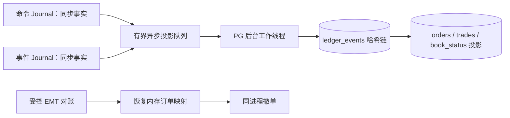

# 轻量订单账本与对账规范

## 目标与边界

`AsyncPostgresOrderLedger` 是单账户、单交易日的异步 PostgreSQL 投影，不是 OMS，也不是 EMT 委托的授权来源。它保存网关已接受的订单意图、网关订单号与 `order_emt_id` 映射、已观察到的订单/成交事实以及可重建的订单簿视图；不做撮合、智能路由、持仓会计、跨账户净额或对 `SUBMIT_UNKNOWN` 自动重发。

命令 Journal 与事件 Journal 是唯一同步事实源：前者在跨越 EMT 原生调用边界前落盘，后者在回调 C6 前落盘。PostgreSQL、追踪后端和订单簿均可由这两类 Journal 与受控 EMT 对账重建。



## 热路径不变量

- C0--C4、C5--C7 中没有 PostgreSQL 连接、读、写、事务提交、重试或退避。
- 网关对 PG 的唯一操作是复制小型规范化事实并执行一次有界 `Queue.put_nowait`；它不等待队列可用、PG 网络、PG 锁、事务提交或 SSD。该操作只包含极短的进程内队列临界区。
- PG 队列满、连接失败、事务失败、模式初始化失败或后台重试，均不得改变下单结果、原生 EMT 调用、回调落盘结果或策略 ACK。
- 异步队列的 `queued`、`inflight`、`persisted`、`dropped`、`failures`、`last_error` 必须暴露给监控。`dropped > 0` 或持续 `failures > 0` 是投影告警；恢复后从命令/事件 Journal 重建投影并执行受控 EMT 对账。

因此，PG 故障会降低只读诊断和投影新鲜度，但不会阻塞、拒绝或暂停原有网关进程。命令/事件 Journal 自身失败仍按原有失败关闭规则处理；两者不能混为一谈。

## PostgreSQL 数据模型

`ledger_events` 是应用层不可更新、不可删除的事实流。每个账户/交易日使用 `ledger_heads ... FOR UPDATE` 行锁串行追加哈希链；`orders`、`trades`、`book_status` 在同一 PostgreSQL 事务中更新，均可从 `ledger_events` 重建。成交使用 `market + report_index` 去重；只有 `report_index` 缺失时才回退到 `market + exec_id`。缺少两者的成交回调不猜测为新成交。

`PostgresOrderLedger` 是后台投影器与运维/重建工具使用的同步存储实现；不得直接传入 `OrderGateway`。生产网关只注入 `AsyncPostgresOrderLedger`：

```python
projector = AsyncPostgresOrderLedger(
    dsn=secrets.require("secret://emt-gateway/ordinary-1/postgres-dsn"),
    schema="acct_ordinary_1",
    capacity=65_536,
    connect_timeout_seconds=1,
)
gateway = OrderGateway(
    native=native,
    command_journal=command_journal,
    event_journal=event_journal,
    order_ledger=projector,
    ledger_account_id="ordinary-1",
    ledger_trading_day="20260827",
)
```

关闭服务时才调用 `projector.close()`；它不是交易热路径 API。

## 启动、对账与撤单

网关启动时可以异步把投影范围标记为 `RECONCILING`，供运维观察；该标记不反压新委托。受控 EMT 对账完成订单和成交分页、持久化结果并处理差异后，后台可写入 `complete_reconciliation`。`RECONCILE_REQUIRED` 代表 PG 视图不能独立作为连续性证明，例如未知订单回调、EMTID 映射冲突、提交不明或不可能的累计成交。

PG 视图无论是 `READY`、滞后、故障还是缺失，都不赋予撤单权限。仅同一网关进程中、已由同步命令 Journal 和原生成功返回证明的内存 `order_emt_id` 映射可以直接撤单。重启后先执行受控 EMT 对账并恢复内存映射；在此之前撤单失败关闭，不逐笔查询 EMT，也不猜测 EMTID。这避免了读取滞后 PG 为撤单增加延时或引入错误授权。

## 回调处理

SPI 入口只复制必要标量到快速队列，不保留 EMT 原始字典，也不做 PostgreSQL I/O。回调先在事件 Journal 落盘形成 C6，再以非阻塞方式投递 PG 投影，随后可形成策略投递并 ACK。PG 投影失败不影响 C6--C7。

订单和成交回调可来自不同线程；“终态订单回调先到、最后一笔成交后到”是正常次序。后台投影按幂等源键去重并补齐成交数量，但不把已经确认的 `FILLED` 或 `CANCELED` 回退为可撤状态。

## 运维与性能

后台 PostgreSQL 事务保持 `synchronous_commit=on`，保证已经被工作线程确认的投影事务本身可恢复；该等待只发生在后台，不能计入网关 C0--C7 延时。数据库必须使用专用角色、TLS（`sslmode=verify-full`）和每账户独立 schema，应用角色只授予该 schema 的最小 DDL/DML 权限。

验收同时覆盖两件事：正常 PG 下投影可重建、哈希链连续；不可达 PG 下下单和回调 ACK 仍成功，且失败只出现在投影状态指标。不得把 PG 事务延时混入原生 EMT 或网关链路延时统计。
