# OMS 数据与持久化设计

> 状态：目标详细设计（继承《OMS-EMS-Adapter-PaperBroker 模块化实施方案》的定档结论；`BrokerCustomRefV1` 于 2026-09-03 定档）
> 重点：PostgreSQL 逻辑表、字段、约束、索引、表关系、投影与重建
> 适用范围：Xuanling TradeCore OMS 订单域及其 PostgreSQL read model
> 非目标：行情、策略算法、前端、柜台撮合和跨主机交易高可用

## 1. 设计结论

OMS 持久化采用三个职责严格分离的层次：

1. `RedisStreamJournal` 是 TradeCore 本地意图、策略归属、幂等、冻结因果和原生调用边界的唯一同步事实源。
2. 完整且通过资格校验的 `BrokerRecoveryEvidence` 是进程崩溃后订单、成交、资产、持仓、信用资源和冻结重建的当前业务状态权威。
3. PostgreSQL 是异步、可重建的查询模型，用于检索、列表、审计展示、报表和对账加速，不参与报单、撤单、释放冻结或自动恢复裁决。
4. SSD archive 是 Redis Journal 的异步、只追加审计归档，不参与热路径，也不自动替代 Redis 或 Broker。

因此，本文中的 PostgreSQL 表均为 **read model/projection**。即使 PostgreSQL 完全不可用，只要 Redis Journal 仍能安全提交，已经进入系统的回调、撤单、恢复及终态处理不得被 PostgreSQL 阻塞。PG lag 达到容量策略的 `stop_new` 水位时可以保护性停止新单，但不能回滚已经提交的 Redis 事实。

## 2. 当前 P0 与目标结构的边界

### 2.1 当前 P0 PostgreSQL 表

当前 `emt_gateway.order_ledger.PostgresOrderLedger` 只包含以下五张兼容表：

| 当前表 | 当前用途 | 目标处理 |
| --- | --- | --- |
| `ledger_heads` | 按账户/交易日串行维护旧 PG 事件哈希链头 | 只保留兼容读取；目标 Journal 顺序来自 Redis Stream |
| `ledger_events` | 旧的不可变 PG 事件记录 | 保留 V1 Reader；目标表改为 Redis 事实的异步投影 |
| `orders` | 单账户轻量订单视图 | 迁移到 `oms_orders`，不原地改变字段语义 |
| `trades` | 旧 EMT 成交去重投影 | 迁移到 `oms_fills` |
| `book_status` | 旧本地账本健康状态 | 迁移到 `account_runtime_status` 与 `account_admission_gates` |

当前字段 `gateway_order_id`、`client_order_id` 和 `order_emt_id` 分别是 P0 兼容字段，不能直接等同于目标模型中的 `oms_order_id`、`client_order_ref` 和跨 Adapter 的 `venue_order_id`。迁移时必须保留显式 legacy identity，不得通过改列名伪造语义一致。

### 2.2 目标 PostgreSQL schema

建议目标 schema 使用 `xuanling_tradecore_rm`；名称可由部署配置固定，但同一 release 内不得漂移。目标表分为五组：

- 身份与授权投影；
- OMS 订单、执行、归属、撤单和成交；
- 风控快照与资源冻结；
- 柜台快照、恢复证据与对账；
- Journal 审计投影、账户状态和 projector 水位。

应用启动时禁止自动执行 DDL。所有建表、索引和回滚均使用版本化 migration，并先在隔离数据库验证。

## 3. 全局字段与类型规范

### 3.1 ID 与作用域

| 字段 | PostgreSQL 类型 | 规则 |
| --- | --- | --- |
| `consumer_id` | `uuid` | UUIDv7，全局唯一 |
| `consumer_account_id` | `uuid` | UUIDv7，消费者可见账户 binding 主键 |
| `strategy_id` | `uuid` | UUIDv7，全局唯一，不跨消费者复用 |
| `oms_order_id` | `uuid` | UUIDv7，OMS 全局订单主键 |
| `execution_id` | `uuid` | UUIDv7，一次执行/算法子单主键 |
| `cancel_request_id` | `uuid` | UUIDv7，一次撤单意图主键 |
| `attribution_binding_id` | `uuid` | UUIDv7，订单归属事实主键 |
| `account_id` | `text` | TradeCore 内部稳定 opaque ID，不保存完整柜台账号 |
| `venue_id` | `varchar(32)` | 如 `EMT`、`QMT`、`PAPER`；只能来自 Adapter Registry |
| `adapter_instance_id` | `text` | 单账户 Adapter 实例 ID |
| `trading_day` | `date` | 便于查询、分区和报表 |
| `trading_day_epoch` | `bigint` | TradeCore 的交易日 Epoch；用于防止跨日 ID 混用 |

### 3.2 金额、数量和时间

- 数量统一使用 `numeric(24,8)`；当前 A 股整数数量也按该类型保存，禁止 `float/double precision`。
- 价格、金额、费用、保证金统一使用 `numeric(24,8)`；如后续产品需要更高精度，只允许扩大精度，不得降低。
- 币种使用 `char(3)` ISO 4217 代码。
- 业务时间使用 `timestamptz`，入库统一 UTC。
- `observed_monotonic_ns` 使用 `bigint`，只用于同一 `boot_id/process_epoch` 内的性能与因果解释，不用于跨进程排序。
- 业务顺序以 Journal position 为准，不以 `created_at`、自增 ID 或数据库提交时间排序。

### 3.3 Journal position

所有由 Redis 事实投影的表均应携带或可追溯以下位置：

```text
journal_id       uuid
stream_generation bigint
redis_ms         bigint
redis_seq        bigint
fact_ordinal     integer
source_fact_hash char(64)
```

数值顺序为 `(redis_ms, redis_seq, fact_ordinal)` 的字典序。禁止按 `"<ms>-<seq>/<ordinal>"` 字符串排序。

### 3.4 状态与版本

- 可演进状态字段使用 `varchar` 加 migration 管理的 `CHECK` 或状态目录表；首版不建议使用难以回滚的 PostgreSQL ENUM。
- 每张可更新投影表必须有 `row_revision bigint` 或领域 revision，并保存最后来源 Journal position。
- 更新只接受更高的合法领域 revision，或相同 position + 相同 payload hash 的幂等重放。
- 相同业务键、相同 Journal position 但 payload hash 不同，必须视为投影冲突，停止对应 projector 并告警，不得覆盖。

### 3.5 敏感字段

- 柜台账号、登录凭据、密码、token、实名和 Adapter 原始回包不得以明文写入通用 OMS 表。
- 需要精确匹配但不需要展示的敏感值保存 `*_digest char(64)`。
- 需要受限展示的值保存 `*_ciphertext bytea + key_id varchar(64)`。
- 密钥材料不进入 PostgreSQL；仅由服务账户专属 secrets root 或 systemd credentials 提供。

### 3.6 券商自定义字段 `BrokerCustomRefV1`（强制格式）

凡券商柜台提供可由客户定义的字符字段，本项目写入的归属值必须采用且只能采用以下规范形式：

```text
broker_custom_ref = broker_system_id + "_" + broker_strategy_id + "_" + broker_trader_id
示例：TC-SYS01_MR01_TRD007
```

这里的三个值都是预登记、稳定、不可变的**柜台侧 ID**，不是内部 UUID 的直接字符串化，也不是系统名称、策略展示名、员工姓名、登录名或业务备注。内部 `strategy_id/consumer_id` 与较短的柜台侧 ID 通过第 5.5 节的 `broker_custom_ref_bindings` 一一绑定。

格式和长度规则：

1. 三个片段均非空，顺序固定，完整值必须恰好包含两个 ASCII 下划线；片段内禁止 `_`。
2. 默认字符集为 ASCII `[A-Za-z0-9-]+`；profile 如需收紧，只能通过已签名 `BrokerCustomFieldSpec` 声明，不能在运行时自行变更大小写、删除字符或替换字符。
3. 每个 Adapter profile 必须明确 `field_name/native_type/max_chars/max_bytes/charset/encoding/normalization_version` 以及报单、订单回报、成交回报、撤单错误、查询和回放的回显路径。本文不虚构具体券商上限；未从 SDK/柜台实测并签名确认上限的 profile 不得自动报单。
4. EMS 在冻结、写 `CALL_STARTED` 和调用 Adapter 之前，同时计算 `char_length` 与按 profile 编码后的 `octet_length`。任一值超限、片段非法、编码失败或柜台会截断/清洗时，返回 `BROKER_CUSTOM_REF_INVALID` 或 `BROKER_CUSTOM_REF_TOO_LONG`，零柜台调用；禁止截断、散列替换、删字符和静默降级。
5. `broker_custom_ref` 是策略/交易员**归属值，不是逐笔订单号**；同一绑定下的多笔订单可以且通常会重复。数据库不得对它单独建立逐笔唯一约束，也不得仅凭它把一条柜台回报自动绑定到某一 `execution_id`。
6. QMT 等字符字段必须原样承载完整值。EMT `order_client_id:uint32` 不能承载该字符串，故仍按订单分配非零整数 `client_order_ref`，并在同一耐久 mapping 中保存该整数与完整 `broker_custom_ref` 的关联。此原生类型例外不改变 PostgreSQL 中三个片段及完整规范值的保存格式。

数据库同时保存三个片段、完整值、字符数、编码字节数、当时的字符/字节上限和 manifest hash。`business_remark`、`strategy_order_id` 与原生逐笔订单 ID 是不同语义，禁止互相填充。

## 4. 表关系总览

```mermaid
erDiagram
    CONSUMER_PRINCIPALS ||--o{ CONSUMER_ACCOUNT_BINDINGS : owns
    CONSUMER_PRINCIPALS ||--o{ CONSUMER_STRATEGY_BINDINGS : owns
    CONSUMER_PRINCIPALS ||--o{ BROKER_CUSTOM_REF_BINDINGS : identifies_trader
    CONSUMER_STRATEGY_BINDINGS ||--o{ BROKER_CUSTOM_REF_BINDINGS : identifies_strategy
    CONSUMER_ACCOUNT_BINDINGS ||--o{ BROKER_CUSTOM_REF_BINDINGS : scopes
    CONSUMER_STRATEGY_BINDINGS ||--o{ CONSUMER_STRATEGY_ACCOUNTS : grants
    CONSUMER_ACCOUNT_BINDINGS ||--o{ CONSUMER_STRATEGY_ACCOUNTS : permits
    CONSUMER_ACCOUNT_BINDINGS ||--o{ OMS_ORDERS : submits_on
    CONSUMER_STRATEGY_BINDINGS ||--o{ OMS_ORDERS : creates
    OMS_ORDERS ||--o{ ATTRIBUTION_BINDINGS : attributed_by
    OMS_ORDERS ||--o{ OMS_EXECUTIONS : splits_into
    OMS_EXECUTIONS ||--o| ATTRIBUTION_BINDINGS : owns
    OMS_EXECUTIONS ||--o| BROKER_ORDER_MAPPINGS : maps_to
    BROKER_CUSTOM_REF_BINDINGS ||--o{ ATTRIBUTION_BINDINGS : snapshots
    BROKER_CUSTOM_REF_BINDINGS ||--o{ OMS_EXECUTIONS : labels
    BROKER_CUSTOM_REF_BINDINGS ||--o{ BROKER_ORDER_MAPPINGS : labels
    OMS_ORDERS ||--o{ OMS_CANCEL_REQUESTS : receives
    OMS_EXECUTIONS ||--o{ OMS_CANCEL_REQUESTS : targets
    OMS_ORDERS ||--o{ OMS_FILLS : accumulates
    OMS_EXECUTIONS ||--o{ OMS_FILLS : receives
    ATTRIBUTION_BINDINGS ||--o{ OMS_FILLS : classifies
    RISK_SNAPSHOTS ||--o{ RISK_SNAPSHOT_ITEMS : contains
    RISK_SNAPSHOTS ||--o{ OMS_ORDERS : admits
    OMS_ORDERS ||--o{ RESERVATION_LEDGER : reserves
    RISK_SNAPSHOTS ||--o{ RESERVATION_LEDGER : justifies
    ACCOUNT_SNAPSHOTS ||--o{ ACCOUNT_SNAPSHOT_BALANCES : contains
    ACCOUNT_SNAPSHOTS ||--o{ ACCOUNT_SNAPSHOT_POSITIONS : contains
    ACCOUNT_SNAPSHOTS ||--o{ ACCOUNT_SNAPSHOT_ORDERS : contains
    ACCOUNT_SNAPSHOTS ||--o{ ACCOUNT_SNAPSHOT_FILLS : contains
    ACCOUNT_SNAPSHOTS ||--o{ RECONCILIATION_RUNS : drives
    BROKER_RECOVERY_EVIDENCE ||--o{ RECONCILIATION_RUNS : qualifies
    RECONCILIATION_RUNS ||--o{ RECONCILIATION_ITEMS : finds
    ACCOUNT_RUNTIME_STATUS ||--o{ ACCOUNT_ADMISSION_GATES : has
    LEDGER_EVENTS ||--o{ OMS_ORDERS : projects
    LEDGER_EVENTS ||--o{ OMS_EXECUTIONS : projects
    LEDGER_EVENTS ||--o{ OMS_FILLS : projects
    PROJECTOR_CHECKPOINTS ||--o{ LEDGER_EVENTS : tracks
```



关系原则：

- 身份/账户/策略 binding 决定谁可以操作哪个账户，但 PG binding 不能作为信号热路径的实时授权源；热路径使用已签名并加载的本地 snapshot。
- `broker_custom_ref_bindings` 将内部系统/策略/交易员身份绑定为长度合规的柜台侧三段 ID；一条绑定可被多笔订单引用，因此 `broker_custom_ref` 不具备逐笔唯一性。
- `oms_orders` 是订单聚合根；执行、撤单、成交和冻结均向它归属。
- `broker_order_mappings` 只保存跨 Adapter ID 映射，不保存第二套订单状态机。
- `account_snapshots` 保存柜台观测窗口；它不是订单事实表。
- `reconciliation_items` 保存差异，不直接回写或覆盖 OMS 投影。
- `ledger_events` 与 `projector_checkpoints` 共同证明 PG 投影来自哪个已提交 Journal 前缀。

## 5. 身份与授权投影

### 5.1 `consumer_principals`

用途：保存消费者身份的受限查询投影。订单和普通日志只引用 `consumer_id` 与身份快照，不复制姓名或登录名。

| 字段 | 类型 | 空值 | 说明 |
| --- | --- | --- | --- |
| `consumer_id` | `uuid` | 否 | 主键，UUIDv7 |
| `login_name` | `varchar(128)` | 否 | 唯一登录名，仅限身份域读取 |
| `employee_legal_name_ciphertext` | `bytea` | 是 | 实名密文，不进入普通订单查询 |
| `identity_key_id` | `varchar(64)` | 是 | 实名密文 key id |
| `identity_snapshot_id` | `uuid` | 否 | 当前身份快照 ID |
| `identity_snapshot_hash` | `char(64)` | 否 | 身份快照内容 hash |
| `status` | `varchar(32)` | 否 | `ACTIVE/DISABLED/REVOKED` |
| `authorization_epoch` | `bigint` | 否 | 安全更新时单调增加，使旧会话失效 |
| `created_at` | `timestamptz` | 否 | 创建时间 |
| `updated_at` | `timestamptz` | 否 | 最近投影时间 |
| `row_revision` | `bigint` | 否 | binding 投影 revision |
| `last_source_fact_hash` | `char(64)` | 否 | 最近来源事实 hash |

约束和索引：

- `PRIMARY KEY (consumer_id)`。
- `UNIQUE (login_name)`；建议使用明确的大小写规范化值，而不是依赖数据库 locale。
- `authorization_epoch >= 0`、`row_revision > 0`。
- 应用角色拆分：OMS 查询角色不得读取实名密文字段。

### 5.2 `consumer_account_bindings`

用途：把消费者可见账户映射到内部账户和唯一 Adapter 实例。

| 字段 | 类型 | 空值 | 说明 |
| --- | --- | --- | --- |
| `consumer_account_id` | `uuid` | 否 | 主键 |
| `consumer_id` | `uuid` | 否 | FK → `consumer_principals` |
| `account_id` | `text` | 否 | TradeCore 内部账户 ID |
| `venue_id` | `varchar(32)` | 否 | 执行端类型 |
| `adapter_instance_id` | `text` | 否 | 单账户 Adapter 实例 |
| `venue_account_id_digest` | `char(64)` | 否 | 柜台账号规范化 digest |
| `venue_account_id_ciphertext` | `bytea` | 是 | 仅在确需受限展示时保存 |
| `venue_account_key_id` | `varchar(64)` | 是 | 密文 key id |
| `adapter_client_scope_digest` | `char(64)` | 否 | EMT `client_id` 或等价 scope 的 digest |
| `account_display_name` | `varchar(128)` | 否 | 消费者可见名称 |
| `binding_version` | `bigint` | 否 | 名称、权限、能力变化时增加 |
| `status` | `varchar(32)` | 否 | `ACTIVE/DISABLED/REVOKED` |
| `capability_snapshot_hash` | `char(64)` | 否 | 账户能力快照 hash |
| `valid_from` | `timestamptz` | 否 | 生效时间 |
| `valid_until` | `timestamptz` | 是 | 失效时间 |
| `last_source_fact_hash` | `char(64)` | 否 | 最近来源事实 hash |

约束和索引：

- `PRIMARY KEY (consumer_account_id)`。
- `FOREIGN KEY (consumer_id) REFERENCES consumer_principals(consumer_id)`。
- 活跃 binding 应满足 `UNIQUE (account_id, venue_id, adapter_instance_id)`；若保留历史版本，使用 `valid_until IS NULL` 的部分唯一索引。
- `UNIQUE (consumer_id, consumer_account_id, binding_version)` 用于事件快照复核。
- 索引 `(consumer_id, status, account_display_name)` 支持 `ListAccounts`。
- 第一版禁止将同一活动 `account_id + venue_id + adapter_instance_id` 绑定到不同消费者。

### 5.3 `consumer_strategy_bindings`

用途：保存策略身份及其所属消费者。人工 OMS 单也必须使用预登记的策略 binding。

| 字段 | 类型 | 空值 | 说明 |
| --- | --- | --- | --- |
| `strategy_id` | `uuid` | 否 | 主键，UUIDv7 |
| `consumer_id` | `uuid` | 否 | FK → `consumer_principals` |
| `strategy_code` | `varchar(128)` | 否 | 消费者范围内稳定代码 |
| `display_name` | `varchar(256)` | 否 | 展示名；人工策略可显示 `MANUAL::<desk/operator>` |
| `strategy_kind` | `varchar(32)` | 否 | `PROGRAM/MANUAL` |
| `binding_version` | `bigint` | 否 | 策略 binding 版本 |
| `status` | `varchar(32)` | 否 | `ACTIVE/DISABLED/REVOKED` |
| `valid_from` | `timestamptz` | 否 | 生效时间 |
| `valid_until` | `timestamptz` | 是 | 失效时间 |
| `last_source_fact_hash` | `char(64)` | 否 | 最近来源事实 hash |

约束和索引：

- `PRIMARY KEY (strategy_id)`。
- `FOREIGN KEY (consumer_id) REFERENCES consumer_principals(consumer_id)`。
- `UNIQUE (consumer_id, strategy_code)`。
- `CHECK (strategy_kind IN ('PROGRAM','MANUAL'))`。

### 5.4 `consumer_strategy_accounts`

用途：将策略与允许使用的消费者账户进行规范化多对多绑定，避免在 `consumer_strategy_bindings` 中存 JSON 账户列表。

| 字段 | 类型 | 空值 | 说明 |
| --- | --- | --- | --- |
| `strategy_id` | `uuid` | 否 | FK → `consumer_strategy_bindings` |
| `consumer_account_id` | `uuid` | 否 | FK → `consumer_account_bindings` |
| `binding_version` | `bigint` | 否 | 授权版本 |
| `status` | `varchar(32)` | 否 | `ACTIVE/REVOKED` |
| `valid_from` | `timestamptz` | 否 | 生效时间 |
| `valid_until` | `timestamptz` | 是 | 失效时间 |
| `last_source_fact_hash` | `char(64)` | 否 | 来源事实 hash |

主键建议为 `(strategy_id, consumer_account_id, binding_version)`。投影器必须验证策略和账户属于同一 `consumer_id`；不能仅依靠 FK 推断该业务约束。

### 5.5 `broker_custom_ref_bindings`

用途：将一个已授权的内部系统、策略和交易员组合，预先映射为满足券商字符字段限制的 `BrokerCustomRefV1`。该表是版本化身份映射投影，不是订单表；一条活动 binding 可以被多笔订单引用。

| 字段 | 类型 | 空值 | 说明 |
| --- | --- | --- | --- |
| `broker_custom_ref_binding_id` | `uuid` | 否 | 主键 |
| `consumer_account_id` | `uuid` | 否 | FK → `consumer_account_bindings`，限定账户/profile 作用域 |
| `strategy_id` | `uuid` | 否 | FK → `consumer_strategy_bindings` |
| `trader_consumer_id` | `uuid` | 否 | FK → `consumer_principals`；程序单为策略执行主体，人工单为当前授权操作员 |
| `venue_id` | `varchar(32)` | 否 | 柜台类型 |
| `adapter_instance_id` | `text` | 否 | Adapter/profile 实例 |
| `broker_system_id` | `varchar(64)` | 否 | `BrokerCustomRefV1` 第一段 |
| `broker_strategy_id` | `varchar(64)` | 否 | 第二段，与内部 `strategy_id` 一一映射 |
| `broker_trader_id` | `varchar(64)` | 否 | 第三段，与 `trader_consumer_id` 一一映射 |
| `broker_custom_ref` | `varchar(256)` | 否 | 完整规范值 `系统ID_策略ID_交易员ID` |
| `broker_custom_ref_chars` | `smallint` | 否 | 完整值字符数 |
| `broker_custom_ref_bytes` | `smallint` | 否 | 按 `field_encoding` 编码后的字节数 |
| `field_name` | `varchar(64)` | 否 | 如 QMT `order_remark`；EMT 记录逻辑字段名但不直接写字符串 |
| `native_type` | `varchar(32)` | 否 | `UTF8_REMARK/UINT32/...` |
| `field_max_chars` | `smallint` | 否 | 当时已验证的柜台字符上限 |
| `field_max_bytes` | `smallint` | 否 | 当时已验证的柜台字节上限 |
| `field_charset` | `varchar(128)` | 否 | 默认 `ASCII:[A-Za-z0-9-]+` |
| `field_encoding` | `varchar(32)` | 否 | 实际编码，如 `UTF-8` |
| `normalization_version` | `integer` | 否 | 编解码/规范化版本 |
| `broker_custom_field_manifest_hash` | `char(64)` | 否 | `BrokerCustomFieldSpec/RouteTokenBinding` hash |
| `binding_version` | `bigint` | 否 | 组合绑定版本，单调增加 |
| `status` | `varchar(16)` | 否 | `ACTIVE/REVOKED` |
| `valid_from` | `timestamptz` | 否 | 生效时间 |
| `valid_until` | `timestamptz` | 是 | 失效时间 |
| `created_position_*` | 位置字段组 | 否 | 来源 Journal position |

必须落为数据库约束的规则（示意 DDL）：

```sql
CHECK (broker_system_id ~ '^[A-Za-z0-9-]+$' AND position('_' in broker_system_id) = 0),
CHECK (broker_strategy_id ~ '^[A-Za-z0-9-]+$' AND position('_' in broker_strategy_id) = 0),
CHECK (broker_trader_id ~ '^[A-Za-z0-9-]+$' AND position('_' in broker_trader_id) = 0),
CHECK (broker_custom_ref =
       broker_system_id || '_' || broker_strategy_id || '_' || broker_trader_id),
CHECK (broker_custom_ref_chars = char_length(broker_custom_ref)),
CHECK (broker_custom_ref_bytes > 0),
CHECK (broker_custom_ref_chars <= field_max_chars),
CHECK (broker_custom_ref_bytes <= field_max_bytes),
CHECK (field_max_chars > 0 AND field_max_bytes > 0),
CHECK (status IN ('ACTIVE', 'REVOKED'))
```

`broker_custom_ref_bytes` 是按 `field_encoding` 得到的权威字节数；PostgreSQL `octet_length(text)` 只代表数据库编码字节数，只有 manifest 编码与数据库编码一致时才可额外用 `CHECK (broker_custom_ref_bytes = octet_length(broker_custom_ref))`。否则由共享 codec 计算并由 projector 重验，避免把 UTF-8 数据库长度误当成柜台编码长度。

唯一性和关系约束：

- `PRIMARY KEY (broker_custom_ref_binding_id)`。
- 活动版本唯一：`UNIQUE (consumer_account_id, strategy_id, trader_consumer_id, venue_id, adapter_instance_id) WHERE status='ACTIVE'`。
- 同一 profile 中三个内部身份不得映射出冲突值：`UNIQUE (consumer_account_id, venue_id, adapter_instance_id, broker_custom_ref) WHERE status='ACTIVE'`。
- 上述唯一约束只约束**身份 binding**；`broker_order_mappings.broker_custom_ref_binding_id` 是一对多 FK，不得对订单表中的 `broker_custom_ref` 建逐笔唯一约束。
- 增加非唯一索引 `(venue_id, broker_system_id, broker_strategy_id, broker_trader_id, status)`，用于按柜台归属组合筛选；任何逐笔查询仍须继续关联 execution/mapping。
- 修改任一片段、长度上限、编码或 manifest 必须撤销旧版本并创建新 binding；历史订单继续引用旧 binding，禁止原地改写。
- 程序订单的 `trader_consumer_id` 来自已签名的策略执行主体/负责人 binding；人工 OMS 订单来自完成本次操作的认证操作者。二者都必须预先具有稳定 `broker_trader_id`，报单时不得用姓名或登录名临时生成。

## 6. OMS 订单主链

### 6.1 `decision_contexts`

用途：保存“该订单当时为何能够准入”的不可变查询投影。恢复或审计时不能用当前配置回填旧订单。

| 字段 | 类型 | 空值 | 说明 |
| --- | --- | --- | --- |
| `decision_context_id` | `uuid` | 否 | 主键 |
| `decision_context_version` | `integer` | 否 | schema 版本 |
| `decision_context_hash` | `char(64)` | 否 | canonical 内容 hash，唯一 |
| `consumer_id` | `uuid` | 否 | 当时消费者 |
| `consumer_account_id` | `uuid` | 否 | 当时账户 binding |
| `strategy_id` | `uuid` | 否 | 当时策略 |
| `identity_snapshot_id` | `uuid` | 否 | 身份快照引用 |
| `account_display_name_snapshot` | `varchar(128)` | 否 | 当时账户展示名 |
| `binding_version` | `bigint` | 否 | 当时 binding 版本 |
| `venue_id` | `varchar(32)` | 否 | 当时执行端 |
| `adapter_instance_id` | `text` | 否 | 当时 Adapter 实例 |
| `mapping_manifest_hash` | `char(64)` | 否 | mapping 版本 hash |
| `capability_snapshot_hash` | `char(64)` | 否 | capability 版本 hash |
| `broker_custom_field_manifest_hash` | `char(64)` | 否 | 本次采用的自定义字段格式、长度、编码及回显契约 hash |
| `risk_snapshot_id` | `uuid` | 否 | FK → `risk_snapshots`，可延迟验证 |
| `risk_rule_bundle_hash` | `char(64)` | 否 | 风控规则 hash |
| `fee_model_hash` | `char(64)` | 否 | 费用模型 hash |
| `margin_model_hash` | `char(64)` | 是 | 信用业务保证金模型 hash |
| `price_protection_hash` | `char(64)` | 否 | 价格保护规则 hash |
| `calendar_rule_bundle_hash` | `char(64)` | 否 | 日历/交易规则包 hash |
| `availability_objective_hash` | `char(64)` | 否 | 账户恢复目标 hash |
| `control_approval_policy_hash` | `char(64)` | 否 | 控制审批策略 hash |
| `feature_flag_snapshot_hash` | `char(64)` | 是 | 本地签名 flag snapshot hash |
| `created_position_*` | 位置字段组 | 否 | 创建该 context 的 Journal position |

约束：

- `PRIMARY KEY (decision_context_id)`。
- `UNIQUE (decision_context_hash)`。
- context 创建后禁止 `UPDATE/DELETE`；更改规则必须创建新 context。

### 6.2 `attribution_bindings`

用途：保存订单来自哪个消费者、账户和策略，以及人工/外部订单的处理权限。

| 字段 | 类型 | 空值 | 说明 |
| --- | --- | --- | --- |
| `attribution_binding_id` | `uuid` | 否 | 主键 |
| `consumer_id` | `uuid` | 是 | 外部未归属单可空 |
| `consumer_account_id` | `uuid` | 是 | 外部未归属单可空 |
| `binding_version` | `bigint` | 是 | 账户 binding 版本 |
| `identity_snapshot_id` | `uuid` | 是 | 身份快照引用 |
| `strategy_id` | `uuid` | 是 | 未归属单可空 |
| `strategy_order_id` | `varchar(128)` | 是 | 策略幂等键或人工工单号 |
| `oms_order_id` | `uuid` | 是 | 外部未挂接单可空 |
| `execution_id` | `uuid` | 是 | 外部未挂接单可空 |
| `origin` | `varchar(32)` | 否 | `PROGRAM/MANUAL_OMS/EXTERNAL_MANUAL` |
| `attribution_state` | `varchar(32)` | 否 | `BOUND/UNATTRIBUTED/ATTACHED` |
| `operator_id` | `text` | 是 | 人工 OMS/挂接审计 ID，不保存姓名 |
| `broker_custom_ref_binding_id` | `uuid` | 是 | FK → `broker_custom_ref_bindings`；本项目自有订单必填，真正外部未归属单可空 |
| `broker_system_id` | `varchar(64)` | 是 | 下单时第一段快照 |
| `broker_strategy_id` | `varchar(64)` | 是 | 下单时第二段快照 |
| `broker_trader_id` | `varchar(64)` | 是 | 下单时第三段快照 |
| `broker_custom_ref` | `varchar(256)` | 是 | 完整 `系统ID_策略ID_交易员ID` 快照 |
| `broker_custom_ref_chars` | `smallint` | 是 | 字符数快照 |
| `broker_custom_ref_bytes` | `smallint` | 是 | 柜台编码字节数快照 |
| `broker_custom_field_manifest_hash` | `char(64)` | 是 | 当时格式/长度/编码 manifest hash |
| `account_id` | `text` | 否 | 内部账户 ID |
| `trading_day` | `date` | 否 | 交易日 |
| `trading_day_epoch` | `bigint` | 否 | 交易日 Epoch |
| `venue_id` | `varchar(32)` | 否 | 执行端 |
| `adapter_instance_id` | `text` | 否 | Adapter 实例 |
| `adapter_client_scope_digest` | `char(64)` | 是 | scope digest |
| `client_order_ref_digest` | `char(64)` | 是 | opaque token digest |
| `venue_order_id_digest` | `char(64)` | 是 | 原生订单 ID digest |
| `handling_authority` | `varchar(32)` | 否 | `OWN/MANUAL_CONTROL/STRATEGY_CONTROL/NONE` |
| `attribution_version` | `bigint` | 否 | 挂接时增加，不改写历史 |
| `journal_position_*` | 位置字段组 | 否 | 归属事实位置 |

约束：

- `PRIMARY KEY (attribution_binding_id)`。
- 自有订单：`BOUND` 必须同时具有 `consumer_id/consumer_account_id/strategy_id/oms_order_id/execution_id`。
- 自有订单还必须具有 `broker_custom_ref_binding_id`、三个 `broker_*_id`、完整 `broker_custom_ref`、字符/字节数和 manifest hash；完整值必须等于三段按固定顺序拼接，且满足所引用 binding 的快照规则。
- 未归属外部单：`UNATTRIBUTED` 不得伪造 `strategy_id/oms_order_id/execution_id`。
- `ATTACHED` 必须有操作员、理由事实和明确 `handling_authority`。
- 每次挂接生成新 `attribution_version`；禁止覆盖原始未归属记录。

### 6.3 `oms_orders`

用途：OMS 订单聚合根和主要查询表。

| 字段 | 类型 | 空值 | 说明 |
| --- | --- | --- | --- |
| `oms_order_id` | `uuid` | 否 | 主键 |
| `consumer_id` | `uuid` | 否 | FK → `consumer_principals` |
| `consumer_account_id` | `uuid` | 否 | FK → `consumer_account_bindings` |
| `account_id` | `text` | 否 | 冗余保存，便于账户查询与隔离校验 |
| `binding_version` | `bigint` | 否 | 下单时账户 binding 版本 |
| `account_display_name_snapshot` | `varchar(128)` | 否 | 下单时展示名称快照 |
| `strategy_id` | `uuid` | 否 | FK → `consumer_strategy_bindings` |
| `strategy_order_id` | `varchar(128)` | 否 | 策略业务幂等键 |
| `intent_hash` | `char(64)` | 否 | 首次订单意图 canonical SHA-256 |
| `decision_context_id` | `uuid` | 否 | FK → `decision_contexts` |
| `risk_snapshot_id` | `uuid` | 否 | FK → `risk_snapshots` |
| `trading_day` | `date` | 否 | 交易日 |
| `trading_day_epoch` | `bigint` | 否 | Epoch |
| `business_line` | `varchar(32)` | 否 | 如 `CASH/MARGIN/SHORT/OPTION` |
| `market` | `varchar(32)` | 否 | 领域市场枚举 |
| `instrument_id` | `varchar(64)` | 否 | 规范化证券标识 |
| `side` | `varchar(32)` | 否 | 领域方向 |
| `position_effect` | `varchar(32)` | 是 | 开平/头寸效果，适用时填写 |
| `order_type` | `varchar(32)` | 否 | 限价、市价等领域类型 |
| `time_in_force` | `varchar(32)` | 是 | 有效期策略 |
| `currency` | `char(3)` | 否 | 币种 |
| `order_qty` | `numeric(24,8)` | 否 | 委托数量 |
| `limit_price` | `numeric(24,8)` | 是 | 限价 |
| `protective_price` | `numeric(24,8)` | 否 | 风控冻结保护价 |
| `filled_qty` | `numeric(24,8)` | 否 | 累计成交量 |
| `leaves_qty` | `numeric(24,8)` | 否 | 剩余量 |
| `avg_fill_price` | `numeric(24,8)` | 是 | 加权平均成交价 |
| `status` | `varchar(48)` | 否 | 统一 OMS 状态 |
| `order_revision` | `bigint` | 否 | 消费者可见状态 revision |
| `origin` | `varchar(32)` | 否 | `PROGRAM/MANUAL_OMS` |
| `business_remark` | `varchar(512)` | 是 | 本地展示备注，不下发到柜台 token |
| `created_at` | `timestamptz` | 否 | 首次接收时间 |
| `updated_at` | `timestamptz` | 否 | 最近投影时间 |
| `terminal_at` | `timestamptz` | 是 | 终态时间 |
| `last_position_*` | 位置字段组 | 否 | 最近订单事实位置 |

关键约束：

- `PRIMARY KEY (oms_order_id)`。
- `UNIQUE (strategy_id, strategy_order_id)`；这是业务幂等约束。
- 同一唯一键重试时，`intent_hash` 必须相同；不同 hash 属于 `IDEMPOTENCY_CONFLICT`，不能覆盖原订单。
- `order_qty > 0`、`filled_qty >= 0`、`leaves_qty >= 0`。
- 正常情况下 `filled_qty + leaves_qty = order_qty`；柜台更正/特殊业务必须由版本化状态规则解释，不能静默破坏。
- `business_remark` 仅本地展示，不属于 `intent_hash`，不得映射为 EMT `order_client_id` 或 QMT `order_remark`。

核心索引：

```text
UNIQUE (strategy_id, strategy_order_id)
INDEX  (consumer_id, consumer_account_id, created_at DESC)
INDEX  (consumer_account_id, status, updated_at DESC)
INDEX  (account_id, trading_day, status, updated_at DESC)
INDEX  (strategy_id, created_at DESC)
INDEX  (market, instrument_id, created_at DESC)
PARTIAL INDEX (account_id, trading_day, updated_at DESC)
  WHERE status IN ('WORKING','PARTIALLY_FILLED','CANCEL_PENDING','SUBMIT_UNKNOWN')
```

### 6.4 `oms_executions`

用途：记录一个 OMS 订单的具体执行尝试或算法子单。父订单与子单是一对多关系。

| 字段 | 类型 | 空值 | 说明 |
| --- | --- | --- | --- |
| `execution_id` | `uuid` | 否 | 主键 |
| `oms_order_id` | `uuid` | 否 | FK → `oms_orders` |
| `child_no` | `integer` | 否 | 同一订单内单调子单编号 |
| `parent_execution_id` | `uuid` | 是 | 多级算法子单时引用父 execution |
| `account_id` | `text` | 否 | 执行账户 |
| `trading_day_epoch` | `bigint` | 否 | Epoch |
| `venue_id` | `varchar(32)` | 否 | Adapter venue |
| `adapter_instance_id` | `text` | 否 | Adapter 实例 |
| `adapter_client_scope_digest` | `char(64)` | 否 | scope digest |
| `client_order_ref_digest` | `char(64)` | 否 | AdapterRouteToken 规范化 digest |
| `route_binding_manifest_hash` | `char(64)` | 否 | RouteTokenBinding 版本 hash |
| `broker_custom_ref_binding_id` | `uuid` | 否 | FK → `broker_custom_ref_bindings`；多个 execution 可引用同一归属 binding |
| `broker_custom_ref_digest` | `char(64)` | 否 | 完整 `BrokerCustomRefV1` 的 SHA-256，便于一致性校验，不作为逐笔唯一键 |
| `broker_custom_field_manifest_hash` | `char(64)` | 否 | 本次字段格式/长度/编码 manifest hash |
| `execution_qty` | `numeric(24,8)` | 否 | 子单数量 |
| `execution_price` | `numeric(24,8)` | 是 | 子单价格 |
| `dispatch_phase` | `varchar(48)` | 否 | `PRE_NATIVE/NATIVE_CALL_ENTERED/NATIVE_RETURN_OBSERVED/LOCAL_ABORTED_BEFORE_NATIVE` |
| `execution_status` | `varchar(48)` | 否 | 执行状态 |
| `native_outcome` | `varchar(48)` | 是 | 确定接受、确定拒绝、结果未知等 |
| `deadline_policy_hash` | `char(64)` | 否 | 本次执行 deadline 策略 |
| `admitted_monotonic_ns` | `bigint` | 否 | 准入单调时间 |
| `native_started_at` | `timestamptz` | 是 | 进入原生调用时间 |
| `native_returned_at` | `timestamptz` | 是 | 原生调用返回时间 |
| `row_revision` | `bigint` | 否 | 执行 revision |
| `last_position_*` | 位置字段组 | 否 | 最近执行事实位置 |

约束和索引：

- `PRIMARY KEY (execution_id)`。
- `FOREIGN KEY (oms_order_id) REFERENCES oms_orders(oms_order_id)`。
- `UNIQUE (oms_order_id, child_no)`。
- `UNIQUE (venue_id, account_id, trading_day_epoch, adapter_client_scope_digest, client_order_ref_digest)`。
- 不得对 `broker_custom_ref_binding_id` 或 `broker_custom_ref_digest` 建逐笔唯一约束；同一策略/交易员的多笔 execution 会共享它们。
- `parent_execution_id` 不得跨 `oms_order_id`；由投影器校验。
- 索引 `(oms_order_id, child_no)`、`(account_id, execution_status, native_started_at)`。

### 6.5 `broker_order_mappings`

用途：保存 TradeCore ID 与柜台 ID 的双向映射；不保存 OMS 业务状态。

| 字段 | 类型 | 空值 | 说明 |
| --- | --- | --- | --- |
| `mapping_id` | `uuid` | 否 | 主键 |
| `execution_id` | `uuid` | 是 | FK → `oms_executions`；自有执行必填，外部订单可空 |
| `attribution_binding_id` | `uuid` | 否 | FK → `attribution_bindings` |
| `mapping_origin` | `varchar(16)` | 否 | `OWN/EXTERNAL` |
| `account_id` | `text` | 否 | 账户 |
| `trading_day` | `date` | 否 | 交易日 |
| `trading_day_epoch` | `bigint` | 否 | Epoch |
| `venue_id` | `varchar(32)` | 否 | 执行端 |
| `adapter_instance_id` | `text` | 否 | Adapter 实例 |
| `adapter_client_scope_digest` | `char(64)` | 否 | scope digest |
| `broker_custom_ref_binding_id` | `uuid` | 是 | FK → `broker_custom_ref_bindings`；自有订单必填，外部未归属单可空 |
| `broker_system_id` | `varchar(64)` | 是 | 第一段快照 |
| `broker_strategy_id` | `varchar(64)` | 是 | 第二段快照 |
| `broker_trader_id` | `varchar(64)` | 是 | 第三段快照 |
| `broker_custom_ref` | `varchar(256)` | 是 | 完整 `系统ID_策略ID_交易员ID`；自有订单必须保存明文规范值并按列授权 |
| `broker_custom_ref_digest` | `char(64)` | 是 | 完整规范值 SHA-256 |
| `broker_custom_ref_chars` | `smallint` | 是 | 规范值字符数 |
| `broker_custom_ref_bytes` | `smallint` | 是 | 按柜台编码计算的字节数 |
| `broker_custom_ref_max_chars` | `smallint` | 是 | 下单时 profile 字符上限快照 |
| `broker_custom_ref_max_bytes` | `smallint` | 是 | 下单时 profile 字节上限快照 |
| `broker_custom_field_manifest_hash` | `char(64)` | 是 | 下单时格式/编码/长度 manifest hash |
| `client_order_ref_kind` | `varchar(32)` | 否 | `UINT32/UTF8_REMARK/...` |
| `client_order_ref_digest` | `char(64)` | 否 | 规范化 token digest |
| `client_order_ref_ciphertext` | `bytea` | 是 | 仅在恢复查询需要时加密保存 |
| `client_order_ref_key_id` | `varchar(64)` | 是 | 密文 key id |
| `venue_order_id_digest` | `char(64)` | 是 | 柜台订单 ID digest |
| `venue_order_id_ciphertext` | `bytea` | 是 | 受限加密值 |
| `venue_cancel_id_digest` | `char(64)` | 是 | 柜台撤单 ID digest |
| `mapping_manifest_hash` | `char(64)` | 否 | 原生字段 mapping hash |
| `scope_ownership_hash` | `char(64)` | 否 | scope ownership 证据 hash |
| `mapping_status` | `varchar(32)` | 否 | `PENDING/BOUND/CONFLICT/TOMBSTONED` |
| `created_position_*` | 位置字段组 | 否 | route 创建位置 |
| `updated_position_*` | 位置字段组 | 否 | 最近 mapping 位置 |

唯一约束：

```text
UNIQUE (execution_id) WHERE execution_id IS NOT NULL
UNIQUE (venue_id, account_id, trading_day_epoch,
        adapter_client_scope_digest, client_order_ref_digest)
UNIQUE (venue_id, account_id, trading_day_epoch, venue_order_id_digest)
  WHERE venue_order_id_digest IS NOT NULL
```

另建非唯一索引 `(account_id, trading_day, broker_custom_ref_digest)` 和 `(broker_strategy_id, broker_trader_id, trading_day)`，用于归属核对及程序/人工订单对照；不得将其改为唯一索引。

自有订单的行级约束必须同时满足：

```sql
CHECK (
  mapping_origin = 'EXTERNAL'
  OR (
    broker_custom_ref_binding_id IS NOT NULL
    AND broker_system_id IS NOT NULL
    AND broker_strategy_id IS NOT NULL
    AND broker_trader_id IS NOT NULL
    AND broker_custom_ref =
        broker_system_id || '_' || broker_strategy_id || '_' || broker_trader_id
    AND broker_custom_ref_digest IS NOT NULL
    AND broker_custom_ref_chars = char_length(broker_custom_ref)
    AND broker_custom_ref_chars <= broker_custom_ref_max_chars
    AND broker_custom_ref_bytes <= broker_custom_ref_max_bytes
    AND broker_custom_field_manifest_hash IS NOT NULL
  )
)
```

完整 `broker_custom_ref` 需要用于柜台回显核对和审计，因此不能只保存 digest 或密文；通过列权限、受限视图与审计访问保护它。它不包含姓名、登录名、账号或密码。`client_order_ref_digest` 仍是逐笔路由键摘要；`broker_custom_ref_digest` 只是归属值摘要，两者不得互换。QMT 若只有 `order_remark` 承载归属值，因该值可重复，不能仅凭 remark 对一笔订单建立唯一 route；还必须结合原生订单 ID 和经 manifest 验证的其他不变量，不能唯一证明时进入 `RECONCILE_REQUIRED`。EMT 则以逐笔唯一的非零 `order_client_id` 作为 `client_order_ref`，并通过本表关联完整规范值。

EMT 专有 `order_client_id/order_emt_id/order_cancel_emt_id` 只能作为受版本保护的 Adapter 扩展查询列或加密载荷，不得成为跨 Adapter 的通用列名。

### 6.6 `oms_cancel_requests`

用途：保存撤单意图、幂等、目标、原生调用边界和柜台结果。

| 字段 | 类型 | 空值 | 说明 |
| --- | --- | --- | --- |
| `cancel_request_id` | `uuid` | 否 | 主键 |
| `oms_order_id` | `uuid` | 是 | 自有订单或已挂接订单对应的 OMS ID |
| `execution_id` | `uuid` | 是 | `OWN_EXECUTION` 目标 |
| `attribution_binding_id` | `uuid` | 是 | `ATTACHED_EXTERNAL` 目标 |
| `cancel_target_kind` | `varchar(32)` | 否 | `OWN_EXECUTION/ATTACHED_EXTERNAL` |
| `cancel_target_id` | `text` | 否 | 规范化目标 ID，便于统一幂等 |
| `caller_cancel_key` | `varchar(128)` | 否 | 调用方撤单幂等键 |
| `consumer_id` | `uuid` | 否 | 发起消费者 |
| `strategy_id` | `uuid` | 是 | 策略撤单时填写 |
| `operator_id` | `text` | 是 | 人工撤单时填写 |
| `reason_code` | `varchar(64)` | 否 | 结构化原因码 |
| `reason_text` | `varchar(512)` | 是 | 受限理由，不保存任意 SDK 文本 |
| `status` | `varchar(48)` | 否 | 请求、调用中、接受、拒绝、未知、完成等 |
| `dispatch_phase` | `varchar(48)` | 否 | 撤单原生边界 phase |
| `venue_cancel_id_digest` | `char(64)` | 是 | 柜台撤单 ID digest |
| `native_outcome` | `varchar(48)` | 是 | 统一结果分类 |
| `requested_at` | `timestamptz` | 否 | 请求时间 |
| `completed_at` | `timestamptz` | 是 | 完成时间 |
| `row_revision` | `bigint` | 否 | 撤单 revision |
| `created_position_*` | 位置字段组 | 否 | `CANCEL_REQUESTED/CANCEL_STARTED` 位置 |
| `last_position_*` | 位置字段组 | 否 | 最近撤单事实位置 |

约束和索引：

- `PRIMARY KEY (cancel_request_id)`。
- `UNIQUE (cancel_target_kind, cancel_target_id, caller_cancel_key)`。
- `OWN_EXECUTION` 必须有 `execution_id`；`ATTACHED_EXTERNAL` 必须有 `attribution_binding_id`。
- 索引 `(oms_order_id, requested_at DESC)`、`(status, requested_at)`。
- 同一 `cancel_request_id` 最多跨越一次 Adapter 撤单副作用边界。

### 6.7 `oms_fills`

用途：保存去重后的成交事实及其与订单/执行/柜台的关系。

| 字段 | 类型 | 空值 | 说明 |
| --- | --- | --- | --- |
| `fill_id` | `uuid` | 否 | 主键 |
| `oms_order_id` | `uuid` | 是 | FK → `oms_orders`；未挂接外部成交可空 |
| `execution_id` | `uuid` | 是 | FK → `oms_executions`；未挂接外部成交可空 |
| `attribution_binding_id` | `uuid` | 否 | FK → `attribution_bindings`；未归属也有稳定 binding |
| `mapping_id` | `uuid` | 是 | FK → `broker_order_mappings` |
| `account_id` | `text` | 否 | 账户 |
| `trading_day` | `date` | 否 | 交易日 |
| `trading_day_epoch` | `bigint` | 否 | Epoch |
| `venue_id` | `varchar(32)` | 否 | 执行端 |
| `market` | `varchar(32)` | 否 | 市场 |
| `instrument_id` | `varchar(64)` | 否 | 标的 |
| `trade_key` | `varchar(256)` | 否 | Adapter 规范化成交去重键 |
| `venue_trade_id_digest` | `char(64)` | 是 | 原生成交号 digest |
| `side` | `varchar(32)` | 否 | 方向 |
| `fill_qty` | `numeric(24,8)` | 否 | 成交数量 |
| `fill_price` | `numeric(24,8)` | 否 | 成交价格 |
| `fill_amount` | `numeric(24,8)` | 否 | 成交金额 |
| `fee_amount` | `numeric(24,8)` | 是 | 已知费用 |
| `currency` | `char(3)` | 否 | 币种 |
| `venue_trade_at` | `timestamptz` | 是 | 柜台/交易所时间 |
| `received_at` | `timestamptz` | 否 | TradeCore 接收时间 |
| `source_key_digest` | `char(64)` | 否 | BrokerEvent source key digest |
| `event_position_*` | 位置字段组 | 否 | 对应成交事实位置 |

唯一约束：

```text
UNIQUE (venue_id, account_id, trading_day_epoch, trade_key)
UNIQUE (journal_id, stream_generation, redis_ms, redis_seq, fact_ordinal)
```

自有成交必须同时具备 `oms_order_id` 和 `execution_id`；外部未归属成交允许两者为空，但必须引用 `UNATTRIBUTED` 的 `attribution_binding_id`，且只能进入账户风险、快照和对账视图，不能伪造策略归属。

索引 `(oms_order_id, venue_trade_at, received_at)`、`(execution_id, received_at)`、`(account_id, trading_day, instrument_id)`。

## 7. 风控快照与冻结账本

### 7.1 `risk_snapshots`

用途：保存准入使用的风险输入快照头。

| 字段 | 类型 | 空值 | 说明 |
| --- | --- | --- | --- |
| `risk_snapshot_id` | `uuid` | 否 | 主键 |
| `account_id` | `text` | 否 | 账户 |
| `trading_day` | `date` | 否 | 交易日 |
| `trading_day_epoch` | `bigint` | 否 | Epoch |
| `snapshot_generation` | `bigint` | 否 | 账户内单调 generation |
| `source_kind` | `varchar(32)` | 否 | `BROKER_QUERY/OFFICIAL_RULE_BUNDLE/...` |
| `source_reference_hash` | `char(64)` | 否 | 查询/规则包引用 hash |
| `coverage_mask` | `jsonb` | 否 | 资金、持仓、额度、券源、资格等覆盖声明 |
| `as_of_at` | `timestamptz` | 是 | 来源 as-of 时间 |
| `received_at` | `timestamptz` | 否 | 接收时间 |
| `valid_until` | `timestamptz` | 否 | 风控有效期 |
| `snapshot_hash` | `char(64)` | 否 | 完整 canonical 内容 hash |
| `freshness_policy_hash` | `char(64)` | 否 | 时效策略 hash |
| `status` | `varchar(32)` | 否 | `VALID/STALE/INCOMPLETE/CONFLICT` |
| `created_position_*` | 位置字段组 | 否 | 快照事实位置 |

约束：

- `PRIMARY KEY (risk_snapshot_id)`。
- `UNIQUE (account_id, trading_day_epoch, snapshot_generation)`。
- `UNIQUE (snapshot_hash)` 可用于内容去重。
- `valid_until >= received_at`。

### 7.2 `risk_snapshot_items`

用途：按资源粒度保存可查询风险值，避免将所有业务值只存入 JSONB。

| 字段 | 类型 | 空值 | 说明 |
| --- | --- | --- | --- |
| `risk_snapshot_id` | `uuid` | 否 | FK → `risk_snapshots` |
| `item_no` | `integer` | 否 | 快照内序号 |
| `resource_type` | `varchar(32)` | 否 | `CASH/SELLABLE_QTY/MARGIN_QUOTA/COLLATERAL/BORROWABLE_QTY` |
| `market` | `varchar(32)` | 是 | 标的资源时填写 |
| `instrument_id` | `varchar(64)` | 是 | 标的资源时填写 |
| `currency` | `char(3)` | 是 | 资金资源时填写 |
| `total_value` | `numeric(24,8)` | 是 | 总量 |
| `available_value` | `numeric(24,8)` | 否 | 可用量 |
| `reserved_value` | `numeric(24,8)` | 否 | 已知冻结量 |
| `unit` | `varchar(16)` | 否 | `MONEY/QTY/RATIO` |
| `item_hash` | `char(64)` | 否 | item canonical hash |

主键 `(risk_snapshot_id, item_no)`；资源检索索引 `(risk_snapshot_id, resource_type, market, instrument_id, currency)`。

### 7.3 `reservation_ledger`

用途：保存冻结的追加式变更投影。它是 Journal 冻结事实的查询副本，不是 PG 自主生成的余额账本。

| 字段 | 类型 | 空值 | 说明 |
| --- | --- | --- | --- |
| `reservation_entry_id` | `uuid` | 否 | 主键 |
| `reservation_id` | `uuid` | 否 | 一组冻结的稳定 ID |
| `reservation_revision` | `bigint` | 否 | 同一 reservation 内单调 revision |
| `oms_order_id` | `uuid` | 否 | FK → `oms_orders` |
| `execution_id` | `uuid` | 是 | 具体执行子单，适用时填写 |
| `account_id` | `text` | 否 | 账户 |
| `trading_day_epoch` | `bigint` | 否 | Epoch |
| `risk_snapshot_id` | `uuid` | 否 | FK → `risk_snapshots` |
| `resource_type` | `varchar(32)` | 否 | 资金、可卖量、融资额度、券源等 |
| `resource_key` | `varchar(256)` | 否 | 规范化资源键 |
| `action` | `varchar(32)` | 否 | `CREATE/ADJUST/RELEASE/RECOVERY_APPLY` |
| `delta_value` | `numeric(24,8)` | 否 | 本次变化；释放为负数 |
| `reserved_after` | `numeric(24,8)` | 否 | 变化后冻结值 |
| `currency` | `char(3)` | 是 | 资金类资源 |
| `protective_price` | `numeric(24,8)` | 是 | 冻结计算保护价 |
| `fee_model_hash` | `char(64)` | 否 | 费用模型 hash |
| `margin_model_hash` | `char(64)` | 是 | 保证金模型 hash |
| `calculation_digest` | `char(64)` | 否 | 输入及计算摘要 |
| `event_position_*` | 位置字段组 | 否 | 冻结事实位置 |

约束和索引：

- `PRIMARY KEY (reservation_entry_id)`。
- `UNIQUE (reservation_id, reservation_revision)`。
- `UNIQUE (journal_id, stream_generation, redis_ms, redis_seq, fact_ordinal)`。
- `reserved_after >= 0`；跳号、负数、重复 release 必须停止 projector 并触发对账。
- 索引 `(oms_order_id, reservation_revision)`、`(account_id, trading_day_epoch, resource_type, resource_key)`。

## 8. 柜台快照与对账

### 8.1 `account_snapshots`

用途：保存一次完整柜台查询窗口的头信息，不直接把多接口返回拼成“严格同一时点”。

| 字段 | 类型 | 空值 | 说明 |
| --- | --- | --- | --- |
| `account_snapshot_id` | `uuid` | 否 | 主键 |
| `account_id` | `text` | 否 | 账户 |
| `trading_day` | `date` | 否 | 交易日 |
| `trading_day_epoch` | `bigint` | 否 | Epoch |
| `venue_id` | `varchar(32)` | 否 | 执行端 |
| `adapter_instance_id` | `text` | 否 | Adapter 实例 |
| `snapshot_generation` | `bigint` | 否 | 账户内单调 generation |
| `query_completion_spec_hash` | `char(64)` | 否 | 分页/终态语义 hash |
| `recovery_evidence_profile_hash` | `char(64)` | 否 | 恢复覆盖要求 hash |
| `ingress_lsn_start` | `text` | 否 | 查询开始时 Journal 边界 |
| `ingress_lsn_end` | `text` | 否 | 查询结束时 Journal 边界 |
| `broker_as_of_at` | `timestamptz` | 是 | 柜台统一 as-of，存在时填写 |
| `window_started_at` | `timestamptz` | 否 | 查询窗口开始 |
| `window_completed_at` | `timestamptz` | 否 | 查询窗口结束 |
| `coverage_mask` | `jsonb` | 否 | 资产、资金、持仓、订单、成交、信用等覆盖 |
| `rowset_digest` | `char(64)` | 否 | 全部子项 canonical digest |
| `status` | `varchar(32)` | 否 | `COMPLETE/INCOMPLETE/UNSTABLE/ERROR` |
| `created_position_*` | 位置字段组 | 否 | 快照提交事实位置 |

唯一约束 `(account_id, trading_day_epoch, snapshot_generation)`。

### 8.2 `account_snapshot_balances`

| 字段 | 类型 | 说明 |
| --- | --- | --- |
| `account_snapshot_id` | `uuid` | FK → `account_snapshots` |
| `balance_no` | `integer` | 快照内序号 |
| `balance_type` | `varchar(32)` | `ASSET/CASH/MARGIN_QUOTA/COLLATERAL/...` |
| `currency` | `char(3)` | 币种 |
| `total_amount` | `numeric(24,8)` | 总额 |
| `available_amount` | `numeric(24,8)` | 可用额 |
| `frozen_amount` | `numeric(24,8)` | 冻结额 |
| `item_hash` | `char(64)` | 行摘要 |

主键 `(account_snapshot_id, balance_no)`。

### 8.3 `account_snapshot_positions`

| 字段 | 类型 | 说明 |
| --- | --- | --- |
| `account_snapshot_id` | `uuid` | FK → `account_snapshots` |
| `position_no` | `integer` | 快照内序号 |
| `market` | `varchar(32)` | 市场 |
| `instrument_id` | `varchar(64)` | 标的 |
| `position_direction` | `varchar(32)` | 持仓方向 |
| `total_qty` | `numeric(24,8)` | 总持仓 |
| `available_qty` | `numeric(24,8)` | 可用数量 |
| `frozen_qty` | `numeric(24,8)` | 柜台冻结 |
| `today_qty` | `numeric(24,8)` | 当日数量，适用时填写 |
| `cost_price` | `numeric(24,8)` | 成本价，适用时填写 |
| `item_hash` | `char(64)` | 行摘要 |

主键 `(account_snapshot_id, position_no)`；索引 `(account_snapshot_id, market, instrument_id)`。

### 8.4 `account_snapshot_orders`

用途：保存柜台快照中原生订单的规范化行。该表允许存在尚未归属的外部订单，因此不能强制引用 `oms_order_id`。

| 字段 | 类型 | 说明 |
| --- | --- | --- |
| `account_snapshot_id` | `uuid` | FK → `account_snapshots` |
| `snapshot_order_no` | `integer` | 快照内序号 |
| `venue_order_id_digest` | `char(64)` | 原生订单 ID digest |
| `adapter_client_scope_digest` | `char(64)` | scope digest，可空 |
| `client_order_ref_digest` | `char(64)` | route token digest，可空 |
| `broker_custom_ref` | `varchar(256)` | 柜台回显的完整归属值，可空；存在时必须符合 V1 格式 |
| `broker_custom_ref_digest` | `char(64)` | 完整归属值 digest，可空 |
| `broker_custom_ref_valid` | `boolean` | 是否与 mapping 三段值、长度及 manifest 一致 |
| `broker_custom_field_manifest_hash` | `char(64)` | 用于解释该行的字段规则 hash，可空 |
| `mapping_id` | `uuid` | 已映射时 FK → `broker_order_mappings` |
| `market` | `varchar(32)` | 市场 |
| `instrument_id` | `varchar(64)` | 标的 |
| `side` | `varchar(32)` | 方向 |
| `order_qty` | `numeric(24,8)` | 委托量 |
| `filled_qty` | `numeric(24,8)` | 成交量 |
| `leaves_qty` | `numeric(24,8)` | 剩余量 |
| `price` | `numeric(24,8)` | 价格，可空 |
| `normalized_status` | `varchar(48)` | 规范化状态 |
| `broker_updated_at` | `timestamptz` | 柜台更新时间，可空 |
| `item_hash` | `char(64)` | 行摘要 |

主键 `(account_snapshot_id, snapshot_order_no)`；唯一索引 `(account_snapshot_id, venue_order_id_digest)`。

### 8.5 `account_snapshot_fills`

| 字段 | 类型 | 说明 |
| --- | --- | --- |
| `account_snapshot_id` | `uuid` | FK → `account_snapshots` |
| `snapshot_fill_no` | `integer` | 快照内序号 |
| `trade_key` | `varchar(256)` | Adapter 成交去重键 |
| `venue_order_id_digest` | `char(64)` | 原生订单 ID digest |
| `mapping_id` | `uuid` | 已映射时引用 mapping |
| `market` | `varchar(32)` | 市场 |
| `instrument_id` | `varchar(64)` | 标的 |
| `fill_qty` | `numeric(24,8)` | 成交数量 |
| `fill_price` | `numeric(24,8)` | 成交价格 |
| `venue_trade_at` | `timestamptz` | 成交时间，可空 |
| `item_hash` | `char(64)` | 行摘要 |

主键 `(account_snapshot_id, snapshot_fill_no)`；唯一索引 `(account_snapshot_id, trade_key)`。

### 8.6 `broker_recovery_evidence`

用途：保存 Adapter 恢复证据及资格计算摘要。PG 只供检索，不参与资格计算和恢复裁决。

| 字段 | 类型 | 说明 |
| --- | --- | --- |
| `recovery_evidence_id` | `uuid` | 主键 |
| `recovery_run_id` | `uuid` | 恢复任务 ID |
| `account_id` | `text` | 账户 |
| `trading_day_epoch` | `bigint` | Epoch |
| `venue_id` | `varchar(32)` | 执行端 |
| `adapter_instance_id` | `text` | Adapter 实例 |
| `account_snapshot_id` | `uuid` | FK → `account_snapshots` |
| `evidence_profile_hash` | `char(64)` | RecoveryEvidenceProfile hash |
| `certificate_hash` | `char(64)` | RecoveryCompletenessCertificate hash |
| `scope_ownership_hash` | `char(64)` | scope ownership 证据 hash |
| `route_token_echo_ok` | `boolean` | token 回显是否闭合 |
| `callback_gap_covered` | `boolean` | callback gap 是否被覆盖 |
| `negative_confirmation_eligible` | `boolean` | 是否允许负确认 |
| `auto_resolution_eligible` | `boolean` | 核心纯函数计算结果 |
| `eligibility_reason_code` | `varchar(64)` | 结果原因 |
| `evidence_digest` | `char(64)` | 完整证据摘要 |
| `evaluated_position_*` | 位置字段组 | 资格事实位置 |

唯一约束 `(recovery_run_id, certificate_hash)`。

### 8.7 `reconciliation_runs`

用途：保存启动、日切或人工对账任务。

| 字段 | 类型 | 说明 |
| --- | --- | --- |
| `reconciliation_run_id` | `uuid` | 主键 |
| `recovery_run_id` | `uuid` | 恢复任务 ID，可空 |
| `account_id` | `text` | 账户 |
| `trading_day` | `date` | 交易日 |
| `trading_day_epoch` | `bigint` | Epoch |
| `account_snapshot_id` | `uuid` | FK → `account_snapshots` |
| `recovery_evidence_id` | `uuid` | FK → `broker_recovery_evidence`，可空 |
| `reconciliation_policy_hash` | `char(64)` | 精度、容差和例外规则 hash |
| `trigger_kind` | `varchar(32)` | `STARTUP/DAY_ROLL/MANUAL/CALLBACK_GAP/...` |
| `status` | `varchar(32)` | `RUNNING/VALIDATED/REQUIRED/FAILED` |
| `difference_count` | `integer` | 差异数 |
| `unresolved_count` | `integer` | 未解决差异数 |
| `started_at` | `timestamptz` | 开始时间 |
| `completed_at` | `timestamptz` | 完成时间，可空 |
| `result_digest` | `char(64)` | 对账结果摘要 |
| `started_position_*` | 位置字段组 | 开始事实位置 |
| `completed_position_*` | 位置字段组 | 完成事实位置，可空 |

索引 `(account_id, trading_day_epoch, started_at DESC)`、`(status, started_at)`。

### 8.8 `reconciliation_items`

用途：逐项记录本地投影与柜台快照的差异、精度、容差和处理结果。

| 字段 | 类型 | 说明 |
| --- | --- | --- |
| `reconciliation_item_id` | `uuid` | 主键 |
| `reconciliation_run_id` | `uuid` | FK → `reconciliation_runs` |
| `item_no` | `integer` | run 内稳定序号 |
| `entity_type` | `varchar(32)` | `ORDER/FILL/CASH/POSITION/QUOTA/BORROWABLE/...` |
| `entity_key` | `varchar(256)` | 规范化业务键 |
| `difference_kind` | `varchar(48)` | 缺失、多出、数量差异、状态差异、映射冲突等 |
| `local_value_json` | `jsonb` | 脱敏本地值 |
| `remote_value_json` | `jsonb` | 脱敏柜台值 |
| `local_digest` | `char(64)` | 本地值摘要 |
| `remote_digest` | `char(64)` | 柜台值摘要 |
| `precision_scale` | `integer` | 比较精度 |
| `tolerance_value` | `numeric(24,8)` | 经批准容差 |
| `within_tolerance` | `boolean` | 是否在容差内 |
| `resolution_status` | `varchar(32)` | `OPEN/REMOTE_APPLIED/EXCEPTION_APPROVED/REJECTED` |
| `approval_reference_hash` | `char(64)` | 人工例外审批引用，可空 |
| `resolved_at` | `timestamptz` | 解决时间，可空 |

约束：

- `UNIQUE (reconciliation_run_id, item_no)`。
- 订单 ID、成交去重键、数量、未知订单/成交和 mapping 冲突的 `tolerance_value` 必须为零。
- 人工例外最多允许账户进入 `DISARMED`，不能直接使账户进入 `READY`。

## 9. 账户状态与 AdmissionGate 投影

### 9.1 `account_runtime_status`

用途：为 `ListAccounts`、账户监控和控制面提供当前状态投影。

| 字段 | 类型 | 说明 |
| --- | --- | --- |
| `account_id` | `text` | 主键组成 |
| `venue_id` | `varchar(32)` | 主键组成 |
| `adapter_instance_id` | `text` | 主键组成 |
| `trading_day_epoch` | `bigint` | 当前 Epoch |
| `lifecycle` | `varchar(32)` | `BOOTSTRAP/RECOVERING/DISARMED/READY` |
| `reconciliation_status` | `varchar(32)` | `NOT_REQUIRED/REQUIRED/RUNNING/VALIDATED` |
| `gate_version` | `bigint` | gate 集合版本 |
| `last_known_journal_id` | `uuid` | 当前 Journal |
| `last_redis_ms` | `bigint` | 最近位置 |
| `last_redis_seq` | `bigint` | 最近位置 |
| `last_fact_ordinal` | `integer` | 最近位置 |
| `recovery_run_id` | `uuid` | 当前/最近恢复任务 |
| `updated_at` | `timestamptz` | 投影时间 |
| `last_source_fact_hash` | `char(64)` | 状态事实 hash |

主键 `(account_id, venue_id, adapter_instance_id)`。

### 9.2 `account_admission_gates`

用途：保存当前和历史 gate。清除 gate 不删除旧行，而是填写清除事实。

| 字段 | 类型 | 说明 |
| --- | --- | --- |
| `gate_id` | `uuid` | 主键 |
| `account_id` | `text` | 账户 |
| `venue_id` | `varchar(32)` | 执行端 |
| `adapter_instance_id` | `text` | Adapter 实例 |
| `gate_type` | `varchar(48)` | `KILL_SWITCH/OPERATOR_STOP/JOURNAL_CAPACITY/...` |
| `gate_class` | `varchar(16)` | `PROTECTIVE/RECOVERY` |
| `reason_code` | `varchar(64)` | 原因码 |
| `source_recovery_run_id` | `uuid` | 来源恢复任务，可空 |
| `operator_id` | `text` | 操作员 ID，可空 |
| `approval_reference_hash` | `char(64)` | 审批引用，可空 |
| `opened_at` | `timestamptz` | 首次生效时间 |
| `last_seen_at` | `timestamptz` | 最近更新时间 |
| `cleared_at` | `timestamptz` | 清除时间，可空 |
| `opened_position_*` | 位置字段组 | 开启事实位置 |
| `cleared_position_*` | 位置字段组 | 清除事实位置，可空 |

部分索引 `(account_id, venue_id, adapter_instance_id, gate_type) WHERE cleared_at IS NULL`，并保证同一账户同一 gate 类型的活动实例满足策略定义的唯一性。

## 10. Journal 审计投影与 projector 水位

### 10.1 `ledger_events`

用途：保存 Redis Journal 事实的不可变 PG 查询投影。它便于检索和审计，但不是 Redis Journal 的替代品。

| 字段 | 类型 | 说明 |
| --- | --- | --- |
| `journal_id` | `uuid` | 主键组成 |
| `stream_generation` | `bigint` | 主键组成 |
| `redis_ms` | `bigint` | 主键组成 |
| `redis_seq` | `bigint` | 主键组成 |
| `fact_ordinal` | `integer` | 主键组成 |
| `batch_id` | `varchar(96)` | Redis batch identity |
| `record_count` | `integer` | batch 成员数 |
| `batch_digest` | `char(64)` | batch 摘要 |
| `schema_version` | `integer` | 事实 schema 版本 |
| `fact_type` | `varchar(64)` | 事实类型 |
| `account_id` | `text` | 账户 |
| `trading_day` | `date` | 交易日 |
| `trading_day_epoch` | `bigint` | Epoch |
| `aggregate_type` | `varchar(32)` | `ORDER/EXECUTION/CANCEL/ACCOUNT/RECOVERY/...` |
| `aggregate_id` | `text` | 聚合根 ID |
| `oms_order_id` | `uuid` | 可空 |
| `execution_id` | `uuid` | 可空 |
| `cancel_request_id` | `uuid` | 可空 |
| `source_kind` | `varchar(32)` | 命令、回调、恢复等 |
| `source_key_digest` | `char(64)` | 幂等 source key digest |
| `header_json` | `jsonb` | 受限、非敏感索引头 |
| `payload_ciphertext` | `bytea` | 可选；如投影完整密文 envelope |
| `payload_key_id` | `varchar(64)` | 可选；密文 key id |
| `payload_digest` | `char(64)` | payload 摘要 |
| `source_fact_hash` | `char(64)` | 单事实 hash |
| `persisted_at_utc` | `timestamptz` | Redis 事实提交时间 |
| `projected_at` | `timestamptz` | PG 投影时间 |

主键：

```text
PRIMARY KEY (
  journal_id, stream_generation,
  redis_ms, redis_seq, fact_ordinal
)
```

其他约束和索引：

- `UNIQUE (journal_id, stream_generation, source_fact_hash)`。
- `(account_id, trading_day_epoch, redis_ms, redis_seq, fact_ordinal)`。
- `(oms_order_id, redis_ms, redis_seq, fact_ordinal)`。
- `(execution_id, redis_ms, redis_seq, fact_ordinal)`。
- `(fact_type, persisted_at_utc)` 仅在确有运维查询需求时创建。
- 禁止应用角色 `UPDATE/DELETE`；更正通过新的 Journal 事实表达。

### 10.2 `projector_checkpoints`

用途：保存每个 projector 已完整提交的 Journal 前缀。

| 字段 | 类型 | 说明 |
| --- | --- | --- |
| `projector_name` | `varchar(128)` | 主键组成 |
| `projector_version` | `varchar(64)` | 代码/schema 版本 |
| `shard_id` | `varchar(64)` | Redis Journal shard |
| `account_scope` | `text` | 主键组成，可为账户或固定 shard scope |
| `journal_id` | `uuid` | 当前 Journal |
| `stream_generation` | `bigint` | 当前 generation |
| `redis_ms` | `bigint` | 已提交位置 |
| `redis_seq` | `bigint` | 已提交位置 |
| `fact_ordinal` | `integer` | 已提交位置 |
| `source_fact_hash` | `char(64)` | 该位置事实 hash |
| `projection_schema_version` | `integer` | 目标 schema 版本 |
| `status` | `varchar(32)` | `RUNNING/PAUSED/ERROR/REBUILDING` |
| `last_error_code` | `varchar(64)` | 脱敏错误码，可空 |
| `updated_at` | `timestamptz` | 更新时间 |

主键 `(projector_name, shard_id, account_scope)`。

最重要的事务规则：领域投影变更、对应 `ledger_events` 插入和 `projector_checkpoints` 推进必须在 **同一个 PostgreSQL 事务** 中完成。绝不允许先推进 checkpoint 再写业务表。

## 11. 投影事务与幂等规则

每个 projector lane 按账户/Journal 顺序处理完整 Redis batch：

1. 读取并校验完整 batch envelope、成员数量、batch digest、generation 和连续 position。
2. `SELECT ... FOR UPDATE` 锁定对应 `projector_checkpoints` 行。
3. 若 incoming position 等于 checkpoint：仅允许 hash 完全相同的幂等重试。
4. 若 incoming position 小于 checkpoint：作为已投影历史读取校验，不得回写当前视图。
5. 若 incoming position 大于预期后继或出现 generation 跳跃：停止 projector，记录 `PROJECTION_GAP`，不得越过缺口。
6. 插入不可变 `ledger_events` 行。
7. 按事实类型更新 `oms_orders/oms_executions/...`，使用领域 revision 和来源 position 防止状态回退。
8. 在同一事务最后推进 `projector_checkpoints`。
9. commit 成功后才更新进程内 lag 水位。

推荐事务隔离级别为 `READ COMMITTED`，依靠 checkpoint 行锁、唯一约束和 per-account 单写入 projector 实现确定顺序。除非有独立证据，不使用全局 `SERIALIZABLE` 增加无必要冲突。

PG 写入失败时：

- 当前事务整体回滚；
- checkpoint 不推进；
- worker 有界退避并从同一 Redis position 重试；
- 相同事实不得产生重复成交、重复冻结或状态 revision 增加；
- PG 错误不能反馈成 Adapter 重报、撤单重试或 callback ACK。

## 12. 查询模型与主要 SQL 访问路径

### 12.1 订单列表

访问条件通常为消费者、账户、状态和时间：

```text
consumer_id + consumer_account_id + created_at DESC
consumer_account_id + status + updated_at DESC
```

必须同时校验当前授权 binding 和订单中冻结的 `consumer_id/consumer_account_id/binding_version`，不能只凭 `oms_order_id` 查询。

### 12.2 策略幂等查询

```text
strategy_id + strategy_order_id
```

命中后返回原 `oms_order_id`、`intent_hash` 和当前投影状态。该 PG 查询只服务展示或诊断；热路径幂等仍由 Redis Journal/索引判断。

### 12.3 柜台订单反查

优先使用：

```text
venue_id + account_id + trading_day_epoch
+ adapter_client_scope_digest + client_order_ref_digest
```

原生订单 ID 到达后允许使用：

```text
venue_id + account_id + trading_day_epoch + venue_order_id_digest
```

任何跨账户、跨 Epoch 或跨 venue 命中均为数据冲突，不得“取最新一条”。`broker_custom_ref` 可用于按系统/策略/交易员筛选和核对，但因同一 binding 下允许多笔订单，它不能替代上述 route key，也不能单独用于逐笔反查。

### 12.4 工作中订单

通过 `oms_orders` 的部分索引读取工作中、部分成交、撤单中或结果未知订单。恢复流程仍必须使用完整 Broker 快照，不能把该 PG 查询当作远端未完成订单集合。

### 12.5 审计轨迹

按 `oms_order_id` 查询 `ledger_events` 的数值 position，并关联 execution、cancel、fill、reservation 和 reconciliation。若 PG 投影缺口或落后，接口应明确返回投影水位；不可将缺失历史伪装成完整审计证据。正式审计仍以 Redis/已 seal SSD archive 为准。

### 12.6 程序单与人工单归属对照

按 `broker_strategy_id + broker_trader_id + trading_day` 查询 `attribution_bindings`，再关联 `oms_orders.origin`、`strategy_order_id`、`operator_id`、execution 和柜台 mapping。`broker_custom_ref` 相同只说明系统/策略/交易员归属相同，不说明是同一笔订单；对照结果必须展示 `origin + oms_order_id + execution_id + client_order_ref/venue_order_id`，避免将多笔订单合并。

## 13. 分区、索引和容量

### 13.1 建议分区表

以下高增长表建议按 `trading_day` 月度 RANGE 分区；达到实测阈值后再按 `account_id` HASH 子分区：

- `ledger_events`；
- `oms_fills`；
- `reservation_ledger`；
- `account_snapshot_orders`；
- `account_snapshot_fills`；
- `reconciliation_items`。

`oms_orders` 首版保持非分区表，以保证 `oms_order_id` 全局主键和精确查询简单；只有在真实容量证据证明单表成为瓶颈后才迁移。禁止为了预期规模过早引入跨分区全局唯一约束的复杂度。

### 13.2 索引原则

- 每个索引必须对应已记录的查询模式；禁止对所有外键、状态和 JSONB 无差别建索引。
- 高频当前状态查询优先部分索引。
- `jsonb` 默认不建 GIN；只有确定存在受控查询并测得收益后增加。
- digest 字段使用 B-tree 精确匹配。
- 时间索引始终将账户或消费者作用域放在前面，避免跨租户大范围扫描。

### 13.3 保留与清理

- PG 分区清理必须晚于 Redis 受控 trim、SSD archive seal、审计保留和消费者重放策略要求。
- 删除 PG 历史不等于删除业务事实；PG 可以从已验证 Journal/archive 重建。
- `consumer_principals` 等身份数据按身份与合规策略单独保留，不随订单分区直接删除。
- 清理不得在 C0–C7 热路径执行。

## 14. Migration 与兼容策略

### 14.1 Migration 工具与执行

- 使用 Atlas 或等价的版本化 SQL migration。
- 应用服务账户无 `CREATE/ALTER/DROP` 权限。
- migration 使用独立部署角色，在账户 `DISARMED` 或不影响旧 schema 的 expand 阶段执行。
- 每个 migration 必须具备升级验证、回滚或前滚修复方案、锁等待预算和大表操作说明。

### 14.2 P0 到目标模型

推荐顺序：

1. 冻结 P0 五表 schema 和 V1 Reader。
2. 新建 `xuanling_tradecore_rm`，不原地改写 P0 表。
3. 部署只读 dual-read 校验工具；新 projector 只消费已验证 Redis Journal。
4. 历史数据从 V1 Journal/已验证 archive 重建；P0 PG 只能用于对比，不能作为回填权威。
5. 对每个 legacy 订单保存 `legacy_gateway_order_id` 与新 `oms_order_id` 的显式迁移映射。
6. 新建并激活 `broker_custom_ref_bindings` 后，只允许新订单生成 `BrokerCustomRefV1`；历史记录只有在旧 Journal/柜台回显能证明三个片段和当时长度 manifest 时才回填。
7. 校验订单数、状态、成交去重、原生 ID 映射、`BrokerCustomRefV1` 三段拼接和哈希前缀。
8. 切换查询接口到新 read model。
9. 旧表进入只读保留期；不得在同一名称下静默替换含义。

需要特别防止的错误映射：

- P0 `client_order_id` 是旧本地幂等字段，不等于 EMT `order_client_id`。
- P0 `gateway_order_id` 不得只改名为 `oms_order_id`；必须证明 ID 生成与全局唯一语义。
- P0 `order_emt_id` 必须进入 `broker_order_mappings` 的 EMT 扩展映射，而不是继续污染通用订单表。
- P0 没有可靠保存 `broker_system_id/broker_strategy_id/broker_trader_id` 时，不得从员工姓名、登录名、策略展示名或旧 `client_order_id` 猜测并回填；保持 `NULL + LEGACY_UNKNOWN` 审计状态。
- P0 `book_status=READY` 不能直接映射为新账户可下单；必须同时满足 lifecycle、reconciliation 和 gate 三维状态。

## 15. PostgreSQL 可用性与高可用边界

### 15.1 第一版定档

第一版不把 PostgreSQL HA 作为交易正确性的组成部分：

- PG 不在报单/撤单/callback 同步链路；
- PG 不授权 Adapter 副作用；
- PG 不参与订单、成交、冻结的自动恢复裁决；
- PG 故障只造成查询降级和 `projection_lag` 增长；
- 达到签名容量策略的 stop-new 水位时，只保护性拒绝新 `CALL_STARTED`，不阻塞撤单、callback 和恢复。

### 15.2 如需提高查询层可用性

可以为 PostgreSQL read model 配置单写主库加只读副本，但属于部署增强，不改变事实权威：

- 只允许一个 PG primary 接收 projector 写入，禁止双主写投影。
- replica 可以异步复制，因为丢失的 PG 投影能够从 Journal/archive 重建。
- 查询响应必须带 `projector_checkpoint` 或可观测 lag；副本不得把落后结果宣称为当前状态。
- failover 后 projector 从新主库 checkpoint 与 Redis Journal 的共同连续位置继续，不依赖旧主库内存状态。
- 新主库发现 checkpoint 超前、hash 不匹配或 projection 行缺失时，停止投影并重建，禁止跳过 Journal。
- 连接池、代理或 DNS 切换只影响 PG worker，不得触发 Adapter 重报或账户自动 `READY`。

### 15.3 Redis 与整机 HA

当前 Redis Journal 域为同机 `STANDALONE_SINGLE_PRIMARY`，无 replica、Sentinel、Cluster 或自动故障接管。四个 Redis shard 只提供容量与故障隔离，不构成跨主机 HA。

第一版只承诺：Redis 服务持续运行时，TradeCore 进程重启可以恢复本地归属、幂等和因果审计。Redis 重启、操作系统重启、主机断电或介质损坏不承诺自动 RPO/RTO，必须保持账户 `DISARMED` 并执行受控人工恢复。

未来若要求 Redis/整机自动高可用，必须另行定档独立故障域、同步复制确认、主节点 fencing、切换后 stream/generation 连续性和重新验收的恢复矩阵；不能直接增加 Sentinel 后宣称满足本方案。

## 16. 安全与权限模型

建议至少拆分以下 PostgreSQL 角色：

| 角色 | 权限 |
| --- | --- |
| `tradecore_projector` | 目标 read model 表的参数化 INSERT/UPDATE；不可执行 DDL |
| `tradecore_query` | 消费者授权范围内的视图/查询函数，只读 |
| `tradecore_audit` | 受限审计读取，可读取必要 digest/密文引用，不持有密钥 |
| `tradecore_identity` | 身份域受限读写，可访问实名密文 |
| `tradecore_migrator` | 仅部署窗口使用的 DDL 权限，不供运行时进程使用 |

附加要求：

- DSN、TLS 私钥和密码不写入配置仓库、Journal、PG 表或日志。
- SQL 全部参数化；禁止将 schema/table 名从消费者请求拼接。
- 默认拒绝跨消费者查询；推荐通过服务层固定谓词或安全视图实施，不依赖前端隐藏。
- 指标 label 不使用 `consumer_id/strategy_id/oms_order_id` 等高基数字段。
- 原始 vendor payload 不直接进入 JSONB；只保存版本化、脱敏、大小受限的规范化字段。

## 17. 自动化验收

PostgreSQL 设计至少需要以下测试：

1. 空库逐版本 migration、上一版本升级、失败回滚/前滚修复。
2. `strategy_id + strategy_order_id` 幂等和不同 `intent_hash` 冲突。
3. route key、原生订单 ID、成交 `trade_key` 的唯一约束。
4. 订单、execution、cancel、fill、reservation 的 FK 与领域约束。
5. 同一 Redis fact 重放不产生重复成交、重复冻结或 revision 增长。
6. 相同 position 不同 hash、position gap、generation 跳跃时 projector fail-closed。
7. 投影写入与 checkpoint 同事务；任一 failpoint 后不能出现 checkpoint 超前。
8. PG 连接中断、主库切换、队列饱和时，OMS/EMS/Adapter 热路径不等待 PG。
9. 从 Redis Journal/已验证 archive 清空重建后，关键表和 checkpoint digest 一致。
10. 多消费者、多账户、多策略查询隔离，禁止通过已知 `oms_order_id` 越权探测。
11. 日切、迟到 callback、外部未归属订单和人工挂接的关系完整性。
12. 敏感信息扫描：密码、完整账号、实名、token、原始回包不出现在 PG 通用表、测试报告和日志。
13. 大数据量下订单列表、工作中订单、柜台反查、审计轨迹和对账查询的 `EXPLAIN (ANALYZE, BUFFERS)` 基线。
14. 分区创建、保留期清理和只读副本 lag 不影响 projector 正确性。
15. `BrokerCustomRefV1` 正例、空片段、额外/缺失下划线、片段含 `_`、非法字符、编码失败，以及 `max_chars-1/max_chars/max_chars+1`、`max_bytes-1/max_bytes/max_bytes+1` 边界。
16. 超限或非法值在冻结、`CALL_STARTED` 和 Adapter 调用前被拒绝；断言没有截断、散列替换、字符删除、PG 查询补救或柜台副作用。
17. `broker_custom_ref_bindings` 的内部身份唯一映射、撤销/换版和历史引用不变；允许同一 binding 关联多笔 execution，同时拒绝同一 profile 的活动映射冲突。
18. QMT fake 对报单、订单回报、成交回报、撤单错误、查询和回放逐路径验证完整字符串无损回显；真实长度未验签时 profile 保持只读。重复 remark 不得单独恢复到任一 execution，歧义必须进入 `RECONCILE_REQUIRED`。
19. EMT fake 验证每笔非零 `uint32 order_client_id` 唯一且与完整 `broker_custom_ref` 一一关联；回调/查询只回显整数时，仍可经 mapping 还原相同三段归属值。
20. PG 约束测试必须证明完整值等于三段拼接、字符数和编码字节数未漂移、当前行引用的 manifest hash 一致，并证明 `business_remark/strategy_order_id/client_order_ref` 不能写入或替代 `broker_custom_ref`。

测试证据应记录 migration version、PG version、Git SHA、schema hash、样本规模、执行计划、checkpoint 起止位置和故障注入点。

## 18. 最终定档摘要

1. PostgreSQL 目标模型以 `oms_orders` 为订单聚合根，向下关联 execution、mapping、cancel、fill、reservation 和 reconciliation。
2. 身份、账户、策略使用规范化 binding 表，订单固化消费者、账户名称和 binding 版本快照，避免后续改名或授权变化改写历史。
3. `decision_contexts` 和 `risk_snapshots` 解释订单当时为何被准入；不能由当前规则回填。
4. 券商字符型自定义字段固定为 `BrokerCustomRefV1 = 系统ID_策略ID_交易员ID`；三个稳定柜台侧 ID、完整值、字符/字节数、上限和 manifest hash 必须落库，非法或超限时在任何柜台调用前拒绝，严禁截断或猜测回填。
5. `broker_custom_ref_bindings` 负责内部系统/策略/交易员到柜台侧短 ID 的版本化一一映射；该归属值允许被多笔订单复用，不是逐笔订单唯一键。
6. `broker_order_mappings` 同时保存归属值快照和跨 Adapter 的逐笔 ID 映射，但不形成第二订单簿；QMT remark 不能单独唯一定位订单，EMT 通过逐笔 `order_client_id:uint32` 关联完整规范值。
7. 柜台快照采用 header + balance/position/order/fill 子表，明确查询窗口和完整性，不用单个大 JSONB 冒充可审计快照。
8. 对账 run/item 独立保存差异与处理结果，不直接覆盖订单事实。
9. `ledger_events + projector_checkpoints` 与所有领域投影在同一事务推进，使 PG 可安全重放和重建。
10. PG 是异步 read model；Redis Journal 与合格 Broker 快照的权威边界保持不变。
11. 第一版提供进程级恢复和 Redis 分片故障隔离，不提供 Redis、PG 或整机跨主机交易 HA。
