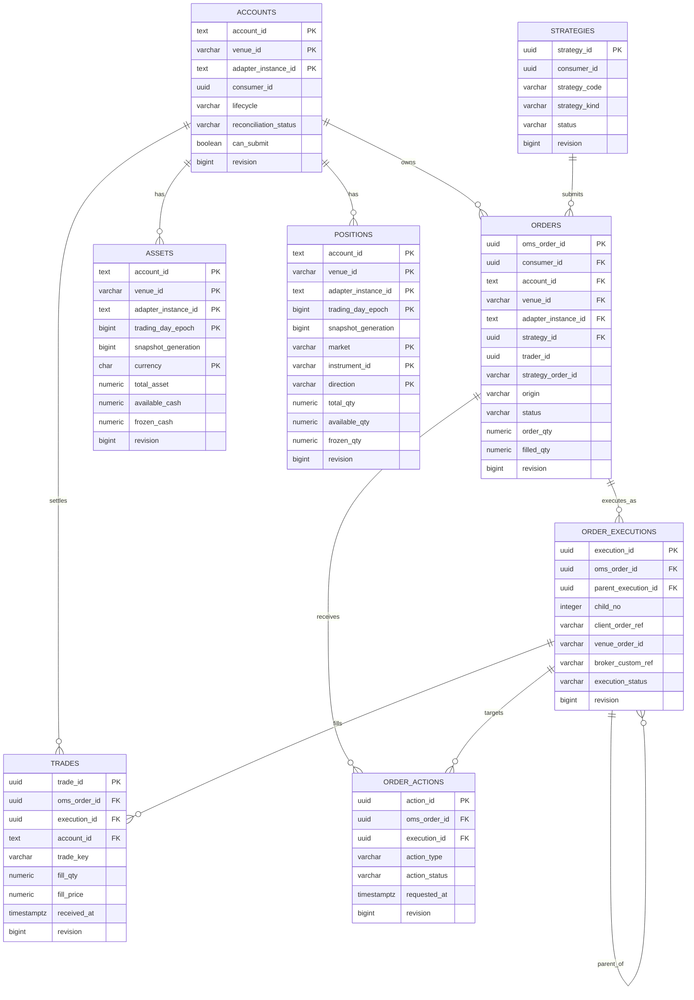

# PostgreSQL 应用查询库最终设计

> 状态：定稿
> 目标 schema：`xuanling_tradecore_rm`
> 表数量：8 张应用查询表 + 1 张投影基础设施表
> 适用范围：OMS 应用端账户、策略、订单、执行、操作、成交、资产和持仓查询

## 1. 设计定位

PostgreSQL 是 TradeCore 的应用查询库，提供稳定、简单、可分页、可筛选的关系型数据。

PostgreSQL 不进入报单、撤单、回调和恢复的同步交易链路，不负责实时授权、交易幂等裁决或自动恢复裁决。PG 暂时不可用时允许查询降级和投影延迟，但不得触发 Adapter 重报或重复撤单。

最终物理表固定为：

| 序号 | 表名 | 数据形态 | 用途 |
| ---: | --- | --- | --- |
| 1 | `accounts` | 当前状态 | 账户列表、运行状态和可交易状态 |
| 2 | `strategies` | 当前状态 | 策略列表和程序/人工分类 |
| 3 | `orders` | 当前状态、历史保留 | OMS 订单列表和订单详情 |
| 4 | `order_executions` | 当前状态、历史保留 | 执行子单、柜台路由和归属字段 |
| 5 | `order_actions` | 追加记录 | 撤单及其他订单操作 |
| 6 | `trades` | 追加记录 | 成交列表和成交明细 |
| 7 | `assets` | 当前状态 | 账户资产、资金和信用摘要 |
| 8 | `positions` | 当前状态 | 账户当前持仓 |
| 9 | `projection_checkpoints` | 基础设施 | 投影器水位、延迟和错误状态 |

除上述 9 张表外，首版不增加身份、授权、风险快照、冻结流水、柜台快照、恢复证据、对账明细或 Journal 事件物理表。应用需要的摘要字段直接投影到上述表中。

## 2. Schema、类型与命名

### 2.1 Schema

所有对象创建在固定 schema：

```sql
CREATE SCHEMA IF NOT EXISTS xuanling_tradecore_rm;

CREATE DOMAIN xuanling_tradecore_rm.sha256_hex AS varchar(64)
CHECK (VALUE ~ '^[0-9a-f]{64}$');
```

应用 SQL 必须显式限定 schema，或由部署配置固定 `search_path`。schema、表名和排序列不得从客户端请求动态拼接。

下文表格中的 `sha256_hex` 均指 `xuanling_tradecore_rm.sha256_hex`；正式 migration 应使用 schema-qualified 类型名。

### 2.2 类型规范

| 语义 | PostgreSQL 类型 | 规则 |
| --- | --- | --- |
| 全局实体 ID | `uuid` | UUIDv7 |
| 内部账户 ID | `text` | opaque ID，不保存完整柜台账号 |
| 状态和分类 | `varchar(n)` | 使用 CHECK 约束；首版不使用 PG ENUM |
| 金额、数量、价格 | `numeric(24,8)` | 禁止 float/double precision |
| 币种 | `char(3)` | ISO 4217 |
| 交易日 | `date` | 业务筛选字段 |
| 业务时间 | `timestamptz` | UTC |
| 单调版本 | `bigint` | 非负、只递增 |
| SHA-256 | `xuanling_tradecore_rm.sha256_hex` | 固定 64 位小写十六进制，禁止空格和非十六进制字符 |
| 受限原生 ID | `varchar(128)` | 只通过受限视图展示 |

### 2.3 公共投影字段

8 张应用表均包含以下字段：

| 字段 | 类型 | 规则 |
| --- | --- | --- |
| `revision` | `bigint` | 业务对象状态版本，`revision >= 1` |
| `source_fact_hash` | `sha256_hex` | 最近来源事实 hash |
| `projected_at` | `timestamptz` | 投影提交到 PG 的时间 |

Upsert 只接受更高 revision。相同 revision 只允许相同 `source_fact_hash` 的幂等重放；相同 revision 但 hash 不同必须回滚事务并告警。

## 3. 最终 ER 图



`projection_checkpoints` 是投影基础设施表，不与业务表建立业务外键。

## 4. 表关系与完整性

### 4.1 关系矩阵

| 子表 | 父表 | 关系 | 外键 |
| --- | --- | --- | --- |
| `orders` | `accounts` | N:1 | `(consumer_id,account_id,venue_id,adapter_instance_id)` |
| `orders` | `strategies` | N:1 | `(consumer_id,strategy_id)` |
| `order_executions` | `orders` | N:1 | `(oms_order_id,account_id,venue_id,adapter_instance_id,trading_day,trading_day_epoch)` |
| `order_executions` | `order_executions` | N:1，可空 | `(oms_order_id,parent_execution_id)` |
| `order_actions` | `orders` | N:1 | `oms_order_id` |
| `order_actions` | `order_executions` | N:1，可空 | `(oms_order_id,execution_id)` |
| `trades` | `order_executions` | N:1，可空 | `(oms_order_id,execution_id)` |
| `trades` | `accounts` | N:1 | `(account_id,venue_id,adapter_instance_id)` |
| `assets` | `accounts` | N:1 | `(account_id,venue_id,adapter_instance_id)` |
| `positions` | `accounts` | N:1 | `(account_id,venue_id,adapter_instance_id)` |

### 4.2 删除规则

- 业务主表外键统一使用 `ON DELETE RESTRICT`；
- 账户、策略、订单、执行、成交不得级联删除；
- 数据保留期结束后，只能由版本化 migration 或受控归档任务按依赖顺序删除；
- 状态失效使用 `status` 或终态字段表达，不通过物理删除表达；
- `projection_checkpoints` 不引用业务表。

### 4.3 跨消费者隔离

`accounts` 增加候选键：

```text
UNIQUE (consumer_id, account_id, venue_id, adapter_instance_id)
```

`strategies` 增加候选键：

```text
UNIQUE (consumer_id, strategy_id)
UNIQUE (consumer_id, strategy_code)
```

`orders` 使用包含 `consumer_id` 的复合外键，同时绑定账户和策略，防止一笔订单引用其他消费者的账户或策略。

## 5. `accounts`

### 5.1 用途

用于账户列表、账户运行状态、当前交易日、对账状态和可提交状态查询。

### 5.2 字段

| 字段 | 类型 | 空值 | 说明 |
| --- | --- | --- | --- |
| `account_id` | text | 否 | 内部账户 ID，PK |
| `venue_id` | varchar(32) | 否 | EMT/QMT/PAPER，PK |
| `adapter_instance_id` | text | 否 | Adapter 实例，PK |
| `consumer_id` | uuid | 否 | 所属消费者 |
| `account_display_name` | varchar(128) | 否 | 应用展示名 |
| `venue_account_masked` | varchar(64) | 是 | 脱敏柜台账号 |
| `trading_day` | date | 否 | 当前交易日 |
| `trading_day_epoch` | bigint | 否 | 当前交易日 epoch |
| `lifecycle` | varchar(32) | 否 | BOOTSTRAP/RECOVERING/DISARMED/READY |
| `reconciliation_status` | varchar(32) | 否 | NOT_REQUIRED/REQUIRED/RUNNING/VALIDATED |
| `reconciliation_reason_code` | varchar(64) | 是 | 当前对账原因码 |
| `active_gate_count` | integer | 否 | 当前活动 gate 数 |
| `can_submit` | boolean | 否 | 应用展示值，不作为实时授权依据 |
| `submit_block_reason_code` | varchar(64) | 是 | 不可提交时的首要结构化原因 |
| `last_recovery_run_id` | uuid | 是 | 最近恢复任务 |
| `capability_hash` | sha256_hex | 否 | 能力快照 hash |
| `revision` | bigint | 否 | 状态版本 |
| `source_fact_hash` | sha256_hex | 否 | 来源 hash |
| `updated_at` | timestamptz | 否 | 业务更新时间 |
| `projected_at` | timestamptz | 否 | PG 投影时间 |

### 5.3 约束与索引

```text
PRIMARY KEY (account_id, venue_id, adapter_instance_id)
UNIQUE (consumer_id, account_id, venue_id, adapter_instance_id)
CHECK (trading_day_epoch >= 0)
CHECK (active_gate_count >= 0)
CHECK (lifecycle IN ('BOOTSTRAP','RECOVERING','DISARMED','READY'))
CHECK (
  reconciliation_status IN (
    'NOT_REQUIRED','REQUIRED','RUNNING','VALIDATED'
  )
)
CHECK (
  NOT can_submit
  OR (
    lifecycle = 'READY'
    AND reconciliation_status IN ('NOT_REQUIRED','VALIDATED')
    AND active_gate_count = 0
  )
)
CHECK (
  (can_submit AND submit_block_reason_code IS NULL)
  OR
  (NOT can_submit AND submit_block_reason_code IS NOT NULL)
)
CHECK (revision >= 1)
```

```sql
CREATE INDEX ix_accounts_consumer
ON xuanling_tradecore_rm.accounts
  (consumer_id, lifecycle, account_display_name);
```

`can_submit`、`active_gate_count` 和 `submit_block_reason_code` 必须由同一账户状态事实一次性投影，不允许应用或前端分别计算、覆盖。`can_submit` 只是查询快照；报单热路径仍使用本地已签名授权和 AdmissionGate。

`accounts` 只能由按账户串行的 `account_summary_projector` 写入。运行状态和对账结果由该 projector 在同一账户 lane 合并并分配统一 `revision`；其他 projector 不得并发更新 `accounts` 的部分列，避免不同 revision 域互相覆盖。

## 6. `strategies`

### 6.1 用途

用于策略列表、策略名称展示以及程序单与人工单分类。

### 6.2 字段

| 字段 | 类型 | 空值 | 说明 |
| --- | --- | --- | --- |
| `strategy_id` | uuid | 否 | PK |
| `consumer_id` | uuid | 否 | 所属消费者 |
| `strategy_code` | varchar(128) | 否 | 消费者内稳定代码 |
| `display_name` | varchar(256) | 否 | 应用展示名 |
| `strategy_kind` | varchar(16) | 否 | PROGRAM/MANUAL |
| `status` | varchar(16) | 否 | ACTIVE/DISABLED/REVOKED |
| `revision` | bigint | 否 | 状态版本 |
| `source_fact_hash` | sha256_hex | 否 | 来源 hash |
| `updated_at` | timestamptz | 否 | 业务更新时间 |
| `projected_at` | timestamptz | 否 | PG 投影时间 |

### 6.3 约束与索引

```text
PRIMARY KEY (strategy_id)
UNIQUE (consumer_id, strategy_id)
UNIQUE (consumer_id, strategy_code)
CHECK (strategy_kind IN ('PROGRAM','MANUAL'))
CHECK (status IN ('ACTIVE','DISABLED','REVOKED'))
CHECK (revision >= 1)
```

柜台使用的短策略 ID 具有账户、venue 和 Adapter profile 作用域，不是策略的全局属性，因此不存入本表。实际下单值以 `order_executions.broker_strategy_id` 的执行时快照为准，不得从 `strategy_code`、展示名或内部 UUID 临时生成。

## 7. `orders`

### 7.1 用途

用于订单列表和订单概要详情。一笔 OMS 订单意图一行；执行子单、柜台订单 ID 和成交明细分别查询 `order_executions` 与 `trades`。

### 7.2 字段

| 字段 | 类型 | 空值 | 说明 |
| --- | --- | --- | --- |
| `oms_order_id` | uuid | 否 | PK |
| `consumer_id` | uuid | 否 | 查询隔离键 |
| `account_id` | text | 否 | 内部账户 |
| `venue_id` | varchar(32) | 否 | 执行端 |
| `adapter_instance_id` | text | 否 | Adapter 实例 |
| `strategy_id` | uuid | 否 | 策略 |
| `strategy_order_id` | varchar(128) | 否 | 策略幂等键或人工工单号 |
| `trader_id` | uuid | 否 | 交易员/策略执行主体 |
| `origin` | varchar(16) | 否 | PROGRAM/MANUAL_OMS |
| `trading_day` | date | 否 | 交易日 |
| `trading_day_epoch` | bigint | 否 | 交易日 epoch |
| `market` | varchar(32) | 否 | 市场 |
| `instrument_id` | varchar(64) | 否 | 标的 |
| `side` | varchar(16) | 否 | 买卖方向 |
| `position_effect` | varchar(16) | 是 | 开平标识 |
| `order_type` | varchar(32) | 否 | 限价、市价等 |
| `time_in_force` | varchar(32) | 是 | 有效期策略 |
| `currency` | char(3) | 否 | 币种 |
| `order_qty` | numeric(24,8) | 否 | 委托数量 |
| `limit_price` | numeric(24,8) | 是 | 委托价格 |
| `filled_qty` | numeric(24,8) | 否 | 累计成交量 |
| `leaves_qty` | numeric(24,8) | 否 | 剩余量 |
| `avg_fill_price` | numeric(24,8) | 是 | 成交均价 |
| `status` | varchar(48) | 否 | OMS 状态 |
| `risk_result` | varchar(32) | 否 | PASS/REJECTED/UNKNOWN |
| `risk_reason_code` | varchar(64) | 是 | 风控结果摘要 |
| `decision_context_hash` | sha256_hex | 否 | 准入上下文摘要 |
| `business_remark` | varchar(512) | 是 | 本地展示备注，不下发柜台 |
| `intent_hash` | sha256_hex | 否 | 首次订单意图 hash |
| `revision` | bigint | 否 | 订单版本 |
| `source_fact_hash` | sha256_hex | 否 | 来源 hash |
| `created_at` | timestamptz | 否 | 创建时间 |
| `updated_at` | timestamptz | 否 | 最近状态时间 |
| `terminal_at` | timestamptz | 是 | 终态时间 |
| `projected_at` | timestamptz | 否 | PG 投影时间 |

### 7.3 约束

```text
PRIMARY KEY (oms_order_id)
UNIQUE (strategy_id, strategy_order_id)
UNIQUE (
  oms_order_id,
  account_id,
  venue_id,
  adapter_instance_id,
  trading_day,
  trading_day_epoch
)

FOREIGN KEY (
  consumer_id, account_id, venue_id, adapter_instance_id
) REFERENCES accounts (
  consumer_id, account_id, venue_id, adapter_instance_id
) ON DELETE RESTRICT

FOREIGN KEY (
  consumer_id, strategy_id
) REFERENCES strategies (
  consumer_id, strategy_id
) ON DELETE RESTRICT

CHECK (origin IN ('PROGRAM','MANUAL_OMS'))
CHECK (order_qty > 0)
CHECK (filled_qty >= 0)
CHECK (leaves_qty >= 0)
CHECK (filled_qty + leaves_qty <= order_qty)
CHECK (
  (filled_qty = 0 AND avg_fill_price IS NULL)
  OR
  (filled_qty > 0 AND avg_fill_price IS NOT NULL)
)
CHECK (risk_result IN ('PASS','REJECTED','UNKNOWN'))
CHECK (revision >= 1)
```

同一 `(strategy_id,strategy_order_id)` 重试必须具有相同 `intent_hash`；不同 hash 属于 `IDEMPOTENCY_CONFLICT`，不得覆盖原订单。

`filled_qty`、`leaves_qty` 和 `avg_fill_price` 是 OMS 当前状态事实的查询快照，不由 PostgreSQL 对 `trades` 临时聚合生成。投影器必须在同一订单 revision 中原子更新三者；柜台更正也必须产生更高 revision。取消或拒绝的数量允许体现为 `order_qty - filled_qty - leaves_qty`。

### 7.4 索引

```sql
CREATE INDEX ix_orders_consumer_time
ON xuanling_tradecore_rm.orders
  (consumer_id, created_at DESC, oms_order_id);

CREATE INDEX ix_orders_consumer_account_time
ON xuanling_tradecore_rm.orders
  (consumer_id, account_id, created_at DESC, oms_order_id);

CREATE INDEX ix_orders_account_status
ON xuanling_tradecore_rm.orders
  (account_id, trading_day, status, updated_at DESC);

CREATE INDEX ix_orders_strategy_time
ON xuanling_tradecore_rm.orders
  (strategy_id, created_at DESC);

CREATE INDEX ix_orders_instrument_time
ON xuanling_tradecore_rm.orders
  (market, instrument_id, created_at DESC);

CREATE INDEX ix_orders_working
ON xuanling_tradecore_rm.orders
  (account_id, trading_day, updated_at DESC)
WHERE status IN (
  'WORKING','PARTIALLY_FILLED','CANCEL_PENDING','SUBMIT_UNKNOWN'
);
```

## 8. `order_executions`

### 8.1 用途

用于执行子单、Adapter route、柜台订单 ID 以及系统/策略/交易员归属查询。一笔 OMS 订单允许包含多条 execution。

### 8.2 字段

| 字段 | 类型 | 空值 | 说明 |
| --- | --- | --- | --- |
| `execution_id` | uuid | 否 | PK |
| `oms_order_id` | uuid | 否 | OMS 订单 |
| `child_no` | integer | 否 | 订单内子单序号 |
| `parent_execution_id` | uuid | 是 | 多级执行父节点 |
| `account_id` | text | 否 | 账户 |
| `venue_id` | varchar(32) | 否 | 执行端 |
| `adapter_instance_id` | text | 否 | Adapter 实例 |
| `trading_day` | date | 否 | 交易日 |
| `trading_day_epoch` | bigint | 否 | epoch |
| `execution_qty` | numeric(24,8) | 否 | 子单量 |
| `execution_price` | numeric(24,8) | 是 | 子单价格 |
| `filled_qty` | numeric(24,8) | 否 | 子单累计成交量 |
| `execution_status` | varchar(48) | 否 | 执行状态 |
| `dispatch_phase` | varchar(48) | 否 | 原生调用阶段 |
| `native_outcome` | varchar(48) | 是 | 原生结果分类 |
| `adapter_client_scope_digest` | sha256_hex | 否 | Adapter client scope 摘要 |
| `client_order_ref_kind` | varchar(32) | 否 | UINT32/UTF8/... |
| `client_order_ref` | varchar(128) | 否 | 逐笔路由值；受限展示 |
| `client_order_ref_digest` | sha256_hex | 否 | 逐笔路由摘要 |
| `venue_order_id` | varchar(128) | 是 | 柜台订单 ID；受限展示 |
| `venue_order_id_digest` | sha256_hex | 是 | 柜台订单 ID 摘要 |
| `broker_system_id` | varchar(64) | 否 | 归属值第一段 |
| `broker_strategy_id` | varchar(64) | 否 | 归属值第二段 |
| `broker_trader_id` | varchar(64) | 否 | 归属值第三段 |
| `broker_custom_ref` | varchar(256) | 否 | 完整 `系统ID_策略ID_交易员ID` |
| `broker_custom_ref_chars` | smallint | 否 | 完整值字符数 |
| `broker_custom_ref_bytes` | smallint | 否 | 按柜台编码计算的字节数 |
| `broker_custom_ref_max_chars` | smallint | 否 | 下单时字符上限 |
| `broker_custom_ref_max_bytes` | smallint | 否 | 下单时字节上限 |
| `broker_custom_ref_encoding` | varchar(32) | 否 | 柜台字段编码 |
| `broker_custom_ref_normalization_version` | integer | 否 | 规范化版本 |
| `broker_custom_field_manifest_hash` | sha256_hex | 否 | 格式、编码和上限 manifest hash |
| `revision` | bigint | 否 | execution 版本 |
| `source_fact_hash` | sha256_hex | 否 | 来源 hash |
| `created_at` | timestamptz | 否 | 创建时间 |
| `updated_at` | timestamptz | 否 | 最近状态时间 |
| `projected_at` | timestamptz | 否 | PG 投影时间 |

### 8.3 主外键与逐笔唯一性

```text
PRIMARY KEY (execution_id)
UNIQUE (oms_order_id, execution_id)
UNIQUE (oms_order_id, child_no)

FOREIGN KEY (
  oms_order_id,
  account_id,
  venue_id,
  adapter_instance_id,
  trading_day,
  trading_day_epoch
) REFERENCES orders (
  oms_order_id,
  account_id,
  venue_id,
  adapter_instance_id,
  trading_day,
  trading_day_epoch
) ON DELETE RESTRICT

FOREIGN KEY (
  oms_order_id, parent_execution_id
) REFERENCES order_executions (
  oms_order_id, execution_id
) ON DELETE RESTRICT

UNIQUE (
  venue_id,
  account_id,
  trading_day_epoch,
  adapter_client_scope_digest,
  client_order_ref_digest
)
CHECK (execution_qty > 0)
CHECK (filled_qty >= 0)
CHECK (filled_qty <= execution_qty)
CHECK (child_no >= 0)
CHECK (revision >= 1)
```

柜台订单 ID 的条件唯一性必须使用部分唯一索引，不能写成表级 `UNIQUE ... WHERE`：

```sql
CREATE UNIQUE INDEX uq_order_executions_venue_order
ON xuanling_tradecore_rm.order_executions (
  venue_id,
  account_id,
  trading_day_epoch,
  venue_order_id_digest
)
WHERE venue_order_id_digest IS NOT NULL;
```

### 8.4 `BrokerCustomRefV1` 强制约束

数据库持久化格式固定为：

```text
broker_custom_ref =
  broker_system_id + "_" + broker_strategy_id + "_" + broker_trader_id
```

示例：

```text
TC-SYS01_MR01_TRD007
```

约束：

```sql
CHECK (broker_system_id ~ '^[A-Za-z0-9-]+$'),
CHECK (broker_strategy_id ~ '^[A-Za-z0-9-]+$'),
CHECK (broker_trader_id ~ '^[A-Za-z0-9-]+$'),
CHECK (position('_' in broker_system_id) = 0),
CHECK (position('_' in broker_strategy_id) = 0),
CHECK (position('_' in broker_trader_id) = 0),
CHECK (
  broker_custom_ref =
    broker_system_id || '_' ||
    broker_strategy_id || '_' ||
    broker_trader_id
),
CHECK (broker_custom_ref_chars = char_length(broker_custom_ref)),
CHECK (broker_custom_ref_chars > 0),
CHECK (broker_custom_ref_bytes > 0),
CHECK (broker_custom_ref_max_chars > 0),
CHECK (broker_custom_ref_max_bytes > 0),
CHECK (broker_custom_ref_chars <= broker_custom_ref_max_chars),
CHECK (broker_custom_ref_bytes <= broker_custom_ref_max_bytes),
CHECK (broker_custom_ref_normalization_version >= 1)
```

`broker_custom_ref_bytes` 必须由共享 codec 按 `broker_custom_ref_encoding` 计算。只有数据库编码与柜台编码一致时，才允许增加 `octet_length(broker_custom_ref)` 等值约束。

禁止截断、散列替换、删除字符或静默降级。任一片段非法或完整值超过券商字符/字节上限时，必须在调用柜台之前拒绝。

`broker_custom_ref` 是归属字段，不是逐笔订单号。相同系统、策略和交易员允许产生多笔订单，因此禁止对以下字段建立逐笔唯一索引：

- `broker_custom_ref`；
- `broker_custom_ref_chars`；
- `broker_custom_ref_bytes`；
- 三段 ID 组合；
- manifest hash。

逐笔唯一性只能由 `client_order_ref` 或 `venue_order_id` 的作用域唯一约束提供。

### 8.5 查询索引

```sql
CREATE INDEX ix_executions_order
ON xuanling_tradecore_rm.order_executions
  (oms_order_id, child_no);

CREATE INDEX ix_executions_status
ON xuanling_tradecore_rm.order_executions
  (account_id, trading_day, execution_status, updated_at DESC);

CREATE INDEX ix_executions_attribution
ON xuanling_tradecore_rm.order_executions
  (broker_strategy_id, broker_trader_id, trading_day);
```

## 9. `order_actions`

### 9.1 用途

用于撤单、修改和人工挂接等订单操作记录。撤单请求、撤单状态和撤单错误保存在同一行，不再拆错误表。

### 9.2 字段

| 字段 | 类型 | 空值 | 说明 |
| --- | --- | --- | --- |
| `action_id` | uuid | 否 | PK |
| `oms_order_id` | uuid | 否 | OMS 订单 |
| `execution_id` | uuid | 是 | 目标 execution |
| `trading_day` | date | 否 | 交易日 |
| `action_type` | varchar(32) | 否 | CANCEL/MODIFY/ATTACH |
| `caller_action_key` | varchar(128) | 否 | 调用方幂等键 |
| `action_status` | varchar(48) | 否 | REQUESTED/ACCEPTED/REJECTED/UNKNOWN/COMPLETED |
| `dispatch_phase` | varchar(48) | 否 | 原生调用阶段 |
| `reason_code` | varchar(64) | 是 | 操作原因 |
| `operator_id` | uuid | 是 | 人工操作员 |
| `venue_action_id` | varchar(128) | 是 | 柜台操作 ID |
| `error_code` | varchar(64) | 是 | 规范化错误码 |
| `error_message` | varchar(512) | 是 | 脱敏、限长错误说明 |
| `requested_at` | timestamptz | 否 | 请求时间 |
| `completed_at` | timestamptz | 是 | 完成时间 |
| `revision` | bigint | 否 | 操作版本 |
| `source_fact_hash` | sha256_hex | 否 | 来源 hash |
| `projected_at` | timestamptz | 否 | PG 投影时间 |

### 9.3 约束与索引

```text
PRIMARY KEY (action_id)
UNIQUE (oms_order_id, action_type, caller_action_key)

FOREIGN KEY (oms_order_id)
  REFERENCES orders(oms_order_id)
  ON DELETE RESTRICT

FOREIGN KEY (oms_order_id, execution_id)
  REFERENCES order_executions(oms_order_id, execution_id)
  ON DELETE RESTRICT

CHECK (action_type IN ('CANCEL','MODIFY','ATTACH'))
CHECK (revision >= 1)
```

`execution_id` 为空表示操作针对 OMS 聚合订单；非空表示针对具体执行子单。

```sql
CREATE INDEX ix_actions_order_time
ON xuanling_tradecore_rm.order_actions
  (oms_order_id, requested_at DESC);

CREATE INDEX ix_actions_status_time
ON xuanling_tradecore_rm.order_actions
  (action_status, requested_at);
```

## 10. `trades`

### 10.1 用途

用于成交列表和订单成交明细。自有成交关联 OMS 订单和 execution；柜台外部未归属成交允许两者同时为空。

### 10.2 字段

| 字段 | 类型 | 空值 | 说明 |
| --- | --- | --- | --- |
| `trade_id` | uuid | 否 | PK |
| `oms_order_id` | uuid | 是 | 自有成交必填 |
| `execution_id` | uuid | 是 | 自有成交必填 |
| `consumer_id` | uuid | 是 | 归属后填写 |
| `strategy_id` | uuid | 是 | 归属后填写 |
| `trader_id` | uuid | 是 | 归属后填写 |
| `account_id` | text | 否 | 账户 |
| `venue_id` | varchar(32) | 否 | 执行端 |
| `adapter_instance_id` | text | 否 | Adapter 实例 |
| `trading_day` | date | 否 | 交易日 |
| `trading_day_epoch` | bigint | 否 | epoch |
| `trade_key` | varchar(256) | 否 | Adapter 规范化成交去重键 |
| `venue_trade_id` | varchar(128) | 是 | 柜台成交 ID，受限展示 |
| `venue_trade_id_digest` | sha256_hex | 是 | 柜台成交 ID 摘要 |
| `market` | varchar(32) | 否 | 市场 |
| `instrument_id` | varchar(64) | 否 | 标的 |
| `side` | varchar(16) | 否 | 方向 |
| `position_effect` | varchar(16) | 是 | 开平 |
| `fill_qty` | numeric(24,8) | 否 | 成交数量 |
| `fill_price` | numeric(24,8) | 否 | 成交价格 |
| `fill_amount` | numeric(24,8) | 否 | 成交金额 |
| `fee_amount` | numeric(24,8) | 是 | 费用 |
| `currency` | char(3) | 否 | 币种 |
| `trade_at` | timestamptz | 是 | 柜台/交易所成交时间 |
| `received_at` | timestamptz | 否 | 系统接收时间 |
| `revision` | bigint | 否 | 成交版本 |
| `source_fact_hash` | sha256_hex | 否 | 来源 hash |
| `projected_at` | timestamptz | 否 | PG 投影时间 |

### 10.3 约束与索引

```text
PRIMARY KEY (trade_id)
UNIQUE (venue_id, account_id, trading_day_epoch, trade_key)

FOREIGN KEY (account_id, venue_id, adapter_instance_id)
  REFERENCES accounts(account_id, venue_id, adapter_instance_id)
  ON DELETE RESTRICT

FOREIGN KEY (oms_order_id, execution_id)
  REFERENCES order_executions(oms_order_id, execution_id)
  ON DELETE RESTRICT

CHECK (
  (oms_order_id IS NULL AND execution_id IS NULL)
  OR
  (oms_order_id IS NOT NULL AND execution_id IS NOT NULL)
)
CHECK (fill_qty > 0)
CHECK (fill_price >= 0)
CHECK (revision >= 1)
```

```sql
CREATE INDEX ix_trades_consumer_time
ON xuanling_tradecore_rm.trades
  (consumer_id, trading_day, received_at DESC);

CREATE INDEX ix_trades_order_time
ON xuanling_tradecore_rm.trades
  (oms_order_id, trade_at, received_at);

CREATE INDEX ix_trades_execution_time
ON xuanling_tradecore_rm.trades
  (execution_id, received_at);

CREATE INDEX ix_trades_position_key
ON xuanling_tradecore_rm.trades
  (account_id, trading_day, market, instrument_id);
```

## 11. `assets`

### 11.1 用途

用于账户当前资产、资金、负债和信用摘要查询。每次完整资产查询产生新的 `snapshot_generation`，但数据库只保留业务键对应的当前行。

### 11.2 字段

| 字段 | 类型 | 空值 | 说明 |
| --- | --- | --- | --- |
| `account_id` | text | 否 | PK |
| `venue_id` | varchar(32) | 否 | PK |
| `adapter_instance_id` | text | 否 | PK |
| `trading_day` | date | 否 | 展示和筛选交易日 |
| `trading_day_epoch` | bigint | 否 | PK，防止相同日期的不同仿真/回放 epoch 互相覆盖 |
| `snapshot_generation` | bigint | 否 | 最近一次完整资产快照 generation，不属于 PK |
| `currency` | char(3) | 否 | PK |
| `total_asset` | numeric(24,8) | 否 | 总资产 |
| `net_asset` | numeric(24,8) | 否 | 净资产 |
| `cash_balance` | numeric(24,8) | 否 | 资金余额 |
| `available_cash` | numeric(24,8) | 否 | 可用资金 |
| `frozen_cash` | numeric(24,8) | 否 | 冻结资金 |
| `market_value` | numeric(24,8) | 否 | 证券市值 |
| `margin_used` | numeric(24,8) | 否 | 保证金占用 |
| `total_debt` | numeric(24,8) | 否 | 总负债 |
| `credit_limit` | numeric(24,8) | 否 | 信用额度 |
| `collateral_ratio` | numeric(24,8) | 是 | 担保比例 |
| `realized_pnl` | numeric(24,8) | 否 | 已实现盈亏 |
| `unrealized_pnl` | numeric(24,8) | 否 | 未实现盈亏 |
| `total_fee` | numeric(24,8) | 否 | 累计费用 |
| `as_of_at` | timestamptz | 是 | 柜台 as-of |
| `revision` | bigint | 否 | 状态版本 |
| `source_fact_hash` | sha256_hex | 否 | 来源 hash |
| `updated_at` | timestamptz | 否 | 业务更新时间 |
| `projected_at` | timestamptz | 否 | PG 投影时间 |

### 11.3 约束与索引

```text
PRIMARY KEY (
  account_id,
  venue_id,
  adapter_instance_id,
  trading_day_epoch,
  currency
)

FOREIGN KEY (account_id, venue_id, adapter_instance_id)
  REFERENCES accounts(account_id, venue_id, adapter_instance_id)
  ON DELETE RESTRICT

CHECK (trading_day_epoch >= 0)
CHECK (snapshot_generation >= 1)
CHECK (revision >= 1)
```

```sql
CREATE INDEX ix_assets_account_day
ON xuanling_tradecore_rm.assets
  (
    account_id,
    venue_id,
    adapter_instance_id,
    trading_day_epoch,
    currency
  );
```

一个 generation 可以包含多币种。完整批次必须在单个 PG 事务中处理：

1. `SELECT ... FOR UPDATE` 锁定对应 `accounts` 行；
2. 确认柜台分页已正常结束，并校验行数和摘要；
3. 按稳定主键 upsert 本批次全部资产行，同时写入新 `snapshot_generation`；
4. 删除相同账户和 `trading_day_epoch` 下 `snapshot_generation <> 本次值` 的旧币种行；
5. 完成 checkpoint 更新并提交事务。

事务提交前，MVCC 读者继续看到完整旧资产；提交后一次性看到完整新资产。批次失败时整个事务回滚，不会出现半批数据，也不需要在 `accounts` 保存 generation 指针。

## 12. `positions`

### 12.1 用途

用于账户当前持仓查询。每次完整持仓查询产生新的 `snapshot_generation`，但数据库只保留业务键对应的当前持仓行。

### 12.2 字段

| 字段 | 类型 | 空值 | 说明 |
| --- | --- | --- | --- |
| `account_id` | text | 否 | PK |
| `venue_id` | varchar(32) | 否 | PK |
| `adapter_instance_id` | text | 否 | PK |
| `trading_day` | date | 否 | 展示和筛选交易日 |
| `trading_day_epoch` | bigint | 否 | PK，防止相同日期的不同仿真/回放 epoch 互相覆盖 |
| `snapshot_generation` | bigint | 否 | 最近一次完整持仓快照 generation，不属于 PK |
| `market` | varchar(32) | 否 | PK |
| `instrument_id` | varchar(64) | 否 | PK |
| `direction` | varchar(16) | 否 | PK，LONG/SHORT/NET |
| `total_qty` | numeric(24,8) | 否 | 总持仓 |
| `available_qty` | numeric(24,8) | 否 | 可用数量 |
| `frozen_qty` | numeric(24,8) | 否 | 冻结数量 |
| `today_qty` | numeric(24,8) | 否 | 今仓 |
| `yesterday_qty` | numeric(24,8) | 否 | 昨仓 |
| `avg_open_price` | numeric(24,8) | 是 | 开仓均价 |
| `cost_price` | numeric(24,8) | 是 | 成本价 |
| `last_price` | numeric(24,8) | 是 | 最新参考价 |
| `market_value` | numeric(24,8) | 否 | 市值 |
| `realized_pnl` | numeric(24,8) | 否 | 已实现盈亏 |
| `unrealized_pnl` | numeric(24,8) | 否 | 未实现盈亏 |
| `as_of_at` | timestamptz | 是 | 柜台 as-of |
| `revision` | bigint | 否 | 状态版本 |
| `source_fact_hash` | sha256_hex | 否 | 来源 hash |
| `updated_at` | timestamptz | 否 | 业务更新时间 |
| `projected_at` | timestamptz | 否 | PG 投影时间 |

### 12.3 约束与索引

```text
PRIMARY KEY (
  account_id,
  venue_id,
  adapter_instance_id,
  trading_day_epoch,
  market,
  instrument_id,
  direction
)

FOREIGN KEY (account_id, venue_id, adapter_instance_id)
  REFERENCES accounts(account_id, venue_id, adapter_instance_id)
  ON DELETE RESTRICT

CHECK (direction IN ('LONG','SHORT','NET'))
CHECK (trading_day_epoch >= 0)
CHECK (snapshot_generation >= 1)
CHECK (total_qty >= 0)
CHECK (available_qty >= 0)
CHECK (frozen_qty >= 0)
CHECK (available_qty <= total_qty)
CHECK (frozen_qty <= total_qty)
CHECK (revision >= 1)
```

```sql
CREATE INDEX ix_positions_account
ON xuanling_tradecore_rm.positions
  (
    account_id,
    venue_id,
    adapter_instance_id,
    trading_day_epoch,
    market,
    instrument_id
  );

CREATE INDEX ix_positions_instrument
ON xuanling_tradecore_rm.positions
  (instrument_id, market, trading_day_epoch);
```

完整持仓批次必须在单个 PG 事务中处理：

1. `SELECT ... FOR UPDATE` 锁定对应 `accounts` 行；
2. 确认柜台分页已正常结束，并校验行数和摘要；
3. 按稳定主键 upsert 本批次全部持仓行，同时写入新 `snapshot_generation`；
4. 删除相同账户和 `trading_day_epoch` 下 `snapshot_generation <> 本次值` 的旧持仓行；
5. 完成 checkpoint 更新并提交事务。

即使本次完整快照为空，也必须执行第 4 步，从而清除上一批次全部持仓。MVCC 保证读者在提交前看到完整旧批次，提交后看到完整新批次，避免半批数据和“幽灵持仓”。

## 13. `projection_checkpoints`

### 13.1 用途

保存每个 projector、shard 和账户作用域已完整提交的投影位置。

### 13.2 字段

| 字段 | 类型 | 空值 | 说明 |
| --- | --- | --- | --- |
| `projector_name` | varchar(128) | 否 | PK |
| `shard_id` | varchar(64) | 否 | PK |
| `account_scope` | text | 否 | PK |
| `projector_version` | varchar(64) | 否 | 代码版本 |
| `journal_id` | uuid | 否 | 当前 Journal |
| `stream_generation` | bigint | 否 | 当前 generation |
| `redis_ms` | bigint | 否 | 已提交位置毫秒部分 |
| `redis_seq` | bigint | 否 | 已提交位置序号部分 |
| `fact_ordinal` | integer | 否 | batch 内事实序号 |
| `source_fact_hash` | sha256_hex | 否 | 当前位置事实 hash |
| `status` | varchar(32) | 否 | RUNNING/PAUSED/ERROR/REBUILDING |
| `lag_records` | bigint | 否 | 估算落后记录数 |
| `lag_milliseconds` | bigint | 否 | 估算投影延迟 |
| `last_error_code` | varchar(64) | 是 | 最近错误码 |
| `updated_at` | timestamptz | 否 | 更新时间 |

### 13.3 约束

```text
PRIMARY KEY (projector_name, shard_id, account_scope)
CHECK (stream_generation >= 0)
CHECK (redis_ms >= 0)
CHECK (redis_seq >= 0)
CHECK (fact_ordinal >= 0)
CHECK (lag_records >= 0)
CHECK (lag_milliseconds >= 0)
CHECK (status IN ('RUNNING','PAUSED','ERROR','REBUILDING'))
```

## 14. 应用查询

### 14.1 账户列表

```sql
SELECT
  account_id,
  venue_id,
  adapter_instance_id,
  account_display_name,
  trading_day,
  lifecycle,
  reconciliation_status,
  can_submit,
  updated_at
FROM xuanling_tradecore_rm.accounts
WHERE consumer_id = $1
ORDER BY account_display_name;
```

### 14.2 订单列表

```sql
SELECT
  o.oms_order_id,
  o.created_at,
  o.origin,
  s.display_name AS strategy_name,
  o.instrument_id,
  o.side,
  o.order_qty,
  o.filled_qty,
  o.avg_fill_price,
  o.status
FROM xuanling_tradecore_rm.orders AS o
JOIN xuanling_tradecore_rm.strategies AS s
  ON s.consumer_id = o.consumer_id
 AND s.strategy_id = o.strategy_id
WHERE o.consumer_id = $1
  AND ($2::text IS NULL OR o.account_id = $2)
  AND ($3::uuid IS NULL OR o.strategy_id = $3)
  AND ($4::varchar IS NULL OR o.status = $4)
  AND o.created_at >= $5
  AND o.created_at < $6
  AND (
    $7::timestamptz IS NULL
    OR (o.created_at, o.oms_order_id) < ($7, $8::uuid)
  )
ORDER BY o.created_at DESC, o.oms_order_id DESC
LIMIT $9;
```

分页必须采用 `(created_at,oms_order_id)` Keyset 游标；禁止使用大 OFFSET。第一页将 `$7/$8` 传空，下一页传上一页末行的 `created_at/oms_order_id`。`$9` 必须由服务端限制最大值。

### 14.3 订单执行详情

```sql
SELECT
  o.oms_order_id,
  o.origin,
  o.status,
  o.strategy_order_id,
  e.execution_id,
  e.child_no,
  e.execution_status,
  e.client_order_ref,
  e.venue_order_id,
  e.broker_custom_ref
FROM xuanling_tradecore_rm.orders AS o
LEFT JOIN xuanling_tradecore_rm.order_executions AS e
  ON e.oms_order_id = o.oms_order_id
WHERE o.consumer_id = $1
  AND o.oms_order_id = $2
ORDER BY e.child_no;
```

### 14.4 程序单与人工单对照

```sql
SELECT
  o.origin,
  o.oms_order_id,
  o.strategy_id,
  o.strategy_order_id,
  o.trader_id,
  e.execution_id,
  e.broker_strategy_id,
  e.broker_trader_id,
  e.broker_custom_ref,
  e.client_order_ref,
  e.venue_order_id,
  o.status
FROM xuanling_tradecore_rm.orders AS o
JOIN xuanling_tradecore_rm.order_executions AS e
  ON e.oms_order_id = o.oms_order_id
WHERE o.consumer_id = $1
  AND o.trading_day = $2
  AND ($3::uuid IS NULL OR o.strategy_id = $3)
ORDER BY o.created_at DESC, e.child_no;
```

相同 `broker_custom_ref` 只表示系统、策略和交易员归属相同。应用必须同时展示 `oms_order_id`、`execution_id`、`client_order_ref` 和 `venue_order_id`，不能用 remark 合并多笔订单。

### 14.5 成交明细

```sql
SELECT
  trade_id,
  execution_id,
  instrument_id,
  side,
  fill_qty,
  fill_price,
  fill_amount,
  fee_amount,
  trade_at,
  received_at
FROM xuanling_tradecore_rm.trades
WHERE oms_order_id = $1
ORDER BY trade_at NULLS LAST, received_at, trade_id;
```

### 14.6 当前资产与持仓

```sql
SELECT a.*
FROM xuanling_tradecore_rm.accounts AS ac
JOIN xuanling_tradecore_rm.assets AS a
  ON a.account_id = ac.account_id
 AND a.venue_id = ac.venue_id
 AND a.adapter_instance_id = ac.adapter_instance_id
 AND a.trading_day_epoch = ac.trading_day_epoch
WHERE ac.consumer_id = $1
  AND ac.account_id = $2
  AND ac.venue_id = $3
  AND ac.adapter_instance_id = $4
ORDER BY a.currency;

SELECT p.*
FROM xuanling_tradecore_rm.accounts AS ac
JOIN xuanling_tradecore_rm.positions AS p
  ON p.account_id = ac.account_id
 AND p.venue_id = ac.venue_id
 AND p.adapter_instance_id = ac.adapter_instance_id
 AND p.trading_day_epoch = ac.trading_day_epoch
WHERE ac.consumer_id = $1
  AND ac.account_id = $2
  AND ac.venue_id = $3
  AND ac.adapter_instance_id = $4
ORDER BY p.market, p.instrument_id, p.direction;
```

订单详情的 executions、actions 和 trades 必须分别查询或由服务层分别聚合，不能将三个一对多表一次性 JOIN 后直接分页，避免结果乘法放大。

## 15. Upsert 与事务

### 15.1 当前状态表

`accounts`、`strategies`、`orders` 和 `order_executions` 使用业务主键 upsert：

```sql
INSERT INTO target (...)
VALUES (...)
ON CONFLICT (business_key)
DO UPDATE SET
  ...,
  revision = EXCLUDED.revision,
  source_fact_hash = EXCLUDED.source_fact_hash,
  projected_at = EXCLUDED.projected_at
WHERE EXCLUDED.revision > target.revision;
```

相同 revision 的重放先比较 hash：

- hash 相同：视为幂等成功，不增加 revision；
- hash 不同：返回 `PROJECTION_CONFLICT`，整个事务回滚。

`assets` 和 `positions` 使用“完整批次 Upsert + 同事务清除旧行”：

1. 锁定账户后才允许写入该账户快照；
2. 只有分页终止、行数和摘要均合格的完整批次才能开始替换；
3. 按稳定业务主键 upsert 全部返回行，并把 `snapshot_generation` 更新为本次值；
4. 删除同一账户、同一 `trading_day_epoch` 下 generation 不是本次值的行；
5. 空快照也执行旧行删除；
6. 业务行、旧行清除和 checkpoint 在同一事务提交；
7. 事务失败全部回滚，读者继续看到上一完整批次。

### 15.2 追加表

`order_actions` 和 `trades` 依靠 PK/UNIQUE 去重，不采用“先 SELECT 再 INSERT”模拟唯一性。

### 15.3 Checkpoint 同事务

每个 projector batch：

1. `SELECT ... FOR UPDATE` 锁定 checkpoint；
2. 校验 generation 和 position 连续；
3. upsert 当前状态表；
4. 插入 actions/trades；
5. 在同一事务最后推进 checkpoint；
6. commit 后才发布新的 projection lag。

任一业务写入失败时，checkpoint 不得推进。

推荐隔离级别为 `READ COMMITTED`，使用 checkpoint 行锁、唯一约束和按账户单写入 lane 保证确定顺序。

## 16. 索引与容量

### 16.1 索引原则

- 每个索引必须对应已经定义的应用查询；
- 时间索引优先以消费者或账户作用域开头；
- 状态使用复合索引或部分索引，不建低选择度单列索引；
- `jsonb` 首版不进入核心表，因此不建 GIN；
- digest 使用 B-tree 精确匹配；
- `broker_custom_ref` 只建非唯一归属查询索引。

### 16.2 分区定稿

首版 9 张表均不分区，理由：

- `orders/order_executions` 需要保持全局 UUID 主键与 FK 简单；
- `trades/order_actions` 的初始容量尚无证据表明必须分区；
- `assets/positions` 只保留当前业务键行，单账户数据量受控；
- 过早分区会迫使 PK/UNIQUE 包含分区键，增加应用查询和外键复杂度。

只有当容量测试证明单表索引、VACUUM 或保留清理达到瓶颈时，才通过独立 migration 将 `trades`、`order_actions` 按 `trading_day` 月度分区。

### 16.3 保留策略

| 表 | 保留规则 |
| --- | --- |
| `accounts/strategies` | 保留当前及失效状态 |
| `orders/order_executions` | 按业务和合规期限保留 |
| `order_actions/trades` | 按业务和合规期限归档后清理 |
| `assets/positions` | 当前 epoch 只保留最新完整批次；历史 epoch 按报表要求归档或清理 |
| `projection_checkpoints` | 每个作用域只保留当前水位 |

清理任务不得在交易热路径执行。

## 17. 权限与安全

### 17.1 数据库角色

| 角色 | 权限 |
| --- | --- |
| `tradecore_projector` | 业务表 INSERT/UPDATE、checkpoint 更新；无 DDL |
| `tradecore_query` | 脱敏视图 SELECT |
| `tradecore_audit` | 受限原生 ID 和 digest SELECT |
| `tradecore_migrator` | 部署窗口 DDL |

### 17.2 应用视图

普通应用只暴露五个主要查询视图：

- `v_accounts`：账户及资产概要；
- `v_orders`：全部订单；
- `v_active_orders`：活动订单；
- `v_trades`：成交记录；
- `v_positions`：当前持仓。

`v_active_orders` 只是 `v_orders` 的状态过滤视图，不创建 `active_orders` 物理表：

```sql
CREATE VIEW xuanling_tradecore_rm.v_active_orders AS
SELECT *
FROM xuanling_tradecore_rm.v_orders
WHERE status IN (
  'WORKING',
  'PARTIALLY_FILLED',
  'CANCEL_PENDING',
  'SUBMIT_UNKNOWN'
);
```

`strategies`、`order_executions` 和 `order_actions` 通过订单详情接口或受限参数化查询函数访问；`projection_checkpoints` 只供运维读取。`v_positions` 必须关联 `accounts` 并限定当前 `trading_day_epoch`，不能暴露其他 epoch。`v_accounts` 可左连接当前 `assets` 形成应用需要的资产概要，但多币种明细仍通过受限查询函数返回。

普通应用视图隐藏：

- 柜台账号完整值；
- 密码、token 和密钥材料；
- 原始柜台 payload；
- 未脱敏错误信息；
- 非必要 digest；
- 未授权消费者的记录。

所有应用查询必须带 `consumer_id` 或服务端已授权的账户作用域，不能仅凭已知 `oms_order_id` 越权读取。

### 17.3 数据库租户隔离

`tradecore_query` 不授予基表 `SELECT`，只允许查询安全视图或参数化 SQL 函数。若应用使用共享连接池，必须在事务内执行：

```sql
SET LOCAL app.consumer_id = '当前已认证的 consumer UUID';
```

事务结束后设置自动失效，禁止使用会泄漏到连接池下一请求的 session 级 `SET`。

对直接包含 `consumer_id` 的 `accounts`、`strategies`、`orders` 和 `trades` 启用并强制 RLS：

```sql
ALTER TABLE xuanling_tradecore_rm.orders ENABLE ROW LEVEL SECURITY;
ALTER TABLE xuanling_tradecore_rm.orders FORCE ROW LEVEL SECURITY;

CREATE POLICY orders_consumer_read
ON xuanling_tradecore_rm.orders
FOR SELECT
USING (
  consumer_id =
  current_setting('app.consumer_id', true)::uuid
);
```

`order_executions` 和 `order_actions` 的安全视图必须通过 `orders.consumer_id` 限制；`assets`、`positions` 通过 `accounts.consumer_id` 限制。普通应用不能直接查询这些无 `consumer_id` 的基表。`trades.consumer_id IS NULL` 的外部未归属成交只允许 `tradecore_audit` 查看，不出现在消费者应用视图。

RLS 是服务层授权的第二道防线，不替代本地授权快照，也不参与报单热路径。

## 18. Migration 定稿

应用启动时禁止自动执行 DDL。使用版本化 SQL migration，由 `tradecore_migrator` 执行。

建表顺序：

1. schema、`sha256_hex` domain 和数据库角色；
2. `accounts`；
3. `strategies`；
4. `orders`；
5. `order_executions`；
6. `order_actions`；
7. `trades`；
8. `assets`；
9. `positions`；
10. `projection_checkpoints`；
11. 二级索引；
12. 应用视图、RLS policy 和列权限。

每个 migration 必须提供：

- 空库安装验证；
- 上一版本升级验证；
- 锁等待预算；
- 大表操作说明；
- 回滚或前滚修复方案；
- schema hash。

## 19. 验收标准

- [ ] schema 内只有本设计定义的 9 张目标表；
- [ ] 所有 PK、FK、UNIQUE、CHECK 使用稳定 constraint name；
- [ ] 订单账户和策略属于相同 consumer；
- [ ] order 与 execution 的账户/venue/Adapter 作用域一致；
- [ ] 父 execution 不得跨 OMS 订单；
- [ ] action 引用的 execution 必须属于同一 OMS 订单；
- [ ] 自有 trade 同时具备 OMS order 和 execution；
- [ ] 外部未归属 trade 的 OMS order 和 execution 同时为空；
- [ ] `strategy_id + strategy_order_id` 幂等唯一；
- [ ] client route key 在 venue/account/day/scope 内逐笔唯一；
- [ ] venue order ID 在 venue/account/day 内逐笔唯一；
- [ ] `BrokerCustomRefV1` 严格等于 `系统ID_策略ID_交易员ID`；
- [ ] 三个 broker ID 非空、不含下划线、字符集合法；
- [ ] broker custom ref 的字符数和编码字节数均不超过券商上限；
- [ ] `broker_custom_ref` 允许重复且没有逐笔唯一索引；
- [ ] `strategies` 不保存无账户/profile 作用域的 `broker_strategy_id`；
- [ ] 资产和持仓主键包含 `trading_day_epoch`，但不包含 `snapshot_generation`；
- [ ] 资产/持仓完整批次在同一事务 Upsert 并删除未出现在本 generation 的旧行；
- [ ] 新快照未包含的旧持仓不会出现在当前查询中；
- [ ] `accounts` 只有 `account_summary_projector` 单写，所有列共享统一 revision 域；
- [ ] 金额、数量和价格均为 `numeric(24,8)`；
- [ ] 所有 SHA-256 字段使用 `sha256_hex` domain；
- [ ] 低 revision 不覆盖高 revision；
- [ ] 相同 revision 不同 hash 导致投影失败；
- [ ] trades/actions 重放不产生重复记录；
- [ ] 业务表写入与 checkpoint 推进处于同一事务；
- [ ] PG 故障不触发柜台副作用；
- [ ] 普通查询角色只能访问脱敏视图；
- [ ] RLS/安全视图阻止跨 consumer 读取，连接池使用 `SET LOCAL`；
- [ ] 普通应用只暴露 `v_accounts/v_orders/v_active_orders/v_trades/v_positions`；
- [ ] `v_active_orders` 是过滤视图，不存在同名物理表；
- [ ] `v_positions` 只暴露账户当前 `trading_day_epoch`；
- [ ] 订单列表使用 Keyset 游标且限制 page size；
- [ ] 核心 SQL 具备 `EXPLAIN (ANALYZE, BUFFERS)` 基线；
- [ ] 订单列表和详情查询不存在一对多 JOIN 乘法放大。

## 20. 定稿结论

1. PostgreSQL 只作为 OMS 应用查询库。
2. 最终物理模型固定为 8 张应用表和 1 张 projector 水位表。
3. `orders` 是应用订单聚合根，`order_executions` 保存子单、柜台路由和归属字段。
4. `order_actions` 保存撤单等操作，`trades` 保存去重后的成交。
5. `assets` 和 `positions` 使用稳定业务主键；完整批次通过“同事务 Upsert + 删除旧 generation 行”原子替换当前状态。
6. `BrokerCustomRefV1` 固定为 `系统ID_策略ID_交易员ID`，不得超出券商字符或字节上限。
7. `broker_custom_ref` 是可重复的归属字段，逐笔唯一性由 `client_order_ref` 或 `venue_order_id` 保证。
8. PG 不保存完整风险快照、冻结流水、柜台快照、恢复证据或 Journal 事件。
9. 所有投影写入使用 revision、`sha256_hex`、唯一约束和 checkpoint 同事务保证可重放。
10. 普通应用只面对账户、订单、活动订单、成交和持仓五个主要视图；活动订单不是独立物理表。
11. 应用查询使用 Keyset 分页、脱敏视图和 RLS/账户作用域构成数据库侧隔离。
12. 本文即 PostgreSQL 物理建表、应用查询和数据库验收的最终依据。
