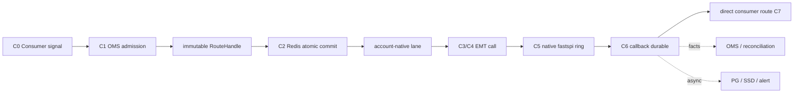

# Kungfu 参考低延迟优化方案

> 状态：单笔 P0 定位与首批热路径优化已完成真实 EMT 模拟盘验收；300 信号旧并发基线已通过，1,000 信号基线因柜台流控与未完成订单恢复未闭合而未通过。P2 的入口并行、原子入队及过载观测代码已完成本地校验，并已完成新的 300 / 2,000 原始信号真实 EMT 模拟盘采样；但 C0→C1 未达到优化目标，2,000 档又触发柜台流控，故 P2 不通过验收。P1–P3 均未验收通过。本文仍不是生产发布 SLA。
> 参考实现：`参考/xlquant_broker/kungfu-systems/kungfu`。
> 适用范围：TradeCore 的 EMT-only 本机执行链路；不改变 OMS、EMS、BrokerAdapter、Journal-first、账户所有权或 fail-closed 语义。
> **历史说明（2026-09-07）：** 本文保留了早期 Redis 基线及其测量资料，供性能归因比较；Redis Journal 代码、部署资产和压测工具已删除。当前可执行路径仅为 `MmapJournalProfileV1`，应以 `Mmap-EMT延迟优化实现状态.md` 和定档第 13.4 节为准。

## 1. 目标与边界

Kungfu 的优势不来自“跳过账本”或“忽略持久化”，而是把本机热路径压缩为固定账户目标、固定消息通道、预先确定的订单关联和旁路账本。TradeCore 借鉴这一结构，并以 mmap Journal 的 commit frame 证明副作用边界。

本方案的目标是降低项目内部两段延迟：

```text
提交段：C0 → C1 → C2 → C3 → C4A
回调段：C5 → C6 → C7
```

`C4A → C5` 是 EMT SDK、网络与柜台异步回报等待，不属于项目内部优化对象。`C4A` 表示本地已完成 EMT 主动调用返回后的内部边界。

以下约束不可突破：

1. `C2` 之前不得调用 EMT；mmap Journal 的完整 commit frame / route directory 是副作用前的恢复事实。
2. 同一 `(account_id, venue_id, adapter_client_scope)` 保持一个活动会话、一个逻辑执行 lane。
3. 回调缺口、route identity 冲突、Journal 不可证明或容量耗尽必须停止新单，不能以降级性能路径继续交易。
4. SDK callback 线程只做最小字段复制和原生入队；禁止同步外部存储、hash、JSON、日志、策略 callback 或数据库 I/O。
5. PostgreSQL、SSD archive、展示/通知、账户快照和非关键 telemetry 只能订阅事实，不能成为 C0→C4A 或 C5→C7 的同步依赖。

## 2. 已知基线

以下数据来自 2026-09-05 的真实 EMT 模拟盘 100 个完整、串行“下单 → 回调 → 撤单终态回调”周期。所有证据为 payload-free；不含账户、标的、订单号、凭据或业务回包。它描述的是当时的单台 Linux、SDK、Redis 与模拟柜台组合，不是生产 SLA。

| 项目内部阶段 | P50 (ms) | P95 (ms) | P99 (ms) | 最大值 (ms) |
| --- | ---: | ---: | ---: | ---: |
| C0→C1：本地提交/准入 | 0.104 | 0.173 | 0.188 | 0.189 |
| C1→C2：Redis durable gate | 0.820 | 1.276 | 1.494 | 1.884 |
| C2→C3：到 EMT binding 前 | 0.020 | 0.120 | 0.174 | 0.177 |
| C3→C4：binding 主动调用 | 0.108 | 0.139 | 0.180 | 0.201 |
| C4→C4A：本地 return 归并 | 0.295 | 0.373 | 0.615 | 2.785 |
| C0→C4A：提交段合计 | 1.388 | 2.057 | 2.485 | 3.811 |
| C5→C6：callback durable | 0.832 | 1.023 | 1.204 | 1.285 |
| C6→C7：下游投递 | 0.010 | 0.013 | 0.017 | 0.019 |
| C5→C7：回调段合计 | 0.843 | 1.033 | 1.218 | 1.297 |
| 两段内部延迟之和* | 2.200 | 2.928 | 3.703 | 4.620 |

\* 每个周期内 `C0→C4A + C5→C7` 的配对和；不含 `C4A→C5`。

结论：当前单笔热路径的最大稳定成本是两个 durable gate（C1→C2 和 C5→C6），其次是 C4→C4A 的 Python return/归并尾部。C0→C1 与 C6→C7 已较短；任何优化都不得通过提前越过 C2 或推迟/丢弃 C6 事实伪造改善。

## 3. Kungfu 可借鉴的性能结构

| Kungfu 结构 | 作用 | TradeCore 采用方式 |
| --- | --- | --- |
| 策略将 `OrderInput` 直接写入目标 TD location | 路由在提交点确定，无热路径多次选柜台 | OMS 准入后固定 `AccountExecutionLane`，绑定账户、Adapter instance、client scope、journal shard 与回传 consumer。 |
| TD 的 `OrderService` 只消费该账户目标输入 | 每账户独立、局部保序 | 使用现有 `ExecutionScheduler` 的独立新单/撤单 lane；不改为全局共享队列。 |
| EMT ID ↔ 本地 order ID 双向映射 | 回报直接找到原请求者 | `VenueOrderIdentity` + durable route directory 为权威，内存索引只作已验证的加速缓存。 |
| 回报写回原请求 source | 不经账本、UI 或中心中继 | callback worker 直接将归一化事实投递到原 consumer stream；OMS/projection 同步消费同一事实而不作转发瓶颈。 |
| Ledger 旁路订阅订单/成交 | 账本不拖慢柜台调用 | 快照、PG、archive、告警均在 durable fact 后异步执行。 |
| 固定布局 mmap frame | 减少解析、分配和锁竞争 | 仅借鉴“紧凑、预分配、按 lane 传递”的思想；不能取代 Redis 的 durable commit。 |

## 4. 目标热路径



`RouteHandle` 不是新的业务事实，也不授予交易权限。它只能在 OMS/EMS 准入、route directory 与账户 fence 已验证后创建，至少封装：

- 固定的 `AccountExecutionLane` 与 journal shard；
- `execution_id`、`oms_order_id`、已分配 client order reference；
- Adapter instance / client scope / venue 的 identity 摘要；
- 原 consumer trace 与 callback 回传 key；
- deadline、优先级、已验证的 route/binding version。

C2 之后的 native lane 只接受该不可变 handle，不再做策略授权、profile 选择、账户遍历或可变配置读取。

## 5. 分阶段改造

### P0：先定位，不改变路径

目的：把 1 ms 以上的尾延时归因到具体操作，而不是用“平均快”掩盖问题。

- 在 C0→C1、C1→C2、C2→C3、C3→C4A、C5→C6、C6→C7 加入 payload-free 子阶段计时：锁等待、对象分配/编码、route lookup、Redis connect/write/read、eventfd 唤醒、worker 被调度与 downstream dispatch。
- 记录每账户 lane depth、reservation 数、native 调用中的 command 数、callback ingress depth、CPU 迁移、major/minor page fault、GC 事件与 Redis slowlog 摘要。
- 使用相同的单笔 100 周期、300 并发与 2,000 并发模型复测；每个模型独立聚合，禁止混合样本。
- P0 不允许更改 C2 的 durability、callback 入队语义或 EMT 调用并发度。

**P0 通过条件：** 每个 p99/p100 异常样本均可归属到一个本地子阶段或明确标记为 EMT 外部等待；无未解释 callback gap、重复调用或 route mismatch。

**当前状态：** 单笔 100 周期与 300 原始信号的 P0 条件已通过（见第 8 节记录）。1,000 原始信号已独立采样，但因柜台 `211008` 流控与恢复未闭合，只能作为容量上限/尾延时观察，不能替代通过的并发验收；2,000 原始信号仍须在恢复状态闭合后独立采样。

### P1：固定 route handle 与无查找 native lane

目的：借鉴 Kungfu “目标 TD 已确定”的收益，主要压缩 C0→C1、C2→C3 与 C4→C4A。

1. 在 OMS 准入成功后构造并一次性验证 `RouteHandle`；EMS dispatch 和 EMT resolver 使用它，不再重复 hash/map/profile 查询。
2. 将 per-account lane 预先持有 Adapter dispatch callable、journal binding、client reference 与 return route；调用时只做 identity 防御校验。
3. 对 hot-path record 使用不可变、紧凑字段与预分配对象池/原生 POD slot；保留冷路径可读的完整领域对象。
4. 使 telemetry 只写预分配标量环；直方图汇总、字符串格式化和日志移动到旁路 worker。
5. 将 C4 返回后的 receipt 校验收敛为常量时间 identity 比对；完整审计扩展由已 durable fact 的旁路处理。

**P1 通过条件：** 全部现有路由、幂等、恢复、callback gap 测试不变；同环境 100 周期测试中 C0→C1、C2→C3、C4→C4A 的 p99 不回退，提交段 p99 有可复核改善。

### P2：本机 dispatch 与 callback 传输优化

目的：降低高并发下的排队和唤醒尾延时，而非增加 EMT 柜台吞吐承诺。

1. 每账户使用有界 native-ready queue / eventfd 唤醒；生产者不争用全局消费者锁。
2. 新单与撤单物理隔离，撤单保持优先但不得饿死已 durable 的新单结果处理。
3. fastspi v2 继续承担 SDK callback 到 worker 的最小 POD 复制；worker 从队列批量 drain，但低负载时按 eventfd 立即唤醒，不引入固定 sleep/poll interval。
4. callback 通过持久 route directory 的精确 identity 直达 consumer；OMS、PG、archive、告警不插入中继队列。
5. 调度器过载时快速拒绝尚未 C2 的新单；禁止用无界积压换取“表面成功率”。

**P2 通过条件：** 在低并发下不损失单笔 p50/p99；在 300 / 2,000 信号模型下分别报告 C0→C1、C1→C4A、C5→C7 和队列深度。2,000 并发的目标以 C0→C1 **p99 ≤ 1 ms** 作为优化目标；`p100` 是操作系统调度最大观察值，只作诊断，不能承诺硬实时 1 ms。

### P3：durable gate 与主机尾延时

目的：只优化 Redis/主机的已证明开销，不把 durable 事实异步化。

- 固定 UDS、专属 Redis 实例与 ACL；连接、函数 SHA、socket buffer 和 CPU affinity 只在 Linux 隔离环境中逐项 A/B。
- 用 Redis Function 维持 route directory、`CALL_STARTED` 和需要的索引原子同批；禁止拆成多个网络往返。
- archive/PG 写入严格异步，且积压只触发容量/告警 gate，不回压已经证明的 callback durable path。
- 若 C1→C2 或 C5→C6 的 p99 由 Redis 服务、内核调度或存储介质主导，先优化服务器与 Redis 配置，再考虑代码；不得把确认语义改成 fire-and-forget。

**P3 通过条件：** Redis Function 回执、route directory、恢复演练和 callback outcome journal 全部通过；任何 C2/C6 延迟改善必须来自同负载、同主机证据。

## 6. 验收矩阵与回滚

| 维度 | 必测项 | 失败即回滚/停止新单 |
| --- | --- | --- |
| 语义 | 幂等、取消因果、订单/成交去重、未知外部单隔离 | route mismatch、重复 native call、猜测归属 |
| 恢复 | `PRE_NATIVE`、`CALL_STARTED`、callback gap、进程中断后 Broker snapshot 对账 | 无法证明副作用或事件连续性 |
| 单笔 | 100 个真实 EMT 模拟盘完整周期，报告所有内部阶段 p50/p95/p99/p100 | 任一完整周期未闭合或内部指标无解释回退 |
| 并发 | 300、2,000 原始信号，分别报告接受、拒绝、流控、队列深度和阶段直方图 | 无界队列、ring overflow、callback gap 或越过 EMT 已测流控边界 |
| 回调 | 订单、成交、撤单终态和撤单错误的稳定 source key / direct consumer route | callback worker 阻塞、回传延迟依赖 PG/SSD/UI |
| 部署 | CPython 3.10 `.venv`、Linux SDK SHA、Git pull 部署、Redis UDS health | ABI、profile、fence 或 service identity 不匹配 |

每个阶段均需先跑单元/契约/故障测试，再进行不产生 EMT 副作用的本地 microbenchmark，最后才进入模拟盘真实委托。发生问题时回滚本阶段的内存 dispatch 优化，不回滚或删除已经 durable 的 Journal 事实。

## 7. 实施优先级

1. **P0 归因**：先证明 C0→C1 与 C1→C2 在 300/2,000 并发下的精确尾延时来源。
2. **P1 route handle**：最小风险、直接吸收 Kungfu 的固定目标路由思想。
3. **P2 native lane**：在 P1 已消除重复查找后，再处理排队、唤醒和对象分配。
4. **P3 Redis/主机调优**：只在软件端已经证实瓶颈转移到 durable gate 后进行。

性能改造完成的定义不是某个平均值变小，而是：相同环境、相同负载下内部阶段直方图改善，同时所有副作用、回调、路由、恢复和 fail-closed 证据仍完整。

## 8. 实施记录

### 2026-09-05：P1-A route handle 真实验收拒绝，已回滚

`PreparedEmtNativeRouteResolver` 的 dispatcher-local route handle 曾在受控 EMT Adapter 同步作用域中复用已验证 route，以消除 client reference 和 native Journal 之间的第二次 route-table lookup。它没有改变 Redis `CALL_STARTED`、route directory、callback durable gate、账户 lane、fail-closed 或 archive 的副作用边界。

- 在同一 Linux / Redis / EMT 模拟盘组合完成 100 个完整提交、回报、撤单周期，100/100 闭合；相关组合单元测试、`compileall`、Ruff 与 diff whitespace 检查均通过。
- 但 P1 的性能接受条件未满足：相对基线，C0→C1 p99 由 0.188024 ms 变为 0.193972 ms，C1→C2 p99 由 1.493530 ms 变为 1.797301 ms，提交内部总段 p99 由 2.484845 ms 变为 2.522934 ms。因此不将“语义正确”误记为“性能已接受”。
- 当时的 P0 子阶段只能证明异常并非 Redis FCALL：最慢批次的 C1→C2 p100 为 9.118912 ms，其中 Redis FCALL 为 0.400 ms，C1E→C1F 的宽泛阶段为 8.280 ms；route validation 仅为 0.040 ms。该阶段名称曾包含 archive offer，但该真实性能驱动未注入 archive 实例，因此不能将它表述为 archive 投递开销。证据为 `data/performance/probes/emt/tradecore-redis-emt-serial-campaign/2026-09-05-p1b-route-handle.json`。
- 按本文件第 5 节的回滚规则，route-handle / thread-local 快路径已恢复为原有有界 route table。durable Journal 事实和验收报告均保留，不删除、不重写。

### 2026-09-05：P1-B archive group hand-off 真实验收拒绝，已回滚

P1-B 曾将同一 Redis receipt 产生的两条 identity-only archive 事实合并为一次异步 archive worker hand-off；Redis Function、FCALL 参数、`CALL_STARTED` 时序、EMT 调用次数、callback route 注册、恢复与 fail-closed 语义均未改变。100 个真实 EMT 模拟盘完整周期均闭合，且报告未包含凭据或业务载荷。

- 性能接受不通过：C0→C1 p99 为 0.223756 ms（基线 0.188024 ms）；C1→C2 p99 为 9.856525 ms（基线 1.493530 ms）；提交内部总段 p99 为 10.434695 ms（基线 2.484845 ms）。即使 C2→C3、C4→C4A 分别降至 0.128757 ms、0.517410 ms，也不能抵消关键提交段回退。
- 同一报告的最慢批次表明这不是 Redis FCALL 尾延时：两个 C1→C2 约 10 ms 的批次由 adapter request mapping 的约 9.1 ms 宽泛子阶段主导，而另一个约 9.17 ms 批次由 C1E→C1F 的约 8.08 ms 宽泛阶段主导；对应 Redis FCALL 均低于 0.5 ms。该宽泛阶段不能证明 archive 参与；批次子阶段 p100 也不能相加来声称精确单样本归因。
- 因此 P0 尚未满足“每个 p99/p100 异常样本可精确归属”的条件。下一步应先输出无载荷的单样本 C1 时间包（仅 cycle ordinal 与阶段耗时，不输出任何订单、账户、Redis key 或 SDK 数据），再选择适配器、回执校验或 archive 侧的代码改造。
- 按本文件第 5 节规则，`offer_many()` 批处理已回滚为原有单条 best-effort archive offer；验收报告 `data/performance/probes/emt/tradecore-redis-emt-serial-campaign/2026-09-05-p1b-archive-batch.json` 与 P0 诊断能力保留。

### 2026-09-05：P0-R2/R3/R4 细分诊断、测量隔离与单笔真实 EMT 验收通过

- 受控 EMT Adapter 增加仅在显式传入 observer 时启用的 C1P→C1S 无载荷时间点，分别覆盖受控 delegate、identity/availability 校验、client reference 校验和 mapped request 构造；未配置 observer 时不读取时钟或回调。
- Redis gate 将 C1E→C1F 拆成 receipt 解析校验、optional archive offer 与 postprocess completion。真实性能驱动没有 archive 实例，因此该样本的 `optional_archive_offer_ns` 预期只反映空的可选分支，而不是 SSD/归档工作。
- 修正性能驱动自身的测量污染：`--diagnostic-file` 只写生命周期 milestone，不再在每个 C1 时间点同步 write-and-flush。原始宽泛 C1 尾样本可能包含该诊断文件 I/O；下一轮真实 100 周期报告是验证该假设的唯一依据。
- `32bd150` 将不可变 `PreNativeRouteCommand` 的规范 JSON 与 payload hash 在准入构造时一次性确定；热路径不再重复编码同一份路由载荷。`ea11349` 将 payload-free milestone 改为线程安全内存缓冲、测量结束后一次落盘，诊断内容仍保留但不再成为 C0/C1 的同步文件 I/O。
- 两个提交均已通过 Git fast-forward 部署。最终报告 `data/performance/probes/emt/tradecore-redis-emt-serial-campaign/2026-09-05-p0-r4-buffered-milestones.json` 在同一 Linux / UDS Redis / EMT 模拟盘组合完成 100/100 个“提交 → 回调 → 撤单终态回调”周期；无 callback gap、重复调用、route mismatch 或缺失 C1 子阶段样本。报告只含周期序号、冷热标识与时长，不含账户、订单、标的、凭据或业务载荷。

| 最终单笔项目内阶段 | P50 (ms) | P95 (ms) | P99 (ms) | 最大值 (ms) |
| --- | ---: | ---: | ---: | ---: |
| C0→C1 | 0.027 | 0.032 | 0.040 | 0.041 |
| C1→C2 | 0.634 | 0.784 | 0.856 | 0.934 |
| C2→C3 | 0.022 | 0.109 | 0.114 | 0.128 |
| C3→C4 | 0.143 | 0.235 | 0.268 | 0.279 |
| C4→C4A | 0.214 | 0.294 | 0.458 | 0.585 |
| C0→C4A 提交段合计 | 1.073 | 1.258 | 1.470 | 1.665 |
| C5→C6 | 0.669 | 0.879 | 1.283 | 1.468 |
| C6→C7 | 0.010 | 0.012 | 0.013 | 0.014 |
| C5→C7 回调段合计 | 0.680 | 0.891 | 1.295 | 1.480 |
| 两段项目内配对和 | 1.753 | 2.086 | 2.399 | 2.417 |

- 相对 P0-R2 测量隔离基线，C1→C2 p95 由 1.051 ms 降为 0.784 ms；其中 Python 编码/命令建帧 p95 由 0.280 ms 降为 0.040 ms。C1→C2 最大样本为 0.934 ms，可精确归属为 Redis FCALL 往返 0.578 ms、adapter request mapping 0.185 ms、Redis 回执校验 0.098 ms 和其余已命名本地步骤，未混入 EMT 外部回报等待。
- P0-R3 的 C0→C1 最大值 3.452 ms 证明同步 milestone 文件刷新仍污染测量；R4 缓冲后最大值为 0.041 ms。这是探针实现的修正，不改变生产交易、Redis 原子门、回调或 SDK 调用语义。

### 2026-09-05：P0 并发基线——300 通过，1,000 未通过

- 已通过 Git 部署的 burst driver 以 barrier 同时释放原始信号、以单一 EMT 原生会话 lane 串行派发；它不并发调用 `insertOrder`、不自动重试，并为每笔原生受理订单只尝试一次有界撤单。为支持独立的 1,000 档位，driver 的显式受限集合扩展为 300 / 1,000 / 2,000；本地 16 个性能驱动测试、`compileall`、Ruff 与 diff whitespace 检查均通过。
- 300 信号报告 `data/performance/probes/emt/tradecore-redis-emt-burst/2026-09-05-p0-baseline-300.json` 完整通过：300/300 原生受理、300/300 到达 C7、0 callback gap、300/300 撤单受理。C0→C1 为 P50/P95/P99/P100 = 119.114/197.381/205.723/207.744 ms；C1→C2 为 0.328/0.653/0.815/0.951 ms；C5→C6 为 0.525/3.643/4.423/6.419 ms。故该压力下的首要瓶颈是单 native lane 前的本地排队，而不是 Redis gate。
- 1,000 信号报告 `data/performance/probes/emt/tradecore-redis-emt-burst/2026-09-05-p0-baseline-1000.json` 不通过：1,000 个 ingress 均被有界 scheduler 接收，但柜台仅原生受理 500 笔；其余 500 笔在原生调用处收到 `211008`。已受理的 500 笔均到达 C7、无 callback gap；但一次性清理仅受理 406/500，94 次撤单同样收到 `211008`。该结果不是“1,000 并发能力”或生产 SLA。
- 1,000 档的可观测尾延时仍保留：C0→C1（1,000 样本）P50/P95/P99/P100 = 375.242/478.676/487.302/490.087 ms；C1→C2（1,000 样本）= 0.209/0.598/0.792/0.963 ms；C5→C6（500 个已受理回调）= 0.486/11.158/17.458/18.030 ms。它进一步证明先解决 ingress 排队和 callback lane head-of-line blocking，而不是牺牲 Redis journal-first 边界。
- fail-closed 恢复已执行：第一次 `QueryUnfinishedOrders` 完整回调后发现 95 笔、95/95 撤单受理；后续复核仍显示 1 笔未完成，第二次恢复对该笔撤单亦被受理，但冷却后的只读核验仍为 1。根据“恢复不自动重试”约束，停止后续下单、撤单和 2,000 档测试，等待人工柜台状态核验。报告均为 payload-free，不含账户、订单、标的或凭据。

### 2026-09-05：P2 C0→C1 代码改造完成，待真实 EMT 验收

- 根因已固化在旧并发驱动中：所有 producer 先完成 admission，之后才开始单一 native lane drain；因此 C0→C1 计入了人为制造的“全量入队后等待”，不能归咎于 Redis gate。
- `ExecutionScheduler` 新增 `admit_and_commit_new_order()`。当不可变 `ExecutionInstruction` 已在入口准备完成时，准入检查、reservation 和入队在一次锁持有中完成；两阶段 API 保留给必须先 reserve、后构造指令的业务流。新 API 在策略拒绝、指令 identity 不匹配和 expiry 时保持零 OMS/零 native 副作用，并且不会残留 reservation。
- EMT burst driver 改为单一 native EMT session lane 与 ingress producer 并行运行；仍绝不并发调用 SDK 的 `insertOrder`。可选 `--ingress-capacity` 使每账户队列有明确上限；超过上限的原始信号在 C1 之前以 `INGRESS_OVERLOADED` 返回，单独报告其入口拒绝耗时，绝不混入 C0→C1 延时样本，也不进入 OMS、Redis 或 EMT。
- 调度器新增无轮询的 consumer wake-up：`wait_for_dispatch()` 在空队列时阻塞，旧两阶段 commit 和原子入队都会在 command 可取时通知 consumer；native lane 被唤醒后重新读取 monotonic clock 再 dequeue。实现不以固定 sleep/poll 拉低或掩盖 C0→C1，且不改变撤单优先顺序。
- 已完成 `compileall`、Ruff、diff whitespace 以及 17 个 scheduler / burst-driver 单元测试（包括原子 API 的并发容量和零 reservation 断言）。这证明本地语义与报告边界，不是性能验收数据。
- 当时未重新触发真实 EMT 订单：前一轮的模拟盘只读复核仍有一笔未完成订单，遵循既定“恢复不自动重试”规则，原计划等待人工柜台核验/闭合。本文件下一节记录的是操作人后续明确授权后进行的模拟盘压测；每份报告仍须同时给出 admitted 样本 C0→C1、C1→C4A、C5→C7，以及 C1 前拒绝数量和拒绝耗时。

### 2026-09-05：P2 真实 EMT 并发采样——未通过，保留证据

- 本次按明确的模拟盘授权运行；每个运行均使用独立临时 UDS Redis、ACL、已加载并核验的 Journal Function 与初始化 scope，AOF/RDB 均关闭。每笔已受理订单最多只执行一次有界清理撤单，不做自动重试。启动配置曾因 epoch、ACL、SDK 动态库路径与 scope 缺失而在登录/下单前 fail-closed；这些零原生调用试次不计入性能样本。
- 有效 300 信号报告 `data/performance/probes/emt/tradecore-redis-emt-burst/p2-concurrent-scope-300-20260905203014.json`：300/300 原生受理、300/300 到达 C7、0 callback gap、300/300 清理撤单受理。C0→C1 的 P50/P95/P99/P100 为 111.495/204.897/212.776/215.584 ms；C1→C2 为 0.368/0.609/0.742/9.149 ms；C5→C6 为 0.684/9.952/12.576/13.486 ms。虽然副作用与回调完整，该 C0→C1 p99 不优于旧 300 基线，不能将代码变更标为性能接受。
- 有效 2,000 信号报告 `data/performance/probes/emt/tradecore-redis-emt-burst/p2-concurrent-scope-2000-20260905203135.json`：2,000/2,000 scheduler admission，C0→C1 P50/P95/P99/P100 为 463.252/647.298/661.934/664.167 ms；C1→C2 为 0.181/0.452/0.602/69.733 ms。柜台原生受理 500，另 1,500 返回 `211008`；已受理 500/500 到达 C7、0 callback gap。清理单次尝试受理 449/500，余下 51 次同样 `211008`，按策略未重试。因此该档不是吞吐能力或性能通过证据。
- 两次有效运行均在报告写入、全部业务派发和单次清理结束后出现 EMT Linux binding 的进程退出 `SIGBUS`。报告本身的 outcomes 与 lifecycle marker 已完整闭合；该 post-report teardown 异常单列为 native lifecycle 缺陷，既不掩盖业务结果，也不得被解释为“验收通过”。
- 结论：当前 P2 的并行 native drain 消除了“等待 producer future 完成”这一显式屏障，却仍让 300/2,000 个 Python producer 线程争用调度器与 GIL，native consumer 被线程风暴饿死，导致 C0→C1 继续主导。下一项必须把入口替换为固定数目的 ingress workers + 有界 MPSC/eventfd hand-off，并在 C1 前执行预算/背压；不能靠继续增大 scheduler 容量、增加 EMT 会话内并发或移除 Redis 来伪造改善。

### 2026-09-05：P2 固定 ingress worker 与 fail-closed 背压代码完成，待真实 EMT 验收

- burst driver 不再为 300/1,000/2,000 个逻辑同时信号分别创建 OS/Python producer。它在所有不可变指令已构造后，以固定 4 个 source worker 和一个共享 C0 release timestamp 向既有有界 scheduler 交接；native EMT 仍严格由单一 dispatch lane 调用。这样 C0 保留真实的“原始信号同时到达”含义，又不让压测器自身的线程/GIL 风暴污染 C0→C1。
- 默认 `--ingress-capacity=1`，不是将 2,000 个信号藏进本地队列。单 native EMT lane 在突发时只能承诺一个 native-ready 信号；其余信号必须在 C1 前以 `INGRESS_OVERLOADED` fail-closed，且不会进入 OMS、Redis Journal 或 EMT。若需与旧报告可比的“全量 admission 基线”，必须显式传 `--ingress-capacity <burst-width>`；该模式不代表生产 SLA。
- 报告将“full acceptance complete”（全量受理）与“protected overload complete”（所有信号可核对、超额仅在 C1 前过载拒绝、每个 admitted 信号均 C7 与一次成功清理）分开。受保护过载绝不掩盖原生 `211008`、超时、callback gap、遗漏 C1 或清理失败；CLI 只有任一严格条件成立才返回成功。
- 本次完成的是代码和单元验证边界，不是新的真实 EMT 性能数据。下一次 300/2,000 模拟盘运行必须报告 accepted C0→C1 与 reject-before-C1 两个分布，并且只有 protected-overload 或 full-acceptance 条件成立才能作为验收证据。

### 2026-09-05：P2 固定 ingress worker 实盘复测启动阻断，未形成性能结论

- 目标机已由 Git fast-forward 部署本节代码，并通过 `compileall` 与 30 个 scheduler / Redis-EMT driver 定向单元测试。受控 fixture、模拟账户配置及 EMT Linux SDK 均已与本地批准副本逐一 hash 一致后使用；Redis 为本次运行独立短 UDS、ACL、Function scope，且关闭 AOF/RDB。
- 300 信号运行进入原生会话启动后未在 180 秒硬上限内写出 `report_written`，因而没有 C0→C1、reject-before-C1、柜台受理或 C7 样本。超时后仅终止本次创建的 transient Redis / driver，不自动重新登录、重新下单或重试；2,000 档没有启动。
- 这是一项 EMT native startup/liveness 阻断，不是对 fixed-worker 路径的通过或失败判定，也不得作为任何延时改善的证据。待原生会话可在有界窗口内完成启动后，必须重新采集 300 与 2,000 的完整 payload-free 报告，再按本节 protected-overload / full-acceptance 定义验收。
- 随后再次以同一已核验 SDK、fixture、模拟账户和隔离 Redis 拆分执行 300 与 2,000 档；每档均在 90 秒硬上限内未写出报告。驱动只有在受控原生会话启动完成后才创建 dispatch lane 并提交信号，因此这两次均没有进入 TradeCore admission、Redis Journal 或 EMT 下单链路；临时 Redis 与 runner 均已确认退出。两档都没有有效延时样本，不能用旧基线代替或估算本次结果。
- 2026-09-06 再次独立执行 300 与 2,000 档，环境预检、隔离 Redis、ACL/Function scope、fixture 与 SDK 均通过；两档仍各自在 90 秒硬上限退出且没有 `report_written`。该重复结果确认 native startup/liveness 阻断持续存在，不能标记 fixed-worker 高并发路径为已验收，也没有留下运行中的 Redis 或 EMT pressure runner。

### 2026-09-06：90 秒硬上限根因修复与 300 全容量复测（真实模拟盘）

- 该症状由三个独立问题叠加：性能驱动将 CLI 的紧凑交易日 `YYYYMMDD` 直接与 EMT 已规范化的 ISO `YYYY-MM-DD` 比较；临时 Redis scope 的 `stop_new_bytes` 与 `maxmemory_bytes` 曾被错误设为相等；以及 Linux EMT binding 在 Python 正常析构阶段可卡住，即使 `logout`、`release` 已返回。
- 两个性能驱动现统一规范化 CLI trading day，并在启动/原生关闭/失败 dispatch 边界写入 payload-free milestone。隔离 Redis 启动器严格检查 scope 初始化回复，且使用 `stop_new_bytes < maxmemory_bytes`。因此 gate 初始化失败会在提交前明确终止，绝不将 Redis 未授权误称为 EMT 拒单。
- 增加仅限显式模拟压测的 `--isolate-native-process`：它仅在报告已落盘、所有已受理委托都已执行一次清理撤单后，以受控短生命周期工作进程绕过供应商 Python 对象析构。外层 runner 随后清理本次 transient Redis；实测无残留 EMT pressure worker。该模式不是生产服务的优雅关闭证明。
- 复测：300 信号、`ingress-capacity=300`、固定 4 个 source worker、单 EMT native lane。300/300 原生受理、300/300 到达 C7、300/300 完成一次清理撤单，报告 accepted，工作进程正常退出。C0→C1 P99 为 188,675,573 ns；C1→C2 P99 为 771,198 ns。此结果仅证明 300 档恢复可运行；2,000 输入档仍须先落实 EMT 同时在途委托不超过已定 1,000 的节流策略，再做实际柜台压测。

### 2026-09-05：EMT vendor trading-day 格式兼容（真实验收通过）

- 真实启动诊断证明 SDK API version 已通过；失败发生在受控 Adapter 的 trading-day 比较之前，尚未进入 submit。EMT Python binding 允许返回紧凑的 `YYYYMMDD`，而核心边界使用 ISO `YYYY-MM-DD`，两种相同日期的表示此前会被误判为不一致。
- 平台边界现将 EMT trading day 严格校验并规范化为 ISO 格式；无效日历值仍 fail-closed。执行会话和只读会话共用这一规则，未改变 EMT 登录、下单、Journal、callback 或恢复语义。
- 已通过 4 个 session、1 个 TradeCore execution session、3 个 controlled Adapter 及 16 个性能驱动测试；该修复已包含在上述 Git 部署与 100 周期真实 EMT 模拟盘复测中，启动、提交、回调和撤单终态均已完成，因此此兼容项验收通过。

### 2026-09-06：P0 native-inflight credit 与入口分段测量——代码完成，待真实 EMT 300 复测

- `ExecutionSchedulerPolicy` 增加可显式配置的 `maximum_inflight_new_orders`。新的 order credit 在 C0 准入时占用，队列 dequeue 后仍保留；只有本地证明未调用 SDK，或 ORDER 的 `FILLED` / `CANCELED` / `REJECTED` 回调已经完成 M1 durable outcome 后才释放。重复终态回调的 release 为幂等 no-op。该上限与 pre-native queue capacity 独立，超额信号在 C1 前以既有 `INGRESS_OVERLOADED` fail-closed，不进入 OMS、Redis 或 EMT。
- 真实 burst driver 将 EMT 批准上限固定为最多 1,000 个 native-inflight order；报告新增 `C0→C0A_AFTER_INGRESS_DECISION`（所有原始信号的入口决定）与 `C0A→C1`（已准入信号等待单 native lane）的独立直方图，同时保留历史可比的 C0→C1。计时改为 burst 预注册 identity 的固定槽位；不再在每一个热路径时间点对共享字典加锁。
- 已通过 `compileall`、Ruff、30 个 scheduler / Redis callback composition / burst probe 定向单元测试与 CLI 参数检查。它们证明 credit 的容量、dequeue 后保留、abandon 回收、终态 durable 后释放以及计时边界；尚不是延迟或 EMT 副作用验收。下一步须 Git 部署到隔离 Linux 模拟盘，以 `burst-width=300`、`ingress-capacity=300`、`native-inflight-limit=1000` 运行完整 C0→C7 与一次有界撤单闭环；报告通过后才填写该节的真实验收数据。
