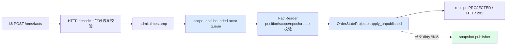

# OMS 内部路径 TPS/QPS 实测报告（2026-09-08）

> 结论：四个隔离 OMS shard 在当前 Git revision `37c3515` 上完成 30 秒实测。W1 fact-ingest 达到 `1,999.40 TPS`，W2 immutable snapshot query 达到 `4,999.84 QPS`；W3 同时完成 `60,001` 次 fact 与 `150,001` 次 snapshot，零 dropped iterations、零 HTTP failures。
>
> 口径：这是实际运行的 OMS 旁路 HTTP/actor/snapshot 服务与 k6 负载生成器的测量数据；测试事实使用合成脱敏 ID，**不调用 EMT SDK、不发送 EMT 委托，不能替代 W7 的真实 EMT 499-burst 并发证明。**

## 1. 测试环境与证据

| 项目 | 值 |
| --- | --- |
| Git revision | `37c3515ed15aefdc6aa25753cdb289bb5ab68976` |
| 服务形态 | 4 个独立 OMS process，每个 process 一个 benchmark scope、一个固定 CPU |
| 测试时长 | 每个 k6 workload `30 s` |
| W1 目标 | `2,000 TPS` fact-ingest |
| W2 目标 | `5,000 QPS` immutable order snapshot query |
| W3 目标 | W1 + W2 同时运行 |
| 原始证据 | `artifacts/oms-load/oms-internal-tps-qps-37c3515/` |
| 结果 schema | `TradeCoreOmsLoadGateResultV1`，状态 `PASS` |

W3 前由受 fault key 保护的 `reset-benchmark` 对每个 shard 依次执行：关闭新事实 admission、排空已受理 actor 工作、恢复固定 seed snapshot、重置 HDR。这样 W3 不会继承 W1 的合成唯一订单 ID 累积状态。

## 2. 被测内部路径

### 2.1 fact-ingest：TPS 路径



内部 HDR 的 `fact_admit_to_projected_ns` 从 `admit timestamp` 到 actor 已完成 `FactReader + Projector` 并生成 receipt；它不包含 k6 客户端、TCP 建连、HTTP request decode/encode 或 OS 网络调度。

### 2.2 snapshot query：QPS 路径

```mermaid
flowchart LR
    K6[k6 GET /oms/orders/{execution_id}] --> HTTP[HTTP route]
    HTTP --> SNAP[当前 immutable snapshot generation]
    SNAP --> IDX[orders_by_execution_id lookup]
    IDX --> RESP[HTTP 200 response]

    FACTS[已提交 facts] -.异步.-> PUB[snapshot publisher]
    PUB -.原子替换.-> SNAP

    style SNAP fill:#dbeafe
    style IDX fill:#dbeafe
    style PUB fill:#dcfce7
```

内部 HDR 的 `snapshot_order_query_ns` 只测 immutable generation 中的 lookup；HTTP P50/P95/P99 则包含网络栈、路由、JSON 响应与调度，二者必须分开阅读。

### 2.3 watermark/health 与 snapshot publisher

- `watermark_health_query_ns`：组装当前 generation、per-scope watermark、队列深度和 pause 状态；
- `snapshot_materialize_publish_ns`：后台复制 projector 当前状态、生成 immutable snapshot 并原子发布；
- publisher 是旁路工作，不进入 EMT `C0→C4A` 或 `C5→C7`，因此它的耗时不得与订单热路径相加。

## 3. k6 端到端 TPS/QPS 结果

下表是 k6 观测到的 HTTP 完整往返延时；它是调用方体验延时，包含 OMS 服务之外的本机网络/HTTP/调度成本。

| Gate | 实际完成量 | 实际速率 | dropped / HTTP failure | P50 ms | P95 ms | P99 ms | Max ms | 判定 |
| --- | ---: | ---: | ---: | ---: | ---: | ---: | ---: | --- |
| W1 fact-ingest | 60,002 | 1,999.40 TPS | 0 / 0 | 0.305 | 2.312 | 11.645 | 79.113 | PASS |
| W2 snapshot query | 150,003 | 4,999.84 QPS | 0 / 0 | 0.152 | 0.511 | 2.522 | 24.626 | PASS |
| W3 fact-ingest | 60,001 | 目标 2,000 TPS | 0 / 0 | 0.338 | 13.111 | 38.328 | 150.667 | PASS |
| W3 snapshot query | 150,001 | 目标 5,000 QPS | 0 / 0 | 0.178 | 6.255 | 16.724 | 119.200 | PASS |
| W4 watermark/health | 7,501 | 250.02 QPS | 0 / 0 | 0.241 | 0.315 | 0.838 | 3.388 | PASS |

W3 的 210,002 次总请求由两个独立 constant-arrival-rate scenario 同时生成；`60,001 + 150,001` 均通过对应状态校验，不是仅按配置目标推断“达到吞吐”。

## 4. W3 服务内部 HDR 实测

### 4.1 各 shard 的内部核心路径

单位为 ms。内部 lookup 原始记录单位为 ns，本表已转换为 ms 以方便与 fact actor 比较。

| 路径 | Shard | Count | P50 | P95 | P99 | Max |
| --- | ---: | ---: | ---: | ---: | ---: | ---: |
| admit→projected | 0 | 15,014 | 0.0639 | 1.7613 | 8.6344 | 95.6170 |
| admit→projected | 1 | 15,027 | 0.0635 | 1.7060 | 6.3078 | 82.8375 |
| admit→projected | 2 | 15,001 | 0.0649 | 1.8831 | 8.7572 | 73.2037 |
| admit→projected | 3 | 14,959 | 0.0620 | 1.6118 | 8.1920 | 96.7311 |
| immutable lookup | 0 | 37,569 | 0.001302 | 0.001953 | 0.003055 | 0.027119 |
| immutable lookup | 1 | 37,571 | 0.001302 | 0.001923 | 0.002885 | 0.019071 |
| immutable lookup | 2 | 37,428 | 0.001312 | 0.001953 | 0.002915 | 0.068735 |
| immutable lookup | 3 | 37,433 | 0.001312 | 0.001943 | 0.002895 | 0.014815 |

### 4.2 后台 snapshot materialize/publish

该指标描述旁路 copy/publish 成本，不能计入 fact actor receipt 或 EMT 热路径。

| Shard | Count | P50 ms | P95 ms | P99 ms | Max ms |
| ---: | ---: | ---: | ---: | ---: | ---: |
| 0 | 136 | 12.755 | 33.079 | 49.316 | 50.790 |
| 1 | 136 | 12.247 | 30.638 | 40.075 | 46.531 |
| 2 | 135 | 13.631 | 30.245 | 49.250 | 126.812 |
| 3 | 135 | 13.083 | 37.388 | 46.498 | 52.396 |

## 5. 结果解读

1. **吞吐目标已在实际运行中完成。** W1、W2 单项负载与 W3 混合负载都没有 dropped iteration 或 HTTP failure；这证明 load generator 没有因客户端自身不足而偷偷降低已发送量。
2. **核心 snapshot lookup 极轻。** 四个 shard 的内部 lookup P99 均低于 `3.055 µs`；W3 的毫秒级 HTTP 尾延时主要不等于 lookup 本身。
3. **fact actor 的尾延时来自完整 actor 路径。** `admit→projected` 包含排队、连续性校验与 projector 状态应用；W3 中 P95 为 `1.612--1.883 ms`，P99 为 `6.308--8.757 ms`。
4. **snapshot publish 被明确隔离。** 它的 P95 为 `30.245--37.388 ms`，但 actor receipt 不等待 publish；若未来要优化，它是旁路内存复制/调度课题，而不是 EMT 下单热路径回归。
5. **这不是 W7。** 本报告验证 OMS 旁路内部吞吐和查询路径；真实 EMT 499-burst 与该负载并发的无干扰结论，仍需要新的 `QueryUnfinishedOrders=0` query-only proof 后执行 W7。

## 6. 原始证据索引与复现规则

| 证据 | 文件 |
| --- | --- |
| 总门禁结果 | `w0-w5-gate-result.json` |
| W1 / W2 / W3 / W4 / W5 k6 原始 summary | `w1-k6-summary.json` 至 `w5-k6-summary.json` |
| W3 clean baseline 证据 | `w3-clean-baseline.json` |
| 每 shard 内部 HDR | `w3-hdr-shard-0.json` 至 `w3-hdr-shard-3.json` |

复测必须保持：相同 revision、四个独立 scope/process、固定 CPU、30 秒 constant-arrival-rate、W3 前 clean baseline、完整 k6 summary 与每 shard 原始 HDR。不得将各 shard 的 percentile 汇总后伪造为全局 HDR，也不得将本 OMS 测试写成 EMT 下单性能结论。
