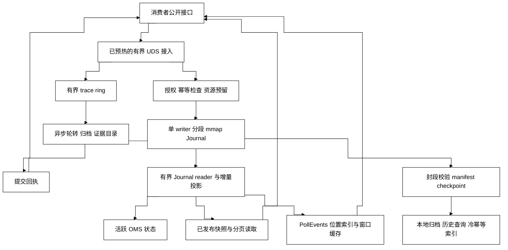

# Consumer UDS 长运行优化实施与验收方案

> 状态：`IMPLEMENTING`。L0/L1核心、L2恢复及L3有界状态、冻结分页、独立read lane、冷幂等续接、增量订单投影、公开冷热查询/签名PollEvents、原文校验冷审计和冷热一致启动恢复正确性子包已实施，详细验收证据见[实施记录](./23-长运行功能包实施与验收记录.md)。冷热恢复首版仍全量扫描源Journal并在新工作代重建索引，不是跳过历史的增量恢复，也未证明大数据60秒RTO。增量快照、归档/回收及完整runtime尚待组装；完整L3–L7及LONG_RUNNING服务组合尚未通过，不得视为已开始两小时或十二小时压测。
>
> 当前性能基线：2026-10-19，服务 `dev@dbc85b8150cebf1077bf1bcdd7999157208d63d2`；当前 Consumer 2,000 profile 已三轮通过，见 [20-Consumer UDS 2,000 TPS/QPS 三轮验收报告](./20-Consumer-UDS-2000TPS-QPS三轮验收报告-2026-10-19.md)。本方案保持该基线，不以历史 5,000 负载的小于 1 秒作为本部署的新门槛。
>
> 实现约束：项目 CPython 3.10、纯 Python 服务代码、现有 UDS/XTC2 数据面及 Journal-first 原则。部署仍走 Git；每个可独立验收子包完成后提交、push。用户已授权部署及清理当前测试Journal；清理须停目标服务并验证目录/文件，不能影响其他项目、执行数据或凭据。

## 1. 目标与结论

推荐采用：**固定资源配额和已预热容量 + 有界内部调度 + 分段 Journal + 有界在线状态 + 旁路归档与快照 + 可验证的同机恢复**。

长运行进程不应依赖定期 reset 保持性能。日切、Journal 切段、trace 轮转、历史数据转冷、消费者重连均由服务内部完成。消费者继续使用公开接口提交、查询和接收结果，无须选择 CPU、队列、物理 Journal segment 或手工切分 LSN。

正式目标分为四组：

1. 持续处理 `2,000 SubmitSignal TPS + 2,000 Snapshot QPS`，事件消费基线不少于 `2,000 checkpointed event/s`，并周期性承受 2,000 次请求同时释放。
2. 在线内存、文件描述符、队列、快照版本、回放缓存、trace 和磁盘积压都有明确上限，达到水位时行为可预测。
3. 同机进程异常退出后，恢复订单状态、资源预留、幂等结果及消费者位置；完整性不足时给出可机器读取的原因，不把未知状态默认为成功。
4. 低负载、高负载、突发和维护在同一长运行实例中交替及并存；低频消费者与高频消费者共享实际入口，分别统计延时和公平性，高压退去后及时恢复热态单笔性能。

EMT 真实调用仍遵守当前约定的 500 笔/秒边界；柜台未知副作用恢复继续受 EMT 权威证据约束。本方案不增加跨主机或掉电级 HA 承诺。

## 2. 当前实现审计

### 2.1 已有能力

- 2,000 提交/查询同时释放均全部成功，整批约 0.42–0.43 秒。
- 有界首帧接入、ready 调度、输出字节限制及超额连接拒绝。
- mmap frame 的长度、CRC、最后 commit word，以及批次成员校验。
- 分页快照、签名 cursor、stream-generation registry 和受保护的 cursor control root 原语。
- trace 有界队列、有界文件和状态统计；测试中零丢失。
- 快照构建已有独立进程和 single-flight 限制。

这些能力可复用，不要求重写 UDS reactor 或引入新的网络中间件。

### 2.2 必须处理的长运行缺口

| 当前代码/配置 | 事实 | 长运行需要补齐 |
|---|---|---|
| `oms/mmap_fact_journal_v1.py` | 单文件固定 capacity，frame=4,096 bytes，上限 1,000,000 fact；满后拒绝写入 | 分段、预创建 successor、连续逻辑位置及归档 |
| `oms/order_book.py::_acceptance_facts` | 每笔新单提交 `ORDER_ATTRIBUTED`、`RESERVATION_CREATED` 两条 fact | 按实际 fact 放大系数预算容量，不能按“一单一格”估算 |
| `consumer/uds_server_v2.py::build_consumer_uds_service_v2` | 每次启动创建新 Journal ID，临时生成事件及快照签名密钥 | 明确长期 runtime，持久身份、密钥、manifest 与恢复 |
| 同上 | 当前入口明确属于 no-Adapter benchmark，启动时关闭父进程自动循环 GC | 长运行 GC/对象生命周期策略，不能直接把压测模式长期挂起 |
| `_OrderBookProjectionV2` | 多份事件列表、位置列表、最新订单映射持续追加 | 共享位置索引、窗口缓存、历史转冷 |
| `OrderBook._AccountBook` | orders、deduplication、events 常驻；未完成订单还占资源预留 | 活跃状态有界；终态、事件和幂等元数据分别管理 |
| `ConsumerSnapshotReadWorkerV2` | 累积 frozen/open event chunks，再提交全量构建 | 增量 read model、受控 checkpoint 和对象回收 |
| `snapshot_index_v2.py` | 已有 120 秒 TTL、最多 8 个 snapshot，但缺总字节预算 | 加总字节/引用 pin 预算，减少全量版本复制 |
| `request_trace_v2.py` | 默认最大 512 MiB；达到上限增加 `capacity_dropped`，没有自动切段 | 异步轮转、连续序列、配额、封段完整性与证据检查 |

### 2.3 容量计算：必须以 fact 为单位

当前基础接纳路径为每单两条 fact，不含之后的订单状态、成交、撤单和冲突事实：

```text
fact_rate = submit_rate × facts_per_submit + callback/control/other_fact_rate
基础接纳：2,000 × 2 = 4,000 fact/s
单文件容量：1,000,000 ÷ 4,000 = 250 秒，即 4 分 10 秒
当前 raw 写入：4,000 × 4,096 = 16,384,000 bytes/s
```

| 持续 2,000 新单/秒 | 仅基础接纳 fact 的原始数据量 |
|---|---:|
| 1 小时 | 约 58.98 GB |
| 2 小时 | 约 117.96 GB |
| 4 小时 | 约 235.93 GB |
| 8 小时 | 约 471.86 GB |
| 24 小时 | 约 1.416 TB |

GB/TB 为十进制；未计冗余副本、checkpoint、索引、trace 和其他 fact。4,096-byte frame 的空间占用不等于实际编码 payload 大小。压缩率必须实测；不能把假定压缩率用于磁盘可用性门禁。

长期 2,000 TPS 的原始写入量不能仅靠“把单文件加大”解决。需要分段和转冷，必要时另开紧凑磁盘格式优化包。保留期未到、无可靠归档或有未决引用的事实不得删除。

## 3. 资源与调度设计

### 3.1 资源边界

继续使用已验证的服务 CPU 集 `64-79,160-175` 和 6 GiB cgroup 上限作为首轮对比基线。维护进程、快照进程、归档进程也必须计入同一服务资源预算；发生器继续与服务隔离。部署前读取实际 cpuset/NUMA，不擅自改变其他项目的 CPU、IRQ、全局 dirty-page 或内存配置。

运行期间保留固定且预热的 reactor、writer 和最小 worker 集。根据已有队列水位调整每轮处理预算和旁路任务配额，不动态增减热路径 worker、不在突发到来时创建大队列、分配 mmap 文件或启动新进程。

旁路任务分为可暂停和必须赶上的两类：统计、压缩可以降速；successor 准备、完整性 checkpoint 和保证留存安全的归档必须保留最低资源。不能因“热路径繁忙”无限饿死维护作业。

### 3.2 初始内存预算

以下是待 L0 测量校正的工程预算，不是已通过的容量：

| 用途 | 初始预算 |
|---|---:|
| 活跃订单、资源预留、热幂等索引 | 1.50 GiB |
| active/prepared mmap、尚未回收的相关页缓存 | 1.00 GiB |
| 回放窗口、位置索引、页缓存 | 0.50 GiB |
| 快照 worker 和快照版本 pin | 0.75 GiB |
| trace、IPC、有界网络缓冲 | 0.25 GiB |
| 解释器、临时对象及其他开销 | 0.50 GiB |
| 正常工作目标 | 合计不超过 4.50 GiB |
| 保护水位 / 硬上限 | 5.10 GiB / 6.00 GiB |

保护水位前减速快照构建/压缩，回收已满足条件的引用；保护水位后先限制新增大查询及新订单接纳，保留资源完成已有订单 callback、撤单、消费进度和必要控制操作。禁止用扩大 cgroup 上限掩盖对象增长。

以 `memory.current`、`memory.stat` 中 anon/file、各子进程 PSS/RSS 和对象计数共同归因。`mmap.close()` 不等于相关文件页已立刻退出 cgroup，不能只看 Python heap。后台在封段已落盘、无pin且归档安全后释放映射并按文件范围回收可丢弃缓存，禁止使用影响其他服务的全局drop-cache；实际cgroup file水位仍须验证。

### 3.3 明确有限容量

如果新单永远不终结，活跃订单和资源预留必然持续增长。系统应有 `maximum_active_orders`、账号级预算和总字节预算；只允许在低于已验收水位时承诺全接纳，超额在 Journal 前明确背压。

长运行 mock 必须包含确定的完成/撤单生命周期，使活跃订单量进入稳定区间。另做“始终不终结”的边界场景，验证额度耗尽时拒绝正确，不能为了通过 soak 把未完成订单当历史删除。

## 4. 总体数据流



旁路从已经提交的事实建立自己的 watermark。它不能反向修改订单归属，也不能把未验证的读模型状态升级成 EMT 副作用授权。

## 5. Journal 生命周期与恢复位置

### 5.1 逻辑 stream 与物理 segment 分离

- 逻辑 `journal_id` 在正常切段和正常重启时保持稳定；物理 segment 有独立 `segment_id`。
- 同一逻辑 stream 使用全局递增 LSN 和 batch ID，物理 frame offset 由 segment 的起始 LSN 计算。
- 单个逻辑 batch 不跨 segment；剩余空间不足时整体进入已准备 successor。
- 正常切段不增加 `stream_generation`，不强制消费者更换 cursor。generation 只用于有明确恢复/授权语义的逻辑迁移。
- 现有签名 cursor 的位置保持不透明，消费者不需要理解段号。旧格式 reader 明确保留；新文件 header/manifest 必须版本化并验证，不能直接用现有“从 LSN=1 扫描”的逻辑读取任意后续段。

### 5.2 初始分段配置

默认候选 segment 为 256 MiB、65,536 个 4 KiB frame；至少维持 active + 2 个已准备 spare。基础 4,000 fact/s 下每段约 16.38 秒。最终大小在 64–512 MiB 范围内根据预触页、归档、恢复及内存测量选择。

维护 worker 在热路径外预分配、校验路径权限、写 header、预触页并注册 successor。到达低剩余容量阈值立即补充；准备吞吐应高于实测 fact 峰值的 1.5 倍。

切换只完成有界状态检查及 active 引用切换。文件创建、目录扫描、hash 整段、压缩、metadata fsync 和预触页均不放入逐单路径。没有可用 successor 时在提交前明确拒绝；不能退回内存 Journal。

### 5.3 状态与 manifest

```text
PREPARED → ACTIVE → SEALED → VERIFIED → ARCHIVED → RECLAIMABLE
                                      ↘ BLOCKED / QUARANTINED
```

manifest 至少记录 logical journal、generation、segment/start/end LSN、batch 边界、文件格式、CRC/hash、前驱摘要、归档位置/摘要、checkpoint 引用及保留策略版本。元数据采用临时文件、校验、原子替换及目录持久化；受限 owner 可写。

激活前先保证 successor 的身份和连接关系可恢复。封段 SHA-256/完整扫描在维护进程完成，成功后更新 manifest。即便进程死在 ACTIVE 切换前后，重启也只能解析出一个被验证的活动尾部；两个候选、缺前驱或范围重叠都阻断写入。

当前 mmap commit 仍是进程崩溃 fence，不是掉电已落盘承诺。后台对封段执行落盘、校验和归档，单独公布 `committed_watermark`、`flushed_watermark`、`archived_watermark`，不能把三者混用。

### 5.4 回收条件

只有同时满足以下条件，旧段才可退出热存储：归档完整性验证完成；必要 checkpoint 覆盖；无未解决恢复引用；快照/replay pin 可安全释放或转向归档 reader；保留策略允许。退出热存储不等于删除审计档案。

消费者故障不得永久 pin 在线 mmap。优先转向磁盘回放；超过公开回放范围时返回可验证的 `CURSOR_HISTORY_UNAVAILABLE`/reset 路径，不悄悄跳到最新位置。该错误码属于拟增合同，实施时需统一 schema、SDK 和联调说明。

## 6. 完整 checkpoint、同机重启与幂等

### 6.1 补足恢复数据

现有基础 fact 以归属和资源预留为主，不能未经证明就声称足以重建全部 execution。长运行 Journal 必须保存可恢复的规范化 intent/执行指令、幂等键和 hash、binding 版本、OMS/execution ID、资源预留变化以及必要状态事实。

优先在现有事实模型内补足 canonical envelope，严格验证 frame payload 边界；如需改变物理格式或 fact 数量，更新放大系数、格式指纹和磁盘预算。禁止通过截断字段或只保存 hash 代替恢复必需信息。

Checkpoint 至少包括：schema/profile 指纹、stream/generation、完整 fact/batch watermark、活跃订单、资源预留汇总及成员、幂等索引 checkpoint、消费者恢复元数据、归档索引引用和摘要。以不可变快照写入，验证后原子发布；保留至少两个可验证 checkpoint 和回放后缀。

### 6.2 幂等不能随历史订单一起丢弃

当前业务幂等键是 `(account_id, strategy_id, strategy_order_id)`，不能未经合同迁移就擅自按日重用。热索引保留活跃及近期请求；较旧的精确结果进入受限磁盘索引。

冷索引必须能精确回答“相同 key/hash 返回原结果、相同 key/不同 hash 返回冲突”。可使用经过完整性验证的分区负向过滤器降低新请求的查询成本，但过滤器只可加速：覆盖不完整、版本不匹配或可能命中时进入有界异步精确查验，不能用近似结果授权新单。索引尚未追上 watermark 的区间由热尾部覆盖；冷热切换必须原子公布覆盖范围。

冷查验在独立有界 lane 执行，不能阻塞单 reactor。磁盘/索引异常时给出未知/不可用状态，不自动视为未提交。过期键的保留与拒绝语义必须先进入接口合同；不得直接 TTL 删除后让旧请求成为新订单。

查验中以完整业务key登记有界in-flight fence，同key并发请求合并/串行；不持有账户锁等待磁盘，不提前冻结资金。结果回到提交lane后，在账户锁内重新检查binding/授权epoch、索引覆盖版本和热尾部，再判断重放、冲突或新提交。冷热交接与恢复必须保留这个防重边界，不能因异步化重新产生check-then-submit竞态。

### 6.3 启动恢复

```text
验证控制根/manifest/密钥
→ 定位最后一个可信 checkpoint
→ 扫描并验证已提交后缀和完整 batch
→ 恢复订单、资源预留、幂等及投影 watermark
→ 验证 cursor/replay continuity
→ 开放已满足恢复条件的 Consumer 操作
```

在 checkpoint 发布、段切换、frame body、commit word、回执发送前后分别注入进程终止。已确认提交且可验证的事实不能丢失；撕裂尾部隔离，不把半个 batch 应用到 OrderBook；已提交 ID/LSN 不重用。

重启从持久 control root 读取 cursor key-ring、stream registry；复用 `AccountCursorControlRootV2`，补齐 snapshot key-ring 的持久化和轮换。正常重启不随机失效仍在有效期的 event cursor。查询 snapshot 可重建，也可按合同返回明确过期结果，不能验证失败后偷偷换数据版本。

EMT 已提交但本地映射未知的情形仍需权威对账，保持原有 DISARMED/恢复门禁。

## 7. 内存、快照与 GC

### 7.1 在线数据分层

| 层 | 保留内容 | 回收条件 |
|---|---|---|
| 热状态 | 未完成订单、未释放预留、未知副作用、近期幂等结果 | 有完整终态/归属及释放证据；未知状态禁止回收 |
| 温状态 | 有界事件窗口、回放块、近期终态摘要、分页缓存 | checkpoint/冷索引已覆盖且无有效引用 |
| 冷状态 | 完整历史事实、历史订单页、审计与较旧精确幂等结果 | 只按明确保留政策回收，保留完整性证明 |

消除同一事件在 OrderBook、replay 三组列表和 read-worker chunks 中无限累计的多份包装。使用全局位置到 segment/block 的索引，PollEvents 仅物化当前页；热点块有字节预算和 eviction 统计。

### 7.2 增量快照

read worker 消费有界已提交增量，维护最新状态；checkpoint + 后缀替代“每次把全部事件传给进程重建”。采用单 builder、固定 watermark、增量脏分片/不可变块共享，限制同时 pin 的版本字节数。

快照必须明确 `as_of_position`、生成时间及 projection lag。持续写入期间，允许按公开新鲜度合同发布固定 watermark 的快照，不能要求构建结束时恰好等于不停增长的最新事件数，否则可能长期返回 NOT_READY。

现有“全量逻辑订单集分页读取”语义保留，不能默默改为只返回活跃订单。历史完整快照通过冻结索引/归档分页实现，避免一次构造全部 Python 对象；新增 active-only 视图必须是显式选项。

初始验收建议：20 万条逻辑订单时创建快照 P95≤1秒；正常混合负载下投影延迟 P99≤1秒。两者是待达成的新目标，现有约4.7秒构建结果不算通过。分页读取继续守住 2,000 QPS；大规模冷历史页另立 profile，不能借历史页降低已发布热页标准。

### 7.3 GC 策略

长运行入口不沿用“关闭 GC 并依靠很快退出”的压测假设。先检查对象环、Future/异常堆栈引用、旧进程池和 snapshot pin，再选择维护进程隔离、稳定不可变对象管理及受控 GC。

GC 在同一 Python 进程中即便由后台线程触发，也可能暂停 reactor；不得把它描述为免费异步回收。比较正常 GC、阈值控制和进程隔离的 A/B，记录停顿；热路径禁止逐单 `gc.collect()`，长期默认关闭循环 GC 必须有可审查的无环约束和稳定内存证据。

## 8. trace、存储水位与运行健康

### 8.1 trace 轮转

复用有界 producer ring；writer 按候选 128–256 MiB 或 60 秒轮转，以先到为准。新文件在旧文件封段前准备，记录 global trace sequence、前后文件关联、request hash、起止时间和 drop 计数，生成完整性 manifest。

正常运行保留轻量全量计数/延时直方图，可按公开采样规则保存详细性能 trace；错误和安全审计不得因普通采样而丢失。正式验收使用 `trace_mode=full`，不采样，全部逐请求覆盖；任何 drop 都令完整证据验收失败。性能 trace 与交易事实、审计日志分开治理，不能用 trace 替代 Journal。

保留文件数/字节、未归档积压、磁盘最低空闲、预备段不足和归档失败均进入健康指标。禁止热路径同步压缩、hash 整文件或等待远端存储。

### 8.2 磁盘预算与故障

部署预算必须同时覆盖 Journal 原始增长、转冷落盘速率、checkpoint、索引、trace、复制及系统安全余量。磁盘写入、后台刷盘和归档吞吐应分别测量，观察突发下的 page fault、writeback 和 cgroup file charge。

初始保留要求：至少留足 active + 2 spare、一次 checkpoint、一次归档 staging 和应急控制事实的空间。低剩余空间先拒绝新的大 snapshot 和非必要写入，再关闭新单准入；为已有订单终态/callback/受控取消保留独立应急额度。预算以 bytes 和可支撑秒数双重表达，不能只用磁盘百分比。

ENOSPC、短写、权限错误、归档损坏和 writer 失效均有明确状态。归档落后时可以暂停新增接纳，不能删除未安全归档的事实维持表面吞吐。

### 8.3 存储格式优化的触发条件

先在保持现有 frame fence 的基础上完成正确分段和恢复。若原始增长超过部署存储预算，再实施紧凑块格式：封段压缩为带 CRC/hash、batch 边界和 seek index 的不可变块，保留可恢复的规范化事实。仅复用项目已批准依赖或 Python 标准库；新增编解码依赖单独评审。

压缩先针对冷 sealed segment，原始段在冷 reader 和完整性验证通过前不回收。紧凑热 Journal 格式作为独立可选包，须另做 crash/撕裂/迁移及性能验收，不能夹在轮转修改中顺便替换。

### 8.4 健康状态

统一输出 proposed 状态：`STARTING`、`RECOVERING`、`SERVING`、`BACKPRESSURED`、`READ_ONLY`、`DRAINING`、`BLOCKED`。Consumer 服务状态与 EMT 账户 READY 分离。

至少暴露：active orders、resident bytes、GC pause、snapshot lag/pins、segment/spare 数、三个 Journal watermark、archive backlog、cold lookup queue、cursor 最早可读位置、trace sequence/drop、disk free/reserve、各类背压及恢复耗时。告警和维护调度在旁路。

## 9. 代码实施包与集中验收

以下文件为拟新增或拟改造位置，类名/路径可在实施时按现有规范细化，不能视为已存在的实现。

| 包 | 主要代码落点 | 完整包的集中验收 |
|---|---|---|
| L0 容量与 runtime 合同 | `consumer/uds_server_v2.py`、拟 `consumer/runtime_profile.py`、配置 schema、基线工具 | 固定 BENCHMARK/LONG_RUNNING 模式；完整恢复字段审计、actual fact/frame 放大系数、bytes/order 和各进程内存归因；错误配置在开放 socket 前拒绝 |
| L1 分段 Journal | `oms/mmap_fact_journal_v1.py`、拟 `oms/segmented_fact_journal.py`、`journal_segment_manifest.py` | batch 不跨段；至少连续1,000次切段；边界各点强杀、重复激活、重叠/缺段/坏hash都被检出；旧格式可读；正常切段无cursor reset |
| L2 完整恢复与幂等 | `oms/order_book.py`、拟 `oms/journal_checkpoint.py`、冷幂等索引、`consumer/control_root_v2.py` | 已提交回执恢复、未知回执同ID重试、跨段重复/冲突、预留不重复冻结；checkpoint损坏回退或明确阻断；有效旧cursor可继续；密钥轮换/过期正确 |
| L3 有界状态与增量读取 | `consumer/uds_server_v2.py` projection、`read_worker_v2.py`、`snapshot_index_v2.py`、拟 `oms/order_state_retention.py` | 终态转冷不丢幂等；未完成状态不回收；跨段/冷热回放无缺口重复；快照pin/总字节有界；持续写入仍可发布快照；慢读者不阻塞新单 |
| L4 trace与存储治理 | `consumer/request_trace_v2.py`、拟归档worker/manifest、健康指标、运维配置 | 至少100次trace轮转连续、全量证据零drop；磁盘满/归档挂起/损坏触发正确背压；不删除未归档数据；原始与冷格式reader结果一致 |
| L5 生命周期与GC | `consumer/service_v2.py`、runtime启动/停止、read worker、部署unit | 日切、签名key轮换、停机drain、worker崩溃、SIGKILL后恢复；确定性mock全生命周期与不终结订单边界；GC A/B无持续泄漏 |
| L6 容量与混合并发性能回归 | 现有HOT/mixed/burst工具、拟 `consumer_uds_soak_probe.py`及timeline/低频probe发生器、独立运维runner | 完成短轮及10.5混合并发门禁；进出冷热边界、切段、checkpoint、trace轮转同时发生时仍守住门槛 |
| L7 长运行验收与发布 | 只调用公开接口的soak发生器、运维证据归档、运行手册 | 2h→24h→72h递进，不reset；持续2K、反复高低压切换和同窗低频消费者均独立通过；每个阶段独立出报告 |

执行依赖：`L0 → L1 → L2 → L3 → L4 → L5 → L6 → L7`。L4 可以提前做代码，但不能在 L1/L2 的保留和恢复语义未闭合时启用自动回收。每个功能包先完成代码和必要离线测试，再集中验收；不在每个小函数修改后插入全量压测。失败先修复该包，不把未验收能力叠入下一轮发布结论。

## 10. 统一验收门槛

### 10.1 每个影响热路径的包完成后的短轮回归

| 场景 | 通过标准 |
|---|---|
| HOT | 三轮各10,000正式样本、全部成功；固定多 frontend fresh-per-request 合同 P95≤1.50ms、P99≤3.00ms；记录P99.9/P100及停顿原因 |
| 持续混合30秒×3 | 2K Submit TPS + 2K热快照QPS + 2K checkpointed event/s；计数/唯一性全通过，零业务/释放错误、窗口内完成 |
| 消费者延时 | S1 P95≤20ms/P99≤60ms；S2/S3 P95≤10ms/P99≤40ms；发生器call-start排队P99≤10ms |
| 2,000提交突发 | 单次共同释放、全ACCEPTED、唯一LSN=2,000、整批<1秒 |
| 2,000查询突发 | 单次共同释放、每页100条、全COMPLETED、整批<1秒；准备耗时另报 |
| 16,384过载 | 容量、拒绝和已接纳计数闭合，无无限排队，无OOM；轮后可恢复 |
| 同步维护 | 切段/归档/checkpoint/trace轮转期间继续满足同一延时门槛；逐维护事件报告尾延时 |
| 高低并发混合 | 10.5中的共存、切换、骤降、空闲恢复及维护交叉场景全部单独通过；不能用以上各场景独立通过替代 |

若20万规模下快照构建新目标尚未达到，L3保持未通过；不能以页面读取达标替代创建快照新鲜度。

### 10.2 长运行场景

所有正式长运行测试均不reset进程、不清空Journal、不靠定时重启释放内存。因故障注入而重启须独立记录并验证连续恢复，不能把它伪装成未中断的soak。

| 阶段 | 负载与持续时间 | 目的 |
|---|---|---|
| S-LR-2H | 持续2K TPS/2K QPS/2K event/s，2小时 | 至少14,400,000新单及相应事实；确认跨大量segment、trace轮转和checkpoint后无积压增长 |
| S-LR-24H | 同口径24小时，真实单据生命周期 | 跨交易日/维护周期、密钥与保留任务，观察资源稳态 |
| S-LR-72H | 低负载、持续目标负载、突发循环，72小时 | 反复高低压切换与长期泄漏；报告每个负载区间，不能用低压平均值代替2K窗口 |
| S-LR-BURST | 在持续背景负载上每60秒额外释放2,000次提交；独立子场景释放查询 | 区分基础2K与额外突发；突发请求单独标记，仍要求全成功且整批<1秒；下轮前无增长积压 |
| S-LR-MIX | 在同一实例反复执行10.5的低压/高压/并存/突发/恢复时间线，2h至少12个完整周期，另做24h及72h轨道 | 小流量不能被大流量长期饿死；分别验证各阶段和高压后的低延时恢复，不代替全程持续2K轨道 |
| S-LR-SLOW | 慢消费者、暂停checkpoint、重连、旧cursor、冷热页 | 慢读者有界；其他消费者延时不超标；回放无缺口、无重复业务副作用 |
| S-LR-LIMIT | 不产生终态、冷索引饱和、spare准备失败、磁盘接近保留底线 | 达水位时拒绝正确；已经接纳的订单与控制操作仍有完成资源 |
| S-LR-FAULT | 独立故障轨道：进程强杀、半批、manifest损坏、worker失败 | 恢复语义正确、没有静默丢失/重复冻结/重复执行；不把故障轨道计为零故障连续soak |

短轮no-Adapter基线每单产生一个接纳事件，2K event/s足以跟上。当长运行mock加入终态/撤单/成交后，一单可能产生多个消费者事件，事件消费必须按实测生产放大系数提高到不低于生产速率，必要时分独立授权consumer group验证；不得固定只消费2K event/s却要求4K或更多事件/s的生产端永不积压。报告同时声明submit TPS、snapshot QPS、produced event/s、checkpointed event/s及PollEvents请求QPS。该放大流量属于长运行profile新增负载，需独立配置发生器并验收，不能与原2K短轮计数混淆。

24小时持续2K新单约1.728亿单，不能在磁盘预算不足时盲目启动。先用L0/L4实测格式、归档与留存计划计算资源，准备独立测试目录和配额；容量不足应报告阻塞，不得降低请求量后仍声称24h全负载通过。

### 10.3 资源稳定与正确性

- 预热/填满声明的缓存窗口后，正常目标负载 `memory.current` P99≤4.5GiB；包含2,000突发/维护时峰值≤5.1GiB；`memory.max/oom/oom_kill=0`，超过保护水位的合成极限测试单独判定背压。
- 稳态内存增长率候选门槛≤10MiB/小时，24h前后差值≤256MiB；同时要求每类驻留对象/页缓存计数有上限，不以刚好未触发OOM证明无泄漏。
- 文件描述符、线程/子进程数在回收周期后回归已声明平台值，不按请求数增长。
- callback、冷热索引、归档和checkpoint backlog均有最大年龄/字节上限；正常目标负载不持续累积。
- warm状态后的每个60秒窗口均达目标。2,000额外突发单独计数；小时汇总通过不能覆盖分钟级吞吐失败。
- trace full 模式零drop、请求ID hash/结果/服务端时间对全覆盖；生成HDR和按分钟/维护事件的P50/P95/P99/P99.9/P100，保留可复算原始数据。
- 已确认提交fact/事件全部可验证；相同幂等键重复不创建新订单/预留；冲突键不执行；跨binding/账号隔离不破坏；未知副作用不自动重报。

### 10.4 运行与恢复目标

初始目标：正常热重启后60秒内恢复“checkpoint+最多5分钟fact后缀”的已验证Consumer只读及no-Adapter接纳能力；恢复性能必须声明活跃订单数、后缀fact数和硬件。超额后缀允许维持RECOVERING但必须报告RTO未达标，不能跳过回放开放新单。

该RTO不适用于EMT权威恢复或掉电故障。服务恢复和柜台可交易状态分别验收。

### 10.5 低并发、高并发共存与反复切换：新增强制门禁

本节是待实施、待验收的新合同；2026-10-19已通过的短轮报告只证明原来的HOT、持续混合和独立突发，不代表本节已经通过。这里的“混合并发”同时包含同一时间不同调用频率共存，以及随时间在低压/高压间切换，两者都必须测。

#### 10.5.1 被测方式与消费者分组

- 所有组调用同一服务的公开UDS接口，使用相同请求验证、授权、Journal、调度和结果路径；客户端不直连内部worker，不人为选择快队列。
- 低频组L：每秒20次SubmitSignal和20次分页查询，开放环计划释放，每种操作最多32在途、release queue有界。20/s描述调用频率，不冒充“并发恒等于1”。另保留单在途HOT独立基线。
- 高频组H：按照时间线补足其余负载。同窗目标2K时，低频20计入总额，高频为1,980 TPS/1,980 QPS；不得把实际2,020谎报为2,000。调度器需要支持非整百的计划速率。
- 多消费者组F：在合法授权fixture下配置20个消费者/策略流，每流10 TPS/10 QPS，加一个背景流1,800 TPS/1,800 QPS，总计2K；每个流单独计数和统计延时。
- 2,000突发组B：frame准备后共同释放，另行标识为额外流量；分别测2,000提交、2,000查询，最后做1,000提交+1,000查询同时释放的联合冲击。三种场景均为每批2,000请求，按操作独立统计。
- 至少覆盖“同binding、不同strategy/连接流”和“多个已授权binding/consumer”两类fixture。无法构建合法多binding环境时该子项记录BLOCKED，不能用越权别名或同一身份伪装成多租户隔离证据。
- L/H/F/B标签仅写入客户端脱敏证据用于分组，不成为服务器优先级字段；服务端不得识别“测试probe”而专门加速。公平性基于真实授权身份/订单顺序及已有有界调度语义。

#### 10.5.2 标准600秒循环

候选工具先冻结下表为timeline，每个阶段记录计划起止与实际起止。阶段按绝对时钟触发，不等上一阶段排空才进入下一阶段，不在阶段间reset/重启/重新预热。

| 区间 | 阶段 | Submit/Snapshot负载 | 观察重点 |
|---|---|---|---|
| 0–60 s | IDLE | 0；连接和frame可预备，不能提前发送业务请求 | 空闲后的首请求、已有缓存/内存的驻留情况 |
| 60–120 s | LOW | 三个20秒子段分别为1、10、20 TPS/QPS | 单笔与小并发延时，不与高压样本池化 |
| 120–150 s | RAMP | 各自20→2,000/s，按冻结斜坡增加 | 预热worker/队列是否导致首次高压抖动 |
| 150–270 s | HIGH | 总计2K TPS/2K QPS；L组20、H组1,980 | 持续能力及低频组在高压背景下的延时 |
| 270–390 s | STEP | 20/s保持30秒→2K/s保持30秒，重复两次；绝对时间骤变 | 升压响应、降压后的队列与延时恢复 |
| 390–450 s | FAIR | F组20个低频流+一个背景流，总计2K | 同窗公平性、账号/策略隔离及饥饿 |
| 450–510 s | BURST-MIX | 背景仍为总计2K；在450秒额外释放2,000提交，470秒额外释放2,000查询，490秒同时释放1,000提交+1,000查询 | 背景不中断、低频probe、单类与联合突发完成时间 |
| 510–600 s | RECOVER | 关闭H组、保留L组20 TPS/QPS | 高压后的排空和热态延时恢复；留足恢复后连续60秒观测 |

PollEvents消费速率按实际事件生产量匹配，维护快照新鲜度和checkpoint进度。日切/归档/trace轮转/segment切换保持真实运行；专门的MAINT子轨道须让这些维护至少有一次与HIGH或BURST-MIX相交。

L6集中验收执行3个独立round，每round至少连续3个600秒循环。round之间可受控reset，round内不允许reset；各round独立判定。L7另执行至少2小时/12循环的不reset MIX轨道，再进入24h/72h。

持续2K耐久轨道与MIX轨道分别留档，MIX包含低压/空闲，不能用它替代“整个2h/24h均持续2K”的证明；反之，持续2K通过也不能替代MIX。

#### 10.5.3 逐场景通过标准

以下均为新目标，实施时不因某轮失败事后放宽。每一消费者/阶段都有独立计数，不能用大流量的成功覆盖小流量失败。

| 场景 | 强制标准 |
|---|---|
| LOW SubmitSignal | P95≤0.30ms、P99≤0.50ms；无错误、无补发掩盖 |
| LOW分页查询 | P95≤1ms、P99≤2ms；只针对已发布同口径热页，新建快照另报 |
| HIGH低频L组 | Submit及热页查询各P95≤10ms、P99≤20ms；无饥饿；高频组及全体仍满足原持续2K门槛 |
| FAIR低频F组 | 每流完成数等于offered，无错误；各流P95≤10ms/P99≤20ms；各流最长等待、排队年龄和成功率必须单报 |
| RAMP/STEP升压 | 到达2K后的每个完整10秒平台窗口达目标，无release error；切换瞬间样本全部保留并单报P100/迟到，不以预热名义删除 |
| STEP/RECOVER降压 | 从计划降压点开始1秒内旧业务队列排空；L组在2秒内出现连续20个响应≤1ms，连续20个样本跨越的时间也计入恢复时间；RECOVER中恢复达成后连续60秒须满足LOW的P95/P99门槛，STEP的30秒低压段独立记录恢复与剩余平台样本 |
| IDLE首请求 | 每个空闲段后分别记录首条提交和首条查询；提交≤2ms、已发布热页查询≤5ms；每round全部空闲首请求逐条过门槛 |
| 背景+单类B突发 | 各自2,000全成功、整批<1秒；背景仍按计划发送，不能暂停H腾出资源 |
| 背景+联合B突发 | 1,000提交和1,000查询同一barrier释放；分别全成功、提交唯一LSN=1,000、联合2,000整批<1秒；背景照常运行，该混合profile尚无现有通过证据 |
| 突发期间L组 | 请求不丢失、不超时，单条端到端等待<1秒；单独保留P50/P95/P99/P100，不将此区间伪装成0.30ms低负载基线 |
| 维护交叉 | 同类业务门槛保持；无trace丢失、无OOM/异常重启；维护不被永久饿死 |

RECOVER固定90秒，恢复识别及随后的60秒观察均须在该段内完成，不能临时延长到通过，也不侵占下一循环的零业务IDLE。统计时分别记录SubmitSignal和查询的恢复样本，任一操作未按时恢复即该循环失败。

同一binding内的请求受已有顺序/资源约束，不能承诺在2,000突发前始终插队；因此HIGH低频目标、突发等待上限和突发后的恢复目标分开设定。如果公平调度引入变化，仍须保证单订单因果顺序、幂等和资源预留正确。

#### 10.5.4 测量、样本充分性与证据

- 每条样本保存`round/cycle/phase/planned_phase_start_ns/consumer_alias/traffic_class/operation`，以及计划释放、实际调用、响应时间和结果；服务端关联使用脱敏request hash。
- 固定速率组采用开放环，发生器不足导致的release error/迟到必须记录，不通过“上个请求完成后再发下一个”减少offered。L组在突发中积压也不得静默跳过计划样本。
- 各round、各阶段、各组、各操作独立输出count、offered/completed、错误、P50/P95/P99/P99.9/P100、HDR、最长队列等待；原始数据允许重算。整体统计仅作附加信息。
- P99正式判定至少1,000个对应样本，P99.9至少10,000个。允许在同一round内合并相同阶段/负载档位的多个cycle，不能跨LOW/HIGH/BURST/RECOVER合并。样本不足标记`INSUFFICIENT_SAMPLES`；1 TPS等低频档不足时逐样本及P100核验，不给虚假的稳定P99结论，另补独立固定低频长窗口。
- IDLE首请求、负载跳变后前100个请求、降压恢复时间及维护交叉请求单独导出。发生器延时、服务端延时和消费checkpoint延时分开统计，不能用总体分位数相减。
- 每秒/每10秒记录在途数、最老排队年龄、各lane/身份进度、active/spare segment、GC pause、snapshot lag、内存anon/file、FD、归档积压、CPU和限额事件。验证高低压循环不会导致容量、worker数或内存基线逐轮抬升。
- 接口与payload、快照页大小及数据规模与基线相同。BENCHMARK和LONG_RUNNING、同binding和跨binding、fresh和persistent连接模式均单独出结论。

#### 10.5.5 对调度实现的约束

沿用已预热的有界容量和固定资源预算。读写/账号/策略的调度份额应同时限制单轮工作量和最老请求等待年龄，防止高压积压在降压后继续以大batch占用reactor。空闲时不关闭必要worker、不回收全部spare；升压时不用临时扩线程才能承接。

针对多消费者的公平性使用授权scope内的预算和可审计调度，不能按客户端声明的低频标签给特权。低压→高压→低压时，队列容量保持有界，允许调节每轮处理预算，但不能改变已接纳请求的顺序/完成语义，也不能用清队列实现快速恢复。

L6/L7的最终验收必须同时满足：持续2K轨道、独立2,000突发、MIX高低压轨道、资源与恢复门禁。任何一项未通过，报告保持该子profile未通过，不以另一项吞吐冗余抵消。

## 11. 上游接口与兼容性

保留 SubmitSignal、PollEvents、CreateOrderSnapshot、ReadOrderSnapshotPage 的现有调用方式和签名token。消费者无须参与内部调度或segment选择；cursor有效且历史在已承诺范围时，由服务器跨segment读取。

长运行需补充并文档化：容量/磁盘背压、恢复中、快照新鲜度、历史不在在线范围、幂等结果待核验的稳定错误分类及重试建议。名称如 `RUNTIME_RECOVERING`、`HISTORY_UNAVAILABLE` 仅为拟议项，需统一schema后发布；不能提前当成已实现接口。

普通超时后的调用方只能用原幂等键查询或重试，不能自动换新ID。新单背压不应导致PollEvents、订单状态查询与必要撤单一起失去容量。

部署时保留独立BENCHMARK模式用于可重复容量测试；LONG_RUNNING模式必须从持久控制根恢复。两种模式禁止在相同数据根混用，旧benchmark目录不能直接当已恢复生产状态。

## 12. 部署、回滚和交付

1. L0–L5先在独立数据根、同等资源配额的候选服务验证；不覆盖现有已验收benchmark namespace。
2. 通过Git拉取冻结revision，保存配置hash、旧格式reader、密钥引用、manifest和数据根兼容性矩阵。
3. 只有完整L6与适用L7门禁通过，才批准长期服务profile；每个功能包独立提交/push并核验远端hash。
4. 新格式已写入后不能只把应用checkout退回旧reader。回滚前验证读写兼容；不兼容时停止准入、保留数据、使用只读恢复或向前修复，不删除Journal。
5. 本地同机备份/归档校验必须覆盖恢复文件；未建立新的掉电保证前维持mmap进程崩溃语义。

交付物包括：容量测量表、配置schema与默认预算、模块实现/迁移代码、完整功能包测试、分段和恢复故障矩阵、长运行原始证据/HDR、消费者错误码说明、运维水位与处置手册、冻结revision及回滚兼容性报告。

## 13. 推荐执行顺序

第一批完成L0–L2，解决“会满、不能连续恢复、重启幂等/cursor失效”；第二批完成L3–L5，解决“历史对象和读模型持续长大、trace耗尽、日切/GC维护”；第三批执行L6–L7，证明“固定资源内不reset长运行”。

每批完成后只宣布已经取得的范围，不提前把代码完成写成长运行已验收。达到当前2K目标无需优先重写服务为多进程ingress、引入Redis或迁移语言；如果长运行证据发现新的明确瓶颈，再按分段、内存、磁盘或读模型的实测原因单独优化。
