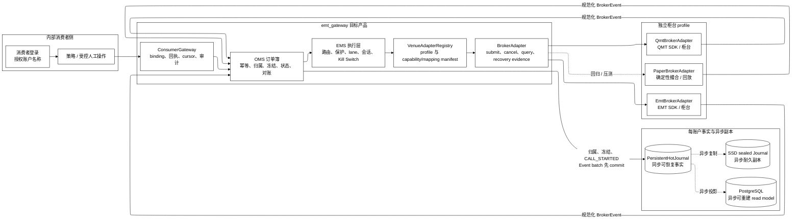
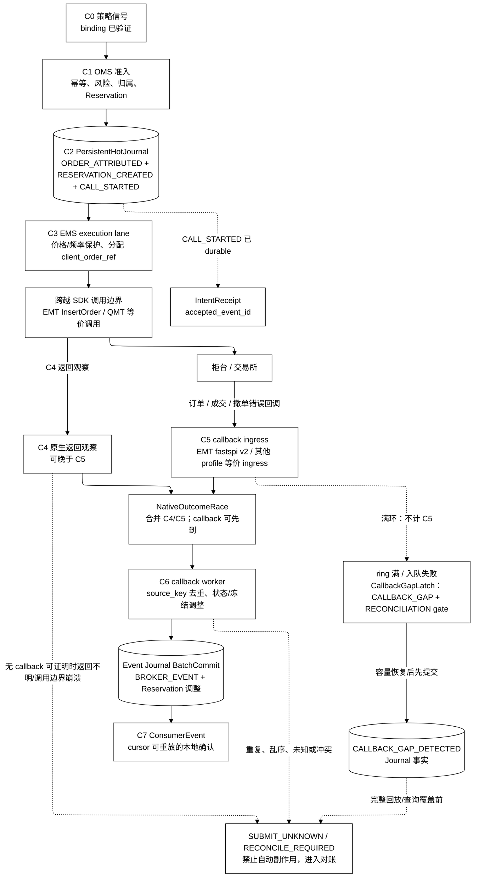
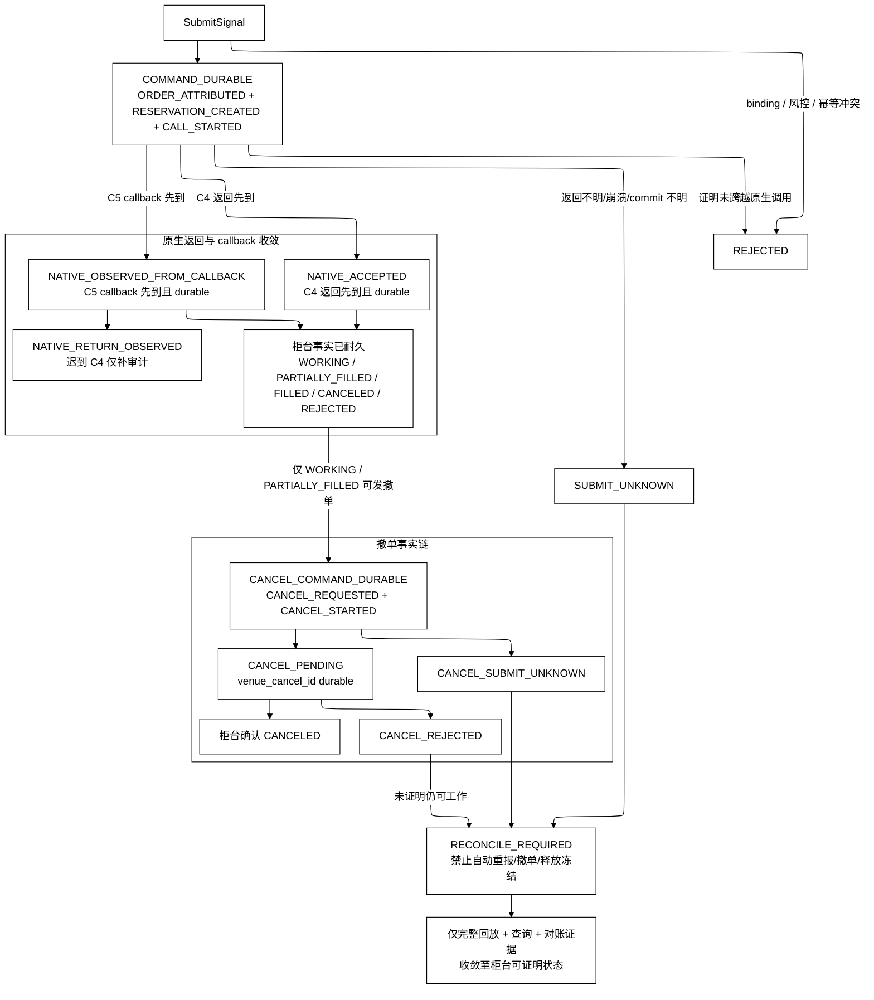
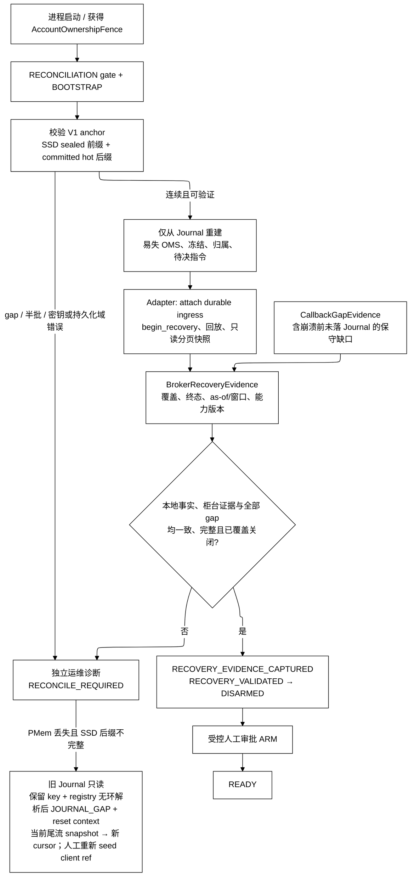
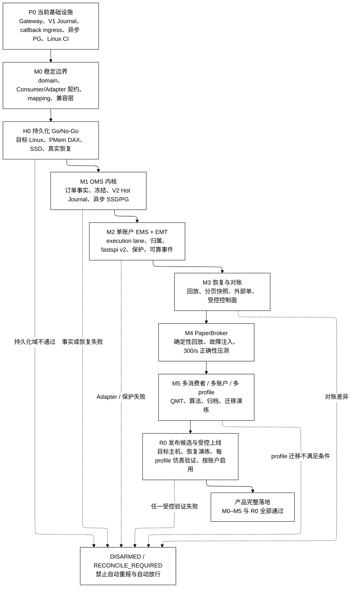

# Mermaid Live 图代码

> 当前状态依据：[当前未实施功能与优化收口路线](../01-架构与定档/10-当前未实施功能与优化收口路线.md)及[BenchmarkStandardV1 复验报告](../04-测试验收与性能/04-OMS性能与容量/05-BenchmarkStandardV1复验报告-2026-09-11.md)。
> 使用方式：将任一 `mermaid` 代码块完整复制到 [Mermaid Live Editor](https://mermaid.live)，即可编辑并导出 SVG/PNG。
> 图示口径（2026-09-11）：EMT-only OMS/EMS、mmap Journal、ConsumerGateway、EMT profile 与 OMS W7 已完成验收；图内 PaperBroker/QMT、跨主机 HA 与 `READY` 是未完成扩展。图 5 是历史阶段路线，不能被误读为当前仍处于 P0。
> 风格：统一使用黑白 `base`、ELK 与 classic。PNG 文件由本文件对应图源导出。

## 图 1：目标产品总体架构

适用于开场说明模块边界、三层持久化和 EMT/QMT/PaperBroker 的可插拔关系。对应导出文件：`emt_gateway总体架构.png`。

## 图 2：消费者信号到柜台回调的 C0–C7 事实链

适用于说明 receipt、柜台受理和订单终态是不同阶段，以及为何副作用前/回调后都必须先 Journal。原生 callback 允许先于同步返回到达，必须在线性化收敛后再推进状态；满环不允许静默丢 callback：它形成可审计缺口和 `CALLBACK_GAP` gate，必须由恢复证据覆盖。EMT 是首个 profile，QMT 遵循同一契约。对应导出文件：`订单到EMT回调的端到端链路.png`。

## 图 3：OMS / EMS 订单与撤单状态机

适用于回答同步返回为什么不是最终成交，以及崩溃/结果不明时为什么不能重报。对应导出文件：`API订单命令状态机.png`。

## 图 4：崩溃恢复、查询与对账闸门

适用于说明“以 EMT 回调为准”的精确定义：是柜台 Adapter 的完整恢复证据，不是单条回调；callback gap 也必须得到回放/查询覆盖。持久内存物理损坏且 SSD 后缀不完整时，必须断开旧事件流并经人工建立新 generation；旧 cursor 还必须通过稳定控制根中的保留 key/registry 验证，控制根不可证明则 fail-closed。完全一致也只能到 `DISARMED`。对应导出文件：`查询接口的调用与完成语义.png`。

## 图 5：历史 P0→M5 产品路线（非当前状态图）

适用于项目计划和资源申请。对应导出文件：`SDK能力门禁与上线判定.png`；文件名因兼容既有引用保留，但图示内容是完整产品门禁。

## 使用与导出规则

- 汇报主线建议：图 1 说明模块边界，图 2 说明热路径事实链，图 3 回答订单状态与重报限制，图 4 说明崩溃恢复，图 5 确认阶段门禁。
- PPT 优先导出 SVG；如使用 PNG，必须由本文件图源重新导出，保留图源 Git SHA。
- 图中的 PaperBroker、QMT、跨主机 HA 与 `READY` 均为未完成扩展；EMT-only OMS/EMS、ConsumerGateway、mmap Journal 与 OMS sidecar 已有对应验收。图 5 仅用于说明早期路线，当前范围以收口路线为准。
- 图 4 的 `RECOVERY_VALIDATED → DISARMED` 不等同账户可交易；只有经控制面审批 `ARM` 后才可 `READY`。
