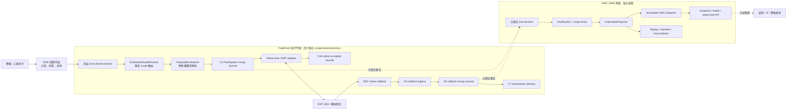
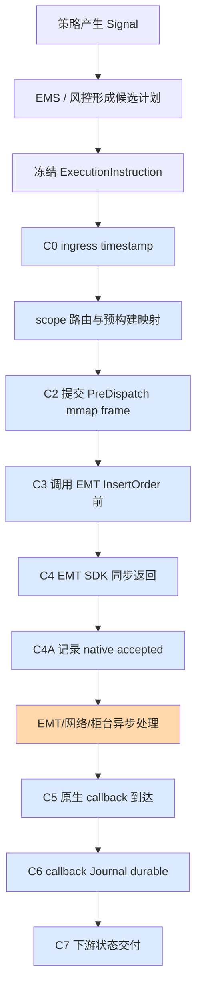
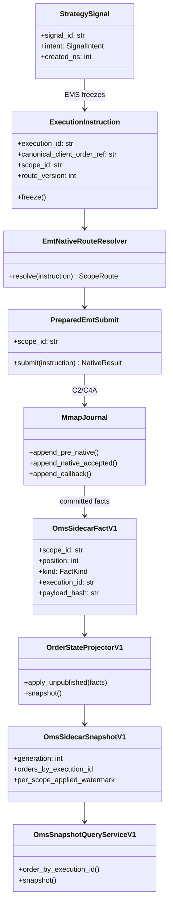
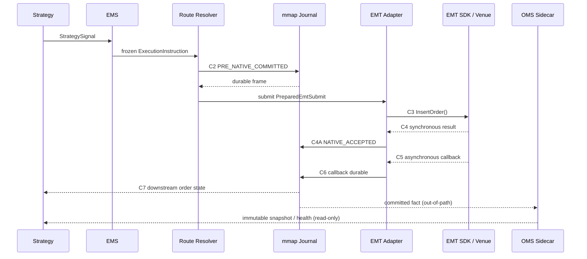

# TradeCore 技术架构与性能验收汇报编写方案

> 文档性质：汇报主文档与答辩/PPT 的编写蓝图，不是新的技术定档，也不把尚未完成的验收写成结论。
>
> 当前事实（2026-09-11）：OMS 平台 W0--W6 与真实 EMT 499-burst 并发的 W7 已通过；五个隔离 OMS shard 在 `2,000 TPS + 5,000 QPS` 下零 HTTP failure/零 dropped，EMT `499/499` native accepted/C7、零 callback gap 且清理归零。该结论不解除 `DISARMED`，也不构成 R1 权威恢复或 `READY` 证明。历史 `QueryUnfinishedOrders=2` 阻断样本必须标注为历史记录，不能覆盖当前 W7。

## 1. 汇报目标、受众与交付物

### 1.1 目标

用一份可独立阅读的汇报说明 TradeCore 如何在 Python/CPython 3.10 环境中做到：

1. 策略信号到 EMT 委托的可追溯、Journal-first 执行；
2. 提交热路径和 callback 热路径不被 OMS、EMS、查询、审计或监控同步阻塞；
3. 当前三 scope/session/process 分片如何兼顾 EMT 单 session 串行约束、并发吞吐与故障隔离；
4. OMS 旁路事实投影、快照查询、replay/watermark/health 如何提供可运营性；
5. 现有性能证据、验收边界、已知风险，以及下一步 R1 权威恢复的真实验收条件。

### 1.2 受众分层

| 受众 | 优先回答的问题 | 建议表达 |
| --- | --- | --- |
| 管理/业务负责人 | 能否稳定、可控地执行？当前风险是什么？ | 一页结论、状态卡、红黄绿门禁 |
| 架构/研发负责人 | 边界为何这样划分？如何恢复与扩展？ | 架构图、数据流、类关系、故障语义 |
| 量化/策略研发 | 策略信号如何成为可执行委托？如何观测结果？ | 策略→指令→路由→回报时序图 |
| 性能/运维 | TPS/QPS、尾延时、负载模型和证据是否可信？ | P50/P95/P99 表、HDR、原始摘要路径、门禁 |

### 1.3 建议交付物

| 文件 | 用途 | 篇幅建议 |
| --- | --- | --- |
| `TradeCore-技术架构与性能验收汇报.md` | 权威、可审计的主报告 | 20--30 页等效内容 |
| `TradeCore-技术架构与性能验收汇报.pptx` | 现场汇报版 | 15--18 页 |
| `附录-数据字典与性能原始证据.md` | 字段、接口、性能口径、结果索引 | 按需展开 |
| `附录-验收状态与风险清单.md` | W0--W7、真实 EMT、恢复和回退项 | 一页状态表 + 明细 |

主报告先完成后，再从每节抽取一张结论图和不超过三条要点生成 PPT；不要反过来只制作图片而缺少可追溯正文。

## 2. 主报告章节编排

| 章节 | 标题 | 必须内容 | 推荐图表 |
| --- | --- | --- | --- |
| 0 | 执行摘要 | 当前能力、已通过门禁、R1 阻断与下一步 | 状态卡 + 一张总架构图 |
| 1 | 业务问题与设计原则 | 低延时、高并发、可靠性、模拟盘边界 | 目标/非目标对照表 |
| 2 | 总体架构 | 策略、EMS、执行、EMT、OMS、观测的职责与进程边界 | 架构图 |
| 3 | 策略信号到下单 | 信号、风险/计划、冻结指令、分片路由、提交语义 | 时序图 + C0--C4A 数据流 |
| 4 | EMT 回报到状态更新 | callback、C5--C7、持久化、下游投影、查询语义 | callback 数据流图 |
| 5 | 适配层与热路径 | EMT adapter、native lane、Journal、路由、热路径禁入项 | 分层表 + 热路径泳道图 |
| 6 | OMS/EMS 数据模型 | 事实、订单/成交状态、索引、watermark、manifest、快照 | UML + 数据结构表 |
| 7 | 性能体系与结果 | EMT 链路指标、OMS TPS/QPS、HDR、W0--W6 | 性能表 + 延时分层图 |
| 8 | 可靠性与故障演练 | replay、pause、stale、fail-closed、恢复边界 | 故障状态图 + 门禁表 |
| 9 | 当前限制与路线图 | R1、direct-write、外部 Adapter、LoadRunner 接入条件 | 风险矩阵 + 路线图 |
| 附录 | 数据字典、术语、原始证据索引 | 不放敏感数据，不复制账户/订单/密码 | 表格 |

## 3. 图表编写规范

### 3.1 图 A：总体架构图

在正文第 2 章使用下图，并在最终 PPT 中保留为唯一的“全景图”。颜色含义建议固定为：蓝色=执行关键路径，绿色=旁路读模型，橙色=外部 EMT，红色=fail-closed 门禁。



图注必须写明：OMS sidecar 只消费**已提交**事实，不是 C0--C7 的同步依赖；它不得反向触发 SDK 下单或撤单。

### 3.2 图 B：策略信号到 EMT 下单数据流图

正文第 3 章建议将 “策略触发” 与 “真正 EMT 下单” 分开描述，避免把 `insert_order` 返回误解为 EMT 已受理。



必须在图下明确三段口径：

- 项目提交内部路径：`C0→C4A`；
- EMT/网络/柜台异步等待：`C4A→C5`，不计入项目内部性能预算；
- 项目 callback 内部路径：`C5→C7`。

### 3.3 图 C：UML 类关系图

正文第 6 章仅展示关键稳定接口与数据对象，不展示 SDK 原始对象、账户信息或大段实现细节。



### 3.4 图 D：策略、执行与 callback UML 时序图

正文第 3--4 章以此图说明“返回 order id”“SDK 返回”“最终 callback”是三个不同边界。



## 4. OMS 数据结构与“表结构”表达方案

### 4.1 必须先说明：不是传统数据库热表

汇报中不要把当前 mmap Journal 和 immutable snapshot 误述为同步关系数据库。正确表述是：**Journal 是追加式事实来源；OMS snapshot 是旁路、版本化的只读投影；下表是逻辑数据字典，不是热路径 SQL DDL。**

### 4.2 逻辑事实表：`OmsSidecarFactV1`

| 字段 | 含义 | 来源/约束 | 汇报时是否展示原值 |
| --- | --- | --- | --- |
| `scope_id` | 事实归属分片 | 必须匹配 route/epoch | 可展示脱敏逻辑名 |
| `position` | scope 内单调位置 | 连续性校验，缺口 fail-closed | 可展示 |
| `kind` | `PRE_NATIVE_COMMITTED`、`NATIVE_ACCEPTED`、`ORDER_CALLBACK` 等 | 已提交边界 | 可展示枚举 |
| `execution_id` | 内部执行关联键 | 与 client ref / external ID 重建关联 | 仅摘要或测试序号 |
| `canonical_client_order_ref` | 稳定客户订单关联键 | callback 先到也可定位 | 不展示原值 |
| `payload_hash` | 标准化载荷摘要 | 重放/冲突校验 | 可展示哈希前缀 |
| `observed_monotonic_ns` | 本地单调时间 | 延时配对依据 | 只展示相对延时 |
| `state_version` | 状态单调版本 | 去重/乱序保护 | 可展示 |

### 4.3 订单读模型：`OmsSidecarOrderRefV1`

| 索引/字段 | 用途 | 一致性规则 |
| --- | --- | --- |
| `orders_by_execution_id` | 按内部执行 ID 查询 | immutable generation 原子替换 |
| `orders_by_client_order_ref` | callback 归属重建 | 冲突进入 `RECONCILE_REQUIRED` |
| `orders_by_external_order_id` | SDK 返回或 callback 后补充 | 不猜测跨 scope 归属 |
| `state` / `state_version` | 订单生命周期 | 只接受单调、可验证迁移 |
| `applied_position` | read model 已投影事实位置 | 与 watermark 对账 |
| `reconciliation_required` | 不安全关联标记 | 禁止自动重发/猜测补全 |

### 4.4 运营逻辑表

| 逻辑集合 | 核心字段 | 用途 | 热路径关系 |
| --- | --- | --- | --- |
| `scope_watermark` | `scope_id`、applied position、generation | 判断投影滞后 | 旁路只读 |
| `snapshot_generation` | generation、as-of time、索引引用 | 原子快照切换 | 旁路只读 |
| `merge_manifest` | scope、segment range、checksum、前序摘要 | replay/recovery 审计 | checkpoint 旁路 |
| `reconciliation_result` | query epoch、差异结论、对应 position | 权威 EMT 对账事实 | 异步写事实，不直接改快照 |
| `performance_run` | revision、gate、环境摘要、P50/P95/P99、完整性 | 验收可追溯 | 仅归档 |

## 5. 适配层与热路径说明模板

### 5.1 适配层职责矩阵

| 层 | 输入 | 输出 | 允许做什么 | 不允许做什么 |
| --- | --- | --- | --- | --- |
| EMS control plane | 策略目标/风险 | 冻结 `ExecutionInstruction` | 拆单、计划、限额、选择可用 scope | 进入 native lane 后修改指令 |
| Route resolver | 冻结指令 | 稳定 scope route | ownership/epoch/route fence、预登记查询 | 跨 scope 猜测路由 |
| Prepared submit | 指令 + 已缓存静态映射 | EMT 参数/调用结果 | 填充订单特有字段、调用适配器 | 实时 JSON、网络查询、全局锁 |
| EMT adapter | prepared request | 原生返回与 callback | `InsertOrder`、取消、只读查询 | 让 OMS/EMS 同步阻塞 |
| mmap Journal | 固定 frame | committed fact | C2/C4A/C6 durable 记录 | 每笔 fsync/msync/数据库 I/O |
| OMS sidecar | committed facts | immutable snapshot/health | replay、投影、查询、HDR | 反向下单、阻塞 C0--C7 |

### 5.2 热路径必讲内容

报告第 5 章采用“两条蓝色路径 + 一条橙色外部等待”的表达：

```text
提交热路径： C0 → C1 → C2 → C3 → C4 → C4A
外部异步段： C4A → C5
回报热路径： C5 → C6 → C7
```

必须明确：

- `C2` 前的 `PRE_NATIVE_COMMITTED` 是“调用 SDK 前可恢复归属标记”，不等待 SSD 物理刷盘；
- `C4A→C5` 是 EMT SDK/网络/柜台异步等待，必须采集但不作为项目内部延时；
- `C6` 前不得将 callback 交付下游；
- OMS、snapshot、Redis/数据库、UI、审计和告警都不得成为两条热路径的同步依赖；
- 单 EMT session 内保持单 native caller；并发通过独立 scope/session/process 分片实现。

## 6. 性能章节写法与已验证数据

### 6.1 先分开两类性能结论

| 测试域 | 回答的问题 | 不能替代什么 |
| --- | --- | --- |
| EMT 499-burst C0--C7 | 执行适配器和 callback 链路是否完整、延时如何 | 不能替代 OMS HTTP 吞吐验收 |
| OMS W0--W6 | 旁路 fact/snapshot/health 在压力与故障下是否稳定 | 不能证明 W7 对真实 EMT 499 无干扰 |
| W7 并发 | OMS `2,000 TPS + 5,000 QPS` 下真实 EMT 499 是否无回归 | 已通过，但不替代 R1 恢复验收 |

### 6.2 当前 OMS 性能表（可直接进入主报告）

| 场景 | 实际负载 | 完整性 | HTTP P95 / P99 | 结论 |
| --- | ---:| --- | ---:| --- |
| W1 fact-ingest | 1,999.95 TPS，60,002 次 | 0 HTTP failure、0 dropped | 9.441 / 50.336 ms | 通过 |
| W2 snapshot query | 4,999.58 QPS，150,004 次 | 0 HTTP failure、0 dropped | 0.571 / 3.044 ms | 通过 |
| W3 mixed write | 与读侧同时运行 | 0 HTTP failure、0 dropped | 9.810 / 58.965 ms | 通过 |
| W3 mixed read | 与写侧同时运行 | 0 HTTP failure、0 dropped | 5.758 / 23.512 ms | 通过 |
| W4 watermark/health | 7,500 次 | 0 HTTP failure | 0.302 / 0.768 ms | 通过 |
| W5/W6 | pause、stale、resume、replay | fail-closed / replay PASS | 不以吞吐计分 | 通过 |
| W7 | OMS mixed + 真实 EMT 499 | 五 shard + 三 EMT scope | 零 HTTP failure/drop；`499/499` native/C7、零 gap、清理归零 | **PASS** |

内部 HDR 采用每 shard 独立展示，不能将 percentile 汇总后伪造为全局 HDR：

- fact admit→projected：P50 `0.0588--0.0618 ms`，P95 `1.101--1.780 ms`，P99 `7.217--11.592 ms`；
- immutable order lookup：P50/P95/P99 `1.302--1.342 / 1.923--1.983 / 2.995--3.065 µs`；
- snapshot materialize/publish 是旁路工作，P95 `26.006--34.570 ms`，不进入 C0--C7。

### 6.3 EMT 链路性能呈现规则

EMT 页面必须带下列字段，且按**同一订单的原始配对时间戳**计算：

| 分组 | 必报指标 |
| --- | --- |
| 提交内部 | `C0→C4A`，各子段 `count/P50/P95/P99/P100`，四 scope 队列深度 |
| 外部等待 | `C4A→C5` 单独列示，标注“非项目内部预算” |
| callback 内部 | `C5→C7`，及 C5D/C5E/C5A/C5B/C6 子段 |
| 批次 | C0→最后 C4A、C0→最后 C7、首 C5→最后 C7 wall-clock |
| 完整性 | native accepted、C7、时间对、callback gap、cleanup terminal、query-after-cleanup |

禁止将不同订单、不同轮次的 P95/P99 相减为“某个订单的精确耗时”；不得把历史 W7 `BLOCKED` 样本误写为当前状态，也不得把 W7 PASS 外推为 R1、`READY` 或生产结论。

## 7. 验收、风险与路线图页面

### 7.1 门禁状态卡

| 门禁 | 当前状态 | 汇报话术 |
| --- | --- | --- |
| W0--W5 k6 | PASS | OMS 合同、吞吐、混合负载、health、fail-closed 已验收 |
| W6 fault drill | PASS | replay/pause/stale/resume 语义已演练 |
| W7 OMS + EMT 499 | PASS | 2026-09-11 五 shard + 三 EMT scope 复验通过；仍为 `DISARMED` |
| callback direct-write A/B | NOT STARTED | 仅有资格合同，不能写成性能优化已完成 |
| LoadRunner | DEFERRED | 仅在许可证、Controller、Load Generator 就绪后接入相同 contracts/schema |

### 7.2 下一步条件

1. 以非临时 namespace release 完成 R1-P1 的日切、轮换、范围耗尽与 anti-rollback 实证；
2. 获得 EMT 可验证的 `onQueryPosition(..., last=true)` 完成语义及经验证的 `RESTART` callback replay；缺失时持续 `RECOVERY_BLOCKED`；
3. 运行 R1-A2--A6：双系统、R2 强杀、unknown/冲突、查询中断与受控清理；
4. R1 改动后重跑受影响的 Hot100、三 scope 499、W7 与 query-only cleanup；
5. 仅在 R1 完整通过后开展 callback direct-write 的 control/candidate 三组交错 A/B。

## 8. 数据来源、脱敏与审阅清单

### 8.1 每张图/表的证据来源

| 汇报内容 | 权威来源 |
| --- | --- |
| C0--C7 定义与 EMT 性能口径 | `docs/04-测试验收与性能/04-OMS性能与容量/01-Python-OMS-EMS综合热路径优化方案.md` |
| OMS/EMS 架构与验收边界 | `docs/04-测试验收与性能/04-OMS性能与容量/02-OMS-EMS旁路能力优化实施方案.md` |
| OMS HTTP 合同与 W0--W7 运行方式 | `tools/oms_load_platform/README.md` |
| W0--W6 与 W7 原始 summary/HDR | `artifacts/oms-load/` 的版本化结果目录与 `05-BenchmarkStandardV1复验报告-2026-09-11.md` |
| 真实 EMT 链路原始配对 | payload-free 的 performance trace/report |

### 8.2 脱敏规则

- 不展示账户号、密码、IP、端口、证券、价格、资金、持仓、EMT 外部订单号或原始 callback payload；
- `execution_id`、client ref、external ID 只使用测试序号、哈希前缀或聚合计数；
- 图中使用逻辑 scope 名，不展示 host 用户名和私钥路径；
- 性能原始数据仅保留版本、时间、测试环境摘要、计数、延时和完整性指标。

### 8.3 发布前检查

- [ ] 每一个“通过”都有对应 gate、revision、原始摘要和完整性计数；
- [ ] W7、R1、direct-write、LoadRunner 状态均准确标记，历史阻断未覆盖当前结论；
- [ ] 所有延时均标明是否包含 `C4A→C5` 外部等待；
- [ ] OMS 逻辑表明确不是热路径数据库；
- [ ] 架构图中 OMS sidecar 只有已提交事实输入，绝不画成 SDK 下单前置；
- [ ] 图表、正文和附录中的版本号、日期、性能数字相同；
- [ ] 已完成敏感信息扫描与人工复核。

## 9. 建议的编写顺序

1. 先完成第 0、2、3、4 章和四张 Mermaid 图，统一术语；
2. 再写第 5、6 章，补齐适配边界、OMS 数据字典和热路径禁入项；
3. 使用当前 W0--W7 结果完成第 7 章，并将 R1 固定标记为未完成；
4. 最后生成附录、敏感信息审阅，并从主报告抽取 PPT；
5. R1 解锁并完成后，仅更新恢复、状态卡、风险和路线图章节，不改写历史证据。
