# TradeCore 完整技术与性能汇报

> 文档用途：用于项目立项、阶段汇报、技术评审和性能验收沟通。本文汇集当前代码、定档与已归档的脱敏实测证据；不是新的架构定档，也不以设计描述替代验收。
>
> 证据截止：2026-09-11 的已归档 Linux 模拟盘、OMS 与 W7 复验结果。当前产品运行基线为 Linux x86_64、独立 CPython 3.10 `.venv`；Windows 材料仅作历史连通性记录。
>
> 结论状态：EMT-only `MmapJournalProfileV1` 仍为 `DISARMED`。2026-09-10 的 F4 基线及 2026-09-11 当前 revision 复验均已通过 W7：五个隔离 OMS shard 在 `2,000 TPS + 5,000 QPS` 下与三 session EMT 499-burst 并行，OMS 零 HTTP failure/零 dropped iteration，EMT `499/499` native accepted/C7、零 callback gap、清理和验收后 query-only 均为零未完成订单。下文早期 `BLOCKED` 段落仅是历史门禁记录，以 F4 evidence manifest 与 9 月 11 日复验报告为当前结论。因此仍不得宣称 `READY`、自动恢复已放行或生产账户可用。
>
> 图形资产：本报告的图形已同步渲染为可直接复用的 SVG 矢量图，位于 [`图片/项目汇报/`](./图片/项目汇报/README.md)；统一为白底黑线、无彩色填充，流程图采用直角折线。下方 Mermaid 代码保留为图形的可编辑源。

## 目录

1. [执行摘要](#1-执行摘要)
2. [项目定位、范围与当前状态](#2-项目定位范围与当前状态)
3. [总体架构图与组件职责](#3-总体架构图与组件职责)
4. [策略触发、信号执行与下单数据流](#4-策略触发信号执行与下单数据流)
5. [适配层、路由与会话分片](#5-适配层路由与会话分片)
6. [热路径、回调路径与副作用语义](#6-热路径回调路径与副作用语义)
7. [OMS 数据结构、UML 与状态机](#7-oms-数据结构uml-与状态机)
8. [PostgreSQL 查询模型与表结构](#8-postgresql-查询模型与表结构)
9. [性能 TPS/QPS 与延时实测](#9-性能-tpsqps-与延时实测)
10. [可靠性、可观测性与验收状态](#10-可靠性可观测性与验收状态)
11. [限制、风险与下一步](#11-限制风险与下一步)
12. [证据索引与术语](#12-证据索引与术语)

## 1. 执行摘要

TradeCore 是面向内部策略和受控人工操作的 Linux OMS + EMS 交易执行核心。它只处理“已完成决策的交易信号”、将其转换为可审计的柜台副作用，并可靠地交付订单、成交和账户回报；它不承担行情订阅、行情缓存或策略算法计算。

当前阶段完成了两条相互隔离的能力线：

| 能力线 | 当前能力 | 已有证据 | 不应作出的结论 |
| --- | --- | --- | --- |
| EMT 执行热路径 | 三个独立 Linux Python 进程、三个独立 EMT session 与 scope-local native lane；命令和 callback 使用 mmap Journal。 | 模拟盘 499 笔共同释放，`499/499` native accepted、`499/499` C7、零 callback gap、清理后 inflight 为零。 | 不能证明生产账户适用、长期账户级并行、硬实时、掉电恢复或 `READY`。 |
| OMS 旁路 | 已提交事实的投影、immutable snapshot、watermark/health、replay/pause/stale/resume 演练。 | W0--W7 通过；W7 在 `2,000 TPS + 5,000 QPS` 下与 EMT 499-burst 并行且零 failure/drop。 | 不等同于 EMT 下单吞吐以外的生产 SLA，也不替代 R1 权威恢复验收。 |
| 查询型 PostgreSQL 模型 | 8 张应用查询表和 1 张 projector checkpoint 表的物理设计，热路径外异步投影。 | 数据模型、ER 图、索引和权限规则已定档。 | PostgreSQL 不授权下单、撤单、幂等或自动恢复。 |
| 可插拔 Adapter | `BrokerAdapter` 统一合同，EMT 为首个执行 profile；QMT 与 PaperBroker 保持隔离实现。 | 领域合同、映射 manifest、scope ownership 与 EMT-only 验收路径已建立。 | PaperBroker 结果不能替代 EMT 柜台性能或真实回报语义。 |

最重要的架构选择是：**柜台副作用前的 Journal 证据与 callback Journal 证据处于交易热路径；OMS 投影、查询、数据库、归档、告警和 UI 只消费已提交事实，不能同步阻塞下单或回报。**

## 2. 项目定位、范围与当前状态

### 2.1 产品边界

| 范围内 | 范围外 |
| --- | --- |
| 策略/人工交易信号的准入、幂等、路由、执行、撤单、柜台查询和回报归一化 | 行情订阅、行情缓存、行情驱动风控、alpha/策略计算、撮合引擎 |
| EMT/QMT/PaperBroker 的 Adapter 合同与独立 profile | 用一个 Adapter 的字段、线程假设或性能报告替代另一个 Adapter |
| 可重放的订单/成交事实、只读 OMS snapshot、对账和恢复证据 | 依据缓存、数据库或“SDK 调用没有异常”猜测订单终态 |
| 受控模拟盘验收与性能测量 | 以模拟盘结果承诺实盘 SLA 或生产 `READY` |

### 2.2 当前模块状态

| 模块 | 代码位置 | 状态 | 汇报口径 |
| --- | --- | --- |
| 领域模型与契约 | `xuanling_tradecore/domain/` | 已实现 | 提供不可变订单、执行指令、回报、恢复、风险和消费者事件模型。 |
| EMS 路由与调度 | `xuanling_tradecore/ems/` | 已实现基础能力 | 静态 account→scope 路由、ownership fence、bounded scheduler、控制面和候选 direct-write 合同。 |
| OMS sidecar | `xuanling_tradecore/oms/sidecar_v1.py` | P0--P4 已实现 | 已提交事实的重放、状态投影、immutable generation 和只读查询；不进入 EMT writer。 |
| EMT 执行适配 | `emt_gateway/`、`xuanling_tradecore/adapters/emt/` | 已实现 EMT-only 基线 | SDK 生命周期、能力核验、预原生 mmap 证据、callback 归一化、scope ownership。 |
| mmap 持久化 | `xuanling_tradecore/persistence/`、`emt_gateway/tradecore_mmap_journal.py` | 已实现 | 固定格式、CRC、最后 commit word；不在每笔热路径执行同步刷盘。 |
| OMS 性能平台 | `tools/oms_load_platform/` | W0--W6 已验收 | k6 自动门禁、JMeter HTTP 复刻、HDR 指标和故障演练。 |
| PostgreSQL read model | 设计与 projector 边界已定档 | 待完整落地验收 | 只读查询/报表投影，禁止成为热路径同步依赖。 |
| PaperBroker | 独立 profile/合同存在 | 不纳入本轮 EMT 验收 | 仅用于隔离回归和确定性实验，不替代柜台。 |

### 2.3 当前准入状态


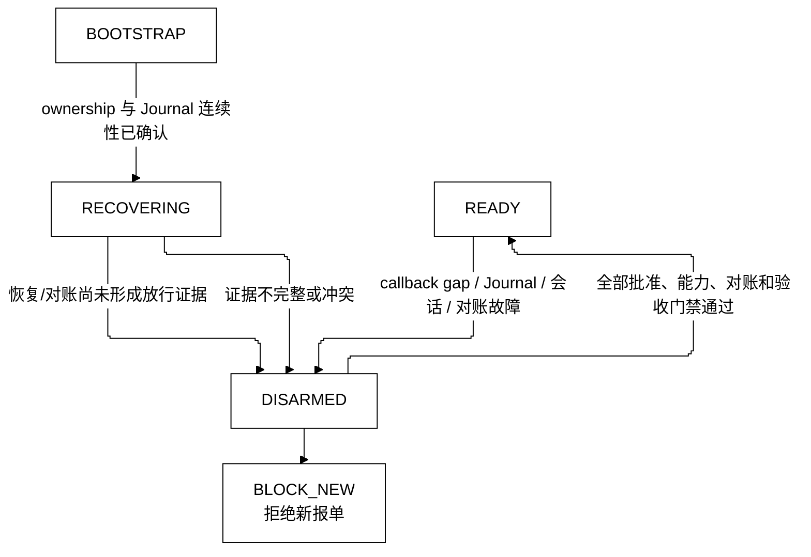

`READY` 是严谨的可交易放行状态，不等同于“进程在线”“SDK 登录成功”或“一个模拟订单成功”。当前所有报告都必须以 `DISARMED` 为准。

## 3. 总体架构图与组件职责

### 3.1 总体架构图


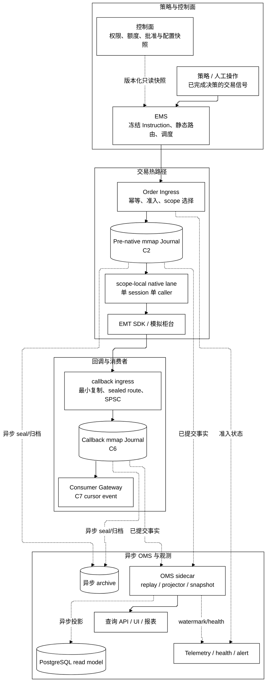

蓝色节点是项目内部的执行/回报关键路径。绿色节点是异步旁路：即使投影、查询或数据库出现延迟，也不得回压已开始的 `C0→C4A` 或 `C5→C7`。

### 3.2 分层职责

| 层 | 输入 | 输出 | 必须负责 | 明确禁止 |
| --- | --- | --- | --- | --- |
| 策略/上游 | 已完成业务决策 | `ExecutionInstruction` 候选 | 给出证券、方向、数量、价格、策略归属和幂等键 | 在网关内依赖行情重新推导下单时机 |
| EMS | 目标、规则、风险快照 | 冻结的执行指令/撤单指令 | 拆单、计划、静态 route、有限 pending plan | 在 C0 后改写既有指令或直接调用 SDK |
| Order Ingress | 指令和批准快照 | 准入结果、scope-local work | 幂等、静态校验、容量和 admission gate | 同步 SQL、网络 RPC、行情查询、无界排队 |
| Journal | 预原生命令或 callback 标量 | 已提交事实 position | CRC、完整 frame、commit word、连续前缀恢复 | 将 Python 堆对象、原始 SDK 对象、密码写入事实 |
| BrokerAdapter | 领域指令 | `SubmitAccepted` / 标准化 `BrokerEvent` | Native 参数映射、SDK 调用、回调归一化、只读查询 | 向领域层泄漏 SDK 类型、猜测最终状态 |
| OMS sidecar | 已提交事实流 | immutable snapshot、watermark、health | 重放、状态归并、查询索引和对账辅助 | 反向确认 Journal、阻塞 writer 或自行下单/撤单 |
| PostgreSQL | projector 输出 | 查询与报表 read model | 列表、详情、审计展示、报表加速 | 同步参与报单、撤单、恢复裁决 |

## 4. 策略触发、信号执行与下单数据流

### 4.1 从策略到柜台的业务数据流图


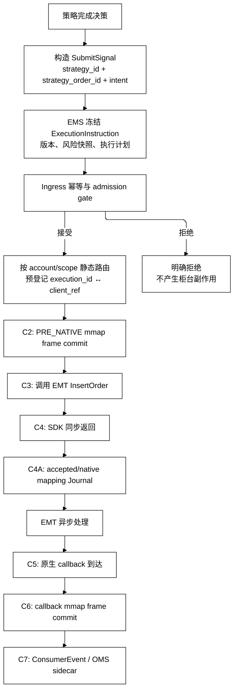

### 4.2 关键时序 UML

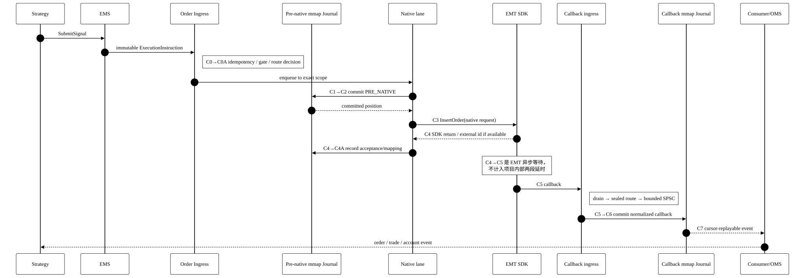

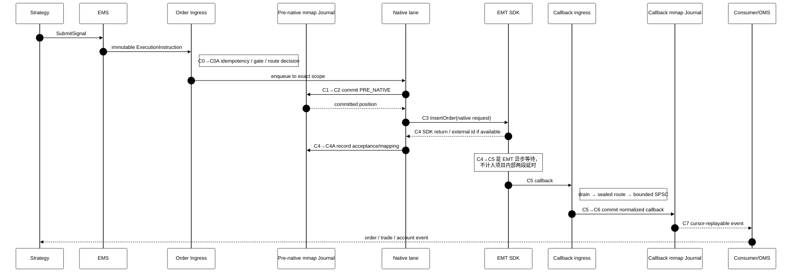

### 4.3 信号、指令和回报的数据契约

| 对象 | 核心字段（脱敏/逻辑名） | 不变量 |
| --- | --- | --- |
| `SubmitSignal` | `strategy_id`、`strategy_order_id`、instrument、side、quantity、limit_price、account scope | 同一策略业务键的不同 canonical intent 必须拒绝为 `IDEMPOTENCY_CONFLICT`。 |
| `ExecutionInstruction` | `execution_id`、`oms_order_id`、account、venue、route、risk snapshot、版本、归属 | 进入 C0 后不可修改；替换和撤单是新的审计指令。 |
| `PreparedEmtSubmit` / pre-native record | execution ID、canonical client ref、scope、route version、hash、position | C2 commit 之前不得调用 `InsertOrder`。 |
| `SubmitAccepted` | execution ID、adapter ID、instance、monotonic time、可选 native identity | 只表示 Adapter 已接受派发，不表示柜台终态、成交或交易所接受。 |
| `BrokerEvent` | source key、client ref / external ID、标准化状态、数量、时间、scope | 重复回报必须幂等；跨 scope/epoch 的映射冲突进入 `RECONCILE_REQUIRED`。 |
| `ConsumerEvent` | cursor lineage、账户、订单/成交状态、审计指针 | 下游按 cursor 至少一次接收、按事件 ID 去重，不从 callback 内存对象直接推断状态。 |

### 4.4 三层 ID 与归属链

```text
OMS execution_id
        ↕  C2 前静态预登记
canonical_client_order_ref
        ↕  SDK 返回或 callback 补全
EMT external_order_id / venue_order_identity
```

每层关联都携带 `scope_id`、Adapter instance、activation epoch、route version 和 Journal position。回调早于 SDK 返回时，系统可先依靠 `client_order_ref` 定位；一旦发现跨 scope、跨 epoch 或同一 ID 指向多个 execution 的冲突，系统停止猜测、进入对账门禁。

## 5. 适配层、路由与会话分片

### 5.1 Adapter 合同

`xuanling_tradecore.adapters.base.BrokerAdapter` 是唯一可插拔的柜台边界。其稳定操作如下：

| 操作 | 语义 | 热路径关系 |
| --- | --- | --- |
| `start(observer)` | 在登录、回放或查询前绑定 durable observer | 生命周期前置；不是每笔下单动作 |
| `submit(instruction)` | 派发一笔已授权、已 Journal-first 的执行指令 | C3→C4 的唯一 native 调用边界 |
| `cancel(instruction)` | 派发有权威 venue identity 的撤单指令 | 独立的 Journal-first 副作用路径 |
| `query(request)` | 发起有界、只读的柜台查询 | 不进入报单关键路径 |
| `begin_recovery(plan)` | 开始只读恢复范围 | 仅 `RECOVERING` 使用 |
| `collect_recovery_evidence(handle)` | 返回完整性显式的恢复证据 | 空集合不等于恢复成功 |
| `stop()` | 停止新工作 | 不伪造柜台状态变化 |

Adapter 的 `submit` 返回只表明调用层已受理。最终的订单状态、成交、拒绝或撤单必须经 `BrokerEventObserver` 回调路径进入 callback Journal 后才可下游交付。

### 5.2 EMT Adapter 的职责拆分

| 子层 | 主要实现 | 职责 |
| --- | --- | --- |
| SDK loader/session | `emt_gateway.platform_loader`、`session` | 运行时版本、ABI、Linux 动态库、创建 API、登录与生命周期。 |
| native facade | `emt_gateway.native_api`、`facade` | 将已经验证的领域请求传到 EMT SDK；业务层不直接导入供应商 binding。 |
| 交易执行 | `emt_gateway.tradecore_execution` | scope-local scheduler、C2/C3/C4/C4A 计时、native accepted 证据。 |
| callback bridge | `spi_bridge_v2`、`fastspi_v2_*` | 快速复制必要标量、路由、bounded queue、callback gap fail-close。 |
| mmap Journal | `tradecore_mmap_journal` | 预原生与 callback 事实的固定格式 commit。 |
| manifest/profile | `xuanling_tradecore/adapters/emt/` | 受签名 mapping、能力、scope ownership、允许 route 与 profile 门禁。 |

### 5.3 静态路由与分片原则


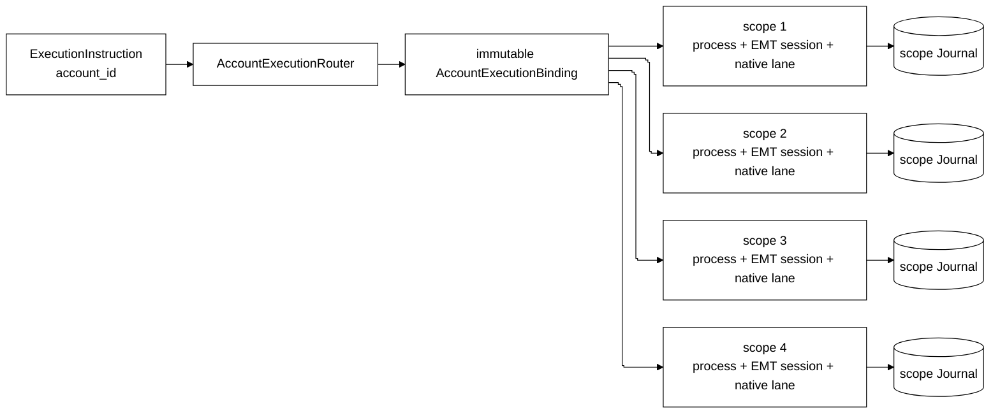

路由计划通过 `AccountExecutionBinding` 固化：`account_id`、venue、Adapter instance、client scope、ownership hash、mapping/capability manifest hash、Journal plan hash、routing epoch 与 shard。启动后不得按实时延时在 session 之间“择优”迁移订单；稳定 ownership 是 callback 归属、撤单、恢复和审计可证明性的前提。

当前 499-burst 基线使用 4 个进程隔离的 EMT session，按 `125 / 125 / 125 / 124` 分配共同释放的信号。每个 scope 内保持单 native caller；跨 scope 并行由独立进程、独立 SDK 对象和独立 CPU 角色实现，而不是同一 SDK session 内多 caller 并发。

## 6. 热路径、回调路径与副作用语义

### 6.1 测量边界

| 时间点 | 含义 | 是否项目内部热路径 |
| --- | --- | --- |
| C0 | 信号进入 ingress 的单调时间 | 是，提交路径起点 |
| C0A | 完成 ingress decision（准入/拒绝） | 是 |
| C0B | native worker 从 scope scheduler dequeue | 是 |
| C0C / C1 | dispatch 前准备完成 / Adapter 前的 prepared-route proof | 是 |
| C2 | pre-native mmap record commit 完成 | 是；未到此点不得调用 SDK |
| C3 / C4 | `InsertOrder` 调用前 / SDK 同步返回 | 是 |
| C4A | native accepted/mapping 记录完成 | 是，提交内部完成 |
| C5 | EMT callback 原生到达 | 外部等待结束；回报内部起点 |
| C5D / C5E / C5A / C5B | Python drain、sealed route、SPSC publish、target worker start | 是，回调分段定位 |
| C6 | callback mmap commit 完成 | 是；未到此点不得交付下游 |
| C7 | Consumer/下游可重放事件完成 | 是，回调内部完成 |

因此本项目严格区分三类数字：

```text
提交内部延时： C0 → C4A
回报内部延时： C5 → C7
EMT 外部等待： C4 → C5
```

`C0→C7` 是端到端观察值，包含 EMT 异步处理；它不能被解释为纯 Python、mmap 或本地调度性能。不同订单或不同轮次的 P95/P99 也不能相减，必须使用同一订单的原始配对时间戳。

### 6.2 mmap Journal 的作用与边界

Journal frame 遵循“预留完整 frame → 写字段 → CRC → 最后写 commit word”的顺序。它是文件支持的 mmap 区域：交易线程写入操作系统页缓存映射，不在每笔等待 SSD 物理刷盘。进程异常退出后，可从 CRC 与 commit word 均有效的连续前缀恢复；整机断电、内核崩溃或存储丢失前的脏页则不在该机制的保证范围内。

| 事件 | 结果 |
| --- | --- |
| 在 C2 之前崩溃 | 不存在已提交 pre-native 事实，禁止假定 SDK 已调用。 |
| C2 已提交、C3/C4 不确定 | 状态是 `SUBMIT_UNKNOWN`；不得自动再次 `InsertOrder`，必须借助 Journal 和权威查询对账。 |
| callback frame 未完成 | 恢复时忽略尾部不完整 frame，并将 callback 完整性作为 fail-close/对账问题处理。 |
| 投影/数据库不可用 | 已经 commit 的交易路径继续保持事实；仅限制未来 admission 或降级查询，不能回写副作用。 |

### 6.3 热路径禁入项

以下工作只能位于旁路，不能被添加为每笔 C0--C7 的同步步骤：PostgreSQL、Redis、HTTP/RPC、同步日志、`fsync`/同步 `msync`、文件扫描、JSON 全量序列化、告警、UI、查询、全局锁、无界队列和 projector publish。

## 7. OMS 数据结构、UML 与状态机

### 7.1 核心事实与快照对象

| 对象 | 关键字段 | 作用 |
| --- | --- | --- |
| `OmsSidecarFactV1` | scope、position、epoch、route version、kind、execution ID、client ref、payload hash、external ID、state、trade key、数量 | 已提交 Journal 的标准化事实。 |
| `OmsSidecarOrderRefV1` | execution ID、scope、client ref、state、state version、applied position、external ID、累计/剩余数量、trade keys | 对一笔 execution 的 immutable 查询索引。 |
| `OmsSidecarTradeRefV1` | trade key、execution ID、scope、external order ID、position、累计数量 | 去重后的成交引用。 |
| `OmsSidecarSnapshotV1` | generation、as-of 时间、per-scope watermark、三种订单索引、成交索引、health | 原子发布的只读 OMS generation。 |
| `ExecutionInstruction` | OMS order、execution、账户/策略归属、route、数量/价格、版本、风险证据 | OMS→EMS 的不可变副作用输入。 |
| `VenueOrderIdentity` | venue、Adapter instance、client scope、client/external order identity | 跨 Adapter 的标准化柜台订单关联。 |
| `BrokerRecoveryEvidence` | 查询覆盖、完整性、账户快照、订单/成交事实、错误说明 | 恢复与对账的权威输入，不能由空结果替代。 |

### 7.2 UML 类关系图


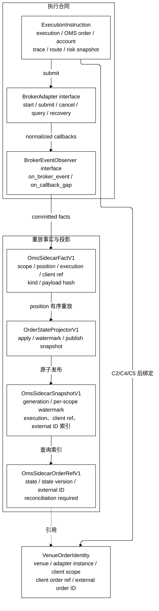

### 7.3 订单状态机


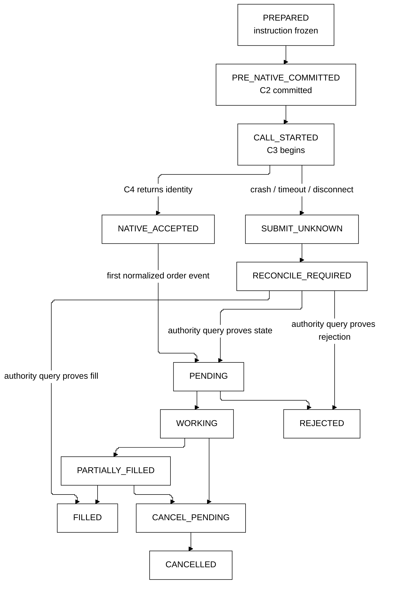

状态机的核心约束是：`CALL_STARTED` 之后不自动重发。任何不确定性都转化为可审计的 `SUBMIT_UNKNOWN`/`RECONCILE_REQUIRED`，由 Journal + EMT 权威只读查询闭合。

## 8. PostgreSQL 查询模型与表结构

### 8.1 定位

PostgreSQL 是异步、可重建的查询模型，而不是交易热表。其数据只能来自已提交 Journal/OMS 投影；当数据库不可用时，列表与报表可以降级或显示落后 watermark，但不能触发重报、撤单或账户自动 `READY`。

### 8.2 物理表总览

最终查询 schema 为 8 张应用表与 1 张 projector 基础设施表：

| 表 | 主键/关键关联 | 核心字段组 | 主要用途 |
| --- | --- | --- | --- |
| `accounts` | `account_id` + Adapter scope | lifecycle、reconciliation、`can_submit`、gate 摘要、trading day | 账户列表与可交易状态展示。 |
| `strategies` | `strategy_id` | consumer、strategy code、类型、状态、版本 | 程序单/人工单的策略展示。 |
| `orders` | `oms_order_id` | account、strategy、instrument、side、quantity、状态、时间、来源 position | OMS 聚合订单列表与详情。 |
| `order_executions` | `execution_id` → `orders` | route、Adapter scope、client ref、venue order ID、状态、归属快照 | 执行子单和双向 ID 映射。 |
| `order_actions` | `action_id` → order/execution | cancel/modify、请求、状态、错误、时间 | 撤单和其他订单操作审计。 |
| `trades` | `trade_key`，可关联 order/execution | venue trade ID、数量、价格、费用、归属、时间 | 成交列表与去重后的成交明细。 |
| `assets` | account + snapshot epoch | 币种、权益、可用、冻结、盈亏、来源 position | 当前资产查询。 |
| `positions` | account + instrument + side/epoch | 总量、可用、冻结、成本、盈亏、来源 position | 当前持仓查询。 |
| `projection_checkpoints` | projector/scope/generation | consumed watermark、source hash、schema version、更新时间 | 证明投影只来自已提交事实，并支持重放。 |

### 8.3 简化 ER 图


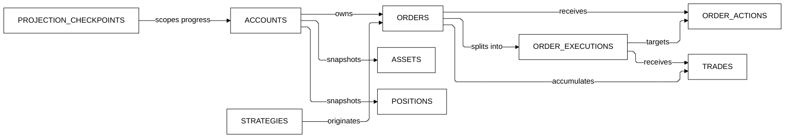

### 8.4 表设计规则

1. 金额、价格与数量使用 `numeric(24,8)`，不得使用浮点数。
2. 所有来源事实可追溯到 Journal position、source hash、schema version 与 row revision；业务顺序不按数据库时间戳推断。
3. `order_executions` 保存逐笔 native ID；`broker_custom_ref` 只表示系统/策略/交易员归属，不能作为逐笔唯一订单号。
4. 订单列表使用 Keyset cursor 和受限 page size；订单、执行、操作和成交的一对多关系不得粗暴 JOIN 后分页，避免乘法放大。
5. `ON DELETE RESTRICT`、状态失效和历史保留优先于物理删除；清理任务不得执行在交易热路径中。
6. 查询角色只访问安全视图/参数化接口；敏感账号、凭据、token、原始 SDK 回包不进入通用表。

完整列级定义、索引、RLS、view 与 migration 规则见[PostgreSQL 数据表关系与 ER 图专项设计](../02-接口与数据/05-PostgreSQL数据表关系与ER图专项设计.md)。

## 9. 性能 TPS/QPS 与延时实测

### 9.1 性能口径总览

| 指标组 | 被测对象 | 关键问题 | 不能替代 |
| --- | --- | --- | --- |
| EMT 499-burst | mmap Journal、native lane、SDK、callback 路径 | 499 条是否全量闭环，项目内部提交/回报延时多少 | OMS HTTP 吞吐、生产柜台 SLA |
| OMS W1/W2/W3 | fact ingest、immutable snapshot 查询、混合负载 | OMS 可否达到指定 TPS/QPS 且无 dropped/failure | EMT 实盘/模拟盘委托性能 |
| OMS 持续饱和 | 60 秒阶梯 | 在尾延时和完整性门禁下的工程容量 | 跨机器、跨内核或跨负载模型的理论上限 |
| 热态单笔 | 单请求、持久连接、无并发 | 低并发真实调用方体验延时 | EMT C0--C7 时延 |

所有 percentile 必须保留该次运行的原始 HDR 或逐笔时间对。多 scope 或多轮运行的 percentile 不允许池化成虚假的“全局 P99”；本报告需要时只报告每轮 percentile 的中位数，并明确标注。

### 9.2 EMT 模拟盘：四分片 499-burst 基线

环境为 Linux + CPython 3.10、4 个隔离 Python 进程/EMT session、4 条 native lane、严格独立 CPU 角色、共同 C0 释放的 499 笔模拟盘被动委托。三轮均满足：

- `499/499` native accepted；
- `499/499` C7；
- `499/499` 完整 C5→C7 时间对；
- `0` callback gap；
- `499/499` 清理撤单获受理，所有 terminal callback 后 inflight 为 `0`。

下表为开启“native scheduler 空→非空唤醒合并”后的三轮**每轮分位数中位数**，单位为 ms。它是某一固定 Linux 模拟盘窗口的回归基线，不是跨环境 SLA。

| 路径 | P50 | P95 | P99 | P100 | 解读 |
| --- | ---: | ---: | ---: | ---: | --- |
| `C0→C4A` 提交内部总和 | 7.362390 | 13.378196 | 13.912184 | 14.266568 | 从 signal ingress 到已记录 native acceptance/mapping 的全部项目内部提交路径。 |
| `C5→C7` callback 内部总和 | 4.448059 | 11.180975 | 11.393270 | 11.457405 | 从 EMT callback ingress 到本地可重放下游事件的项目内部回报路径。 |
| `C4→C5` EMT 异步等待 | 不作为本地回归指标 | 不作为本地回归指标 | 不作为本地回归指标 | 不作为本地回归指标 | EMT/柜台异步处理与外部回报等待，不能归因给 TradeCore。 |
| `C0→C7` 直接观测 | 46.312806 | 64.212980 | 65.775952 | 65.877482 | 包含外部 C4→C5，适合观察端到端窗口，不可作为纯本地优化结论。 |

同一三轮的整批墙钟中位数为：`C0→last C4A = 14.266568 ms`、`C0→last C7 = 65.877482 ms`、`first C5→last C7 = 56.814498 ms`。这里的 `first C5→last C7` 表示最早 callback 到最终一笔下游交付的批次 drain 窗口，不能与任一单笔的 C5→C7 分位数混用。

### 9.3 EMT 模拟盘：热态单笔对照

在连续 100 笔、每笔完成 C7 与清理终态后才释放下一笔的严格低并发实验中，四分片不会让单笔依次走过四条 lane；每笔始终只走稳定归属的一条 scope。四 session 数据如下（单位 ms，P50/P95/P99/P100）：

| 路径 | 结果 | 说明 |
| --- | --- | --- |
| `C0→C4A` 项目内提交 | `0.581312 / 0.637417 / 0.873701 / 1.524057` | 单笔低并发下的本地提交证据。 |
| `C5→C7` 项目内 callback | `0.479610 / 0.525699 / 0.715594 / 1.810738` | 单笔低并发下的本地回报处理。 |
| `C4→C5` EMT 外部等待 | `10.016371 / 10.982773 / 11.080089 / 11.499088` | 柜台/SDK 异步等待，不纳入两段项目内部总和。 |
| `C0→C7` 直接观测 | `11.066169 / 12.091907 / 12.591527 / 13.321853` | 包含上述 EMT 外部等待。 |

这组结果说明四分片的价值在于 499 突发时降低每条 native lane 的排队深度，而不是对单笔进行动态 session 选择。静态 owner routing 仍是回调归属、撤单和恢复证据的正确选择。

### 9.4 OMS W1--W4 合同负载

以下是 2026-09-08、四个隔离 OMS shard、30 秒 constant-arrival-rate 运行的调用方 HTTP 完整往返数据。它包含本机网络、HTTP、JSON、调度和服务端路径；与内部 HDR 分开报告。

| Gate | 实际完成量 | 实际速率 | dropped / HTTP failure | P50 ms | P95 ms | P99 ms | Max ms | 判定 |
| --- | ---: | ---: | ---: | ---: | ---: | ---: | ---: | --- |
| W1 fact-ingest | 60,002 | 1,999.40 TPS | 0 / 0 | 0.305 | 2.312 | 11.645 | 79.113 | PASS |
| W2 immutable snapshot query | 150,003 | 4,999.84 QPS | 0 / 0 | 0.152 | 0.511 | 2.522 | 24.626 | PASS |
| W3 fact-ingest | 60,001 | 2,000 TPS 目标 | 0 / 0 | 0.338 | 13.111 | 38.328 | 150.667 | PASS |
| W3 snapshot query | 150,001 | 5,000 QPS 目标 | 0 / 0 | 0.178 | 6.255 | 16.724 | 119.200 | PASS |
| W4 watermark/health | 7,501 | 250.02 QPS | 0 / 0 | 0.241 | 0.315 | 0.838 | 3.388 | PASS |

W3 的 `210,002` 次请求由两个独立场景同时生成，且均完成状态校验；因此这不是“只按照压测配置推断达到吞吐”。对应服务端 HDR 显示：

| 内部路径 | P50 范围 | P95 范围 | P99 范围 | 结论 |
| --- | --- | --- | --- |
| `admit→projected` | 0.0620--0.0649 ms | 1.6118--1.8831 ms | 6.3078--8.7572 ms | 包含 actor 排队、连续性校验和状态应用。 |
| immutable lookup | 1.302--1.312 µs | 1.923--1.953 µs | 2.885--3.055 µs | map lookup 不是 HTTP 毫秒级尾延时的主因。 |
| snapshot materialize/publish | 12.247--13.631 ms | 30.245--37.388 ms | 40.075--49.316 ms | 明确为旁路，不进入 EMT C0--C7。 |

### 9.5 OMS 60 秒持续容量与饱和边界

工程容量应使用完整性和尾延时门禁，而不是把短跑峰值当作可发布容量。

| 路径 | 通过门禁的持续容量 | 全量受理但尾延时越界的观察上界 | 首个失稳点 | 工程结论 |
| --- | ---: | ---: | ---: | --- |
| fact-ingest | **2,000 TPS** | 2,750 TPS | 2,900 TPS 出现 9 次 dropped | 发布容量使用 2,000 TPS；2,750--2,900 是硬饱和区间证据。 |
| immutable snapshot query | **9,500 QPS** | 无单独越界通过档 | 10,000 QPS 出现 555 次 dropped | 发布容量使用 9,500 QPS。 |
| mixed fact + snapshot | **2,000 + 2,000 ops/s** | 无 | 2,000 + 4,000 出现 dropped/failure | 不得将 2,750 TPS 与 9,500 QPS 相加。 |

代表性原始数据如下：

| 负载 | 完成/失败 | P50 / P95 / P99（ms） | 判定 |
| --- | --- | --- | --- |
| fact 2,000 TPS，60 秒 | 119,999；0 dropped；0 HTTP failure | 0.305 / 12.316 / 65.412 | 持续门禁通过 |
| fact 2,750 TPS，60 秒 | 165,000；0 dropped；0 HTTP failure | 0.431 / 120.663 / 268.613 | 全量受理，但尾延时不合格 |
| snapshot 9,500 QPS，60 秒 | 570,002；0 dropped；0 HTTP failure | 0.112 / 4.024 / 24.330 | 持续门禁通过 |
| mixed 2,000 + 2,000，60 秒 | 240,001；0 dropped；0 failure | fact 0.491 / 26.556 / 138.260；snapshot 0.212 / 8.989 / 68.402 | 有效通过 |
| mixed 2,000 + 4,000，60 秒 | 359,977；24 dropped；20 snapshot failure | fact 0.449 / 41.737 / 148.237；snapshot 0.278 / 14.900 / 74.034 | 首个失稳，不能计为容量 |

### 9.6 OMS 热态单笔低并发基线

独立 CPU 客户端预热 1,000 次后，通过四条持久 HTTP 连接轮转发起 10,000 个样本，全局任何时刻只有一个 request in flight。此数据代表 OMS HTTP/actor/snapshot 旁路，而非 EMT SDK：

| 操作 | P50 | P95 | P99 | P100 | 内部定位 |
| --- | ---: | ---: | ---: | ---: | --- |
| fact-ingest `POST→201 PROJECTED` | 0.166771 ms | 0.199299 ms | 0.298779 ms | 3.739914 ms | `admit→projected` 内部 P50 约 35--36 µs。 |
| immutable snapshot `GET→200` | 0.099759 ms | 0.126910 ms | 0.154412 ms | 3.611700 ms | immutable map lookup 内部 P50 约 1 µs。 |

P100 是少量 OS/网络/调度离群值，不能与稳定的 P50--P99 混为一谈。

### 9.7 W7 的当前状态与历史阻断样本

W7 的目标是在 OMS mixed 负载（设计目标 `2,000 TPS + 5,000 QPS`）下，同时运行真实 EMT 499-burst，比较 EMT C0→C4A 与 C5→C7 是否回归。它要求 `499/499` native accepted、`499/499` C7、完整 C5→C7 时间对、零 callback gap 和完全 cleanup。

当前结论为 **PASS**：2026-09-11 在五个隔离 OMS shard 的 `2,000 TPS + 5,000 QPS` 负载下并行运行三 scope EMT 499-burst，OMS 零 HTTP failure/零 dropped，EMT `499/499` native accepted/C7、完整 C5→C7 时间对、零 callback gap，且清理与验收后 query-only 均为零未完成订单。详见 [BenchmarkStandardV1 复验报告](../04-测试验收与性能/04-OMS性能与容量/05-BenchmarkStandardV1复验报告-2026-09-11.md)。

此前 query-only 预检发现未完成订单并保护性返回 `BLOCKED` 的记录是**历史门禁样本**：它证明 fail-closed 行为正确，但不覆盖上述 W7 当前通过结论。

## 10. 可靠性、可观测性与验收状态

### 10.1 故障处理原则

| 故障类别 | 新单行为 | 已发命令/回报行为 | 恢复要求 |
| --- | --- | --- | --- |
| callback gap、callback queue 满、route 冲突 | 立即 `DISARMED` / `BLOCK_NEW` | 保留 Journal，禁止猜测或重发 | 回放 + 权威查询 + 对账。 |
| C2 后 C4 前进程异常 | 停止新单 | 标记 `SUBMIT_UNKNOWN` | 查询 EMT 权威订单/成交，不自动重发。 |
| mapper/manifest/capability 不匹配 | 拒绝新副作用 | 不改写既有事实 | 修复并重新签署/验证 profile。 |
| OMS projector/PG 不可用 | 可保护性收紧未来 admission | 已提交 C0--C7 不等待 PG | 从 Journal watermark 重放 read model。 |
| scope ownership fence 丢失 | 停止该 scope 新单 | 不把会话迁移到另一 scope 猜测续跑 | 重新取得 fence，进入恢复/对账。 |
| 进程/主机重启 | `BOOTSTRAP/RECOVERING` | callback 与 journal 连续性必须核验 | 形成 `BrokerRecoveryEvidence` 后才可评估放行。 |

### 10.2 观测指标

| 范畴 | 关键指标 |
| --- | --- |
| EMT 热路径 | C0--C7 全分段 HDR、499 批次墙钟、native accepted、C7 coverage、callback gap、inflight、cleanup terminal。 |
| 主机归因 | CPU affinity、迁核、上下文切换、IRQ、minor/major page fault、GC 与队列水位。 |
| OMS 旁路 | fact admission、projected watermark lag、immutable generation、lookup HDR、snapshot publish、health/stale、HTTP failures/dropped iterations。 |
| 恢复/审计 | Journal 连续前缀、CRC/commit 完整性、manifest chain、projector checkpoint、query coverage、reconciliation outcome。 |
| 安全 | capability/manifest hash、profile 签名、scope ownership、approval/activation epoch、敏感数据扫描。 |

### 10.3 验收看板

| 项目 | 状态 | 证据/说明 |
| --- | --- | --- |
| EMT 499-burst 四分片闭环 | 已完成模拟盘基线 | 499 全接纳、完整 callback、零 gap、清理闭环；仍为 `DISARMED`。 |
| mmap Journal 结构与回放合同 | 已完成代码/契约验收 | 固定 frame、CRC、commit word、连续前缀读取。 |
| OMS fact/projector/snapshot | 已完成代码与本地契约验收 | P0--P4 旁路能力，不反压 C0--C7。 |
| OMS W0--W5 | PASS | k6 合同、TPS/QPS、mixed、watermark/health、fail-closed。 |
| OMS W6 fault drill | PASS | replay、projector pause、snapshot stale、resume。 |
| callback direct-write A/B | 2026-09-14 已完成真实三组交错 A/B；六轮完整性与清理均通过 | Direct 虽消除 `C5A→C5B` 交接，但 `C5→C7` P95/P99 不优于 Control；默认保持 Control，不称为性能改进。 |
| W7 OMS + 真实 EMT 499 | **PASS** | 2026-09-11 五 shard + 三 scope 复验：零 failure/drop、`499/499` native/C7、零 gap、清理归零。 |
| 自动恢复 / `READY` | 未通过 | 需要完整恢复矩阵、权威对账与放行证据。 |

## 11. 限制、风险与下一步

### 11.1 必须在汇报中保留的限制

1. EMT 499-burst 是模拟盘、固定主机和固定时间窗口证据，不是生产 SLA。
2. C4→C5 是 EMT 异步外部等待，不能被归因到 TradeCore/Python，也不能通过本地代码把它“优化”掉。
3. 单 session 内仍保持单 native caller。多 scope 的收益依赖柜台允许独立 session 在该账户/环境下并行，长期账户级限流聚合仍需继续实证。
4. OMS 单项容量与混合容量不同；不得把单项上限相加。
5. mmap Journal 强化进程崩溃恢复证据，但不承诺掉电时最后脏页的物理耐久性。
6. PostgreSQL 是 read model；任何将其重新放回报单/撤单同步链路的改动都会破坏当前延时和故障边界。

### 11.2 下一步路线

| 优先级 | 工作 | 完成判据 |
| --- | --- | --- |
| P0 | R1 namespace 发布与权威恢复闭环 | 非临时 release 的日切/轮换/反回滚、完整查询证书、R2 强杀与双系统隔离统一验收。 |
| P0 | R1 的 EMT 外部证据缺口 | 获得可验证的 position 查询终态及 `RESTART` replay；缺失时保持 `RECOVERY_BLOCKED`。 |
| P1 | callback direct-write A/B 已完成并回退决策 | 三组交错、零 gap、完整清理已通过；因候选 `C5→C7` P95/P99 回退，不切换默认路径。 |
| P1 | 细化混合饱和区间 | 采用独立 load generator，在 4k→6k ops/s 间隔 250 ops/s、多轮 60 秒测量。 |
| P1 | 完整恢复矩阵 | 进程故障、会话故障、Journal 尾部、projector/PG 故障下的回放、查询、对账与放行证据。 |
| P2 | 外部 Adapter 扩展 | PaperBroker/QMT 的官方 SDK、能力范围、真实适配与独立恢复验收。 |

## 12. 证据索引与术语

### 12.1 主要设计与实测来源

| 主题 | 文档 |
| --- | --- |
| 项目边界与总体架构 | [项目需求与边界](../01-架构与定档/01-项目需求与边界.md)、[总体架构设计](../01-架构与定档/02-总体架构设计.md) |
| OMS/EMS 唯一实施基线 | [OMS-EMS-Adapter-PaperBroker 模块化实施方案](../01-架构与定档/04-OMS-EMS-Adapter-PaperBroker模块化实施方案.md) |
| EMT 高性能路径与 499 基线 | [Mmap-EMT 延迟优化实现状态](../04-测试验收与性能/03-EMT接口性能/05-Mmap-EMT延迟优化实现状态.md) |
| OMS/EMS 旁路状态与 W0--W7 | [OMS-EMS 旁路能力优化实施方案](../04-测试验收与性能/04-OMS性能与容量/02-OMS-EMS旁路能力优化实施方案.md) |
| OMS TPS/QPS 实测 | [OMS 内部路径 TPS-QPS 实测报告](../04-测试验收与性能/04-OMS性能与容量/03-OMS内部路径TPS-QPS实测报告-2026-09-08.md) |
| OMS 持续容量与热态单笔 | [OMS 持续饱和上限实测报告](../04-测试验收与性能/04-OMS性能与容量/04-OMS持续饱和上限实测报告-2026-09-08.md) |
| OMS 数据模型 | [OMS 数据与持久化设计](../02-接口与数据/04-OMS数据与持久化设计.md) |
| PostgreSQL 物理表与 ER 图 | [PostgreSQL 数据表关系与 ER 图专项设计](../02-接口与数据/05-PostgreSQL数据表关系与ER图专项设计.md) |
| 性能平台运行合同 | [`tools/oms_load_platform`](../../tools/oms_load_platform/README.md) |

### 12.2 术语

| 术语 | 含义 |
| --- | --- |
| OMS | Order Management System，订单身份、状态、事实、查询与对账的领域层。 |
| EMS | Execution Management System，路由、调度、执行计划、Adapter 协调与副作用控制层。 |
| Adapter | 领域模型与某一柜台 SDK/协议之间的唯一适配边界。 |
| scope | 一个不可混用的账户 + venue + Adapter client namespace；拥有独立 ownership 和 Journal 路径。 |
| native lane | 同一个 EMT session 的串行 SDK 调用通道。 |
| Journal-first | 在 native 副作用前写入可验证的命令事实；副作用不确定时禁止自动重发。 |
| immutable snapshot | 由已提交事实构建、原子发布、查询者不加写锁读取的 OMS 视图。 |
| watermark | projector 已经处理到的各 scope Journal position。 |
| callback gap | native callback 没有完整进入本地 durable 路径的证据；必须触发 fail-close/对账。 |
| W0--W7 | OMS 负载与故障验收门禁；W7 专指 OMS 压力下与真实 EMT 499-burst 的并发无干扰验证。 |

---

本文中的账户、证券、订单号、价格、密钥、密码、服务器地址和原始回包均已省略或脱敏。任何正式对外材料应保留这一规则，并将图表数值与所引用的原始测量证据逐项复核。
