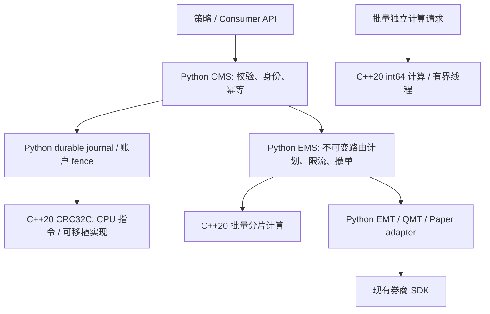

# XunTradeOMSEMS 混合架构

本版本从 `emt-win-gateway/tradecore-python` 的当前工作区导入，来源提交与文件哈希见
[provenance.json](provenance.json)。原 Python 领域对象、OMS、EMS、账户 fence、journal-first、
显式恢复和券商适配器仍使用原包名以保持调用兼容；对外发行名称为 `xuntrade-omsems`。

## 语言边界与实际接入

| 模块 | 实现 | 边界 |
| --- | --- | --- |
| `emt_gateway.journal.crc32c` | 直接绑定 C++ 函数 | 保持 Castagnoli、帧格式、提交标记和恢复行为 |
| `AccountSessionShardRouter.route_execution_ids` | Python 校验与拓扑，C++ 批量计算 | 与单笔 BLAKE2s-128 / `tcshard1` 完全相同 |
| `compute.assess_orders` | C++ int64，检查乘法溢出 | 每行独立快照；不会预留共享现金、下单或替代权威风控 |
| 单笔路由与密码学签名 | 原实现 / hashlib / cryptography | 已有原生库负责计算，无须重复迁移 |
| OMS、订单状态、恢复、持久化屏障 | Python | 继续先写 durable journal 再进入券商调用 |
| SPI ring | 保留原有 C 扩展 | Linux v2 ring 不与新 C++ 计算层混为一体 |

`EmsControlPlaneV1.create_plan()` 在快照新鲜且可用后，把完整子单集合交给
`AccountSessionShardRouter.route_executions()` 一次批量计算，按输入顺序生成路由计划。
跨账户批次在计算前拒绝，计算失败不发布部分计划。该步骤只生成待执行计划，
没有新增直接调用券商、跳过账户 fence 或跳过持久化证据的入口。

## 原生计算约束

- C++20 核心不依赖 Python、Redis、数据库或券商 SDK；CMake 可单独编译、执行 CTest。
- CPython binding 只接收内建不可变 bytes、内建字符串和 int64；拒绝 bool、float、超界整数。
- 批量入口只接收 list/tuple，最多 1,000,000 行；ID 最长 256 个 Unicode 字符。
- 在持有 GIL 时复制输入；纯计算释放 GIL，返回前恢复 GIL。大 CRC 输入为不可变 bytes。
- 每次批量计算最多 32 个 C++ worker，小批次自动串行；保持输入顺序，每个输出槽只有一个写者。
- 批量转换与输出使用保守内存记账：单批 64 MiB、进程 256 MiB，最多 4 个在途调用，
  合计最多 32 个请求 worker。容量不足时显式拒绝，完成或异常时由 RAII 释放预算。
- 大批次按需扩展并复用至多 31 个后台 C++20 worker，工作队列有界；小批次留在调用线程。
  进程采用 `spawn`；继承原生模块的 `fork` 子进程拒绝批量计算，避免使用继承的锁或线程状态。
- 线程创建失败、分配失败、原生计算失败返回异常，不自动切换算法、不重试交易。
- 默认 `XUNTRADE_BACKEND=native`；扩展缺失时启动失败。`python` 用于诊断，`auto` 用于显式兼容检查。
  `backend_info()`、CLI 和基准报告会显示实际后端。

`workers` 是单机 CPU 并行度，不是分布式执行权。多数金额乘法的计算量很小，首次创建线程、
工作分发和 Python 数据转换可能大于运算收益，必须按实测选择批次大小和 worker 数。

## 冷归档边界

`AsyncFileJournalArchive` 的接收队列保持有界且不执行磁盘 I/O，冷线程使用
`SegmentedArchiveStore` 按记录数/字节数轮转。`FileJournal` 可关闭逐条历史缓存，
恢复时仍验证全部帧并保留正确的后续 LSN；默认普通 journal 的完整记录接口保持兼容。

活动文件与封存段分别处理：活动尾部按连续完整前缀恢复；封存段禁止自动截断修复，
并核对已保存的 SHA-256。段索引是可重建的派生元数据，在启动、轮转和关闭时写入，
不能代替执行 journal 或 broker 恢复证据。

归档所有权 lease 跨轮转保持。默认不删除封存段；显式 `maximum_segments` 策略仅清理
最旧封存段，保留当前活动文件。关闭先停止接收，再等待已接受工作结束，超时不会关闭活跃写者的文件。

## 分片与多进程部署

现有多账户运行时、不可变账户路由与 session shard 计划继续生效。每个账户/venue/client scope
只能由一个经过 fence 验证的执行 owner 持有；多个进程或机器按已批准的账户计划分区部署。
批量接口只计算这些已声明分片中的索引，不会动态添加节点或在故障时改投另一个会话。

撤单和回报依旧按完整原生订单身份解析，不能重新对订单 ID 做 hash 选择目标。路由计划变更
需要新版本、epoch、执行权交接和未完成订单核对。`CALL_STARTED` 或不确定提交结果不能自动重发。

本次实现了单机 C++ 并行计算和既有账户分片接入；未新增跨机器 RPC 调度、共识、自动扩缩容或
分布式共享资金账本。需要网络计算集群时，应把无副作用快照计算与实际账户执行权分开部署，
并在既有 journal/fence 契约下单独验收网络分区、节点恢复和重复消息。

## 平台与验收范围

新的 C++ 计算层、文件 journal 和离线自检支持 Windows x64 / Linux x64。原 EMT 实盘接入仍遵循
已有 Linux x86_64、CPython 3.10 和官方 SDK 装载约束。没有复制供应商 SDK、凭据、账户数据或
运行产物，也没有从 Python binding 推测 C++ 券商 ABI。

性能报告区分 Python→C++ 调用开销、原生串行、原生并行。CPU kernel 提速不能代表 fsync、
网络、柜台或 C0→C7 全链路延迟已经达标；真实账户验收需要原有部署流程和现场条件。

历史文档保留作来源参考，其中里程碑、环境路径和验收记录不代表本仓库已执行的验证。
本版本验证结果见 [VALIDATION.md](VALIDATION.md)。
